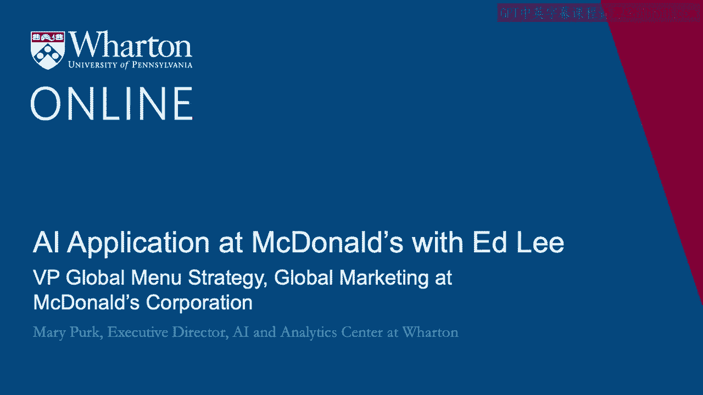
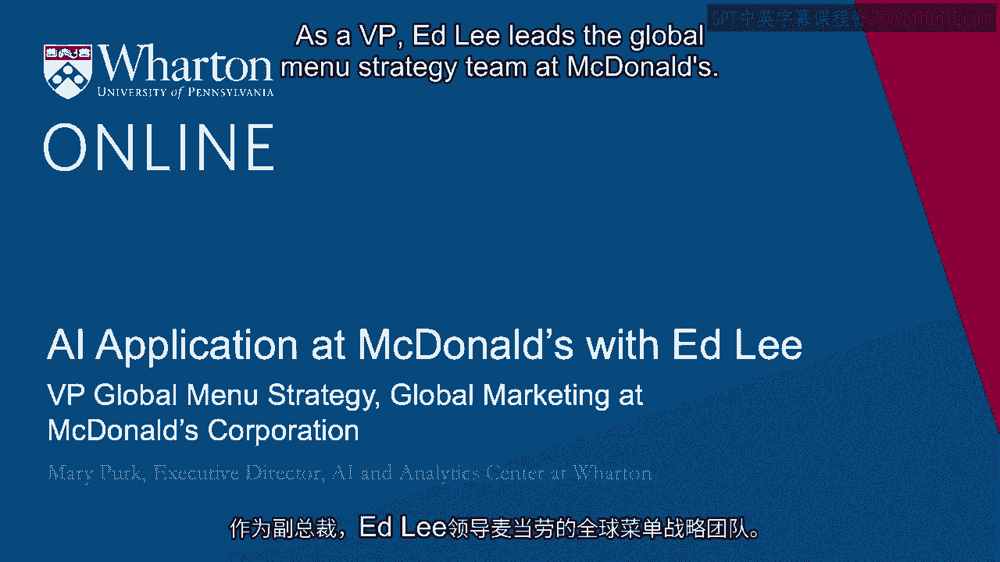

# 33：麦当劳如何利用AI驱动增长 🍟🤖

在本节课中，我们将通过麦当劳全球菜单战略副总裁艾德·李的访谈，学习一家全球性餐饮企业如何将人工智能（AI）和机器学习（ML）应用于实际业务，以提升客户体验、优化运营并驱动增长。

---

## 概述：麦当劳的AI战略领导

作为副总裁，艾德·李领导麦当劳的全球菜单战略团队。

在这个角色中，他负责推动核心类别和品牌的增长，创建未来增长平台，并在麦当劳构建食品营销和开发能力。最近，他还领导了全球战略洞察团队，利用消费洞察和商业分析为麦当劳寻找新的增长机会。

在加入麦当劳之前，艾德在凯洛格公司工作了12年，积累了丰富的快速消费品行业经验。

---

## AI在麦当劳的核心价值驱动

上一节我们介绍了艾德·李的背景和角色，本节中我们来看看AI为麦当劳顾客带来的核心价值。艾德指出，最大的价值驱动在于**个性化**和**客户体验**。

以下是AI带来的两个关键结果：

1.  **个性化体验**：麦当劳每天服务约6000万顾客。利用大数据和AI，公司可以更深入地理解每一位顾客，从而提供更符合个体需求的个性化体验。
2.  **提升客户满意度**：麦当劳每年通过收据等渠道收集约6000万份客户反馈。利用AI挖掘这些数据，可以快速识别服务短板，并采取措施改善体验，最终推动业务增长。

---

## AI在“得来速”的创新应用

我们了解了AI带来的宏观价值，现在聚焦到一个具体场景。对于麦当劳而言，“得来速”是一个至关重要的销售渠道，其销售额占比在疫情期间从约50%上升至超过60%。

麦当劳通过收购Dynamic Yield公司，将个性化技术应用于“得来速”点餐环节。

**系统工作原理简述**：
当顾客驾车进入“得来速”时，系统会实时分析多种数据，例如：
*   当前天气
*   前10辆车的点单记录
*   周二下午两点的常见点单习惯

基于这些分析，菜单板会**实时生成个性化建议**。例如，当顾客点了一个双层芝士汉堡时，系统会立即推荐与之搭配的饮品或小食。这项创新成功提升了销售额和客户满意度。

---

## 自然语言处理（NLP）的实际应用

除了个性化推荐，自然语言处理（NLP）是AI在麦当劳的另一项重要应用。它主要用于分析海量的非结构化文本数据，例如顾客在满意度调查中填写的评论。

**NLP的应用场景**：
面对成千上万条文本评论，人工分析效率低下。NLP技术可以：
*   **挖掘情感倾向**：了解顾客对某款新产品或某项新服务（如疫情期间的安全协议）的真实感受。
*   **提供实时反馈**：将分析结果快速反馈给每一家单独的餐厅，帮助其迅速改进运营，提升顾客体验。

因此，AI不仅服务于消费者端的个性化，也深入到每家门店的日常运营优化中。

---

## 麦当劳AI战略的演进与实施

那么，麦当劳应用AI的方式与五年前有何不同？艾德指出，这经历了从偶然尝试到战略核心的转变。

如今，麦当劳以明确的战略意图在全公司推行AI。其核心是建立了**数据与分析卓越中心**。这些中心通过收购（如硅谷和特拉维夫的公司）和内部建设，汇聚了尖端知识与能力。

来自不同国家、不同职能的业务实践者会与这些中心协作，共同确定年度优先事项，并将资源和注意力集中在公司最高优先级的领域。这使AI应用成为一种常态化的商业实践。

---

## 业务部门与技术专家的协作模式

我们讨论了战略层面，接下来看看具体执行中，业务部门如何与技术专家协作。在麦当劳，通常由业务部门（如全球洞察小组或某国运营团队）提出具体的业务问题。

**协作流程示例**：
1.  业务方提出问题（例如：如何评估新产品、送餐服务和促销活动各自对销售额的贡献？）。
2.  问题被提交给与卓越中心相连的业务人员或中心的专家。
3.  团队利用AI工具进行分析，得出洞察。

目前的一个重要趋势是工具的“民主化”。市场上出现了许多新工具和平台，能让业务单位更容易地进行自主分析。麦当劳的目标不是让一个小组包揽所有工作，而是建立一个专家中心，赋能全公司其他部门。

---

## A/B测试与AI的结合

在利用先进的AI和机器学习方法时，A/B测试是一个至关重要的组成部分。它应该与AI项目的实施同步推进，因为它能提供快速、实时的反馈。

**A/B测试的关键要素**：
许多人可能不知道，新闻网站的标题经常通过A/B测试来优化点击率。麦当劳正将这一理念引入实体空间。

**应用实例**：
在“得来速”的户外数字菜单板上，麦当劳可以进行多种A/B测试：
*   测试不同美食图片的吸引力。
*   测试字体、大小和版式布局。
*   根据时段动态调整内容（例如，下午3点是否为咖啡预留更多展示空间）。

通过这些测试，麦当劳可以迅速确定到**单店级别**的最优菜单板设计，从而最大化销售机会。A/B测试在公司所有不同的AI应用中都得到了严格使用。

---

## 展望：让创始人惊叹的AI创新

最后，让我们展望一下未来。如果麦当劳创始人雷·克罗克今天还在世，哪项AI创新会让他惊叹？艾德提到了目前正在测试的“得来速”语音自动化。

**语音AI机器人的潜力**：
一个AI机器人可以与驾车前来点餐的顾客互动并接收订单。如果将其与数字菜单板展示的优惠或忠诚度计划连接，将能创造高度个性化的体验。

**想象一下这个场景**：
顾客驾车到来，AI机器人可以说：“你好，玛丽！感谢光临麦当劳。看起来你还有200个忠诚积分，你想点一个芝士汉堡吗？”
此外，机器人可以说多种语言，或在特定促销期模仿知名角色（如达斯·维德）的声音。艾德认为，这种水平的创新和技术肯定会让雷·克罗克感到惊讶。

---

## 总结

本节课中，我们一起学习了麦当劳如何将人工智能从战略规划落实到具体业务场景：

1.  **核心价值**：AI驱动**个性化体验**和**客户满意度**提升。
2.  **场景应用**：在“得来速”通过实时数据分析提供**个性化推荐**；利用**自然语言处理（NLP）** 分析客户反馈。
3.  **战略与协作**：公司建立了**数据与分析卓越中心**，以战略意图推动AI，并通过“民主化”工具促进业务部门与技术专家的协作。
4.  **关键方法**：将**A/B测试**与AI结合，在实体场景中快速验证和优化方案。
5.  **未来展望**：**语音AI机器人**等创新将继续重塑顾客体验。

通过麦当劳的案例，我们可以看到，AI的成功应用离不开清晰的业务目标、跨部门的紧密协作以及对快速实验和反馈的重视。

