# 35：人工智能应用模块简介 🧠

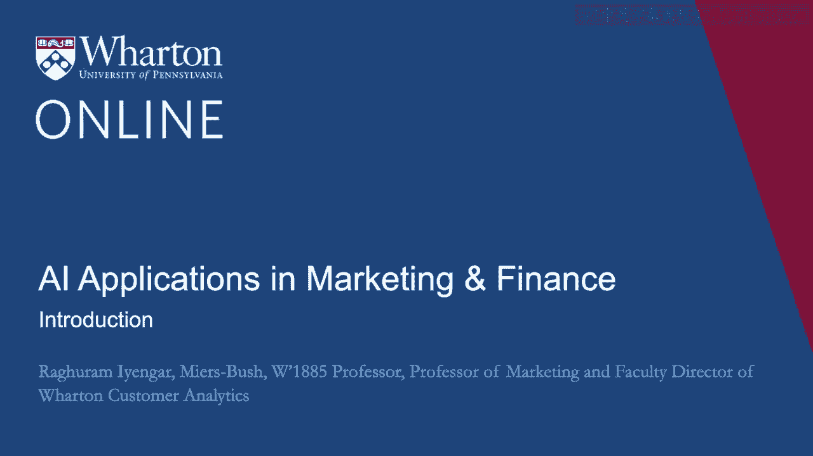

在本节课中，我们将从客户视角出发，探讨人工智能在商业领域的应用。我们将了解客户旅程的概念，并分析人工智能在其中扮演的角色。

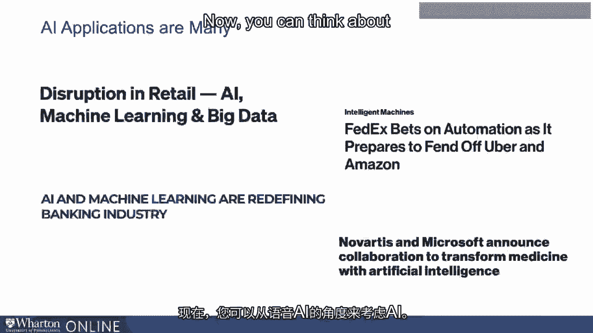

目前，零售、银行、制药等多个行业都在经历由人工智能、机器学习和大数据驱动的变革。例如，联邦快递和微软等公司都在积极应用这些技术。理解这些应用的最佳方式，是思考它们具体实现了什么功能。

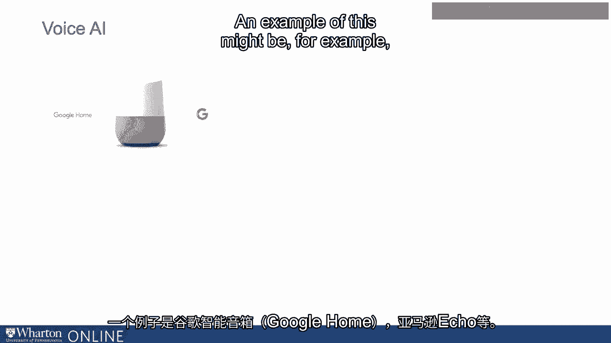

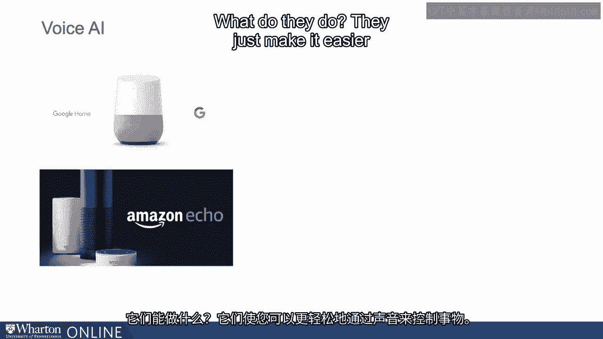

上一节我们概述了人工智能应用的广泛背景，本节中我们来看看几种主要的人工智能应用类型。

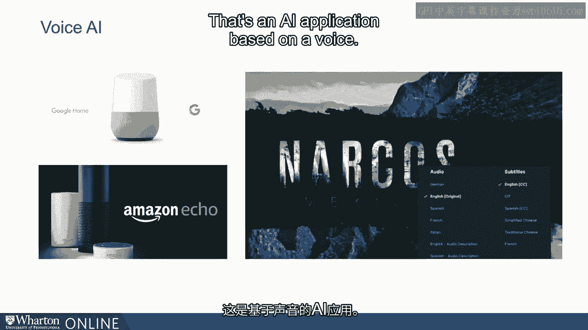

## 语音人工智能 🗣️

语音人工智能旨在让用户通过声音更便捷地控制设备或获取服务。

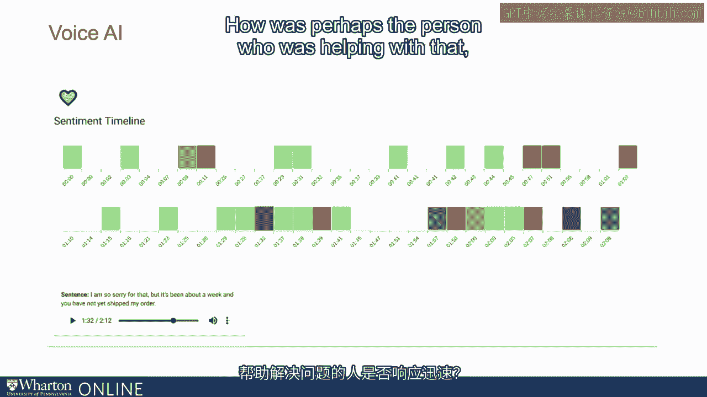

以下是语音人工智能的几个例子：
*   **智能音箱**：例如谷歌智能音箱和亚马逊Echo，它们允许用户通过语音指令控制智能家居设备或获取信息。
*   **流媒体服务**：例如Netflix，用户可以通过语音轻松切换影片的语言或进行搜索。
*   **企业级应用**：在客户服务中心，语音AI可以用于分析来电客户的身份、情绪、通话时长以及座席的响应效率，从而优化服务流程。

更具未来感的设想，如电影《她》中描绘的人机关系，也属于语音交互的范畴。目前，与Alexa或Google Assistant的对话已初具雏形。

## 视觉人工智能 👁️

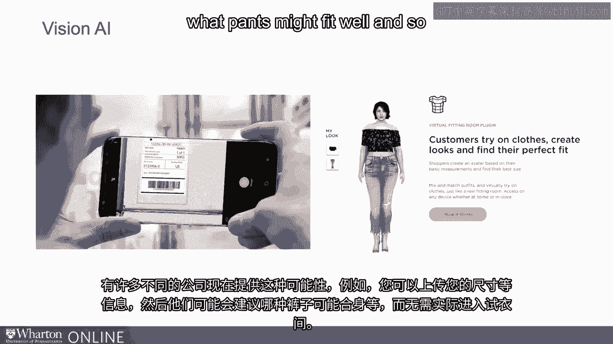

视觉人工智能主要处理图像和视频信息，实现识别、追踪和增强现实等功能。

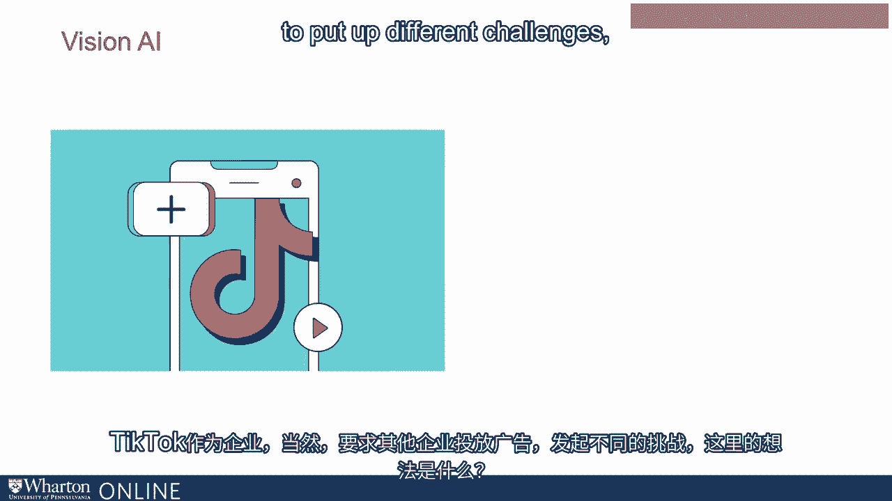

以下是视觉人工智能的几个应用方向：
*   **包裹追踪**：通过手机扫描二维码等代码，轻松追踪物流包裹。
*   **虚拟试衣**：用户上传身高、体型等数据，AI可以推荐合身的衣物，无需亲临实体店试穿。
*   **社交媒体分析**：例如在TikTok上，企业可以分析用户观看品牌视频时的行为和反应，以优化营销策略。
*   **图像识别**：这项技术应用广泛但也存在争议，涉及隐私问题，例如IBM就因此退出了相关业务领域。

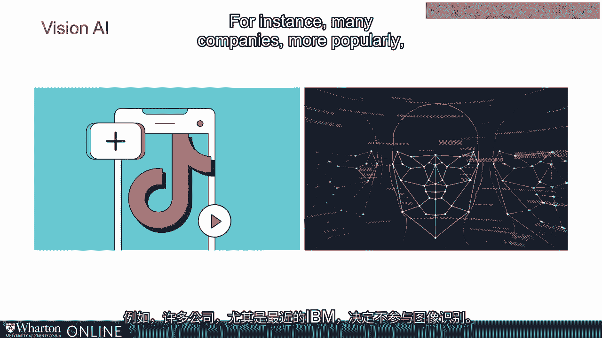

视觉AI还有两个重要的前沿应用：
*   **自动驾驶汽车**：车辆通过视觉系统实时识别道路标志、行人和其他车辆，以实现安全驾驶。其核心功能可概括为：`识别对象(图像) -> 分类(例如：“停止标志”、“行人”) -> 决策(例如：刹车)`。
*   **智慧城市**：城市基础设施利用视觉AI识别市民需求，以提供更无缝的服务体验，但这同样面临复杂的隐私挑战。

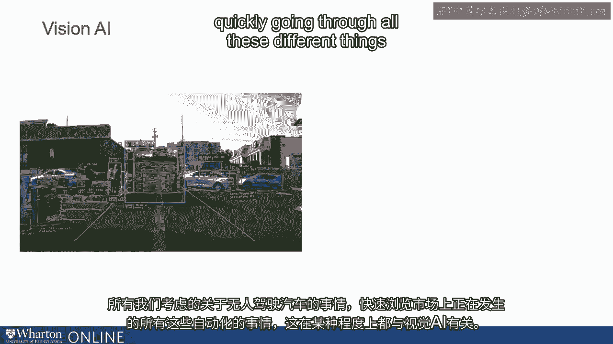

## 语言人工智能 📝

语言人工智能专注于文本的理解、生成和翻译。

以下是语言人工智能的典型应用：
*   **实时翻译**：手机应用可以轻松将一种语言（如印地语）翻译成另一种语言（如英语）。
*   **文本生成**：例如GPT-3这类模型，能够根据提示撰写完整的文章，这可能会对出版和内容创作行业产生深远影响。

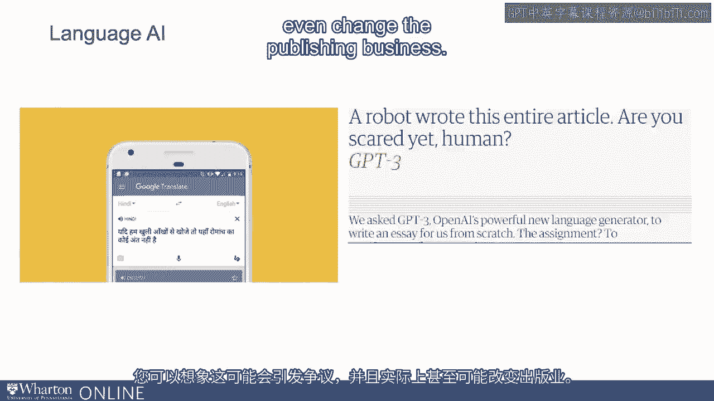

---

本节课中，我们一起学习了人工智能的三种主要应用类型：**语音人工智能**、**视觉人工智能**和**语言人工智能**。每种类型都通过不同的方式（如语音控制、图像识别、文本处理）嵌入客户旅程，解决特定问题并创造价值。理解这些分类有助于我们明确兴趣所在，并思考如何将AI技术应用于实际场景。