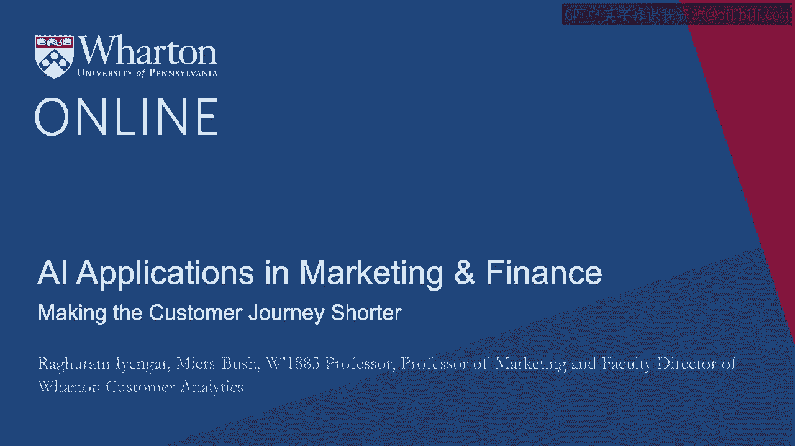
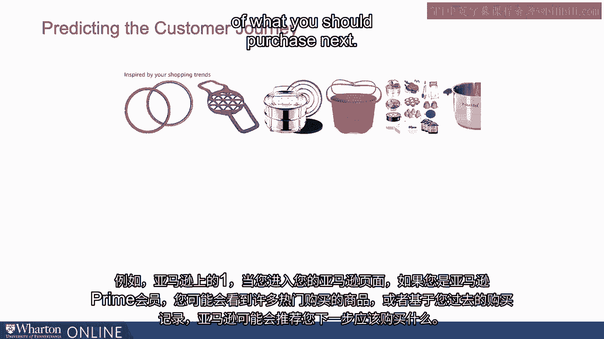
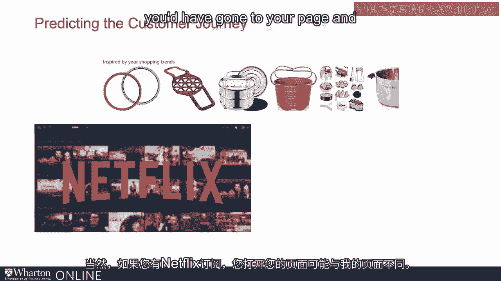
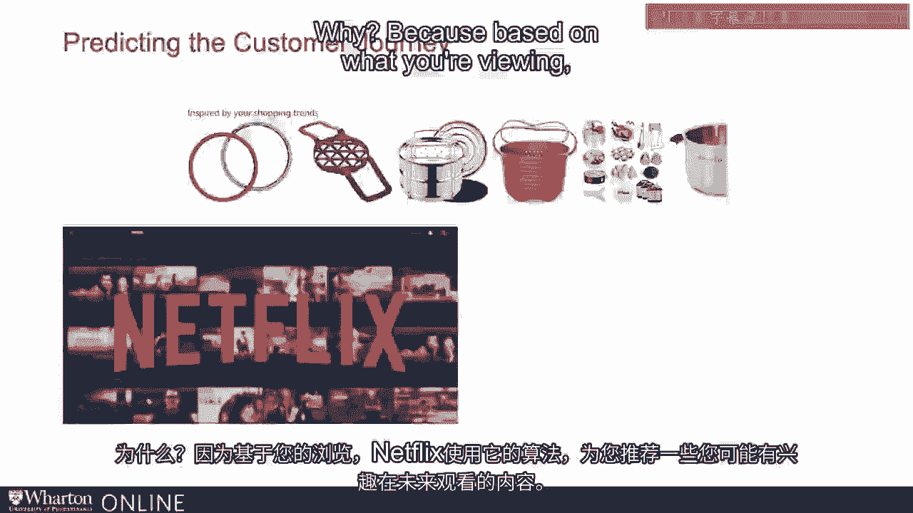
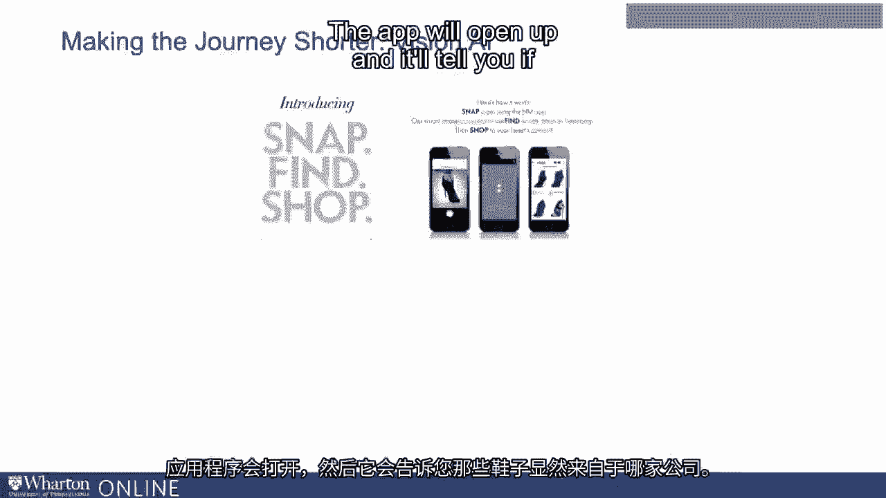
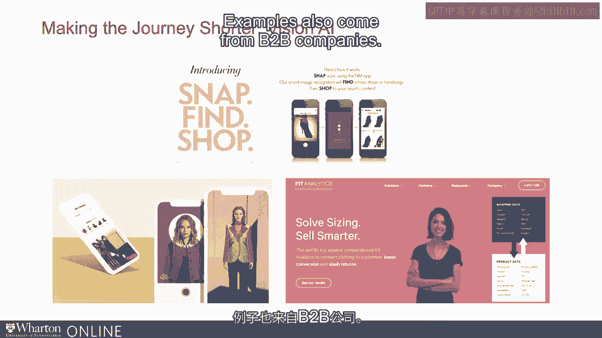
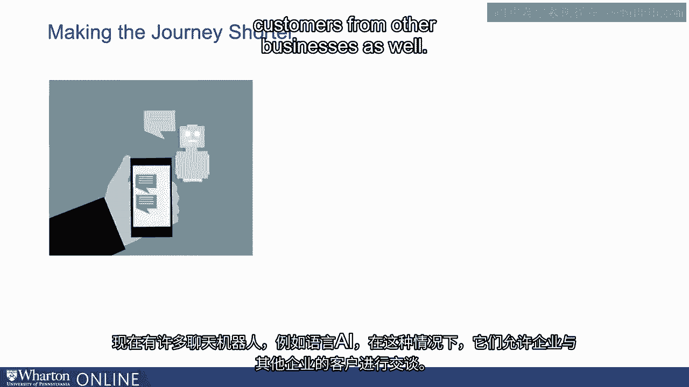
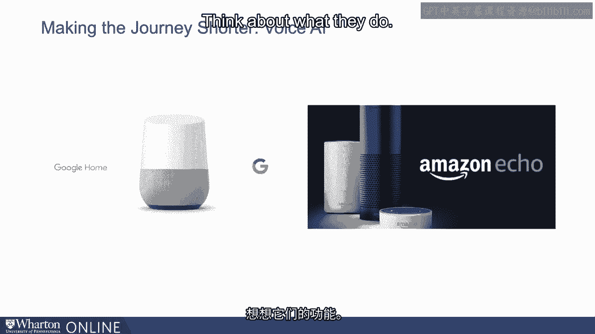

# 37：人工智能与客户旅程 🧭

在本节课中，我们将探讨人工智能如何与客户旅程相结合。我们将重点学习人工智能的两大核心应用：**预测客户旅程**与**缩短客户旅程**。通过具体的商业案例，我们将理解机器学习与人工智能技术如何帮助企业更好地理解和服务客户。

---

## 预测客户旅程 🔮

上一节我们介绍了课程主题，本节中我们来看看人工智能如何用于预测客户旅程。其核心思想是：通过分析客户的历史行为数据，算法可以预测他们未来可能采取的行动或感兴趣的内容。

以下是几个预测客户旅程的典型例子：

*   **亚马逊的商品推荐**：如果你是亚马逊Prime会员，登录后可能会看到“经常一起购买”或基于你过往购物记录的推荐。背后的算法通过分析你过去的购买行为，预测你未来可能想买什么。其逻辑可以简化为一个推荐公式：`推荐项 = f(用户历史行为， 相似用户行为)`。
*   **Netflix的内容推荐**：Netflix的首页因人而异。算法根据你观看过的影片，个性化地推荐你可能感兴趣的未来内容。这同样基于用户行为数据的模式识别。
*   **Stitch Fix的服装订阅**：对于订阅用户Raghu，Stitch Fix会分析他已拥有的衣物，然后预测并推荐他下一次可能想购买的服装款式。

在所有这些例子中，机器学习和后台算法的目标是：**审视你迄今为止的行为，预测你下一步将去向何方**。

---

## 缩短客户旅程 ⚡

理解了预测之后，我们来看看人工智能如何帮助缩短客户旅程。这里的核心目标是：在客户产生需求后，利用技术手段尽可能简化从“意识”到“购买”的步骤，提升效率与体验。

以下是几种缩短客户旅程的技术应用：

*   **视觉AI应用（如Snap Find Shop）**：你可以用手机拍下别人穿的好看鞋子，该应用会通过图像识别技术告诉你鞋子的品牌或推荐类似商品。这直接跳过了“搜索-比价”等环节，将“看到”（意识）与“购买”之间的旅程大幅缩短。
*   **虚拟试衣间（如Style.me, Magic Mirror）**：在线购买服装时，虚拟试衣技术让你能直观看到上身效果，减少了因尺寸、款式不合而退货的麻烦，降低了决策成本和风险，从而缩短了购买旅程。
*   **语言AI与聊天机器人（B2B场景）**：许多企业使用聊天机器人来与客户进行即时沟通，快速解答问题或处理交易。这加速了B2B领域的商务流程，从“询盘”到“成交”的旅程变得更高效。
*   **工业视觉辅助（如Google Glass）**：在工厂车间，工人通过智能眼镜等设备，能直接看到操作指引，无需翻阅厚重的手册。这从工作流程上缩短了“遇到问题”到“找到解决方案”的旅程。
*   **语音AI助手（如Amazon Echo, Google Home）**：你可以让Alexa播放音乐，或让Google Home搜索并预订附近餐厅。语音交互使得从“产生需求”（如想听歌、想吃饭）到“满足需求”的路径变得极其便捷。

这些应用，无论是基于语音、语言还是视觉AI，其共同目标都是：**在客户意识到某个特定需求后，利用人工智能技术，最大限度地简化并加速满足该需求的整个过程**。

---

## 总结 📝

本节课中，我们一起学习了人工智能在客户旅程管理中的两大核心作用。

首先，我们探讨了**预测客户旅程**。通过分析历史数据，AI算法能够预测客户未来的行为或偏好，帮助企业进行个性化推荐，例如亚马逊的商品推荐和Netflix的影片推荐。

接着，我们研究了**缩短客户旅程**。AI技术（如视觉识别、聊天机器人、语音助手）能够简化从需求产生到需求满足的各个环节，为客户提供更直接、高效的体验，例如拍照购物和虚拟试衣。

总而言之，人工智能通过**预测**和**缩短**旅程，正在深刻改变企业与客户互动的方式，使服务变得更加智能、便捷和个性化。