# 38：向上游移动客户体验 🚀

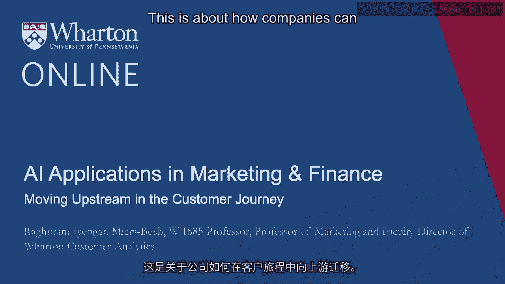

在本节课中，我们将学习一个重要的商业策略：**向上游移动客户体验**。我们将探讨公司如何通过预测、缩短甚至“拥有”整个客户旅程来创造竞争优势。课程将结合多个行业案例，帮助你理解这一概念的核心及其应用。

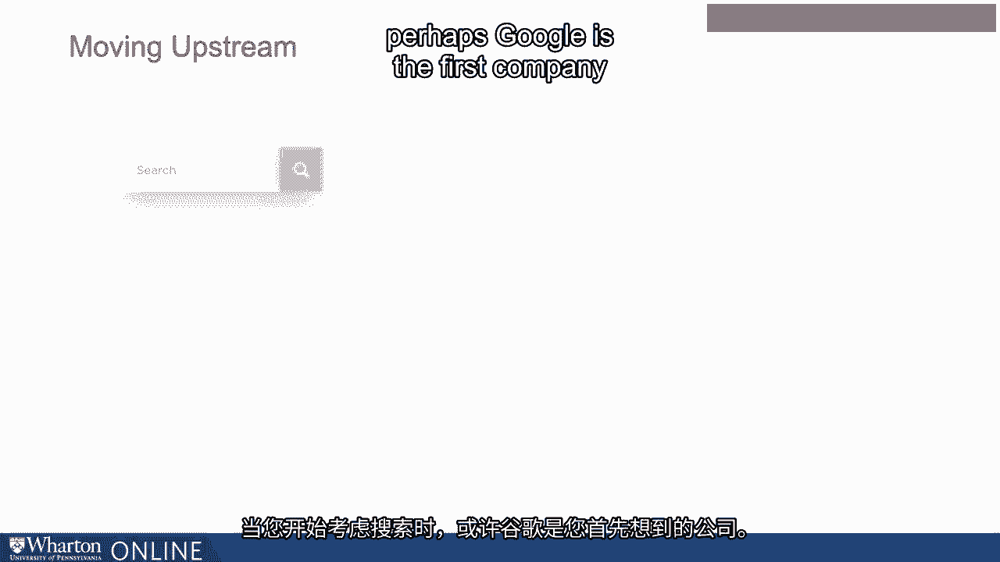

---

## 预测与缩短客户旅程

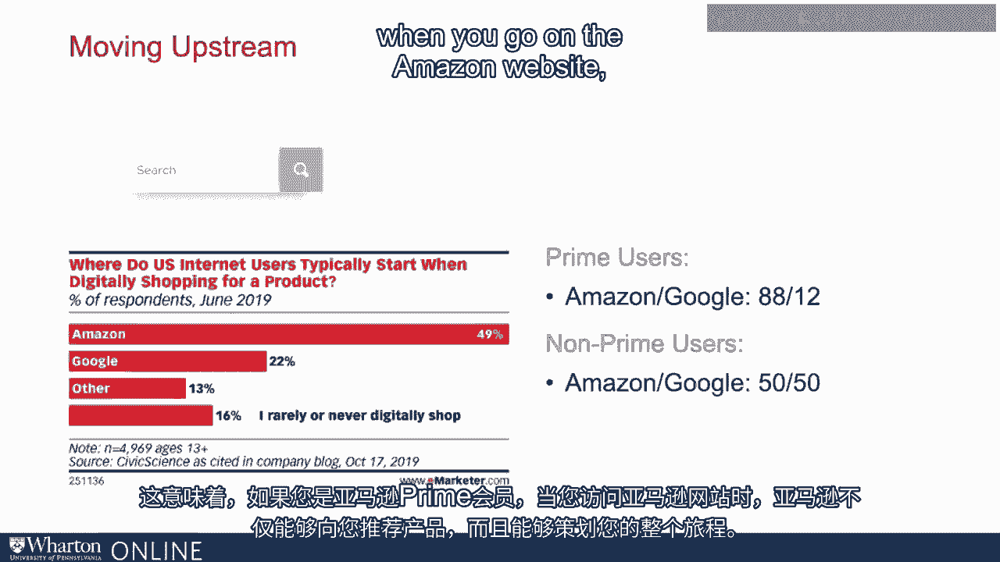

上一节我们介绍了课程主题。本节中，我们来看看公司如何通过预测和缩短客户旅程来提升体验。

以搜索引擎为例。当人们思考搜索时，首先想到的可能是谷歌。

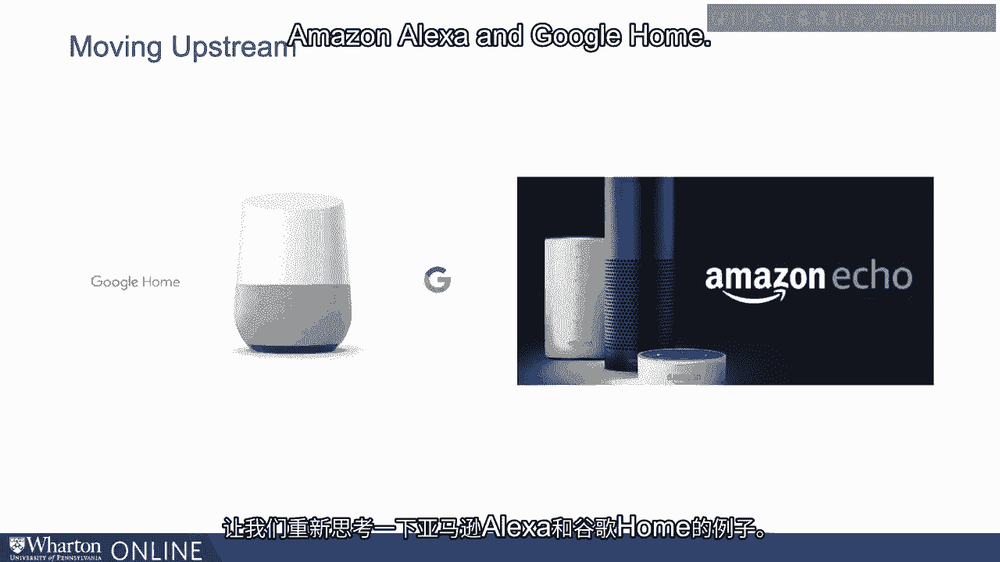

但数据显示，当人们寻找欲购商品时，亚马逊的实际表现远超谷歌。对于亚马逊会员用户而言，这种差距更为明显。

这表明，亚马逊会员在访问网站时，平台能做的不仅仅是推荐产品。

亚马逊能够**策划你的整个购物旅程**。例如，如果你想购买智能手机，亚马逊会分析你的历史购买记录和已知信息。它不仅能推荐手机，还能规划你应如何完成购买。这就是**在客户旅程中向上游移动**的理念。

---

## 拥有客户旅程：从智能音箱到超级应用

理解了预测旅程后，我们进一步探讨公司如何“拥有”客户旅程。让我们重新审视亚马逊Alexa和谷歌Home的例子。

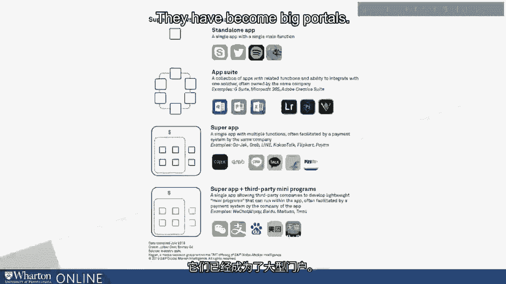

我们曾讨论它们如何缩短客户旅程。现在深入看看它们如何“拥有”旅程。以亚马逊为例，它旗下还有全食超市。

想象一个场景：你可以在亚马逊Alexa上创建购物清单，并直接通过它从全食超市下单。这不仅仅是缩短旅程，而是**从头到尾策划整个旅程**——从你萌生购物想法（认知阶段），到最终完成购买。谷歌Home同理，你可以搜索附近餐厅并直接预订。

核心在于，公司可以超越“缩短”或“预测”旅程，转而思考**如何拥有客户旅程**。

另一个关键概念是**超级应用**。在许多国家，像韩国的KakaoTalk和中国的微信这类应用，已成为用户的“起始页面”。

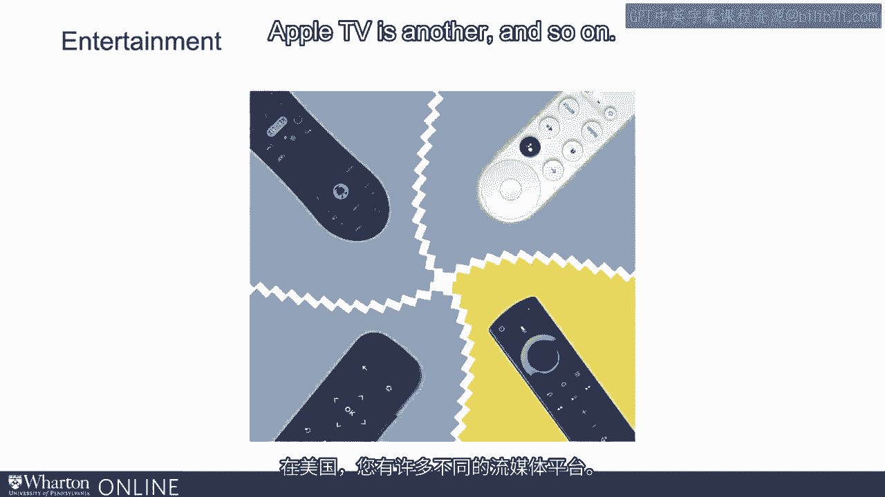

例如，微信集成了支付、社交、商务沟通等多种功能，本质上成了一个大型门户。与使用独立的Facebook或Twitter应用相比，微信、KakaoTalk这类超级应用正试图成为**客户旅程的策展人**。这就是“向上游移动”的体现——成为客户开启旅程的起点。

---

## 策划体验：流媒体平台的例子

从超级应用回到更具体的场景，我们看看娱乐流媒体平台如何策划体验。

在美国，有Roku、Apple TV等多种流媒体设备。

它们的策略体现了不同的“向上游”方式：
*   **Roku**：平台设置不同页面（如Netflix、Amazon Prime）。用户先决定使用哪个流媒体应用，再在其中寻找内容。旅程由各个流媒体平台策划。
*   **Apple TV / Amazon Firestick**：用户从想观看的内容开始搜索，平台会展示所有可观看的渠道。旅程由设备平台本身策划。

这两种方式导致了完全不同的客户体验。关键在于，**谁控制了旅程的起点和路径，谁就更能影响客户决策**。

---

## 数据所有权：医疗保健行业的竞争

“拥有旅程”往往与“拥有数据”紧密相连。这在分散的医疗保健行业尤为明显。

苹果、亚马逊、谷歌等科技公司正进入医疗领域。
*   **苹果**：通过Apple Watch等可穿戴设备收集健康数据（如心率），致力于用科技使医疗保健个性化。
*   **亚马逊与谷歌**：也在通过不同方式探索早期测试和研究。

这里的核心问题是：**谁将拥有这些健康数据？** 数据在哪里，基于数据的应用生态就会围绕谁构建。例如，选择苹果生态的用户，其健康数据可能被整合进苹果的服务中，从而在某种程度上被“锁定”在该生态系统内。因此，在医疗等关键领域，思考**数据所有权**至关重要。

---

## 向上游与下游：扩展客户旅程

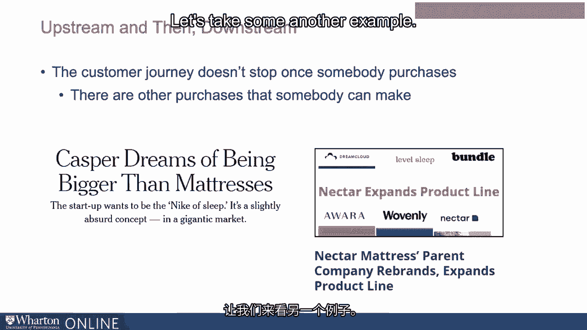

“向上游移动”关注旅程开端，但客户旅程在购买后并未停止。公司也可以思考如何向下游扩展，提供更多价值。

以下是相关案例：

**床垫公司（如Casper、Nectar）**
*   **核心思想**：它们不只销售床垫，更想成为“睡眠”垂直领域的领导者（如“睡眠界的耐克”）。
*   **做法**：提供与睡眠相关的其他产品和服务，扩展产品线。

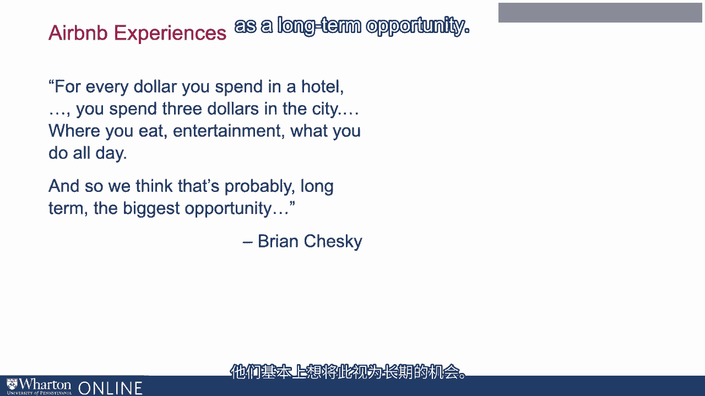

**Airbnb**
*   **核心思想**：意识到人们度假时不仅需要住宿，还需要餐饮、娱乐等体验。
*   **做法**：推出“Airbnb体验”功能。用户可以在平台上预订当地旅行、活动。

*Airbnb联合创始人指出，用户在酒店消费1美元，在当地城市会额外消费3美元。*

*Airbnb体验功能示例。*

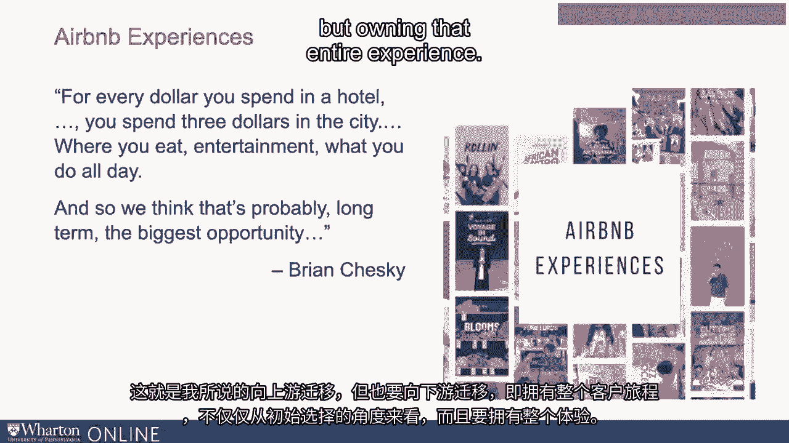

*这体现了拥有整个客户体验，而不仅仅是初始交易。*

---

## B2B案例：Shopify的旅程演进

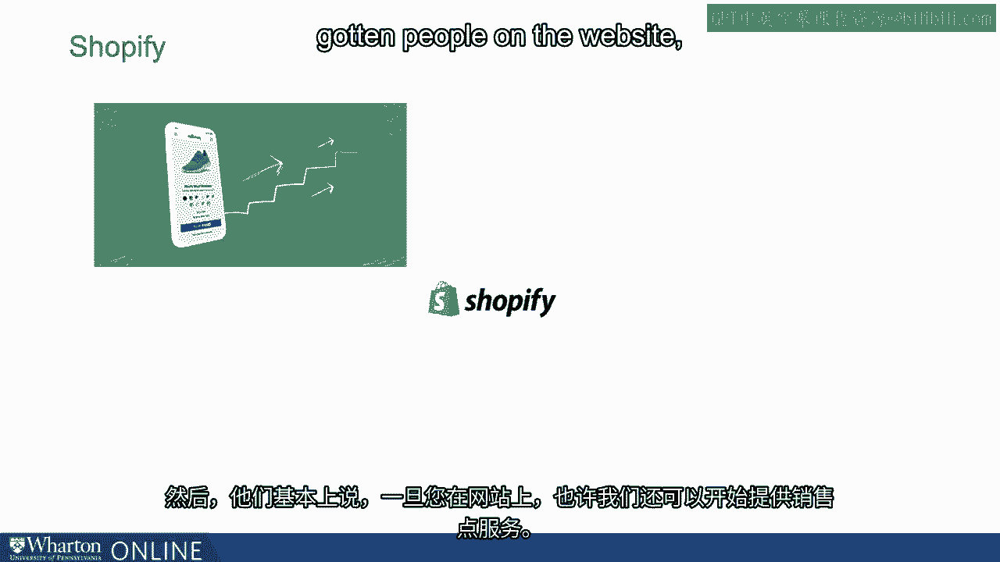

从B2C转向B2B视角，我们分析Shopify如何通过向上下游扩展来服务客户。

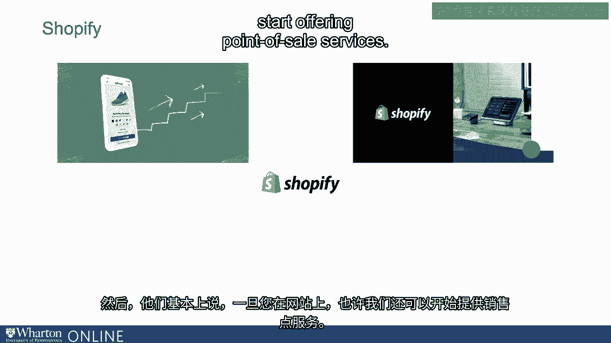

Shopify最初帮助中小型企业建立在线网店。

它的演进路径如下：

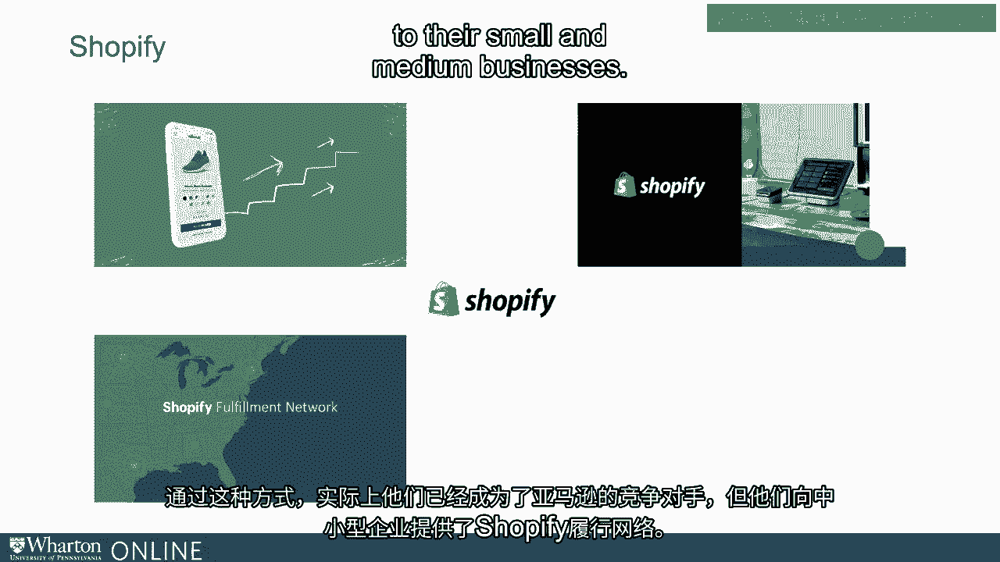

1.  **在线商店服务**：提供建站、后端管理等基础服务。
2.  **销售点服务**：从线上扩展到线下，提供店内POS系统。
    
3.  **履约网络**：解决库存和物流需求，建立Shopify Fulfillment Network，甚至与亚马逊竞争。
    
4.  **金融服务**：基于对客户的深入了解，提供资金借贷服务。
    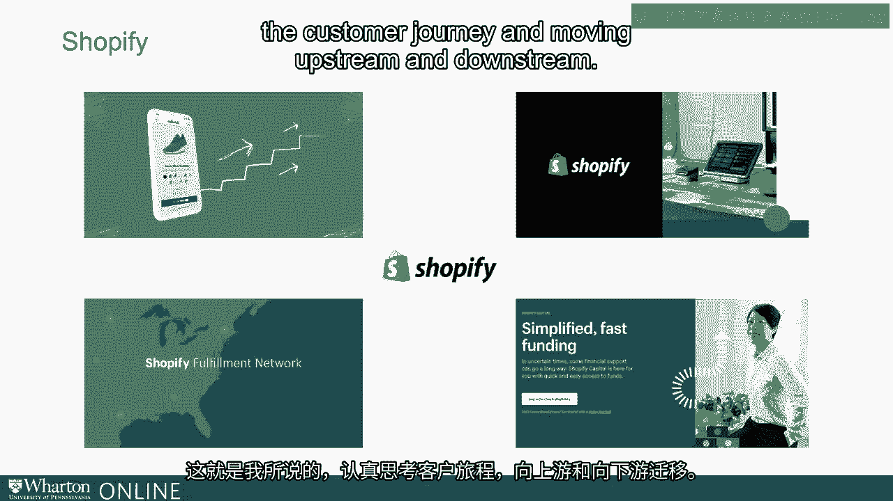

Shopify从解决客户“上线”这个最终需求开始，不断向旅程的上下游（如支付、物流、融资）移动，解决客户企业的其他痛点，从而深度绑定客户。

---

## 总结：从“为什么”出发，思考你的角色

在接触具体技术之前，思考的逻辑起点不应是本末倒置。

正确的思路是：
1.  **从“为什么”开始**：你的客户需求是什么？你要解决什么问题？
2.  **再思考“如何”**：什么样的技术（如视觉AI、语言AI）能帮助解决问题？
3.  **形成协同**：在“为什么”（需求）和“如何”（技术）之间建立良好协同。

作为企业，你需要思考自己在客户旅程中扮演的角色：

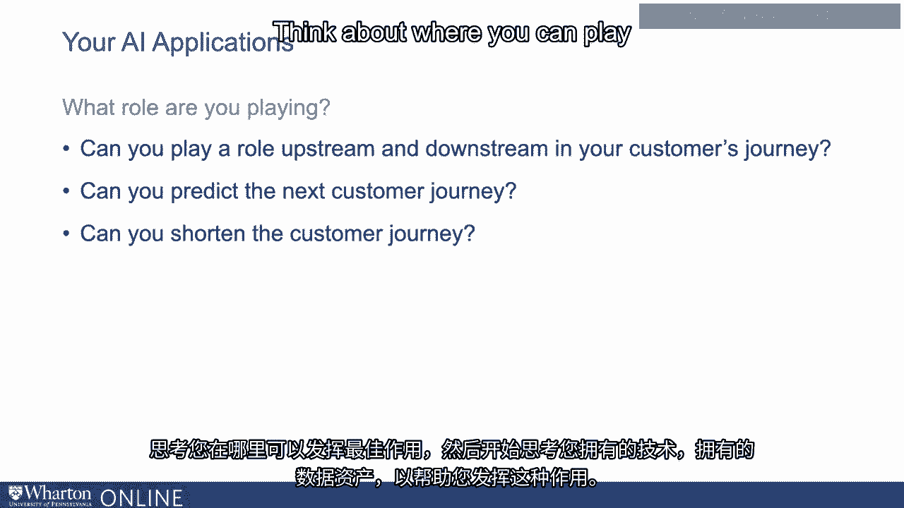

*   **策划整个旅程**（向上游移动）：如Shopify、Roku、亚马逊Prime、谷歌Home所做的那样。这是最大的胜利。
*   **预测下一个步骤**：如亚马逊根据历史购买预测下一件商品。
*   **缩短客户旅程**：简化从需求产生到购买的步骤。

确定你能发挥的最佳角色，然后利用你的**数据资产**和**技术**来实现它。

---

**本节课中，我们一起学习了“向上游移动客户体验”的核心策略。** 我们通过亚马逊、超级应用、流媒体平台、医疗保健、Airbnb和Shopify等多个案例，理解了公司如何通过预测、缩短、拥有和扩展客户旅程来构建竞争优势。关键在于，始终从客户需求（“为什么”）出发，明确自身在旅程中的角色，再辅以技术和数据来实现目标。