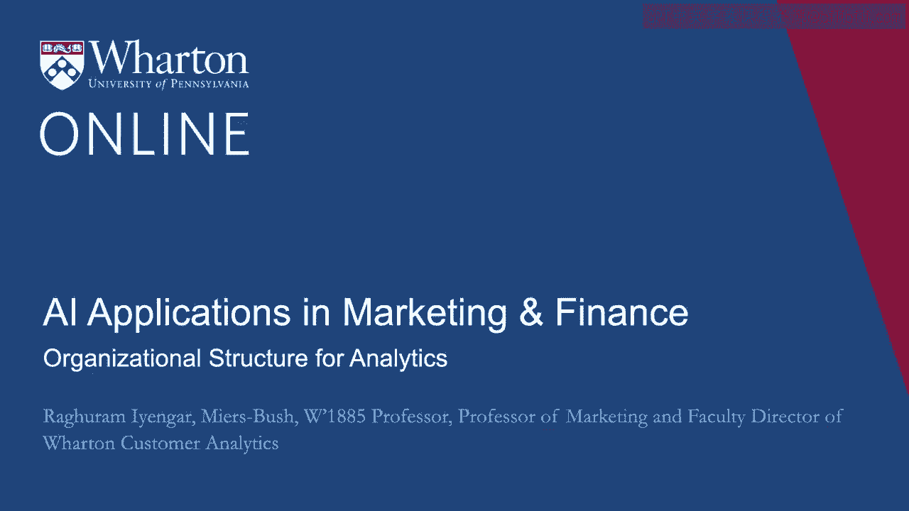
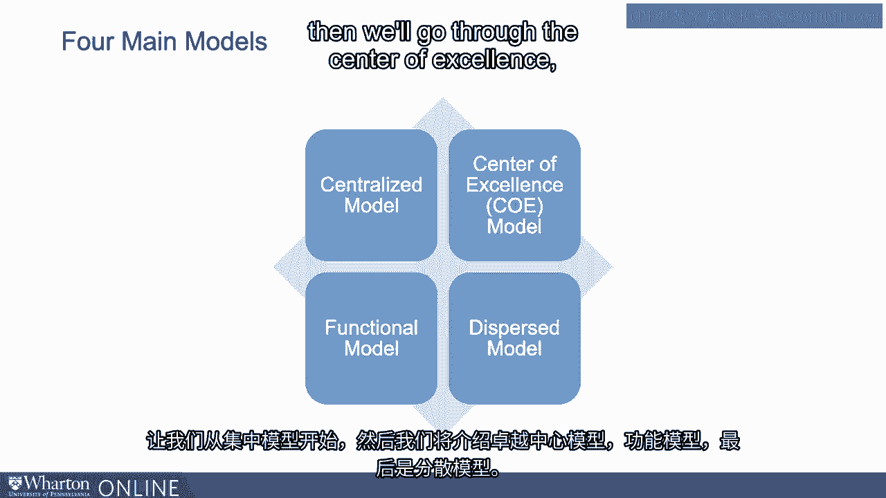
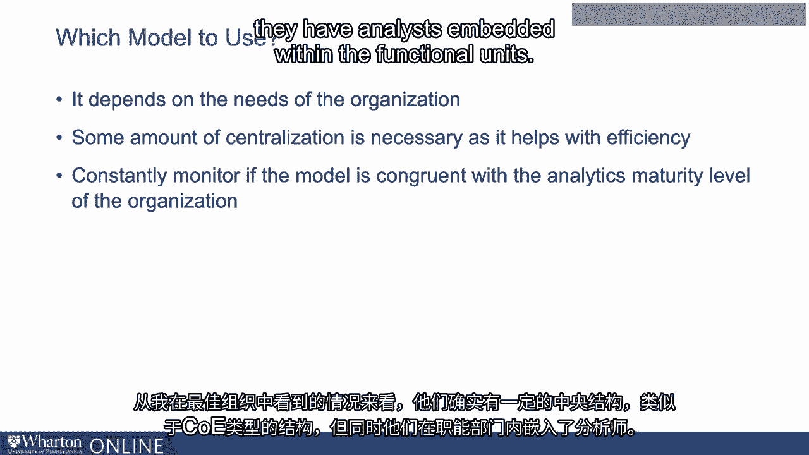

# 40：面向分析的组织架构 📊

在本节课中，我们将学习如何为数据分析工作设置有效的组织架构。我们将探讨几种常见的模型，分析它们的优缺点，并帮助你思考哪种架构最适合你所在组织的成熟度。

我们已经讨论了声音、愿景以及各种AI技术。我认为，在组织内部如何获得成功，其关键部分取决于分析结构的设置。因此，让我们通过一些例子来理解不同类型的架构及其可能性，从而在如何让组织更有结构以获取分析成果方面获得一些启发。

## 🏛️ 集中式模型

我们先从集中式模型开始。这里的理念是建立一个服务整个公司的核心分析单位。

以下是这种模型的优点：
*   **跨职能协作**：有能力处理跨职能项目。
*   **全局视野**：核心单位能看到公司各个部门（如营销、财务）的分析活动全貌。
*   **知识共享**：便于公司不同部门的分析师之间分享想法。
*   **高可靠性**：中央单位及其分析师对公司具有很高的可靠性。

然而，这种模型也存在一些缺点：
*   **资源压力**：根据分析师的配置，工作量和时间限制可能会很大。
*   **优先级冲突**：有时可能优先处理营销项目，有时又需处理运营项目。
*   **灵活性不足**：作为一个大单位，同时处理多个项目时，灵活性会降低。

## 🔗 卓越中心模型

上一节我们介绍了集中式模型，本节中我们来看看卓越中心模型。这是一个非常有趣的组合，行业内通常称之为 **COE**。

其核心思想是尝试兼得两全其美。这意味着有一个小的核心小组（中心小组），同时分析师也嵌入在各个业务单元中。

以下是这种模型的优点：
*   **业务知识**：嵌入业务单元的分析师拥有实质性的业务知识。
*   **集中培训**：中心小组负责所有培训，确保标准统一。
*   **良好协调**：中心小组能在不同业务单元间进行协调。

这种模型的潜在缺点包括：
*   **控制力有限**：中心小组规模较小，可能对整体分析活动缺乏足够的控制力。
*   **支持力度**：组织内部对该模型的支持信号强弱会影响其效果。

## 🧩 职能模型

接下来，我们讨论职能模型。这个模型的选择很大程度上取决于组织的成熟度。

这里的想法是，分析师通常集中在主导分析活动的特定职能内部。例如，公司的财务小组或运营团队可能因为活动密集而集中了大量分析师。

以下是职能模型的优点：
*   **聚焦收益**：分析集中在最能获益的职能领域，便于评估投资回报。
*   **技术评估**：有助于理解新技术在特定领域的应用效果。

其缺点则在于：
*   **支持不均**：其他职能可能得不到所需的分析支持。例如，如果分析师都集中在运营领域，市场营销就可能缺乏支持。

## 🌐 分散式模型

最后，我们来看一种严格来说不算“模型”的架构——分散式模型。其基本思想是分析师遍布整个组织，但没有中央支持。不幸的是，许多组织目前正处于这种状态。

如果要说优点，那就是某些单位碰巧有分析师，因此能得到支持。但我认为它有很多缺点：
*   **不成体系**：这并非真正的模型，只是组织不同部分的零星火花，不足以形成燎原之势。
*   **缺乏结构**：没有一种真正的方法可以期待其形成有效的分析结构。

如果你发现自己的组织正处于这种状态，那么是时候开始思考如何改变分析工作的组织了。

## 🤔 如何选择模型？

我们讨论了不同的模型：集中式、COE、职能式等。那么，究竟该使用哪个模型？

老实说，这取决于组织的具体需求。在某些组织中，我观察到随着它们变得更加成熟，架构也在演变。最初开始时，你需要一定程度的集中化，以便了解组织内（如营销、运营等部门）正在进行的活动。这样，在一个部门可用的经验或许能在其他部门得到利用。

因此，你需要某种形式的集中化。反过来，你也需要持续监测，确保组织采用的模型与其成熟度保持一致。我看到，在那些更成熟的最佳实践中，组织通常采用类似COE的结构，但同时也在职能单位中嵌入了分析师。

为什么？因为我认为，让分析师理解决策背后的实质性特征非常重要。当分析师构建模型或采用新技术来帮助其业务时，他们需要理解决策者所经历的过程，以及公司内部决策者在采用新技术时面临的障碍。

## 📝 总结

本节课中，我们一起学习了四种面向分析的组织架构模型：**集中式**、**卓越中心**、**职能式**和**分散式**。每种模型都有其适用的场景和优缺点。关键在于，没有一刀切的解决方案。你需要审视自己组织的成熟度水平，判断哪种类型的结构最适合你的组织，并随着组织的发展不断调整和优化。