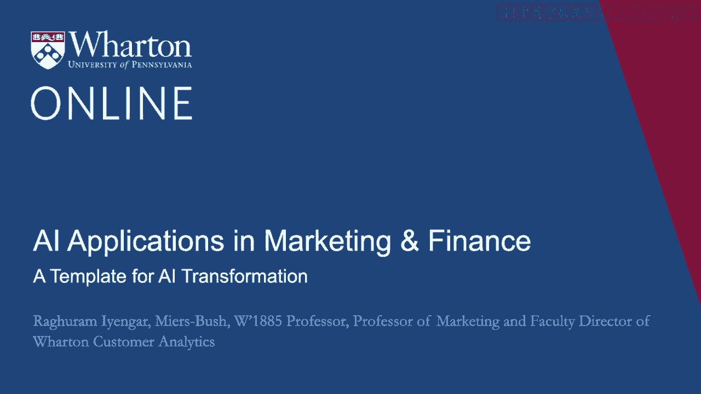
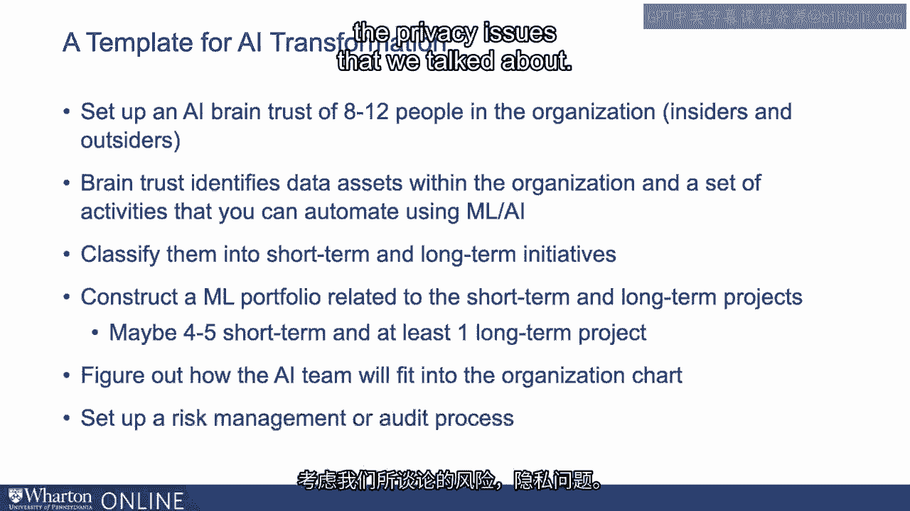

# 41：AI转型实施指南 🚀

在本节课中，我们将学习如何在一个组织内成功规划和实施人工智能项目。我们将探讨如何组建团队、识别机会、平衡短期与长期目标，并确保项目最终能带来实际价值与变革。

---

## 🤝 组建多元化AI智囊团

上一节我们介绍了课程主题，本节中我们来看看如何启动转型。成功的第一步是在组织内部建立一个专门的团队。

这个团队应由8到12名成员组成，他们分享共同的转型愿景。团队构成应是内部人员与外部专家的结合。

以下是组建团队的核心要点：
*   **确保多样性**：成员应来自不同的职能领域，以提供多元视角。
*   **聚焦共同目标**：团队需围绕一套可实施的、能真正推动组织变革的想法凝聚起来。
*   **识别内部资源**：团队应开始梳理组织内部现有的**数据资产**和可能**自动化**的活动清单。

在思考数据和自动化时，必须始终以客户旅程为核心，牢记客户的需求与痛点。

---

## 🎯 坚持问题驱动，而非技术驱动

在组建团队后，我们需要确立正确的工作方向。关键在于保持问题驱动的思维，避免被新奇技术本身所诱惑。

这意味着要持续追问“为什么”，明确需要解决的客户需求是什么。只有从问题出发，才能做出明智的技术决策。

基于此视角，我们可以更好地判断：
*   哪些技术**当下**就有帮助。
*   哪些技术可能**未来**才有帮助。
*   解决客户需求的方法是什么。

---

## ⏳ 平衡短期收益与长期变革

明确了方向后，我们需要规划具体的项目路径。一个健康的AI项目组合应同时包含能快速见效的短期项目和能带来根本性变革的长期项目。

**短期项目**（例如：开发一个移动应用简化流程）旨在快速展示AI投资的回报，获取“低垂的果实”。建议启动四到五个在不同领域的短期项目，以实现快速收益和多元化验证。

**长期项目**则通常涉及客户习惯或组织流程的重大改变，需要更长时间和持续投入。

规划时需从组织和客户两个角度，优先考虑那些从长远看能创造最大价值的举措。

---

## 🏗️ 设计合适的组织架构

项目规划完成后，我们需要思考支撑它们运行的组织结构。这关系到团队在哪里、以何种模式运作。

回顾我们之前讨论过的分析型组织，常见的模型包括：
*   **卓越中心模型**：集中化的专家团队。
*   **功能模型**：AI能力嵌入各业务部门。

选择哪种模型取决于组织的成熟度。关键在于明确**问责制**——谁对不同的项目负责。清晰的责权划分是项目成功的重要保障。

---

## 📊 持续追踪投资回报与风险

最后，在整个AI转型过程中，我们必须建立持续的评估机制。不能只关注投入，更要关注产出和风险。

我们需要系统性地思考：
*   **投资回报率**：如何确保所有投资都能带来正的财务或业务回报？
*   **各类风险**：包括技术风险、业务风险等。
*   **隐私与合规问题**：在数据应用过程中严格遵守相关规定。

跟踪这些指标，能确保我们的行动始终围绕创造真实价值，而不仅仅是追逐技术热点。

---

## ✅ 总结与核心建议

本节课中，我们一起学习了成功实施AI转型的完整框架。

**核心公式可归纳为：**
**成功AI转型 = 多元化团队 × 问题驱动视角 × (短期收益 + 长期变革) × 清晰组织架构 × 持续ROI追踪**

记住，在拥抱最新AI与机器学习技术时，切勿忘记你的客户。将**客户旅程**、客户障碍与管理问题，与最新技术实现相结合，这种协同效应将为你带来最大的成功。

祝你AI转型之旅顺利！