# 43：个性化推荐对市场的影响 📈

在本节课中，我们将探讨推荐系统如何影响消费者的选择，以及这种影响对市场产生的整体效应。我们将通过具体数据和案例，分析推荐系统是促进了选择的多样性，还是加剧了热门商品的集中度。

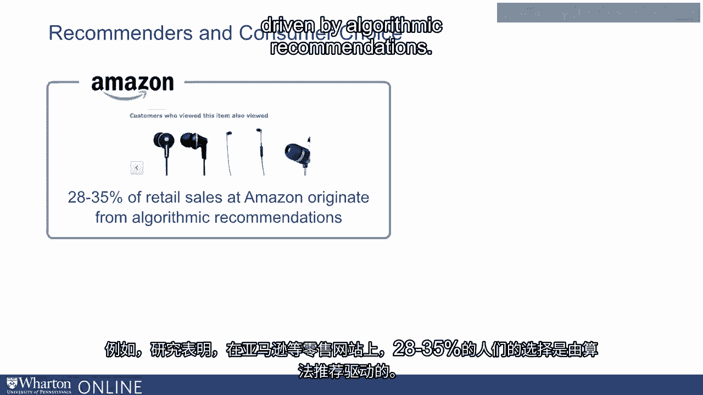

---

## 推荐系统的影响力概述

推荐系统在多种线上场景中显著影响着消费者的决策。研究表明，在亚马逊等零售平台上，约有28%到35%的消费比例直接归因于算法的推荐。

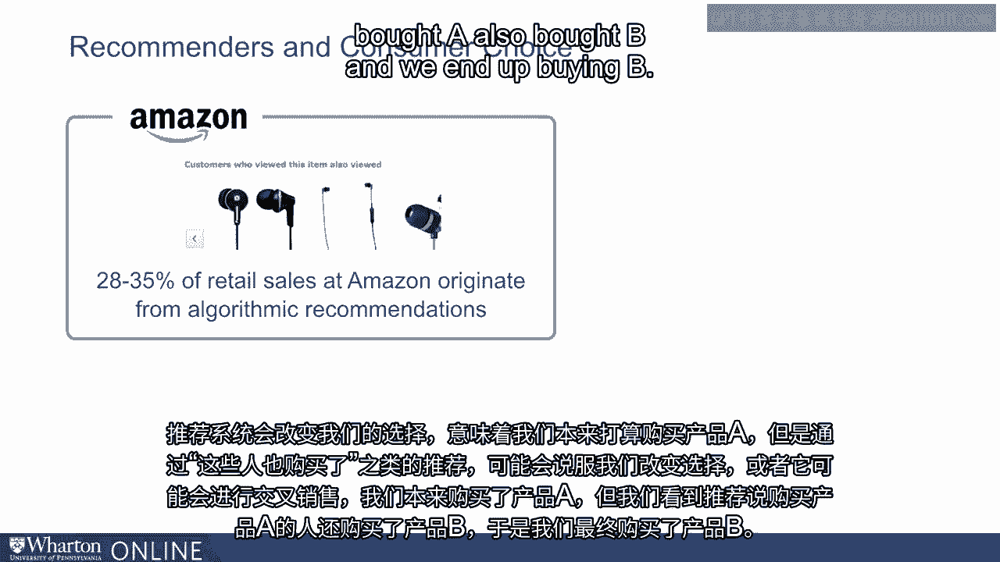

这意味着，推荐系统主要通过两种方式改变我们的选择：
1.  **改变初始选择**：用户原本打算购买产品A，但系统通过“购买了此商品的顾客也购买了…”等推荐，说服用户转而购买产品B。
2.  **促进交叉销售**：用户在购买产品A后，看到“购买A的人也购买了B”的推荐，从而额外购买了产品B。

简而言之，算法推荐在很大程度上引导了用户的消费行为。

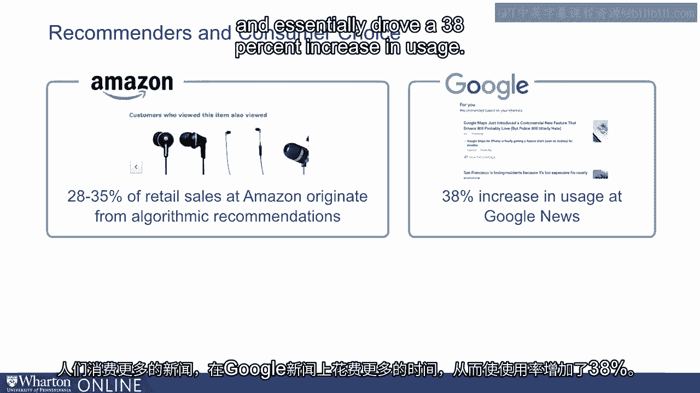

---

## 推荐系统提升用户参与度

推荐系统不仅能改变选择，还能显著提升平台的用户参与度和使用量。

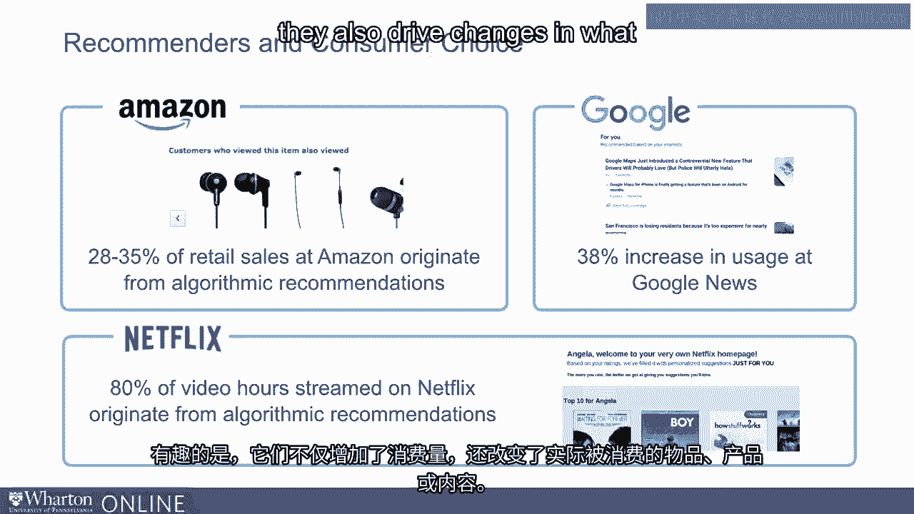

以下是相关研究数据：
*   在Google News上，算法推荐使网站的消费者使用率增加了约**38%**，意味着用户阅读了更多新闻，停留时间更长。
*   来自Netflix数据科学家的论文指出，其平台上**80%** 的观看时长来源于算法推荐。

这些数据表明，推荐系统是驱动用户消费内容的关键引擎。

---

## 推荐如何改变消费内容：长尾理论

推荐系统不仅增加了消费总量，也改变了我们所消费的商品或内容类型。关于其影响，一个著名的理论是“**长尾理论**”。

该理论由克里斯·安德森在《长尾》一书中提出，核心观点是：互联网（尤其是自动化推荐）将帮助消费者从追逐最热门的商品，转向发现和购买更小众、更个性化的商品。

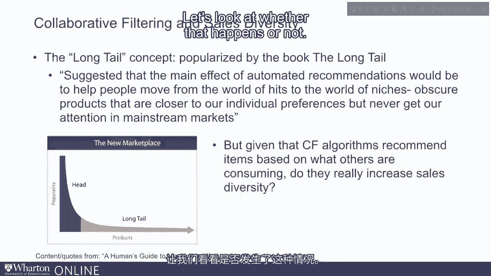

其逻辑在于，在没有推荐时，我们通常依赖“畅销榜”、“热门电影”等列表做选择，这些列表天然偏向流行商品。而个性化推荐有望根据个人偏好，引导我们发现那些虽不热门但更符合兴趣的项目。

然而，一个关键问题是：**这真的发生了吗？** 尤其是考虑到协同过滤等主流算法，其推荐本身就基于大众的消费行为，这可能导致其推荐结果依然带有“流行度偏见”。

---

## 衡量市场多样性：基尼系数

为了科学地验证推荐系统是促进了多样性还是集中度，我们可以使用“**基尼系数**”作为衡量指标。

**基尼系数**是衡量收入或消费集中度的通用指标，取值范围在0到1之间。
*   **基尼系数为0**：表示所有产品的销售额完全相等，市场极度多样化。
*   **基尼系数为1**：表示单一产品产生了全部销售额，市场极度集中。

计算基尼系数需要先绘制**洛伦兹曲线**。该曲线展示了：排名前X%的产品，占据了总销售额的百分之多少。如果所有产品销售额相等，洛伦兹曲线将是一条45度的对角线。基尼系数就是洛伦兹曲线与这条对角线之间面积的两倍。

通过比较**有推荐系统时市场的基尼系数（G1）** 和**无推荐系统时市场的基尼系数（G0）**，我们可以判断推荐的影响：
*   若 **G1 < G0**，则推荐促进了多样性（长尾效应）。
*   若 **G1 > G0**，则推荐加剧了集中度（流行偏见）。

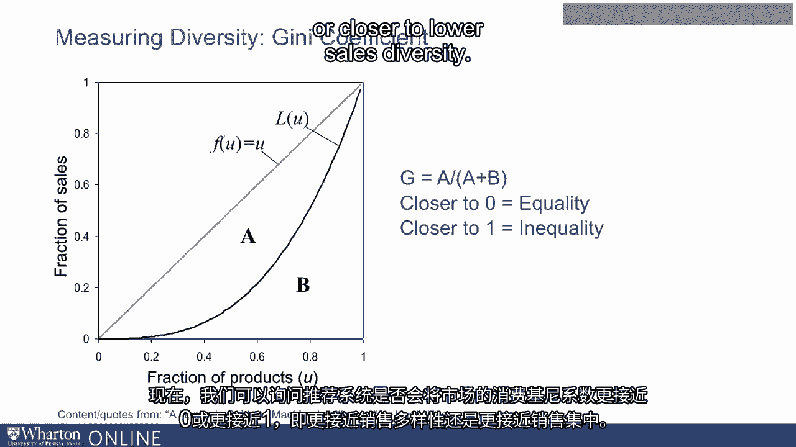

---

## 实验验证：推荐系统的真实影响

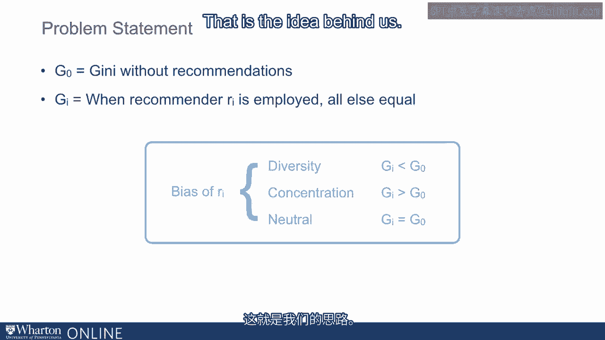

为了验证上述理论，我们与北美一家大型零售商合作，在2013年8月进行了一次大规模的A/B测试。

实验将超过130万网站访问者分为三组：
1.  **控制组（77%用户）**：不显示任何推荐。
2.  **实验组A（11.5%用户）**：显示“**看了又看**”（基于浏览的协同过滤）推荐。
3.  **实验组B（11.5%用户）**：显示“**买了又买**”（基于购买的协同过滤）推荐。

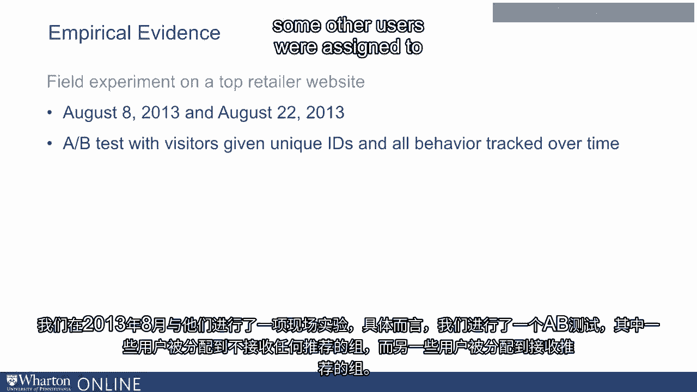

随后，我们分别计算并比较了三组用户消费数据所对应的基尼系数。

---

### 实验结果分析

实验数据清晰地揭示了协同过滤推荐的影响。

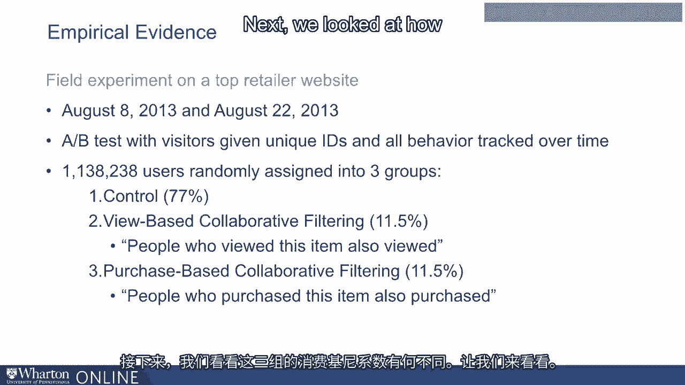

以下是基于“看了又看”推荐的实验结果：
*   开启推荐后，洛伦兹曲线更加偏离对角线。
*   具体表现为：底部40%和60%的产品所占的市场份额显著下降。
*   基尼系数从控制组的 **0.60** 上升至实验组的 **0.68**。**销售变得更加集中**。

以下是基于“买了又买”推荐的实验结果：
*   集中化趋势更为明显。
*   基尼系数从控制组的 **0.60** 大幅上升至 **0.70**。

**结论**：协同过滤推荐存在显著的**流行度偏见**。它们倾向于推荐已经被大量浏览或购买的商品，从而强化了热门商品的流行地位，而非帮助小众商品获得曝光。

---

## 重要补充：绝对销售额的增长

然而，以上结论需要一个重要补充。当我们观察**产品的绝对销售额**（而非市场份额）时，会发现一个不同的现象。

在推荐开启后，**所有类别产品的绝对销售额都获得了增长**，无论是左侧的小众商品还是右侧的流行商品。

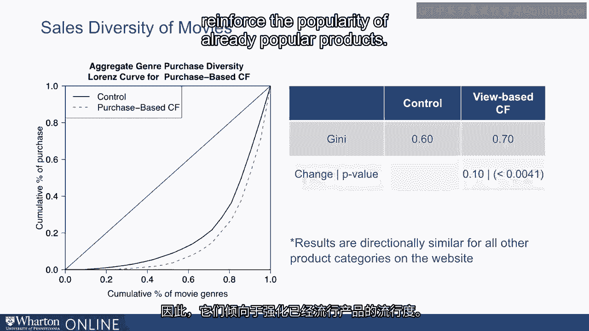

这意味着：
*   推荐系统确实帮助了所有商品（包括小众商品）更好地被用户发现和购买。
*   但是，这种增长是**不均衡**的。流行商品从中获得的收益增长，远远超过小众商品。

这类似于社会收入不平等的辩论：所有人的绝对收入都在增加，但富人的收入增长远快于穷人，导致相对差距拉大。推荐系统创造了类似的“市场不平等”：它做大了整个蛋糕，但分给热门商品的那块变得更大。

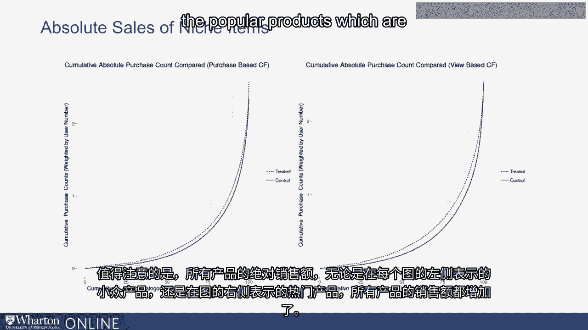

---

## 不同推荐算法的差异

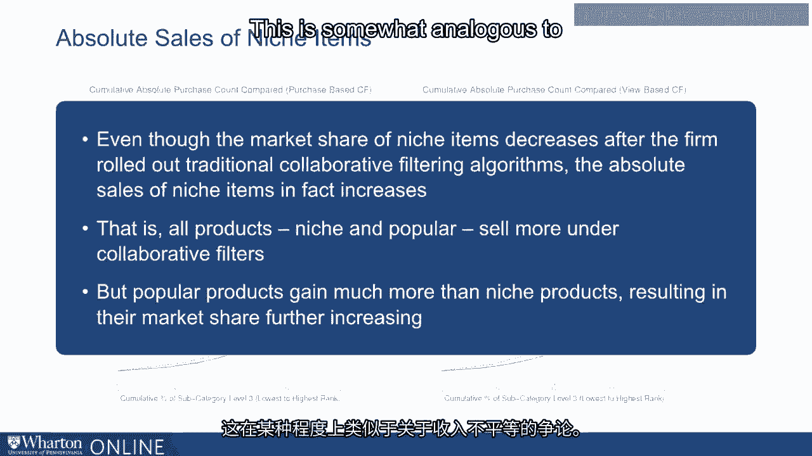

需要指出的是，并非所有推荐算法都有相同的偏见。

*   **协同过滤**（基于用户行为）：如实验所示，具有强烈的**流行度偏见**。
*   **基于内容的推荐**（基于商品属性匹配）：能更好地帮助用户发现符合其偏好的商品，而这些商品不一定是最热门的。因此，**基于内容的推荐更有利于实现长尾效应**。

两种设计各有优劣，公司在选择时需要权衡。

---

## 课程总结

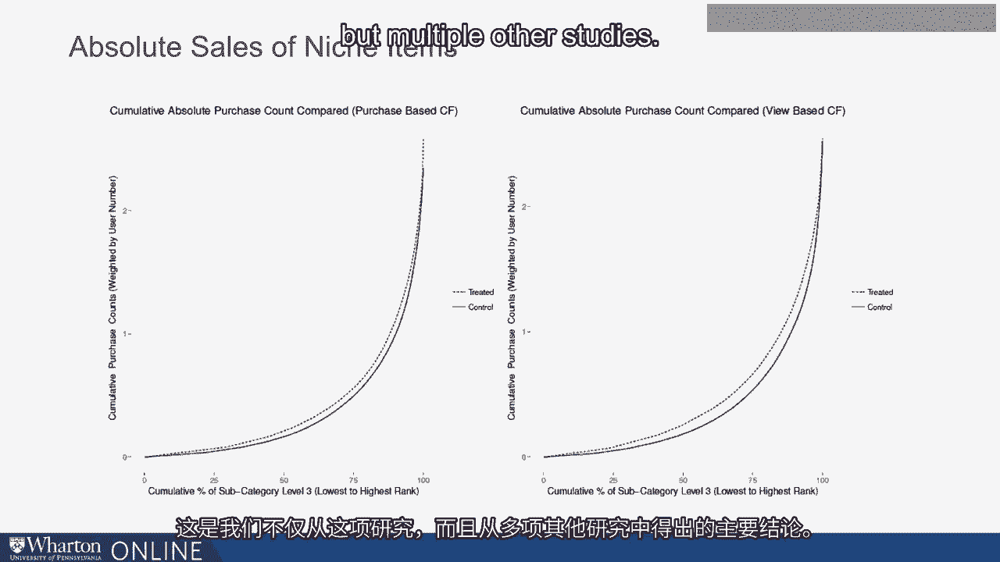

本节课中，我们一起学习了推荐系统对市场的深远影响。

1.  **推荐系统**是驱动用户消费和参与度的核心力量，能显著改变用户的选择。
2.  关于其是否促进消费多样性，**长尾理论**提出了乐观预期，但需要实证检验。
3.  通过**基尼系数**和**洛伦兹曲线**，我们可以量化市场集中度。
4.  大型A/B测试表明，主流的**协同过滤推荐**会加剧市场的集中度，存在**流行度偏见**，使热门商品更热门。
5.  但推荐也提升了所有商品的**绝对销售额**，只是增长收益不均衡。
6.  相比之下，**基于内容的推荐**更有可能帮助发现小众商品，促进多样性。

理解这些影响，有助于我们更理性地看待推荐结果，并为设计更平衡、更负责任的推荐系统提供思考方向。