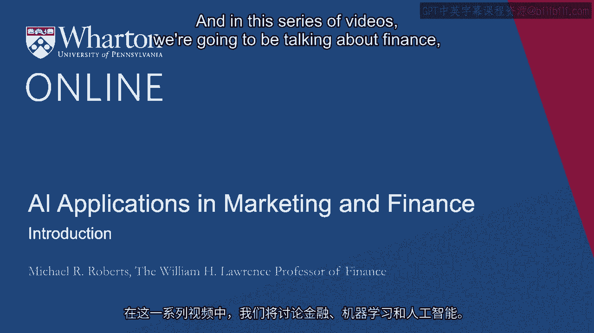
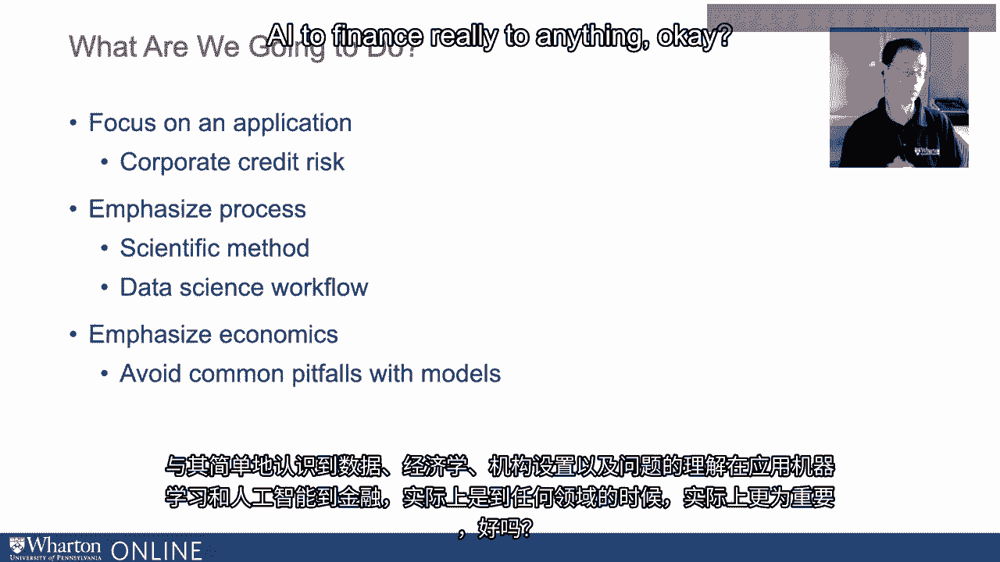
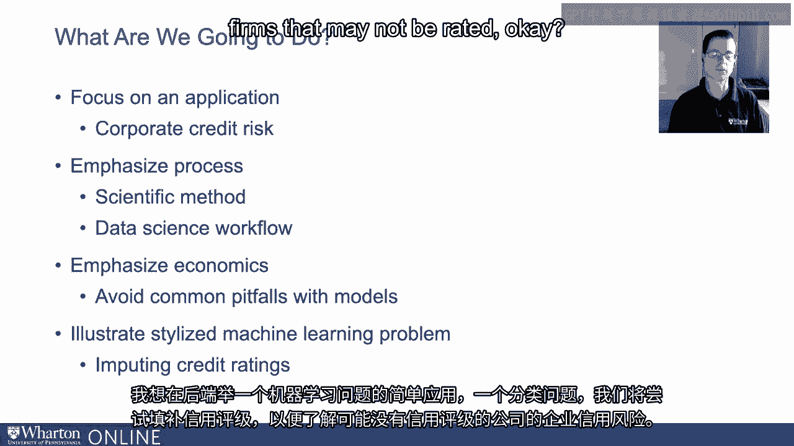
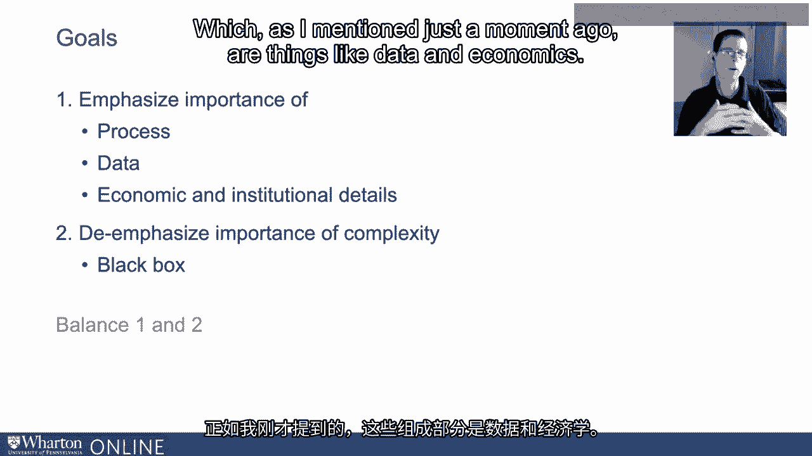

# 46：金融机器学习与人工智能简介 🧠💰

在本节课中，我们将探讨金融、机器学习与人工智能的交汇点。我们将了解金融领域如何长期依赖数据与技术，并聚焦于一个具体应用——企业信用风险分析——来展示如何将科学方法、经济学原理与数据科学工作流程相结合，从而避免常见陷阱。

---

金融一直是以技术、数据和模型为导向的领域。从20世纪初的穆迪手册开始，数据就在金融中扮演着核心角色。技术的发展也始终是金融演进的前沿。

因此，近期大众对机器学习和人工智能的关注，在金融领域并非全新现象。金融一直处于数据技术和建模的前沿。

至于应用方面，在金融、机器学习或人工智能领域进行搜索，会得到大量信息。实际上，很难找到一个数据不发挥核心作用的金融应用。

根据对机器学习的定义，回归分析自20世纪上半叶手动计算时就已经存在。考虑到金融、机器学习和人工智能这一主题的广度和深度，我们在此需要明确目标。

我们将专注于一个具体应用，以提供直观感受并说明其用法，而不是泛泛而谈。这个应用就是企业信用风险分析。

我们将特别强调科学方法和数据科学工作流程。同时，强调对经济现象、原则以及企业信用风险背后制度细节的理解至关重要。这有助于避免常见的陷阱和错误，这些错误通常源于盲目地将复杂模型或“黑箱”应用于数据，并期望得到正确答案。

对人工智能和机器学习的失望，往往与过度依赖模型和算法有关，误以为它们是解决所有问题的灵丹妙药。我们必须认识到，数据、经济学和对问题的制度性理解在任何应用中都是核心。

---

上一节我们概述了金融与机器学习结合的基本理念，本节中我们来看看具体的应用目标。

我们的目标是在后端展示一个机器学习问题的简单应用。这是一个分类问题：我们将尝试推测未评级公司的信用风险或信用评级。

我们将以非正式、对话式的方式进行讲解。这种方式虽然可能包含口误或即兴修正，但旨在模拟我们并肩坐在电脑前共同探讨数据与模型的情景。希望这种动态、非脚本化的方法能带来更有趣、更具启发性且富有成效的学习体验。

---

那么，我们的核心目标是什么？

目标是传达关于实证分析或金融分析的一些核心理念。我们将特别强调流程的重要性。规范的流程不会限制创造力，但能规范我们分析数据的方式。

以下是本课程希望强调的几个关键方面：

*   **强调数据的重要性**：数据是分析的基石。
*   **强调经济和制度细节的重要性**：理解背后的原理和规则至关重要。
*   **适当弱化算法复杂性**：我们将不过分强调复杂算法、流行术语或过程的“黑箱”方面。

我们需要在两种理想之间找到平衡：一是对研究现象具备领域专业知识，清晰理解其数据和经济背景；二是理解处理数据并输出答案的算法或模型。本课程将强调这两方面的平衡。

过去几年的经验表明，人工智能和机器学习组件受到了不成比例的大量关注。虽然这有其合理理由，因为该领域取得了巨大进展，但代价可能是忽视了其他同等重要的组成部分。

---

正如之前提到的，这些同等重要的组成部分包括数据和经济学等内容。

---

本节课中，我们一起学习了金融与机器学习、人工智能结合的历史背景与核心理念。我们明确了课程将聚焦于企业信用风险这一具体应用，并强调了平衡数据科学、经济学原理与制度理解的重要性，避免陷入过度依赖复杂模型的陷阱。在接下来的课程中，我们将深入这一应用的具体实践。