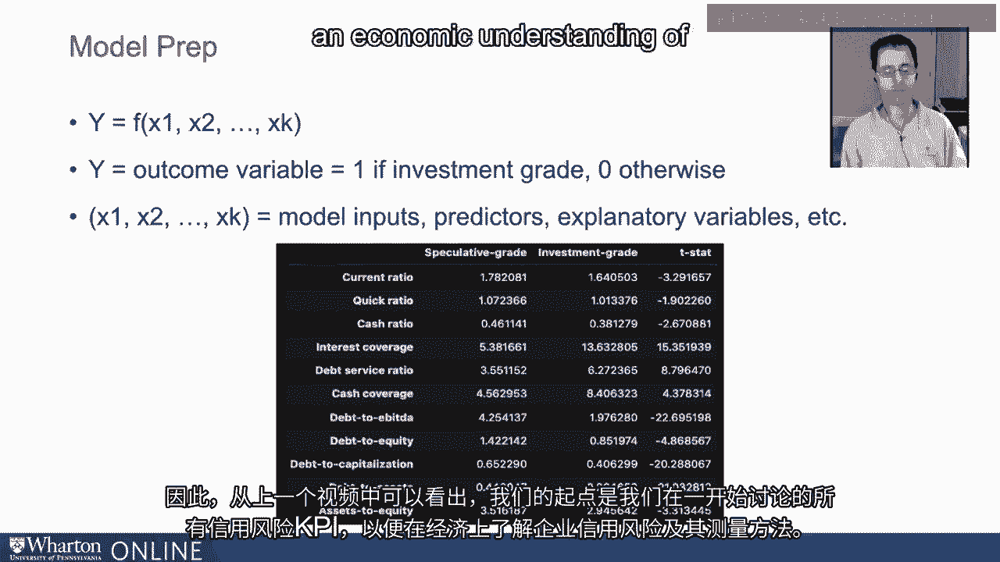
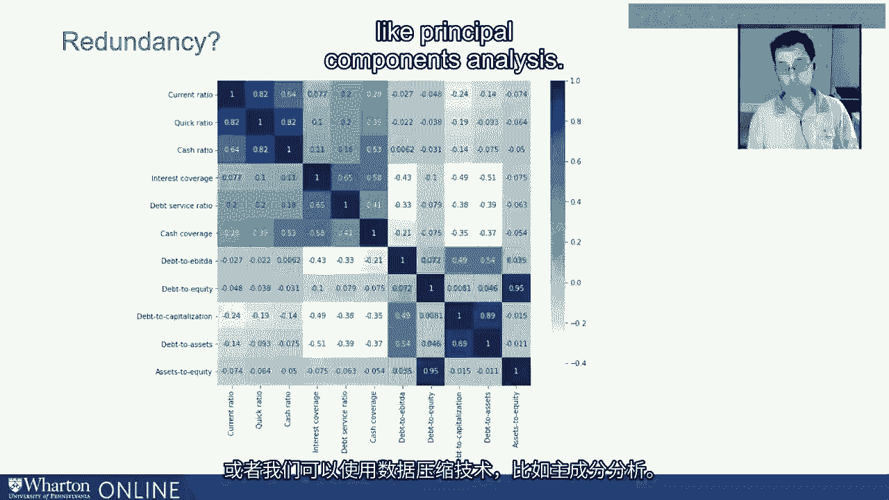
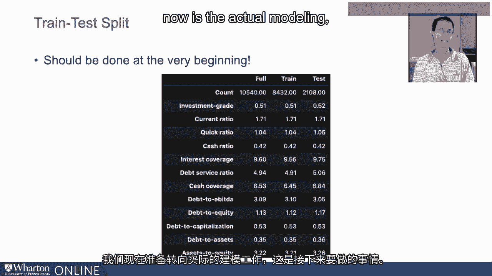

# 54：信用风险模型准备 📊

在本节课中，我们将学习如何为信用风险模型的训练与测试进行数据准备。我们将重点讨论预测变量的相关性分析、冗余问题以及如何正确地将数据集拆分为训练集和测试集，以避免模型过拟合。

---

上一节我们介绍了信用风险建模的目标，即估计一个函数 **F**，利用一系列预测变量 **x** 来对结果变量 **y**（投资级为1，非投资级为0）进行分类。

## 🔍 预测变量的相关性分析

为了理解预测变量之间的关系，我们首先需要分析它们的相关性矩阵。相关性矩阵以热图形式呈现，帮助我们识别变量间的强正相关或强负相关。

以下是分析相关性矩阵的几个关键点：

*   矩阵的对角线元素均为1，代表变量与自身的完全正相关。
*   较深的颜色表示较强的正相关关系。
*   较浅的颜色表示较强的负相关关系。
*   例如，债务与资产比率和利息覆盖比率之间存在较强的负相关（约-0.5）。

## ⚠️ 识别冗余变量

我之所以展示相关性矩阵，是为了引出冗余变量的问题。在最初引入信用风险关键绩效指标时，我们根据其衡量内容进行了分组。

以下是按组划分的变量示例：

*   **流动性指标组**：包括流动比率、速动比率和现金比率。这些指标旨在衡量同一概念（流动性），因此彼此之间存在非常强的正相关。

冗余变量可能导致模型过于复杂。模型的**简约性**对于样本外预测非常重要。因此，我们可能需要减少使用的变量数量。虽然我们可以将所有变量放入模型，让模型自行筛选，但这并非总是最佳策略。完全相关的变量会给模型带来各种问题。

## 🧩 训练集与测试集拆分

接下来，我们需要讨论训练集与测试集的拆分。这一步应在建模过程开始时进行。其核心目的是避免**过拟合**——即模型在训练数据上表现完美，但在新数据上表现糟糕。

我们需要将完整的数据样本拆分为两部分：

*   **训练集**：用于估计模型、寻找最佳模型。
*   **测试集（或保留样本）**：仅在确定最终模型后使用一次，用于评估模型在未见数据上的表现。

我执行了数据拆分。完整数据集共有10,540个观测值。拆分后，训练集包含8,432个观测值，测试集包含2,108个观测值。通过比较预测变量和结果变量（投资等级指示符）在完整数据集、训练集和测试集中的平均值，可以发现它们在统计和经济意义上均无显著差异。这正是随机分配观测值到训练集和测试集时应有的结果。

---

本节课中，我们一起学习了信用风险模型准备的关键步骤。我们分析了预测变量的相关性并识别了潜在的冗余问题，理解了模型简约性的重要性。最后，我们掌握了如何正确地进行训练集与测试集的拆分，这是防止模型过拟合、确保其泛化能力的基础。至此，数据准备阶段已完成，我们即将过渡到实际的模型训练环节。