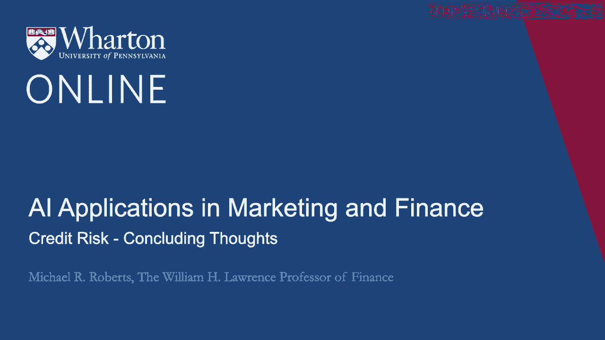
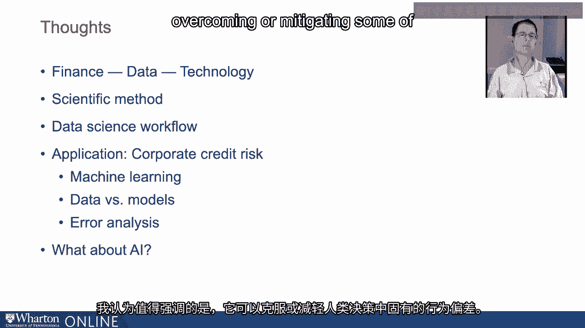
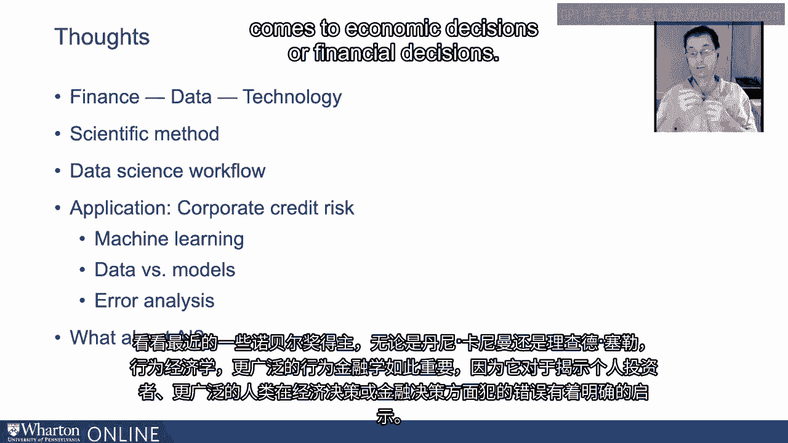
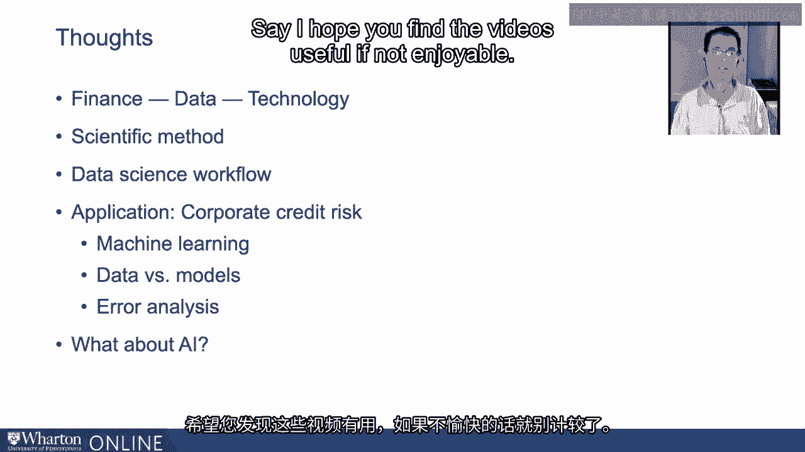

# 58：信用风险总结与思考 💭

在本节课中，我们将对“金融、数据与技术”这一系列主题进行总结，并回顾在信用风险建模过程中学到的核心概念。我们将探讨数据、模型与人工智能在金融领域的作用，并思考未来的发展方向。

---

正如课程开始时提到的，金融、数据与技术三者密不可分。自金融活动诞生以来，数据就扮演着核心角色。随着技术的发展，这些技术逐渐渗透到金融实践乃至学术研究中，形成了强大的合力，引领我们走到今天。

在当今环境中，机器学习与人工智能等概念已成为核心。在本系列视频中，我们以线性方式探讨了多个相互关联的主题。所有工作都始于科学方法：清晰地定义问题、提出精确的假设、理解这些假设对数据可能产生的影响，并最终通过数据进行检验。

上一节我们介绍了科学方法论，本节中我们来看看数据科学工作流程的具体组成部分。

以下是数据科学工作流程的主要步骤：
*   **数据获取与验证**：从源头获取数据并确保其质量。
*   **数据准备**：清洗和转换数据，使其适合进行分析。
*   **探索性数据分析**：初步探索数据，发现模式和异常。
*   **建模**：基于准备好的数据构建预测或分析模型。

我们以企业信用风险作为应用背景，展示了上述所有步骤。我们首先讨论了企业信用风险的含义及其对公司和各类利益相关者的重要性。接着，我们探讨了通过分析企业财务报表和关键绩效指标来评估信用风险的基础知识。

然后，我们过渡到信用评级的讨论。信用评级是我们基于财务报表分析，向量化信用风险迈进的关键一步。我们以区分“投资级”与“投机级”这一相对粗略的视角为例，决定对信用评级进行建模。

在建模部分，我们实施了一个机器学习流程。我们从逻辑回归模型开始，并探索了包括K近邻算法在内的其他模型。我们有意避免了复杂的技术细节，旨在提供对这些概念的总体概述。对于希望深入学习的同学，有大量其他资源可供参考。

然而，从中得出的一个不常被强调的重要教训是：**数据比模型更重要**。如果你有资源可以投入，应该优先投入到数据质量上，而非一味追求更复杂的模型。因为模型的表现上限受限于输入数据的质量。

我们学到的另一件事是：**了解模型在何处犯错，可能与了解其成功之处同等重要**。错误所在之处，正是建模过程中需要改进的关键环节。

通过以上所有内容，你可能会问：“那么人工智能呢？我们还没谈到人工智能。”

我喜欢将人工智能视为一个包含机器学习的更大集合，其中还包括其他内容。为了保持内容的可消化性并将本系列控制在合理时长内，我们之前没有深入探讨。现在请允许我简要补充几句。

人工智能在金融领域可以扮演许多角色。我认为值得强调的一点是，它在克服或减轻人类决策中固有的行为偏见方面潜力巨大。看看丹尼尔·卡尼曼和理查德·塞勒等诺贝尔奖得主在行为经济学和行为金融学领域的工作，他们揭示了人类在做出经济或财务决策时常犯的错误。

我们总是会犯错。我认为人工智能的功能之一（当然它还有很多其他功能），就是帮助我们规范决策过程，避免在投资或其他金融决策中犯一些常识性错误。这方面潜力巨大，我们已经在智能投顾等领域看到了初步应用。并且，随着我们获得更多数据和计算能力的提升，人工智能在帮助人们做出更好财务决策方面的作用只会越来越重要。

---

**本节课总结**

在本节课中，我们一起回顾了整个信用风险分析的学习路径：
1.  我们理解了**金融、数据与技术**的紧密联系。
2.  我们实践了从**问题定义、数据准备、探索分析到建模**的完整数据科学工作流。
3.  我们以**企业信用风险**为案例，学习了如何通过财务指标分析和机器学习模型（如逻辑回归）来评估风险。
4.  我们认识到**数据质量**的核心重要性，以及**分析模型错误**对于改进的关键作用。
5.  最后，我们展望了**人工智能**在规范金融决策、克服行为偏见方面的未来潜力。

希望本系列课程为你理解数据科学在金融领域的应用提供了一个清晰而实用的起点。