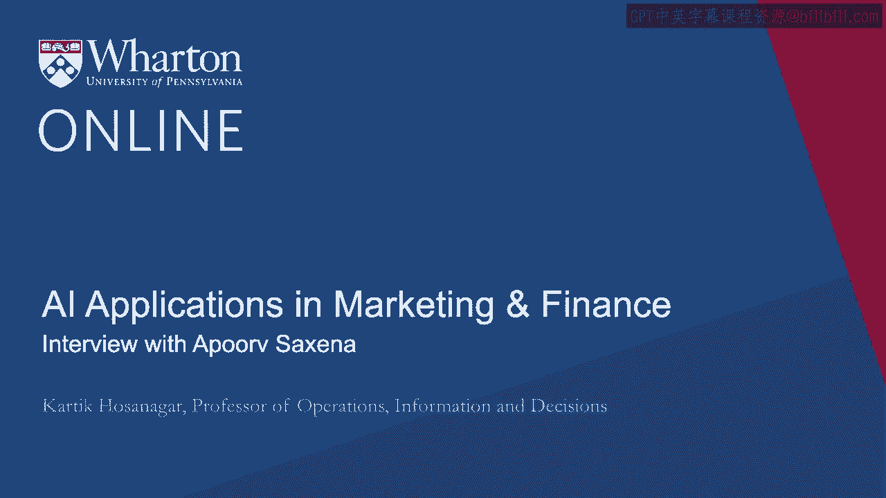

# 59：人工智能在金融领域的应用 🏦💡

在本节课中，我们将学习人工智能在金融服务行业中的具体应用。我们将探讨人工智能如何改变前台客户互动和后台运营，并了解成功实施人工智能项目所需的关键策略。

---

## 访谈概述

我们曾讨论过使用投资组合来管理人工智能项目，也探讨过机器学习的民主化。本次访谈是与Apoorv Saxena的深入对话。Apoorv Saxena曾在谷歌工作，帮助实施了许多人工智能项目，目前是摩根大通的全球人工智能负责人。本课程提供的文章可作为可选阅读材料，鼓励大家深入了解。现在，让我们开始与Apoorv的对话。

你好。现在与我一同参与的是Apoorv Saxena，他是摩根大通的全球人工智能负责人。Apoorv，感谢您加入我们。如果可以，请简要介绍一下自己和您的背景。

> 谢谢你，Karthik，邀请我参与这次对话。正如你所说，我领导摩根大通的人工智能和机器学习团队。我在这里快一年了。我根本相信人工智能对金融行业是非常具有变革性的。这是我在过去几年中的主题。在此之前，我在谷歌工作，负责谷歌人工智能垂直团队，基本上是将人工智能应用于医疗、金融和工业领域。我们相信人工智能是一个贯穿始终的主题，关于转型多个行业。我正在摩根大通实现这一点。

很好。事实上，关于这一点，我很想听听人工智能在金融服务中的影响。你能帮助我们了解人工智能如何被使用的全貌吗？人工智能在金融中是如何应用的？

> 如果你看看金融历史，它一直是一个技术驱动的行业，从自动取款机到使用数字银行。这是一个非常数据驱动的行业。人工智能转型所需的两个基本论点是，您必须拥有大量数据，并且这必须是数字化的。这两个关键因素在金融中一直存在。第三个非常有趣的方面是，通常不存在代理问题。其他行业中存在于医疗领域，拥有数据的人有巨大的激励来实现盈利，作为任何人工智能决策过程的结果。金融领域的转型速度非常快。所以我认为这三个组合使人工智能在金融行业非常成熟，通过人工智能的颠覆。有多种事情正在发生。人工智能现在被用来颠覆您与前台的互动方式，一直到在后台，可以给您多个例子说明这一点是如何实现的。

---

## 前台应用：客户互动转型

上一节我们介绍了人工智能在金融领域的整体成熟度。本节中我们来看看人工智能如何具体改变金融服务公司与客户的互动方式，即前台应用。

> 我想再说一遍。在前台，最重要的是客户互动。因此，AI正在被用来从根本上转变多渠道、全渠道的体验。无论你现在谈论的是哪种方式，是否只是访问一个在线网站，你可以与银行进行对话。这是一个正在利用对话AI进步而转变的领域。更好的目标定位，微目标定位，使用通常的独特信号。银行在目标客户群体时从未使用这种方式。而第三个是个性化。个性化已经存在一段时间，但创造个性化的金融产品，还有正在前端发生的事情。

好的。你所说的创造个性化金融产品是什么意思？我们在本课程中确实讨论过个性化。这是一个重要主题，不仅限于金融服务，还有零售和许多其他场景。但这也是一个已经存在一段时间的想法。那么，请多告诉我们一下如何个性化产品本身。

> 这是一个非常好的问题。个性化已经存在很长时间了。因此，信息传递的个性化也已经存在一段时间，在电子邮件方面比较长，但电子邮件的目标定位，使用正确的语言，这正是目标定位。但在过去几年发生了什么？在过去的几个季度中，产品的创造越来越多。一个例子是主题投资组合。因此，你可以拥有一个基于你兴趣的非常独特的创意投资组合。嘿，我想投资于可持续发展的公司。我想投资于针对特定地区的公司。那么，如何在不实际挖掘他们的SEC数据和文件的情况下做到这一点？他们的投资关系，然后提出一个特定主题。这就是一个AI用于创建主题投资组合的例子。

---

## 后台应用：运营效率提升

了解了前台互动后，我们转向后台运营。人工智能在金融后台，如风险控制和运营自动化方面，同样发挥着关键作用。

> 再次说明。AI在金融领域已经使用很长时间了。传统上，后台处理如欺诈和反洗钱。因此，发生了什么变化？新深度学习技术正在转变。技术正在被用来创建非常复杂的欺诈检测模型。这就是你可以在某种程度上操纵数据的规模，利用数据和新数据源。这就是正在发生的巨大转变。反洗钱也是一样。现在例如，摩根大通处理大约三分之一的所有交易，在世界上发生的事情通过某种方式与摩根大通相关。我们正在使用实时极其复杂的知识图谱来创建见解和反欺诈警报。这就是一个例子。其他领域，呼叫中心的传统领域。与其说你的IVR体验是完全的，我们通过对话体验来转变客户体验。你甚至可以与银行账户进行体验对话，谈论如何。银行的支票账户里有多少余额，你可以做什么。你现在可以完全通过对话方式进行简单的电汇，而无需与人类交谈。这就是传统上存在的后台操作类型，现在通过AI正在进行转型。另一个我应该提到的例子是合同。因此，银行。银行的许多后台操作与合同相关，谈判和维护合同。因此，在这一方面有很多令人兴奋的新事物发生。机器理解合同并识别差异，在合同中提醒相关方采取行动。因此，在这一领域也有很多出色的工作。

---

## 成功实施人工智能的策略

我们已经看到了人工智能在前台和后台的具体应用。那么，公司如何确保其人工智能投资能获得回报呢？以下是成功实施人工智能项目的关键策略。

所以作为全球AI负责人，显然，无论是你个人还是整个组织，正在大量投资于AI。当公司在AI上进行大量投资时，问题是需要具备哪些条件。你想从中获得回报？因为正如我们所见，有很多公司正在投资AI，但尚未看到回报。那么告诉我们你对此的看法。你认为哪个AI策略效果很好？长期来看，**这可能会产生回报**？

> 这是一个非常好的观点。我认为需要注意的一点是，开始使用AI非常简单。我认为实际上可以雇佣几位数据科学家，给他们一台笔记本电脑，他们应该能够迅速开始进行AI，从事机器学习或数据科学。我认为你需要关注的是如何产生巨大影响，AI的变革性影响？我认为我们看到的工作有三种方式。

以下是实现人工智能变革性影响的三个关键支柱：

1.  **建设大规模AI基础设施**：这意味着要确保数据就位，数据易于发现和注释，并具备训练大型模型的能力。这可以表示为：`强大的AI基础设施 = 高质量数据 + 高效计算平台`。
2.  **采用端到端的业务流程视角**：不要只关注单个接触点，而应审视从头到尾的整个流程，看看人工智能如何能改变整个链条。
3.  **创造全新的数字体验**：利用人工智能的能力，创造过去无法实现的新颖客户体验，这往往是产生最大长期影响的地方。

有什么新的数字体验可以通过AI创造的例子？

> 我认为AI无法做到的，已经能够做得很惊人。通过对话创造新体验。语音转文本的准确性大大提高。创建新文本的能力，完全由AI生成的文本大大增加。现在你可以想到两三年前根本不可能的体验。就在两三年前。所以正确的例子是。如果你在私人领域讨论，实际上有很多低接触。你通常作为银行想要自动化的高频交易。例如嗨。你早上醒来，想检查你的投资组合。它怎么样，为什么会下降？所以，嗨，你醒来，跟Alexa对话，数字体验助手之一，并且说，为什么我的投资组合下降了两个百分点？然后人工智能助手分析你的投资组合。它给出了非常好的理由说明为什么会下降，并给你这个交易。当然。在所有这些体验中，如果你想深入挖掘，可以深入研究。你实际上拨打了你的财富顾问的电话。但这就是我们所谈论的体验。

所以很清楚你可以如何应用人工智能来改善现有体验。但当你谈论创造新体验时，你到底是什么意思？

> 所以人工智能实现了完全变革的体验。你与机器的对话方式，以及你如何生成新的、机器生成的文本。所以这两个进展可以用来改变你与银行的互动。举个例子。通常是低接触、高频率的互动。你的私人财富顾问通常是银行想要自动化的内容。这方面的一个例子是你早上醒来，通过Alexa与银行对话，并说。嗨，我的投资组合今天怎么样？实际上，昨天表现如何？而且它说，嗨。它下降了两个百分点，然后你开始深入挖掘，嘿，为什么会下降两个百分点？它说这是你的投资组合是如何构建的。这就是它出现问题的原因等等。所以这种互动非常低接触，非常高频率。但今天你可以轻松自动化的事情。这就是我所说的体验。

---

## 总结

本节课中我们一起学习了人工智能在金融领域的广泛应用。我们了解到：

*   在**前台**，人工智能通过对话式交互、精准定位和个性化产品创造，正在彻底改变客户体验。
*   在**后台**，人工智能提升了欺诈检测、反洗钱、客户服务和合同管理的效率与复杂性。
*   要确保人工智能投资获得回报，公司需要聚焦三大策略：**建设强大的AI基础设施**、**从端到端流程视角应用AI**，以及**利用AI创造全新的、颠覆性的数字体验**。

Apoorv，再次感谢你加入我们。

> 感谢你的邀请。