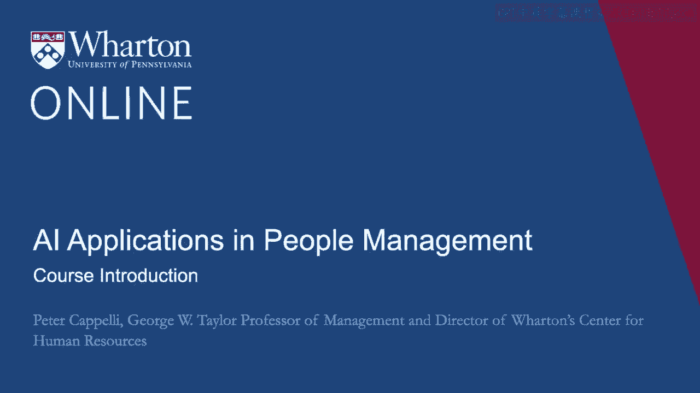
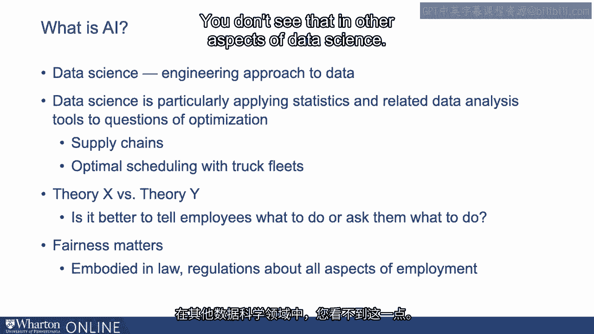
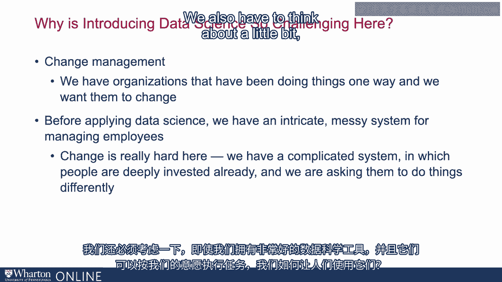
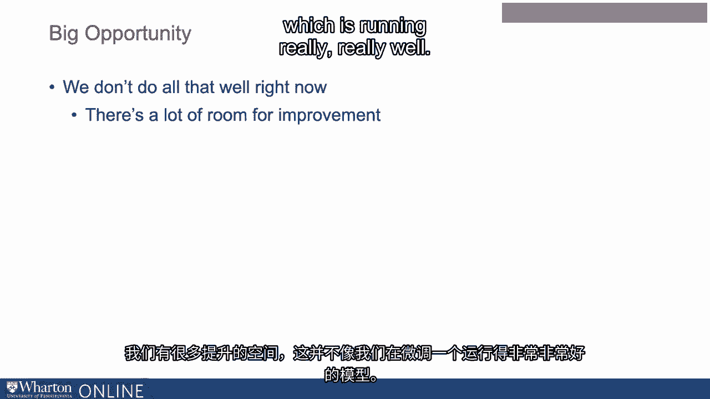

# 63：人工智能在人员管理中的应用介绍 🧠

在本节课中，我们将探讨人工智能和数据科学如何应用于人员管理领域。我们将了解其带来的巨大机遇，以及将原本用于优化机器和流程的工具应用于管理“人”时所面临的独特挑战。

---

## 课程概述

我是彼得·卡佩利，在沃顿商学院担任教授已有35年，并负责运营人力资源中心。长期以来，我一直在关注工作场所的变化，特别是薪酬、绩效管理方式的转变，以及劳动力市场日益开放、员工流动性增强的趋势。在本课程中，我和我的同事们将共同探讨人工智能在人员管理中的角色。

我的同事**马修·比德威尔**和**索尼·坦比**（一位转行研究工作场所问题的计算机科学家）也将参与讲解。我们将用大约四个小时的时间，深入讨论这些重要议题。

---

## 人员管理的重要性

首先，让我们从管理人员的一般视角开始。对于管理经验不多或从数据科学角度切入的观众，需要理解：管理是一项巨大的任务。

从成本角度看，在一个典型组织中，约三分之二的成本来自员工或各类劳动。仅在美国，每年就有约6600万人更换工作，这还不包括庞大的在职劳动力。因此，如何管理员工绩效、支付薪酬、规划职业道路并帮助他们转型，都是核心问题。

这个行业的规模极其庞大。仅在美国，由人员管理（包括外包、薪酬、绩效、招聘等）驱动的行业规模就达到约五千亿美元，几乎与整个美国建筑行业相当。这说明了人员管理对组织、社会和企业财务的重大影响。

此外，人员管理直接影响公司品牌。当前，性骚扰、多样性与包容性等问题受到高度关注，公司需要证明其遵守相关政策。在商业战略中，企业的核心竞争力往往归结为“人”以及管理他们的方式。

最终，人员管理之所以至关重要，是因为它直接影响人们的生活。管理不善可能导致健康问题、压力，甚至让员工感到痛苦。良好的管理则能让生活变得更美好。

---

## 什么是人工智能与数据科学？

上一节我们介绍了人员管理的宏观背景，本节中我们来看看我们将要使用的主要工具：人工智能与数据科学。

“人工智能”是一个动态发展的目标，其理念是让机器能够做出通常只有人类才能做出的决策。目前，当我们谈论人工智能时，主要指的就是**数据科学**。

数据科学的核心是对数据进行工程化处理，其基础学科是**统计学**。数据科学特别应用统计学和数据分析工具来解决**优化**问题。

以下是优化问题的两个例子：
*   **供应链管理**：确保在正确的时间将适量的货物送达商店。
*   **车队调度**：优化卡车车队的调度，以确保拥有恰好数量的车辆。

其通用目标可以表述为：在给定约束条件下，找到使某个目标函数（如成本最低、效率最高）最优的解决方案。

---

## 管理“人”与管理“物”的根本区别

然而，将数据科学应用于“人”时，问题变得截然不同。与卡车不同，人会生病、会愤怒，并在愤怒时做出反抗行为。他们可能会离职，如果对工作不投入，可能会怠工甚至进行破坏。

这在工会运动中有一项旧技术，称为 **“按规章工作”** 。如果员工对管理层不满，他们可以严格地、逐字逐句地遵循工作手册上的每一条规则，这足以让组织陷入停滞。

因此，管理“人”带来了许多与单纯优化机器设备完全不同的后果。自管理学科诞生以来，其根本性辩论之一就是“管理”观点与“领导”观点之间的划分。

这项研究在20世纪30年代开始，50年代后受心理学影响更大。道格拉斯·麦格雷戈著名的**X-Y理论**区分了这两种观点：
*   **理论X**：认为人是理性的，本质上不愿工作，除非给予报酬和严密监督。
*   **理论Y**：认为如果管理得当，人们可能会主动去做你希望他们做的事。

测试你自己立场的一个方法是思考：是告诉员工该做什么更好，还是询问他们该做什么更好？前者更接近理论X，后者更接近理论Y。理论X的观点与工程原则及数据科学的管理方式更为一致。

---

## 公平性与法律：不可忽视的维度

当我们从预测设备故障转向预测员工行为时，一个关键区别出现了：我们不仅关心预测结果的准确性，更关心得出预测结果的方式。

例如，如果我们能100%准确地预测谁将辞职，但方法是通过窃听员工的电话记录或监控其社交媒体，那么即使预测完美，也会引发严重的道德和法律问题。

因此，在人员管理中，像**公平性**这样的议题至关重要。公平性问题体现在法律和政府对所有就业方面的规章中。当我们开始处理就业决策时，就不可避免地会遇到这些公平性问题，并经常与法律发生冲突。这是数据科学在其他领域（如设备管理）中较少遇到的挑战。

---

## 变革管理：实施新工具的挑战

将数据科学引入人员管理面临的另一个重大问题是**变革管理**。这是一种非常重要的通用管理能力。

在数据科学出现之前，我们已经有一套非常复杂、甚至有些混乱的员工管理系统。人力资源部门有大量的文件和手册来描述员工应如何被管理，并且投入了大量资源培训管理者。

现在，我们要求他们采用一种基于数据科学的、截然不同的决策方式。这就产生了变革的阻力。即使我们拥有出色的数据科学工具，如何让人们放弃现有的决策方式，转而采纳这些算法，是一个需要仔细思考和管理的过程。

简单来说，如果你将数据科学用于优化酒店房间定价，房间不会起诉你。但如果你用于分配工作任务，而这些分配影响了公平性，员工可能会起诉你。相同的算法，在不同环境下会导致截然不同的结果。

因此，我们需要考虑的不仅仅是人力资源界或基层管理者的阻力，更要仔细管理变革过程，以抓住做得更好的机会。

---

## 巨大的机遇与总结

回顾我一生中所见的商业变革，人工智能在人员管理中的应用可能是其中最大的变化之一。它通过改变决策方式、数据收集方式和资源分配方式，产生了深远的连锁反应，并影响着公平性等核心问题。

这里存在着巨大的机遇，因为当前许多人员管理决策的执行效果并不理想。例如在招聘中，我们不仅常常未能将合适的人放在合适的岗位上，还存在着大量的偏见和歧视。因此，我们并非在微调一个已经完美的模型，而是有很大的提升空间。

如果我们能做得更好，就能改善组织的运营，也能让员工的生活变得更好。这正是我们面临的现状：一个真正的提升机会，同时也是一个真正的挑战——如何将那些为制造业等领域开发的工具，成功地应用于截然不同的人类管理背景中。

在本课程后续的章节中，我和我的同事们将与大家继续深入探讨这些话题。

---

## 本节课总结

在本节课中，我们一起学习了：
1.  **人员管理**的巨大规模与重要性。
2.  **人工智能与数据科学**的基本概念及其优化本质。
3.  管理“人”与管理“物”的**根本区别**，特别是人的情感与反应。
4.  在人员管理中引入数据科学时必须考虑的**公平性与法律**维度。
5.  实施新工具时面临的**变革管理**挑战。
6.  尽管挑战重重，但将数据科学应用于人员管理领域存在着**巨大的机遇**，能够显著改善决策质量和员工体验。