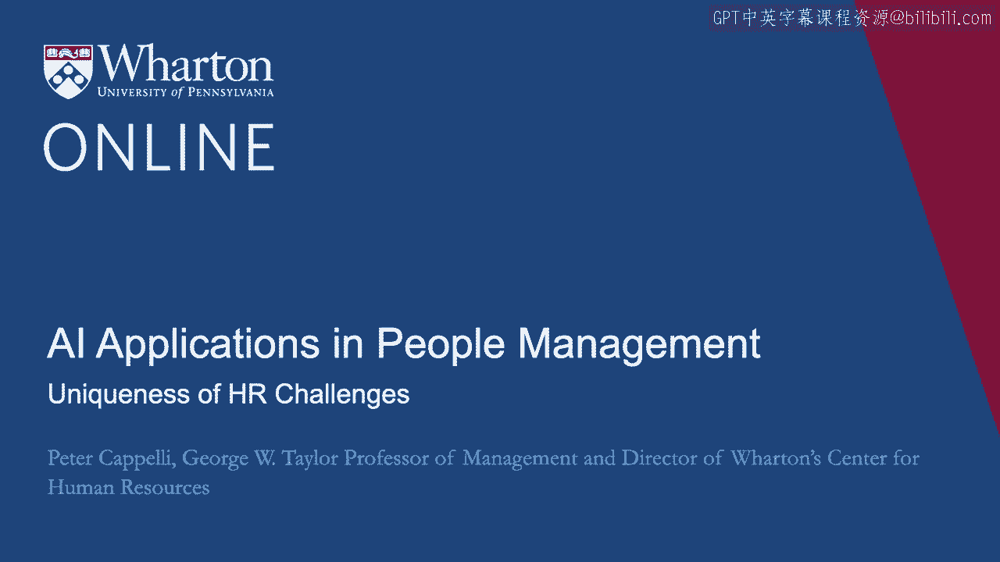
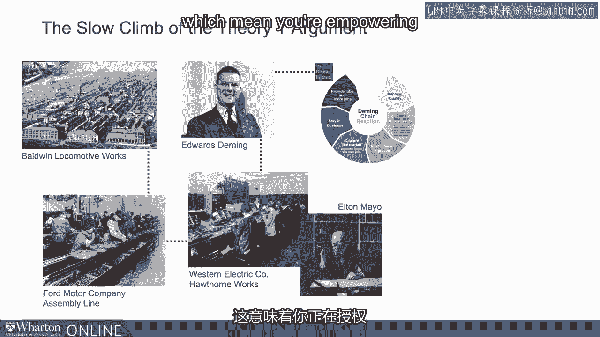
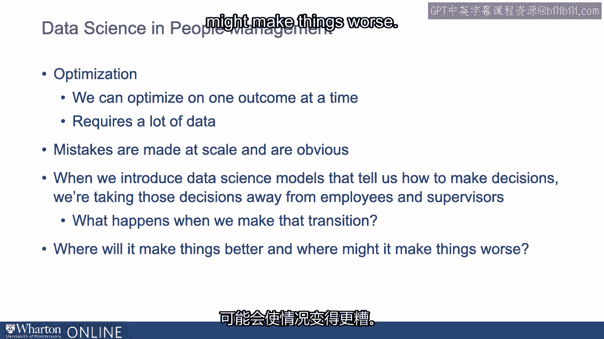

# 64：人力资源管理的独特挑战与数据科学应用 📚

在本节课中，我们将探讨人力资源管理领域面临的一些独特挑战，并了解数据科学如何介入这一复杂领域。我们将从历史视角出发，回顾管理思想的演变，并分析在现代组织中引入数据科学工具时需要考虑的关键问题。

---

## 🏭 历史背景：从混乱到科学管理

上一节我们概述了课程主题，本节中我们来看看人力资源管理的起源。大约100年前，现代工厂时代初期，工作组织方式与今天截然不同。

以1900年左右的费城工厂为例，你会惊讶地发现，许多在建筑内工作的人并非员工，而是**独立承包商**。据估计，到1910年，美国工厂中高达**40%** 的工人属于此类。组织内部通常非常混乱，员工流动率极高，大约为**300%**，管理实践也极为随意。

例如，当时世界上最大的制造企业——鲍德温机车工厂，其工头每天早晨会清点工人人数。如果有人缺席，他们便走到工厂门口，向聚集的求职人群扔苹果。接住苹果的人即获得当天的工作。这种方法简单直接，但也导致了极度的混乱和不稳定。

---

## 🔄 管理实践的演变：稳定与赋能

随着生产复杂度的提升，企业开始意识到高流动率和随意管理的问题。福特汽车公司是早期的改革者。

福特发现，在装配线上，一个工人的错误会停止整条生产线，造成巨大损失。因此，他推行了“每天5美元计划”，大幅提高工资。其核心目的并非让员工买得起车，而是为了**降低员工流失率**。结果，流动率从300%骤降至约50%，汽车质量也显著提升。这揭示了稳定员工队伍和进行人才管理的重要性。

大约十年后，西方电气公司的“霍桑实验”带来了另一项洞见。研究人员本想研究照明对生产力的影响，却发现无论灯光变亮还是变暗，生产力都会提高。最终他们意识到，关键因素在于**对员工的关注和沟通**。这种关注本身就能提升绩效。

由此，管理思想开始分化：
*   **弗雷德里克·泰勒**倡导**科学管理**，其核心公式可概括为：`工作分解 -> 任务计时 -> 设定标准 -> 按绩效付酬`。他将工人视为机器的一部分。
*   **埃尔顿·梅奥**则发起了**人际关系运动**，认为工人有心理需求，关注这些需求能显著提高生产力。

---

## 📈 质量革命与员工赋权

到了20世纪中叶，管理焦点转向质量。二战后，美国多采用泰勒的科学管理法，而日本企业则吸收了**爱德华·戴明**的质量管理理念。

日本企业推广的“**质量圈**”模式，赋予一线员工发现和解决质量问题的权力。随后，丰田的“**精益生产**”系统更进一步，让工人团队不仅负责质量，还主动寻找提升生产效率和降低成本的方法。

进入21世纪10年代，源自软件行业的“**敏捷项目管理**”将赋权理念推向新高度。它让团队在支持性环境下，自主决定如何最好地满足客户需求，涉及设计、生产等几乎所有环节。

这一系列演变的核心，正如道格拉斯·麦格雷戈的**理论Y**所描述，就是持续的**赋权**：让员工在质量、生产力乃至整体运营中承担更多责任。

---

## ⚖️ 现代人力资源的复杂维度

为了使赋权体系有效运作，组织必须构建全面的支持系统。在现代语境下，人力资源管理远不止优化绩效，还需考虑多重复杂因素。

以下是管理者必须关注的几个关键领域：

*   **激励与公平**：员工在意自己的贡献是否得到公平的认可和报酬。感知到的不公平是离职的主要原因之一。
*   **多样性与包容性**：组织不仅追求最佳绩效者，也追求能代表社会构成的多元化团队，并营造包容的环境。
*   **雇主品牌与公众形象**：组织希望被视为优秀雇主，其管理实践需要获得内外部认可。
*   **合规性**：必须遵守反歧视、残疾人保障、工资工时等一系列法律法规，这常常限制了纯粹基于绩效的“最优”决策。

---

## 🤖 数据科学带来的机遇与挑战

在上述复杂背景下，数据科学开始介入人力资源决策。其起点通常是**优化**某一特定结果（如预测最佳绩效者）。但这立刻带来了问题。

数据科学在人力资源领域应用时，面临几个独特挑战：

1.  **多目标冲突**：我们无法用单一模型同时优化“绩效”、“留任率”、“团队合作”等多个目标。选择优化哪一个本身就是难题。
2.  **数据量要求**：机器学习模型需要大量数据。对于中小型企业，可能没有足够的员工变动数据来构建可靠模型。
3.  **历史数据与隐私**：使用多久以前的数据？这涉及严重的员工隐私问题。
4.  **规模化错误的风险**：一旦算法出错，其影响会因大规模应用而被迅速放大，且更容易被发现，包括被原告律师发现。
5.  **“算法黑箱”与公正性**：当决策权从主管移交给算法时，可能引发新的公平性问题。

例如，用排班软件替代人工排班后，员工对班次不满时，主管可能只能回答“这是软件决定的”，导致员工投诉无门，损害了程序公正感。

因此，引入数据科学的关键决策在于：判断在哪些领域它能真正改善现状，而在哪些领域它可能使事情变得更糟。

---

## 🎯 总结与核心判断

本节课中，我们一起学习了人力资源管理从混乱、标准化到赋权的发展历程，并探讨了现代人力资源在激励、多样性、合规等多维度的复杂性。

数据科学为人力资源决策提供了强大的新工具，但其应用必须建立在对**劳动力复杂性**的深刻理解之上。我们最终需要做出的核心判断是：在理解数据科学能力边界的前提下，精准识别那些它能带来切实帮助、而非制造新问题的应用场景。

这要求我们始终在**技术效能**与**人的需求**、**组织公平**之间寻求审慎的平衡。