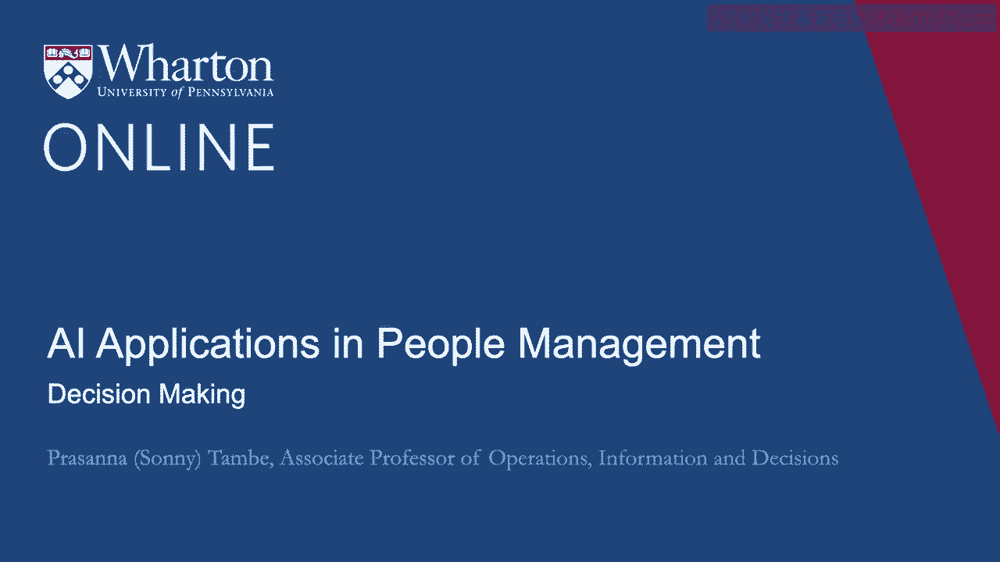
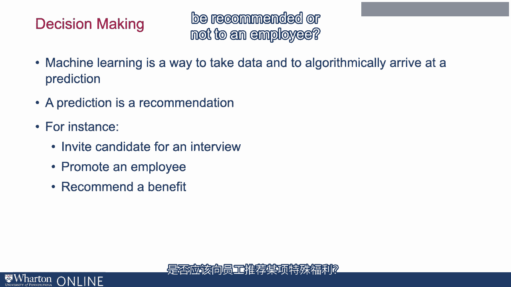
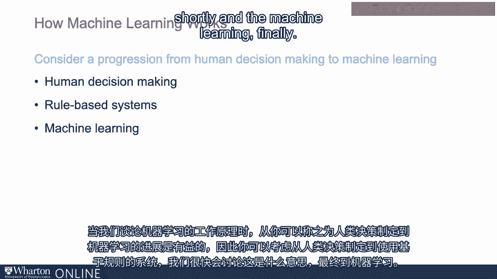
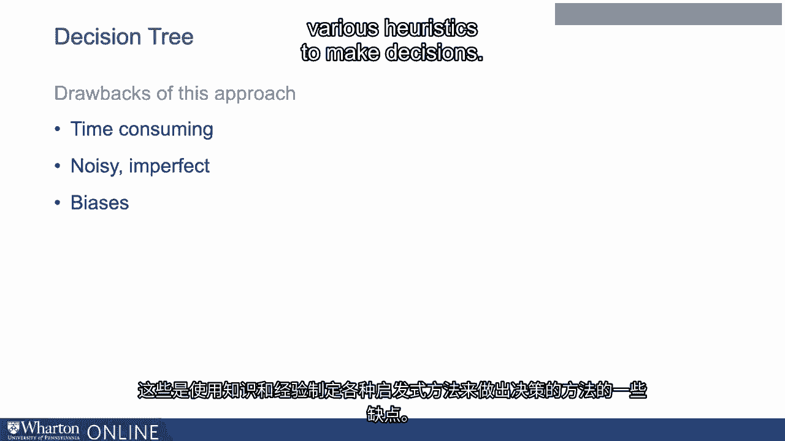

# 66：决策过程与机器学习简介 🧠

在本节课中，我们将学习决策过程如何从人类判断演变为机器学习。我们将探讨人类决策的启发式方法、其局限性，并初步了解基于规则的系统如何作为迈向机器学习的桥梁。

---

## 人类决策：启发式与决策树 🌳

上一节我们介绍了课程的整体目标，本节中我们来看看人类是如何做决策的。

当我们做决定时，会运用自己的知识和经验来制定启发式方法。这在信息不完善、需要快速决策的环境中尤为常见。例如，人力资源筛选员面对大量求职申请时，无法了解候选人的全部信息，因此会依赖过去积累的经验和知识来制定筛选标准。

一种常见的思考决策过程的方式是将其视为一棵**决策树**。在评估是否推进某个候选人时，我们可能会权衡多个因素。

以下是决策时可能考虑的一些因素：
*   这可能与候选人毕业的学校有关。
*   这可能与候选人之前的工作经历或雇主有关。
*   这可能与候选人具备的特定技能或文化契合度有关。

通过这些不同的信息分支，可以构建一棵决策树。例如，如果候选人毕业于某个特定学校的特定项目，我们可能推断他们受过良好训练，从而判断其适合某个组织角色。

然而，这种依赖个人经验的决策方法存在一些缺点。它非常耗时，且具有噪声和不完美性。个人的经验无法捕捉整体市场状态和所有申请者的信息。此外，申请者市场和有价值的信号会随时间变化，很难将所有新信息整合到决策中。同时，人类的决策总是存在潜在的偏见。

---

## 迈向自动化：基于规则的系统 ⚙️

上一节我们探讨了人类决策的优缺点，本节中我们来看看如何通过基于规则的系统开始解决其中一些问题。

基于规则的系统旨在将人类的启发式方法形式化和自动化，至少可以解决效率问题，并开始触及一致性和可扩展性的挑战。

感谢观看。

---

**本节课总结**：本节课我们一起学习了决策过程的演变。我们从依赖个人经验和启发式方法的人类决策开始，分析了其耗时、有噪声且可能存在偏见的局限性。接着，我们引出了基于规则的系统作为迈向更自动化、更一致决策的第一步。在接下来的课程中，我们将继续深入探讨机器学习的原理与应用。