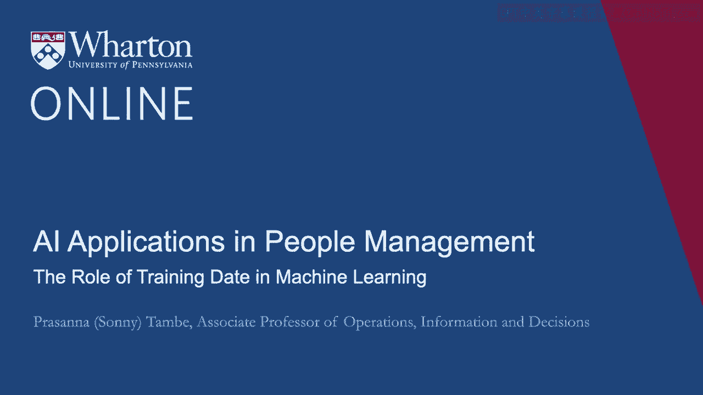
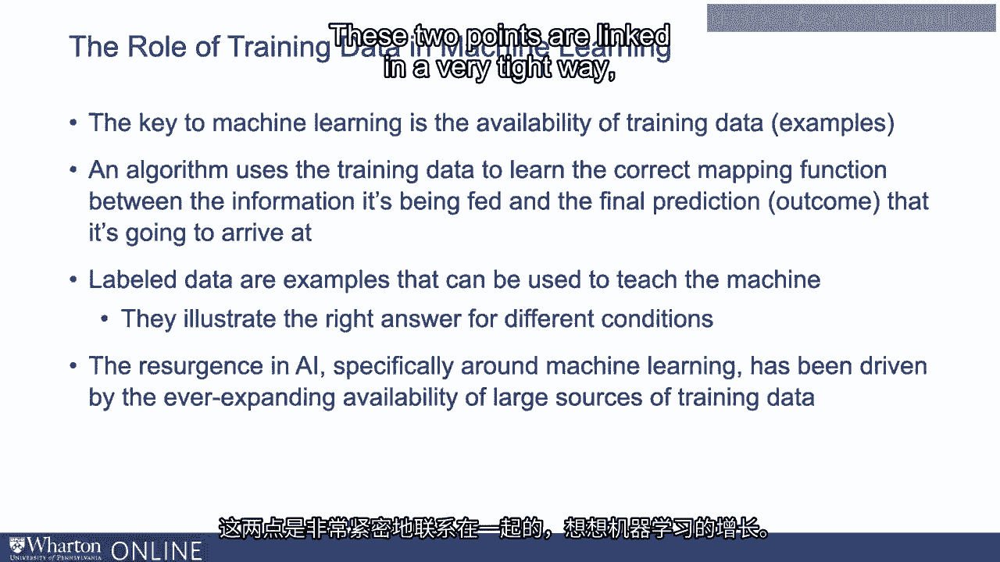
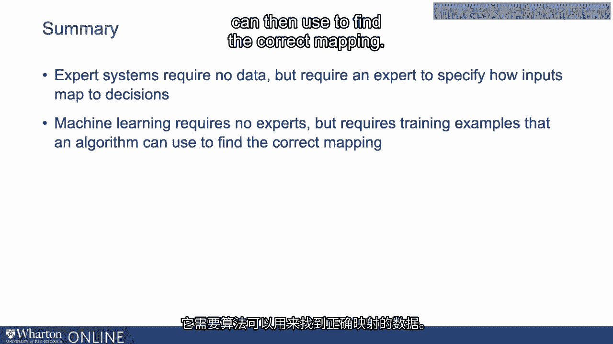

# 69：训练数据在机器学习中的角色 📚

在本节课中，我们将要学习训练数据在机器学习系统中的核心作用。我们将了解什么是训练数据，它从何而来，以及它如何使算法学会做出预测或决策。

---

## 什么是训练数据？🤔

开发机器学习系统的关键在于能够为算法提供示例，算法可以从这些示例中学习。这些示例被称为**训练数据**。

一个算法利用这些训练数据来学习你所需的正确映射函数。这个映射函数可以理解为在输入的信息与最终预测之间建立联系。我们称之为**标记数据**的这些示例，就是可以用来“教授”机器的示例。你可以把它们看作是为不同案例条件提供正确答案的示例。

---

## 训练数据的来源 📂

上一节我们介绍了训练数据的概念，本节中我们来看看训练数据通常从哪里获得。机器学习近年的成功，很大程度上得益于大量、多样化的训练数据变得更容易获取。

以下是训练数据的主要来源：

*   **档案数据**：这是最常见的数据来源，指的是企业拥有的历史数据库。例如，公司内部关于价格、市场营销、会计、人力资源等的大量历史信息，都可以用来训练机器学习系统。
*   **人工生成数据**：即使没有现成的历史数据，你也可以生成训练数据。例如，你可以让公司内部人员根据一组申请者数据集，人工做出决策，目的就是为了创造那些用于指导机器学习算法的标记示例。
*   **外包标注平台**：你也可以将这些数据标注工作外包给专门的平台。这些平台可以接受你的信息，并为你进行数据标注或做出决策，从而生成可用的训练数据。

---

## 训练数据的工作流程示例：医疗影像诊断 🏥

为了将训练数据的作用放入具体的工作流程中，让我们以医疗影像诊断为例。这是人工智能和机器学习取得重大突破的领域之一。

一些现代机器学习系统可以查看医疗图像（如X光片），并预测患者是否患有某种疾病。这对医生和患者都具有巨大的潜在价值。

在这个机器学习工作流中，你需要大量的数据和许多图像，以及医生历史上根据这些图像对患者做出的诊断决策记录。

如果你将这些数据（图像本身以及放射科医生对应的诊断决策）输入到机器学习系统中，这就是算法模仿决策所需的一切。算法不需要学习任何医学知识，也不需要理解医生在图像中寻找什么。它只需要一个包含成千上万张图像及其对应诊断结果的数据集。

机器学习算法可以完成其余的工作，学习图像数据与应做出何种决策之间的正确映射。**公式上，这可以表示为学习一个函数 `f(图像) -> 诊断`**。

---

## 训练数据与专家系统的对比 ⚖️

简单总结一下最后几点，我们可以对比机器学习与传统专家系统对数据的需求：

*   **专家系统（基于规则的系统）不需要大量数据**。它们需要人类专家来指定人们应该如何思考并做出决策，然后由开发者将这些规则转化为代码。
*   **机器学习系统不需要预先定义的专家规则，但确实需要由专家生成的示例数据**。它需要算法可以用来找到正确映射的数据。

正是训练数据的可获取性，推动了机器学习能够被应用到如此多的场景中，这也是当前人工智能经济如此重视数据的原因。

---

本节课中我们一起学习了训练数据的核心角色。我们明白了训练数据是机器学习算法的“教材”，它来源于历史档案、人工生成或专业标注。通过医疗影像诊断的例子，我们看到了数据如何让算法学会复杂的映射关系。最后，我们对比了依赖数据的机器学习系统与依赖规则的专家系统的根本区别。理解训练数据，是理解机器学习如何工作的第一步。