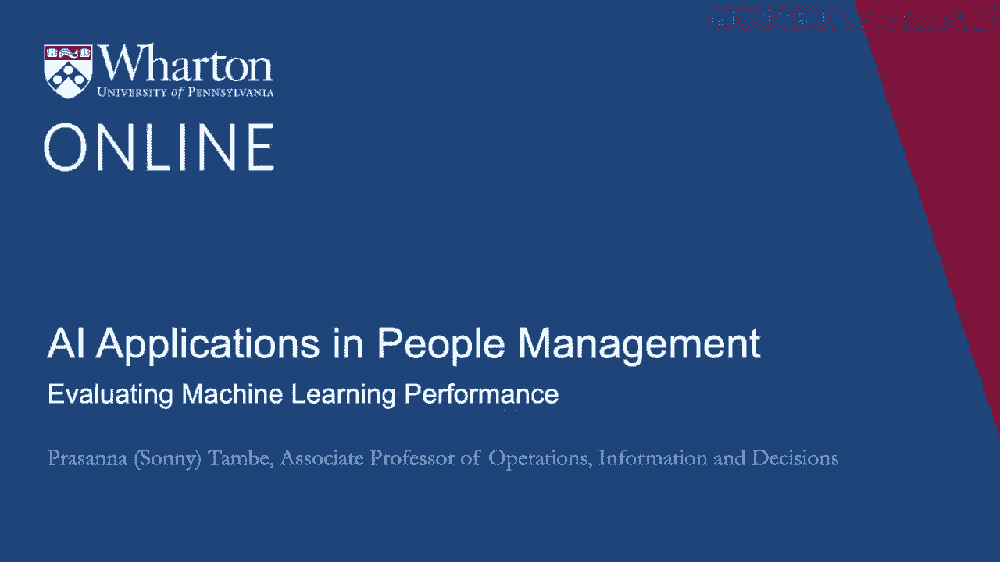
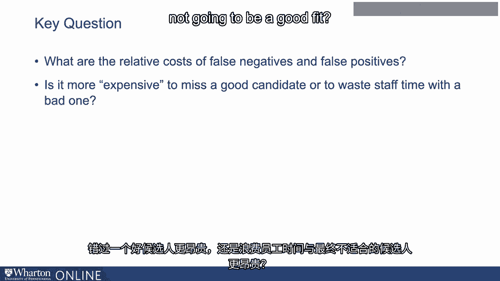

# 71：机器学习性能评估入门 📊

在本节课中，我们将学习如何评估机器学习模型的性能。理解不同的性能指标至关重要，因为预测模型总是服务于具体的商业目标，而不同的错误类型（例如，错误地推荐一个候选人，或错误地拒绝一个候选人）会带来不同的成本和后果。我们将介绍几个核心指标，并解释为何需要根据具体场景选择合适的评估标准。

## 为何需要多种性能指标？🤔

上一节我们提到了评估性能的重要性，本节中我们来看看为什么会有这么多不同的指标。根本原因在于，机器学习预测总是嵌入在特定的商业背景中。不同的错误类型（例如“假阳性”或“假阴性”）具有不同的成本和收益。因此，我们不仅仅是在优化单一的“正确率”，而是需要根据业务需求，权衡并优先考虑避免某些特定类型的错误。

以下是两个具体的商业场景示例，用以说明为何评估标准需要调整：

*   **场景一：争夺稀缺人才**：假设我们有一个算法，用于筛选简历并推荐候选人进入面试。在人才紧缺的市场中，我们的首要目标是**绝不漏掉任何一个潜在的优秀候选人**。即使这意味着需要多面试一些最终并不合适的候选人（即容忍一些“假阳性”），我们也要确保抓住所有机会（即尽量减少“假阴性”）。

*   **场景二：节约高成本面试**：相反，如果该职位申请者众多，但公司内部面试官的时间成本极高。此时，我们的目标就变成了**绝不浪费面试官的时间在明显不合适的候选人身上**。我们希望确保算法不会错误地将一个平庸的候选人标记为强力候选人（即尽量减少“假阳性”），即使这可能意味着偶尔会错过一个合适的人选（即容忍一些“假阴性”）。

由此可见，在不同的业务目标下，我们需要优化和权衡的方向是不同的。这直接引出了我们对不同性能指标的定义和关注。

## 核心性能指标解析 🎯

理解了业务背景的重要性后，我们来具体看看几个常用的性能指标。它们都是从**混淆矩阵**（Confusion Matrix）这一基本概念衍生出来的。混淆矩阵是一个2x2的表格，总结了模型预测结果与实际结果的四种情况：

*   **真正例**：实际为真，预测也为真。
*   **假正例**：实际为假，预测为真。
*   **假反例**：实际为真，预测为假。
*   **真反例**：实际为假，预测也为假。

基于这四种情况，我们可以定义多个指标：

1.  **准确率**：模型预测正确的总体比例。
    `准确率 = (真正例 + 真反例) / 总样本数`

2.  **精确度**：在所有被模型预测为“真”的样本中，实际为“真”的比例。它关注的是**预测结果的准确性**。在场景二中，我们希望精确度越高越好，以减少浪费。
    `精确度 = 真正例 / (真正例 + 假正例)`

3.  **召回率**：在所有实际为“真”的样本中，被模型成功预测出来的比例。它关注的是**找出所有正例的能力**。在场景一中，我们希望召回率越高越好，以避免遗漏。
    `召回率 = 真正例 / (真正例 + 假反例)`

4.  **特异性**：在所有实际为“假”的样本中，被模型正确预测为“假”的比例。它和召回率是互补的。
    `特异性 = 真反例 / (真反例 + 假正例)`

## 权衡的艺术：精确度 vs. 召回率 ⚖️

精确度和召回率通常是一对需要权衡的指标。提高精确度（更严格，减少误报）往往会降低召回率（可能漏掉一些正例）；反之，提高召回率（更宽松，减少漏报）则往往会降低精确度（引入更多误报）。

这种权衡关系被称为 **精确度-召回率权衡**。在构建和调整模型时，我们需要根据业务背景中“假阳性”和“假阴性”错误的相对成本，来决定是偏向高精确度还是高召回率。

*   在**医疗诊断（如癌症筛查）**中，漏诊（假阴性）的成本极高，因此我们会优先保证高召回率，即使这会增加一些误诊（假阳性）的代价。
*   在**垃圾邮件过滤**中，将正常邮件误判为垃圾邮件（假阳性）的代价很大，因此我们会优先保证高精确度，即使可能让少量垃圾邮件进入收件箱（假阴性）。

## 总结与展望 📝

本节课中我们一起学习了机器学习性能评估的基础知识。我们明白了不能只依赖单一的准确率指标，因为不同的业务场景对错误的容忍度不同。我们介绍了**准确率**、**精确度**、**召回率**和**特异性**这几个核心指标，并重点探讨了**精确度与召回率之间的权衡关系**，这是在实际应用中调整模型的关键。

记住，选择哪个指标作为优化目标，取决于你的业务需求：**避免漏掉重要项目（高召回率）还是避免误判（高精确度）**？在接下来的课程中，我们将通过一个端到端的示例，来具体演示如何应用这些概念来评估和选择一个合适的模型。

感谢学习，我们下节课再见。