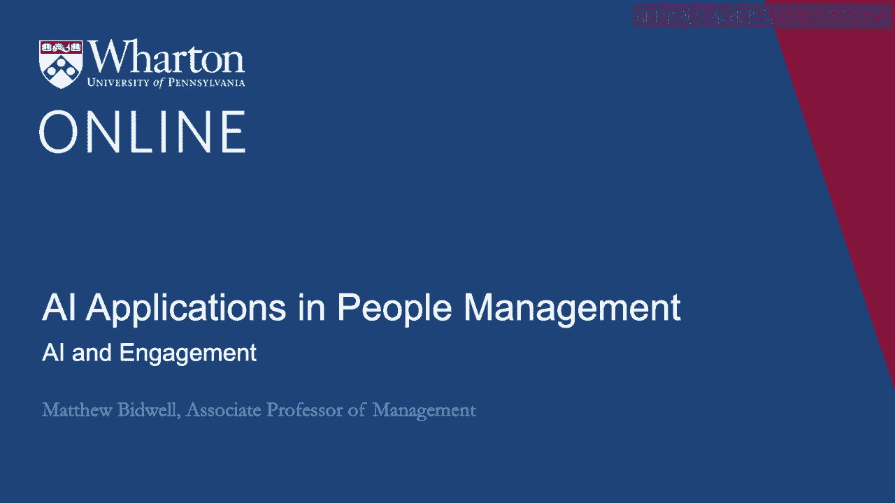
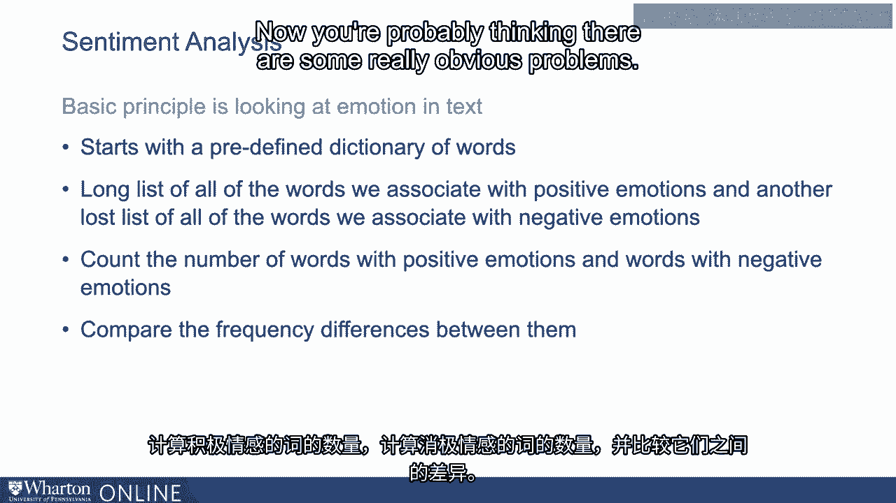
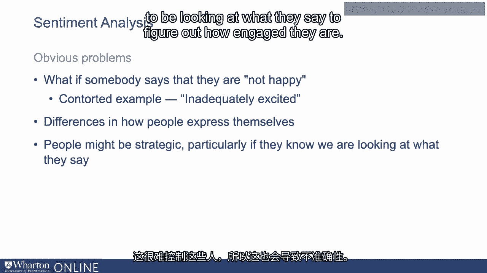
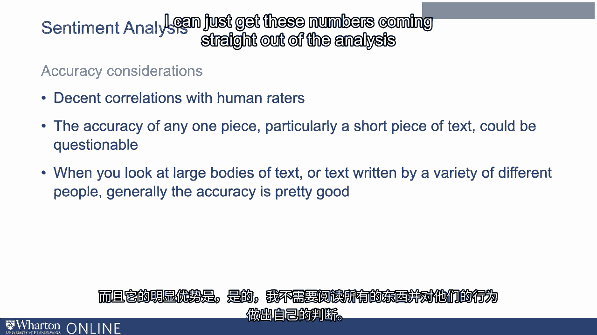
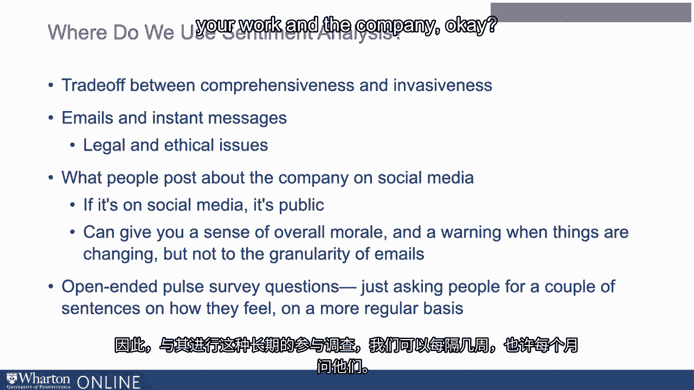

# 74：AI与员工参与度 📊

在本节课中，我们将学习如何利用人工智能，特别是机器学习的两种方法——情感分析与主题建模，来系统性地衡量和提升员工的参与度。我们将探讨其工作原理、应用场景以及相关的权衡考量。

---

## 概述

公司非常关注员工的参与度，因为他们认为参与度更高的员工更有可能更有动力、努力工作、表现更好，也更有可能留在公司。因此，测量员工参与度一直是管理中的一个重要方面。传统上，组织通过年度调查等方式来实现这一目标。如今，机器学习提供了新的可能性。

上一节我们介绍了测量员工参与度的传统方式，本节中我们来看看机器学习如何介入这一领域。

---

## 机器学习如何评估参与度？

为了理解这些算法如何运作，假设你是一名经理，想要评估每位下属的参与度，但不使用调查。你会怎么做？

最明显的方法是倾听他们说话。他们是否抱怨很多？他们是否说工作有趣并对此感到满意？还是他们谈论的大部分内容是关于工作的缺点？仅仅通过追踪这些，你就能初步了解员工的参与情况。

事实证明，这些事情是机器学习非常擅长的。我们将讨论使用机器学习，以系统的方式研究员工所说的内容。具体将探讨两种方法：第一个是**情感分析**，第二个是**主题建模**。

---

## 方法一：情感分析 😊😞

情感分析的基本原理是处理任何文本，并尝试分析该文本的情感内容。它判断文字是在表达快乐、多愁善感还是其他情绪。

在考虑计算机如何做之前，假设你需要训练一个朋友去做这件事。你收集了一大堆员工对他们工作的描述，希望朋友告诉你有多少人对工作满意，以及多少人感到疏离。但假设你的朋友完全没有情商，在没有明确指导的情况下，他们会觉得很难做到。

你最终可能会告诉他们这样做：查看描述情感的所有词汇。一些词汇与积极情绪有关（如“快乐”、“兴奋”），另一些则是负面的（如“沮丧”、“失望”）。我们可以直接统计这些词语的数量，然后比较它们的频率。如果人们使用了更多快乐的词汇（如“兴奋”、“投入”或“非常激动”），那么我们可以推断他们感到参与其中。

这就是情感分析的基础。它的工作原理是从一个预定义的词汇表开始。算法有一长串与积极情绪关联的词汇，以及另一长串与负面情绪关联的词汇。对于任何一段文本，它只会统计积极情绪词汇和负面情绪词汇的数量，并计算它们之间的差异。

用公式化的方式描述，可以简化为：
`情感得分 = (积极词汇数量) - (负面词汇数量)`

然而，这种做法存在一些明显的问题。例如，如何处理否定句（如“不快乐”）？通常，这些算法会足够复杂，在否定词（如“不”）出现时，要么忽略后续词汇，要么反转其意义。但这并不完美，可能会出现误判。

此外，人们的表达方式存在差异。例如，英国人说“工作很好”可能表示非常兴奋，而美国人说同样的话可能只是表示“还不错”。人与人之间的表达习惯也不同，有些人总是充满活力，这会导致分析不准确。

第三，结合调查来看，我们可以想象人们可能会采取策略性表达。特别是如果他们知道我们将会分析他们的话来推断其参与度，问题可能就变成了“我希望人们认为我有多投入”，而不是“我实际有多投入”。

尽管存在这些问题，人们已经尝试验证这些类型的分析。使用算法对文本情感进行编码，然后与人类评估者的判断进行比较。结果显示，计算机的分析与人类的判断之间存在相当不错的相关性。对于单段较短的文本，可能会有各种错误，但当你查看大量文本时，通过这些方法获得的准确性通常相当不错。

情感分析的明显优势是，管理者不需要阅读所有内容并自行整理判断，可以直接从计算机的分析中获取数据。

---

## 情感分析的应用与权衡

情感分析只是一种对文本进行情感编码的工具。一个显而易见的问题是：我们计划用什么文本来理解员工的参与度？

这可能是他们写的任何东西，但我们该去哪里找呢？在考虑应用场景时，存在一种权衡：在**全面性**和**侵入感**之间。

如果我想知道人们是否兴奋，最好的办法可能是查看他们的电子邮件和即时消息。在组织内部，我们通过电子方式进行大量交流，所有数据都在这里。我们可以轻松地对人们所写的所有内容进行情感分析，以理解他们的兴奋程度、日常变化、哪些群体参与度更高等。

市面上已有一些工具用于分析Slack消息等。但我们应该这样做吗？从法律角度看，在美国，对工作邮件没有隐私期望，所以可能没问题。但从伦理角度看，在某些组织中，这可能被视为对隐私的重大侵犯。一旦你开始深入了解人们在这个层面上所写的内容，确保人们理解你对他们数据的处理方式并感到舒适，对于保持**信任**至关重要。因此，是否这样做可能因组织而异。

我们还可以用情感分析做其他事情。例如，分析人们在社交媒体上发布的关于公司的内容。如果内容在社交媒体上，从定义上来说就是公开的。因此，查看人们对公司的帖子可以让你对整体士气有一个不错的感觉。显然，这样获得的信息变少了，没有那种跨群体和时间的细粒度数据，但这是一件值得关注的事情。

另一个常见的应用场景是直接询问人们的感受。与其进行长期的参与度调查，我们可以每隔几周或每个月请人们写下几句关于对工作和公司感受的开放文本。这段开放文本对他们来说更简单，也为我们提供了更丰富的信息。我们可以做的第一件事就是对所有回复进行快速的情感编码，以了解整体满意度。

这段文字还有一个好处：它不仅适用于情感分析，询问人们的感受也给了我们更多杠杆去尝试弄清楚他们为什么会有这样的感觉。这其中有哪些主题？缺点是现在我们可能会有成千上万条这样的句子，需要从中提取主题。因此，这引出了我想讨论的第二个工具。

---

## 方法二：主题建模 🗂️

主题建模是一种机器学习技术，用于从大量文本集合中发现抽象“主题”。它可以帮助我们从成千上万的员工反馈中，自动识别出大家频繁讨论的核心议题，例如“薪酬福利”、“工作压力”、“团队合作”或“职业发展”。

通过主题建模，管理者可以超越简单的情感正负，深入理解影响员工参与度的具体驱动因素和痛点，从而采取更有针对性的改进措施。

---

## 总结

本节课中，我们一起学习了如何利用人工智能评估员工参与度。我们探讨了两种核心的机器学习方法：

1.  **情感分析**：通过分析文本中的情感词汇来量化情绪倾向，其核心是计算`积极词汇数量 - 负面词汇数量`。这种方法高效，但需注意表达差异和隐私伦理的权衡。
2.  **主题建模**：用于从大量文本中自动提取和归纳核心讨论主题，帮助深入理解影响参与度的具体原因。

这两种工具可以单独或结合使用，为管理者提供从宏观情绪把握到微观原因洞察的全方位视角，从而更科学、更高效地提升组织的人才管理效能。