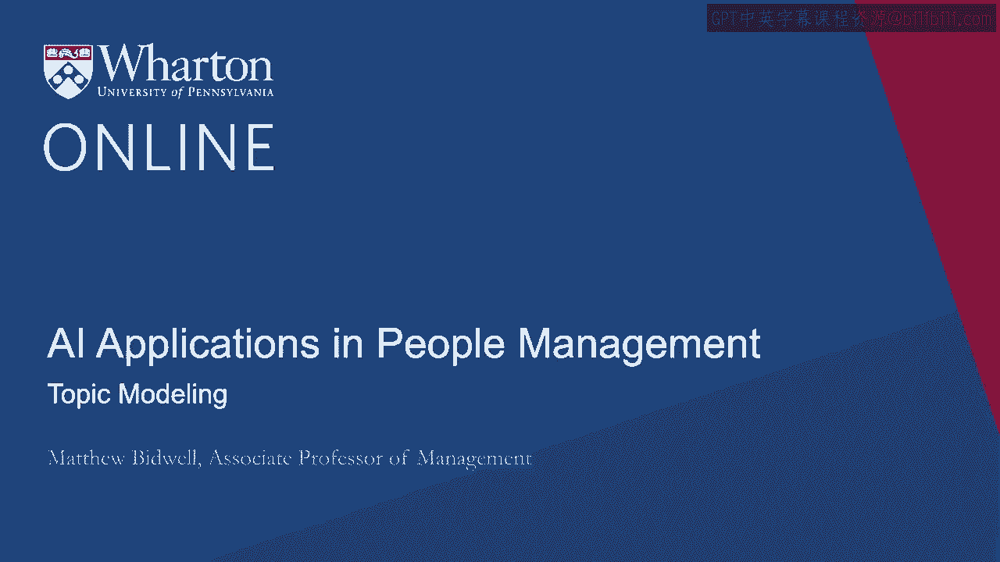
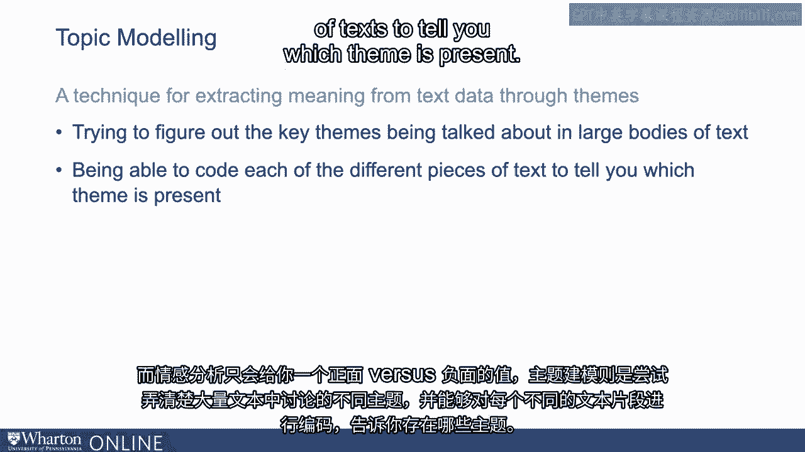
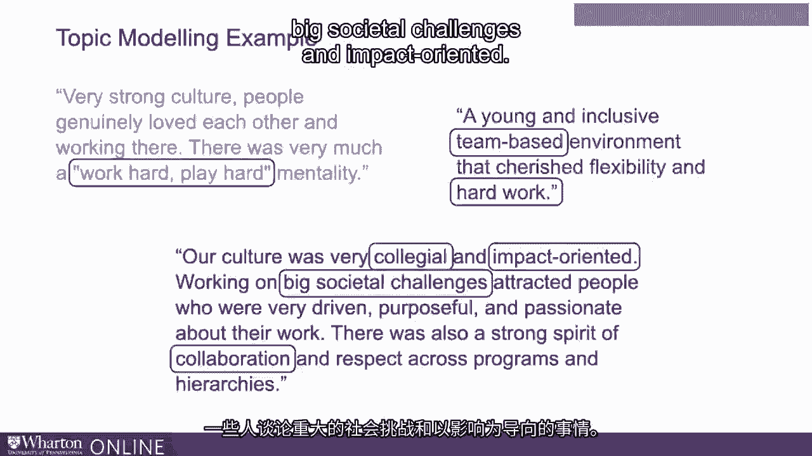
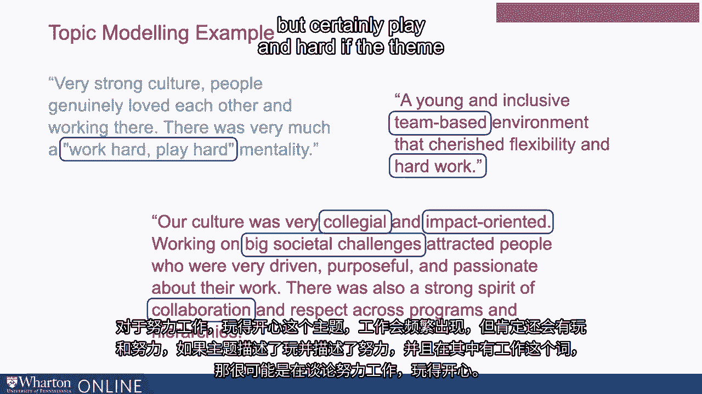
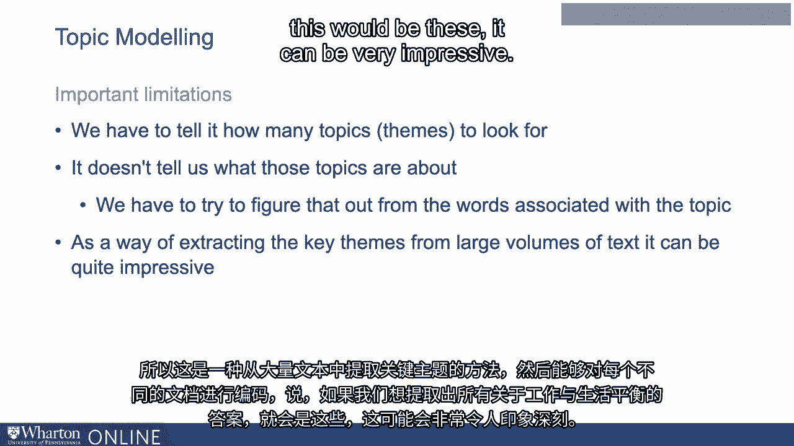
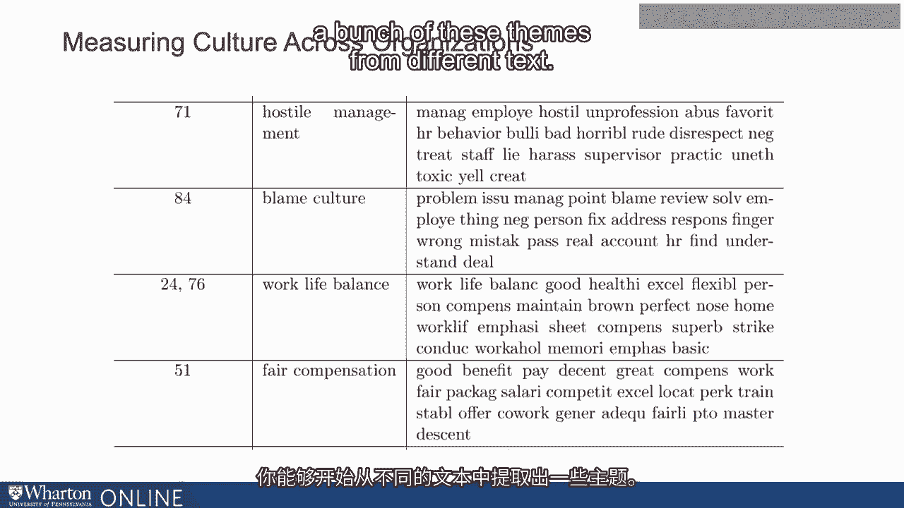
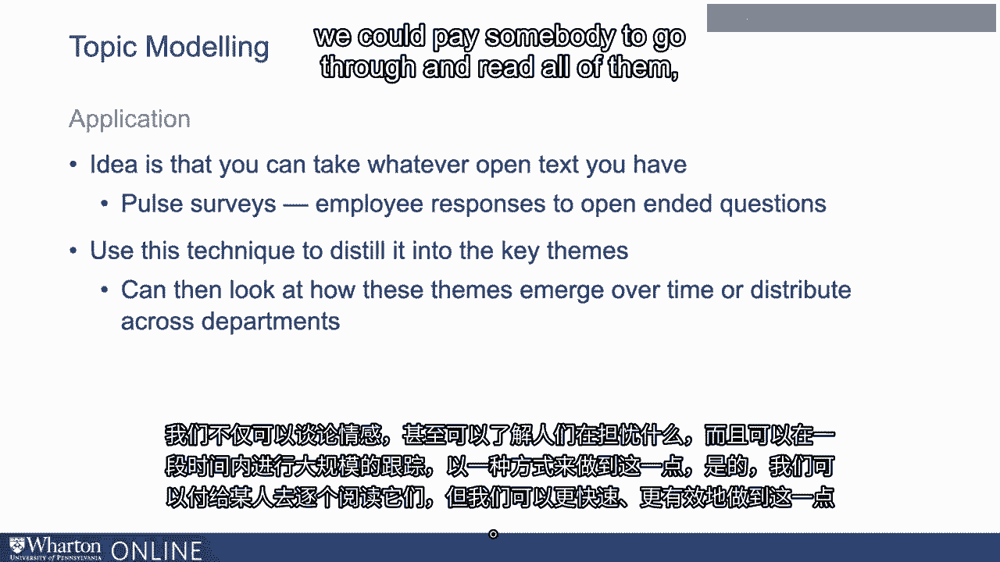

# 75：主题建模 📚

在本节课中，我们将要学习一种名为“主题建模”的文本分析技术。主题建模能够帮助我们从大量文本数据中自动识别和提取出核心主题，从而理解文本集合中讨论的主要内容。

---

## 什么是主题建模？🤔

上一节我们介绍了情感分析，它主要判断文本的积极或消极倾向。主题建模是另一种从文本中提取意义的技术。它的目标是识别文本中正在讨论的不同主题。

情感分析仅提供一种价值判断（积极或消极）。主题建模则试图弄清楚文本中讨论的不同主题。对于大量文本，它能对每个文本片段进行编码，并告诉你其中存在哪些主题。

---

## 主题建模的基本思想 💡

为了更好地理解，我们可以设想一个场景：你正在向一位情商为零的学者朋友解释，如何从一堆文本中提取关键主题。你会怎么做？

实际上，我们可以通过一个例子来理解。假设我们收集了学生们对其所在组织文化的简短描述。我们的任务是找出人们描述组织文化时的主要维度，即经常出现的主题。

我们可以通读这些描述，观察是否有共同的主题浮现。例如：
*   有几个描述明确提到了“努力工作，尽情玩乐”。
*   另一个经常被提及的主题是“同事关系”，比如团队合作、协作等。
*   还有人谈论重大的社会挑战，这可以归为“影响力导向”。

通过这种方式，我们开始看到一些主题浮现出来。

---

## 如何让计算机识别主题？💻

上一节我们通过人工阅读识别了主题。但对于成百上千份文本，我们需要一种自动化的方法。我们可以这样告诉计算机：

对于每一个我们识别出的主题，我们可以建立一个与之相关的小型词汇字典。

*   对于 **“努力工作，尽情玩乐”** 主题，相关的词汇可能包括：`工作`、`努力`、`玩乐`、`游戏`。
*   对于 **“合作”** 主题，相关的词汇可能包括：`协作`、`合作`、`团队`、`同事关系`。

这就是主题建模的基本思想。它假设：
1.  每个文档（如一段文化描述）只包含有限数量的主题。
2.  整个文本集合中，存在的主题总数是较少的。
3.  每个主题都与一组特定的词汇相关联。

计算机看到的是所有文本和词汇。它的任务是推断出：
*   文档与主题之间的关联（每篇文档涉及哪些主题）。
*   主题与词汇之间的关联（每个主题包含哪些词汇）。

它通过分析词汇在文档中的分布，找出最有可能产生这种分布的潜在主题结构。这个过程可以用以下公式化的思想来描述：

**主题建模的核心是发现文档-主题分布和主题-词汇分布，使得观察到的文档-词汇矩阵最有可能出现。**

---

## 主题建模的局限性 ⚠️

上一节我们介绍了主题建模的工作原理，但它存在一些重要的局限性。

首先，计算机本身并不知道主题是什么，它只是进行推断。更重要的是，它无法自动确定文本集合中到底存在多少个主题。因此，我们通常需要预先告诉算法要寻找的主题数量（例如，假设有15种描述文化的方式）。

其次，算法输出的是与每个主题相关联的词汇列表，但不会直接告诉我们这个主题“关于什么”。我们需要人工查看这些词汇，然后推断出该主题的实际含义（例如，看到`团队`、`协作`等词，我们推断主题是“合作”）。

尽管有这些局限，主题建模在处理大型文档集时通常效果良好。它是一种从海量文本中提取关键主题，并对文档进行自动编码的有效方法。

---

## 实际应用案例 🌟

以下是一个来自斯坦福和伯克利研究的优秀案例。研究人员利用Glassdoor网站（员工可匿名评价雇主文化的平台）上的海量评论，提取了所有包含“文化”一词的句子，并运行主题建模来理解人们谈论文化的具体维度。

他们设定了大约100个主题，并得到了每个主题的相关词汇。例如：

*   **主题示例1：敌对管理**
    *   **相关词汇**：`管理层`、`员工`、`敌对`、`不专业`、`恶劣`、`偏袒`、`欺凌`、`糟糕`、`可怕`、`粗鲁`、`不尊重`
*   **主题示例2：工作与生活平衡**
    *   **相关词汇**：`工作与生活平衡`、`良好`、`健康`、`灵活`、`个人`

通过这种方式，研究者能够从不同文本中系统地提取出一系列明确的主题。

---

## 在员工参与度调查中的应用 📊

我们可以在员工脉搏调查或其他简短问答中应用主题建模。例如，询问员工：“你喜欢和不喜欢什么？你希望我们知道什么？”

从一个组织收集到成千上万条简短回答后，通过运行主题建模，我们可以：
*   **快速识别**这成千上万条回答中主要讨论哪些主题。
*   **量化分析**每个主题出现的频率。
*   **追踪变化**观察不同时期主题流行度的变化趋势。
*   **对比分析**研究哪些主题在不同部门中更为常见。

这样，我们不仅能分析整体情感倾向，还能深入、可扩展地了解员工具体关注和担忧的事项，其效率远高于人工逐一阅读。

---

## 总结与展望 🚀

本节课中我们一起学习了主题建模技术。

当涉及跟踪员工参与度时，机器学习开辟了有趣的可能性。通过情感分析，我们可以快速评估文本的整体积极性。而通过主题建模，我们可以更进一步，在员工提供开放文本反馈时，高效地分析文本、提取关键主题、量化常见内容并追踪其变化。

虽然这些应用仍处于早期阶段，但已有许多公司开始采用主题建模等技术分析文本。它是对传统繁琐的年度调查的一个有力补充，未来有望在跟踪和提升组织参与度方面成为非常有价值的工具。

---