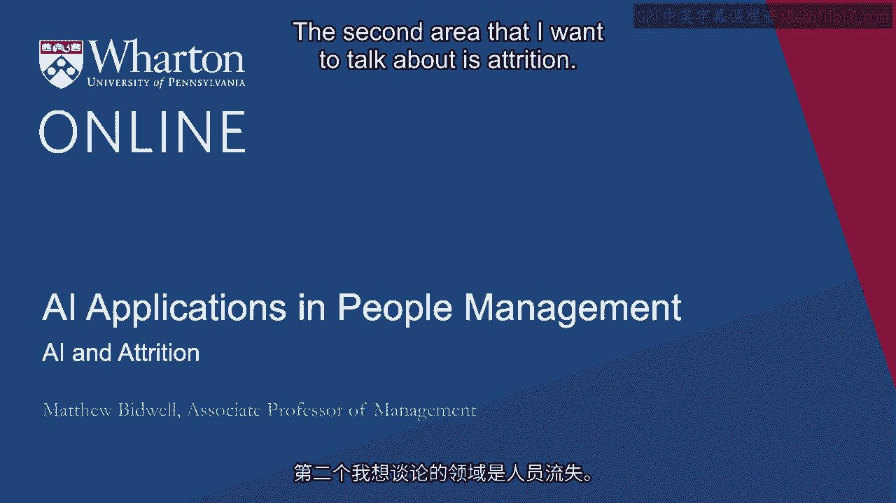
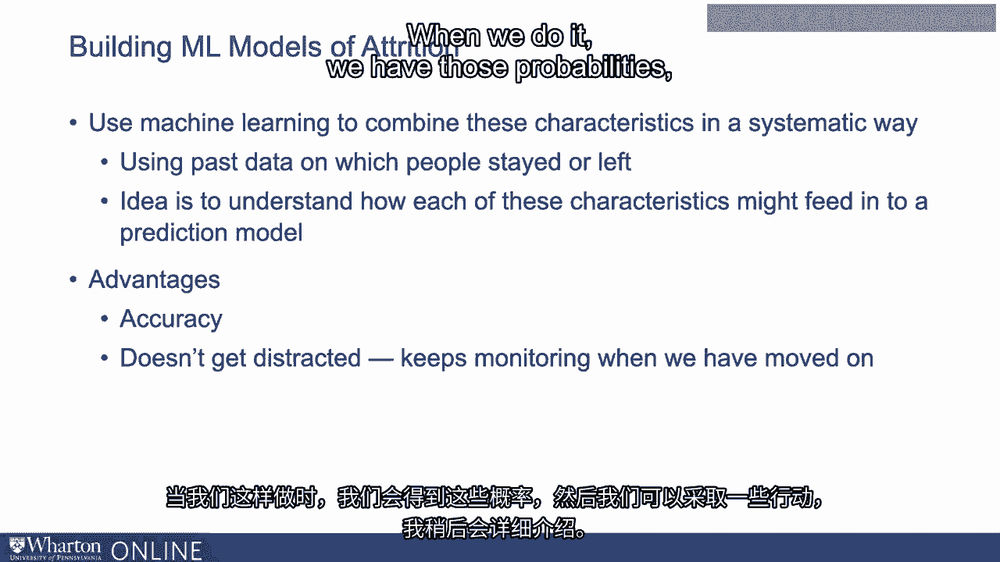

# 76：AI与员工流失分析 🧠

在本节课中，我们将探讨人工智能，特别是机器学习，如何应用于分析和管理员工流失。我们将了解其核心原理、优势以及实际应用方式。

---

上一节我们介绍了AI在人力资源领域的应用背景，本节中我们来看看它在员工流失分析中的具体作用。

组织通常非常关注员工流失率，因为人员流失的成本很高。为了理解员工为何离开并采取应对措施，许多组织已经开始使用机器学习工具。这些工具本质上是在系统化地完成人类管理者也会做的分析工作，但效率和准确性更高。

## 核心分析逻辑

机器学习模型预测员工流失的逻辑，与一位经验丰富的管理者思考“谁可能会离职”的过程相似。以下是模型通常会考虑的几个关键特征：

以下是模型在预测时可能参考的一些个人信息维度：
*   **年龄**：年轻员工可能因探索职业方向或继续深造而更频繁地换工作。
*   **工作历史**：过去频繁更换公司的员工，未来再次离职的可能性更高。
*   **当前职位**：某些角色（如枯燥的或技能需求旺盛的岗位）本身就有更高的流失率。
*   **工作投入度**：任何显示员工不投入或不满意的信号都是重要指标。
*   **绩效与社交**：工作表现是否顺利、性格内向程度等因素也可能被纳入考量。

## 机器学习的优势

当我们使用机器学习时，核心工作就是将上述所有特征系统化地结合起来，并利用历史数据（包含这些特征以及员工最终是去是留的结果）进行训练。相较于依赖主管的主观猜测，机器学习模型带来了两大优势：

以下是机器学习在流失预测中的两个主要优势：
1.  **更高的准确性**：人类不擅长同时有效权衡多种复杂标准，而机器学习模型在此方面的表现通常远超人类。
2.  **持续性与自动化**：管理者可能会分心或只能定期（如每半年）评估一次。机器学习模型则可以持续运行，不断扫描数据，实时标记出有离职风险的员工。

## 模型的输出与应用

模型在分析后，会为每位员工计算一个**离职风险概率**。这个概率可以用以下公式化的方式理解：
`离职风险 = f(年龄， 工作历史， 职位， 投入度， 绩效， ...)`
其中，函数 `f` 是通过历史数据训练得到的机器学习模型。

基于这个风险评分，组织便可以主动采取干预措施，例如与高风险员工进行沟通、了解其需求或改善其工作条件，从而提前降低流失可能。

---

本节课中我们一起学习了机器学习如何应用于员工流失分析。我们了解到，其核心是系统化地分析多种个人与工作特征，并利用历史数据进行预测。相比传统方法，机器学习在预测准确性和持续监控方面具有显著优势，最终通过输出风险概率帮助组织实现更主动的人才保留管理。