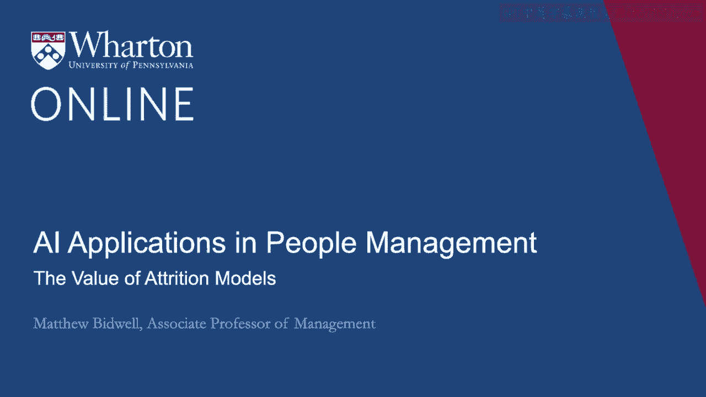
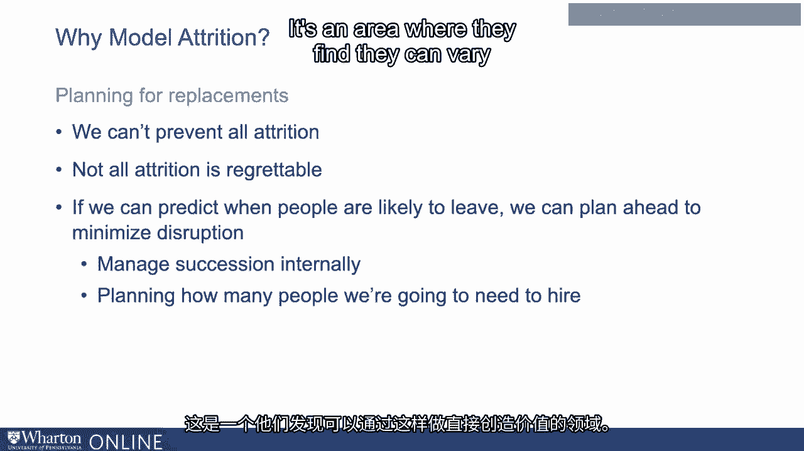

# 78：员工流失模型的价值 📊

在本节课中，我们将探讨构建员工流失模型的实际价值。我们将了解组织如何利用这些模型获得洞察、采取行动并进行规划，从而有效管理人才流失。

---

## 🔍 洞察流失驱动因素

上一节我们提到了构建流失模型的可能性。本节中，我们来看看模型如何帮助我们更深入地理解影响员工流失的因素。通过分析哪些因素能真正预测离职，我们可以识别出组织可以改进的领域。

以下是模型可能揭示的一些具体洞察示例：

*   一个组织发现，经理是否在新员工入职第一周安排一对一会议，是预测该员工是否会长期留任的重要指标。未安排此类会议的经理，其下属的离职率更高。
*   另一个组织发现，当新员工入职时，如果有团队成员主动迎接并引导他们，其留任率会更高。相比之下，需要新员工自行寻找团队的，其离职风险更大。

这些发现促使组织更加重视新员工的入职引导体验，认识到早期阶段的举措对员工留存至关重要。

---

## 🎯 针对高风险员工采取行动

了解了流失的驱动因素后，我们来看看如何应用这些知识。如果我们能通过模型识别出有高离职风险的员工，就能更精准地投入资源，努力留住他们。

模型可以标记出离职概率高于平均水平的员工。针对这些高风险员工，管理者可以采取以下主动措施：

*   **进行留任面谈**：不同于离职后的面谈，留任面谈旨在提前了解员工的需求、顾虑以及对组织的看法，从而采取行动提升其留任意愿。
*   **实施干预计划**：例如，IBM公司结合流失模型，推行了让管理者主动与高风险员工协作以保留人才的项目。该公司声称，此类主动干预措施帮助他们节省了超过 **3亿美元** 的成本。

---

## 📈 为人员更替进行规划

尽管我们可以努力留住员工，但并非所有流失都能或都应该被阻止。有些员工的离开对组织而言是可以接受的。本节中，我们看看模型如何帮助组织为不可避免的人员变动做好准备。

如果我们能更准确地预测员工可能离职的时间，就可以提前进行规划，从而减少业务中断。

流失模型在规划方面的价值主要体现在：

*   **制定人员编制计划**：通过预测不同群体或部门的潜在离职人数，人力资源团队可以更精确地规划需要招聘多少新人。
*   **管理内部继任**：了解关键岗位员工的流失风险，有助于提前培养内部接班人，确保业务连续性。
*   **减少岗位空缺期**：提前预知离职，可以为招聘和交接争取更多时间，缩短职位空缺期。

---

## 💎 课程总结

本节课中，我们一起学习了员工流失模型的三大核心价值：

1.  **提供深度洞察**：揭示影响员工去留的关键因素，特别是入职初期体验的重要性。
2.  **支持主动干预**：通过识别高风险员工，使管理者能够采取针对性的留任措施，如留任面谈，从而直接创造商业价值（例如节省成本）。
3.  **赋能前瞻规划**：帮助组织预测离职规模，更好地进行人员编制、招聘和继任规划，以平稳应对人员流动。

许多组织发现，构建和应用员工流失模型是机器学习在人力资源领域最具价值的应用之一。