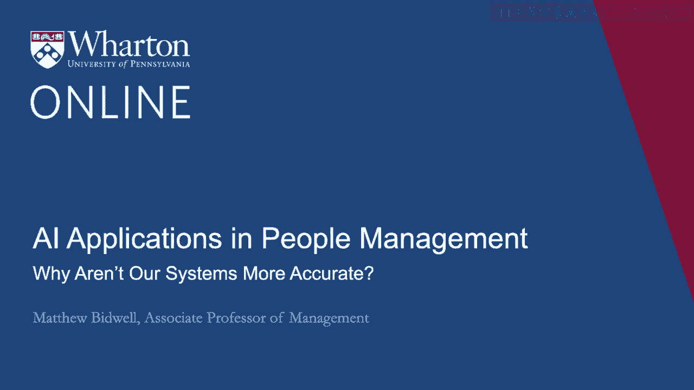
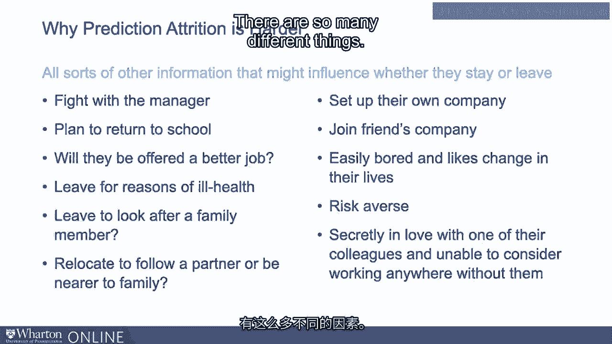
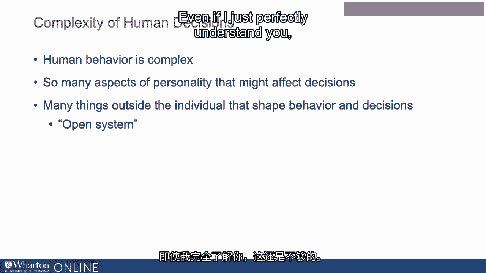

# 84：21_为何我们的系统不够准确 🎯



在本节课中，我们将探讨机器学习系统在预测复杂问题（如员工流失）时，为何难以达到像语音识别那样的高准确率。我们将通过对比不同任务的性质，分析数据完备性与预测准确性之间的关系。

---

上一节我们介绍了机器学习在语音识别等任务上的卓越表现，本节中我们来看看它在预测员工流失这类问题上为何面临挑战。

语音识别之所以能达到99%以上的准确率，是因为它处理的是一个**封闭系统**。当我说出一个词（例如“海龟”），计算机进行分类所需的所有信息——**音频数据**和**语言上下文**——在那一刻是完备的。

```python
# 语音识别任务可以简化为一个分类问题
输入：音频信号波形数据
输出：对应的文字类别（如“海龟”）
```

然而，预测员工是否会离职则是一个**开放系统**问题。要做出完全准确的预测，理论上我们需要掌握所有可能影响员工决策的内外部因素。

以下是影响员工流失的部分关键数据维度列表：

*   **人口统计信息**：年龄、性别等。
*   **职业信息**：在职时长、岗位、绩效评估。
*   **申请与社交数据**：申请的职位、社交媒体动态。

但是，即便我们收集了以上所有数据，这仍然不足以做出完美预测。因为还有许多我们无法测量或永远无法得知的关键因素在起作用。

以下是模型无法涵盖的部分关键变量列表：

*   **未来突发事件**：下个月是否会与经理争执？是否会收到更好的外部工作机会？
*   **个人计划与变故**：是否有未告知的深造计划？是否会因健康或家庭原因离职？
*   **个性与偶然因素**：个人是否喜新厌旧、厌恶风险？是否有隐秘的人际关系（如暗恋同事）影响去留？



人类行为极其复杂，受到无数个性层面和外部环境互动的影响。我们不仅需要理解个体，还需要理解个体与组织内其他人、以及外部所有机会的复杂互动网络。

```math
流失风险 = f(已知因素) + g(未知个性因素) + h(不可测外部事件) + ε
```



这种**信息的不完备性**和**系统的开放性**，使得在员工流失或招聘表现预测等复杂问题上，机器学习模型很难达到接近百分之百的准确率。

---


本节课中我们一起学习了机器学习在不同任务上准确性差异的原因。核心在于，语音识别等任务拥有分类所需的**完备信息**，而员工流失预测则是一个受无数**未知和不可测变量**影响的开放系统问题，这从根本上限制了预测模型能达到的最高准确度。理解这种局限性，对于合理设定预期和正确应用机器学习至关重要。