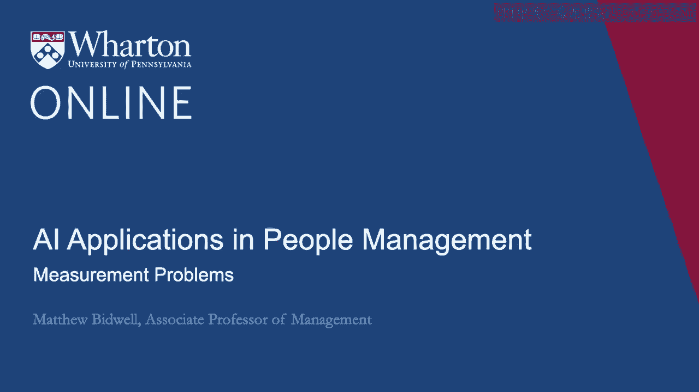
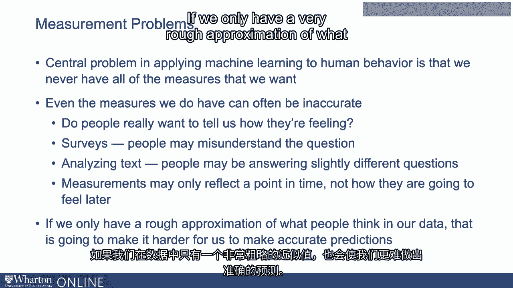
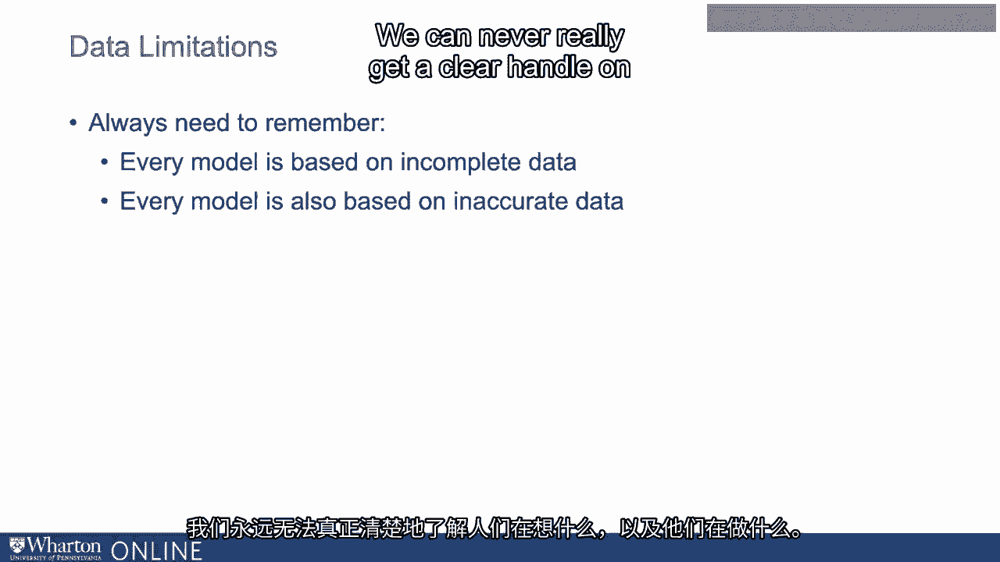

# 85：机器学习中的测量问题 📏

在本节课中，我们将要学习将机器学习应用于人类行为研究时，一个核心且普遍存在的挑战：**测量问题**。我们将探讨为什么我们难以获得理想的数据指标，以及即使获得了数据，这些指标为何常常不准确。理解这些局限性对于正确解读模型结果和保持谦逊的态度至关重要。

---

## 核心挑战：指标的缺失与不准确性

上一节我们介绍了课程的主题。本节中，我们来看看测量问题具体包含哪两个核心挑战。

在将机器学习应用于人类行为时，一个真正的核心问题是我们从来没有所有我们想要的指标。

但即便如此，我们还有第二个问题。这就是我们所拥有的指标往往可能是不准确的。

---

## 理解人类行为与心理状态的困难

当我们试图理解人们的表现、他们将如何行为、他们会做什么、他们在想什么、他们的态度时，他们的心理状态非常重要。我在评估参与感时谈了很多这个。

我试图强调的事情之一是，有很多有用的事情我们可以做，来真正开始理解他们的参与感。但所有这些方法都有缺陷。

以下是我们在测量时面临的一些具体问题：

*   **回答的策略性**：人们真的想告诉我们他们的感受吗？因此，人们可能非常有策略性。
*   **调查的误解**：如果你考虑调查，当我们调查人们时，他们可能会误解问题。
*   **文本分析的偏差**：如果你谈论分析文本，人们可能会回答稍微不同的问题。这可能会影响他们所描述的情感。

---

## 态度测量的不稳定性问题

当我们试图研究人们的态度时还有其他问题。我们真正想知道的是相对稳定的态度，例如当他们在普通日子里进来时，他们对工作的感受如何。

但每当我们衡量它时，我们都是在某一时刻进行测量。这可能无法反映他们明天的感受。

每当你做调查时也会有问题，有些人会以不同的方式填写。以下是两种常见的回答模式：

*   **极端化回答**：有些人喜欢填写极端值。一切都是一（这是糟糕的）或七（这是伟大的）。
*   **中庸化回答**：会有更多的人衡量一切都是三或四。

---

## 对机器学习模型的影响与启示

我们想要衡量的一些核心内容，我们总是用有误差的方式测量它。我们在调查中遇到这些问题，我们在情感分析上遇到了这些问题。不管怎样，我们试图了解这些态度。

所以如果我们在数据中只对人们的想法有一个非常粗略的估计，这也将使我们更难做出准确的预测。

因此使用这些模型，我们必须适度谦虚。它们可以非常有用。但我们总是必须记住两个关键事实：

1.  **模型基于不完整的数据**：`模型 = f(不完整数据)`。有很多关于人们的事情我们希望能够衡量，但我们就是无法做到。
2.  **模型基于不准确的数据**：`模型 = f(不准确数据)`。因此我们所有的衡量方式都比没有要好。但我们必须记住，它们总是嘈杂的指标。

我们从来无法真正清楚地掌握人们在想什么，他们在做什么。

---

## 总结

本节课中我们一起学习了机器学习应用于人类行为研究时的**测量问题**。我们认识到，由于**指标的缺失**和**现有指标的不准确性**，我们获得的数据往往是**不完整**和**有噪声**的。这源于人类回答的策略性、调查的局限性、态度的不稳定性等多种因素。因此，我们必须对基于此类数据构建的模型保持**谦逊**，理解其预测的局限性，并始终意识到我们无法完全清晰地掌握人类的复杂内心与行为。