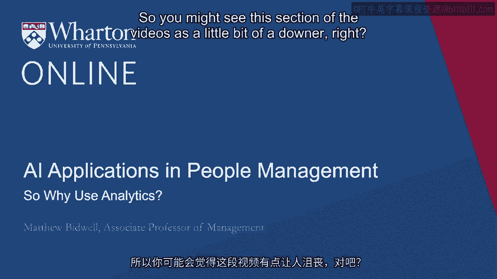
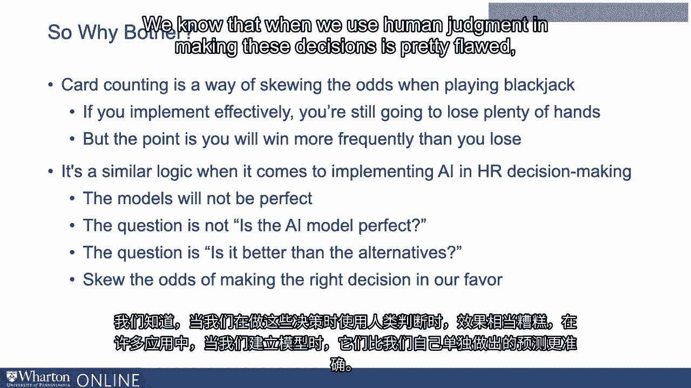
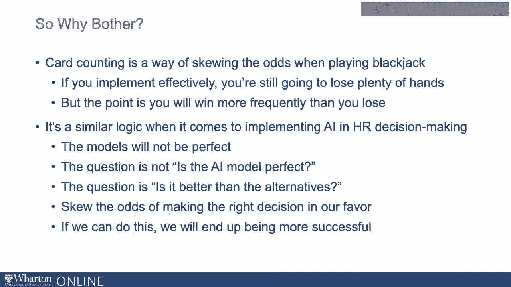
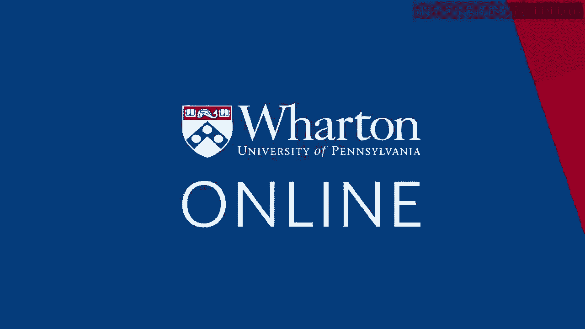

# 86：为什么在人力资源中使用分析？ 🤔



在本节课中，我们将探讨一个核心问题：既然人工智能模型在预测人力资源结果（如员工离职或绩效）时并不完美，我们为什么还要投入时间和资源去使用它们？我们将通过一个生动的比喻来理解其背后的逻辑。

你可能会觉得这部分内容有些消极。确实，我要说明的是，我们通常只能期待这些模型提供有限的准确性。


如果我们能解释30%到50%的离职率或绩效变化，就已经做得很好了。现在的问题是，我们是否在浪费时间，去思考如何应用人工智能于人力资源问题？答案是否定的。

## 从《点球成金》中获得的启示 🎬

上一节我们提到了模型的局限性，本节中我们来看看一个经典的例子，它改变了很多人对数据分析的看法。

我最喜欢的例子来自《点球成金》。这本书或电影是许多人人力资源分析工作的基础文本。它讲述了奥克兰运动家棒球队的故事，他们通过应用数据分析，而非传统的侦察技巧，来识别和雇佣合适的队员。

电影中有一个精彩时刻，主角（布拉德·皮特饰）说：“各位绅士，我们现在就像是在二十一点牌桌上的算牌者，我们要把赌场的赔率翻转过来。”这个比喻的核心观点非常重要。

## 算牌的比喻：理解“倾斜赔率” ♠️♥️♣️♦️

为了理解为什么“不完美”的模型仍有价值，让我们深入探讨算牌这个比喻。以下是算牌的基本原理：

算牌是一种在玩二十一点时获取优势的方法。玩家无法预知具体会得到什么牌，但通过追踪已发出的牌，可以估算牌堆中剩余牌的概率分布。

**核心公式**可以简化为：
```
优势 ≈ 对剩余牌堆组成的更准确估计
```
当牌堆中有利于玩家的牌（如10、J、Q、K、A）比例较高时，玩家获胜的概率就会增加。算牌者据此调整下注策略：在优势时下大注，在劣势时下小注或不下注。

关键在于，算牌者不需要每次都赢。他们只需要确保在长时间内，赢的次数比输的次数多，从而将整体的数学期望（赔率）向自己倾斜。

## 应用于人力资源决策 🧑💼

这个逻辑同样适用于人力资源中的人工智能决策。我们不需要模型完美无缺。

当我们使用模型辅助招聘或评估绩效时，会发生以下情况：
*   一些被预测为高绩效的员工可能实际表现不佳。
*   一些被模型拒绝的候选人可能原本会是优秀的员工。

我们需要问自己的核心问题不是：“AI模型完美吗？” 而是：“**它是否比我们现有的其他方法（如纯人力判断）更好？**”

我们知道，仅凭人类直觉做决策是存在缺陷的。



在许多应用中，我们构建的模型其预测能力优于不干预时的结果。虽然一些基于模型的决策会被证明是错误的，但错误决策的比例会比完全依赖人力判断时更低。


**核心思想**是：
```
目标 = 使做出正确决策的几率产生倾斜
```
如果我们能通过模型将做出正确雇佣、留任或晋升决策的几率哪怕只提高几个百分点，长期来看，组织将变得更加成功。这就是为什么投资构建并应用这些模型通常是值得的。

---

**本节课总结**：我们一起学习了为什么在人力资源中应用不完美的人工智能模型仍然具有价值。关键在于理解“倾斜赔率”的概念——我们不需要完美的预测，只需要比现有方法更好的预测。就像算牌一样，目标是在长期决策中提高整体成功率，从而为组织带来竞争优势。






