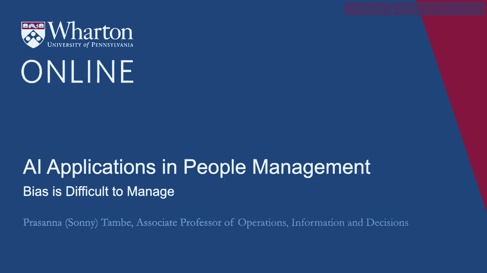
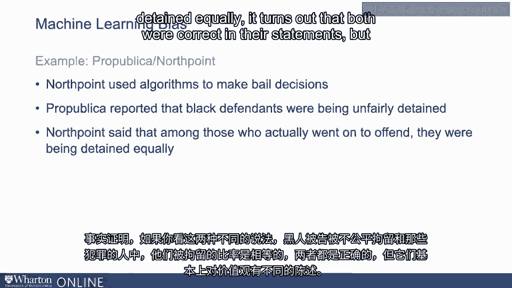
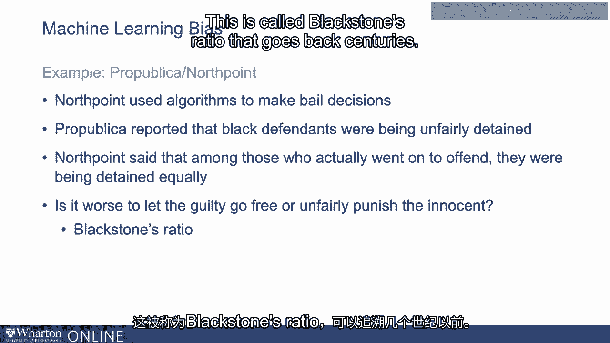

# 88：偏见为何难以管理？ 🎯

在本节课中，我们将探讨算法系统中偏见的成因，并深入分析为何有效管理这些偏见极具挑战性。我们将通过一个著名的现实案例，揭示偏见问题背后复杂的价值判断与组织决策。

理解算法偏见为何产生相对容易。然而，管理这些系统中出现的偏见却相当困难。

## 管理偏见的复杂性 🤔

上一节我们提到了偏见的普遍性，本节中我们来看看管理它为何如此棘手。原因在于，当考虑如何处理偏见时，通常涉及价值判断，并且需要一个整体视角。

目前尚不清楚这纯粹是一个技术问题还是数据问题。当你思考如何在组织背景下解决这个问题时，这确实需要对组织有一个整体的视角和深入的思考，需要深入思考组织的优先事项。

当然，这可以跨越多个不同的决策者，而不仅仅是单个开发者或数据科学家。这就是为什么处理这个问题变得复杂的原因。

## 案例分析：ProPublica 与 Northpointe ⚖️

为了更具体地理解上述复杂性，我们来看一个相当高调的例子——ProPublica 和 Northpointe 的案例。

这是一个例子，Northpointe 开发了一个算法，被用于做出保释决定。该算法在这个案例中被用来预测某人是否可能再次犯罪。

ProPublica 是一个新闻组织。他们审查了这个算法并声称，黑人被不公平地拘留。Northpointe 则表示，在那些实际上犯罪的人中，他们被拘留的比率是相等的。

事实证明，如果你看这两个不同的陈述——“黑人被不公平地拘留”和“在犯罪者中，他们被同等拘留”——他们在陈述中都是正确的，但他们基本上在说关于价值的不同事情。

## 核心矛盾：价值权衡 ⚖️➡️🤔

他们所问的本质上是一个价值选择：是“让有罪的人自由”更糟糕，还是“不公平地惩罚无辜”更糟糕？这当然是一个非常古老的问题。

这被称为 **黑石比率**（Blackstone‘s ratio），历史悠久。其核心思想可以用一个简单的价值判断公式来描述：

**“宁可错放十个有罪之人，也不冤枉一个无辜者”**  vs  **“为保护多数人，可接受对少数人的误判”**

这是一个深刻的哲学问题。如果我们问一百个人他们对此的看法，我们会得到多种不同的答案。然而，它说明这并不是一个单纯的数据科学家问题或算法问题。

这实际上是一个更深层次的问题，需要在社会价值观或商业价值方面进行优先排序。

## 组织情境下的权衡 🏢

在人力资源的例子中，我们可能在思考机器学习算法如何评估候选人或评估组织内的人员。

以下是算法决策可能带来的多重影响：
*   **对生产力的影响**
*   **对偏见和不平等的影响**

但这需要在不同目标之间权衡成本和收益。这些不同事物具有非常深刻的组织影响，并需要进行多项权衡。这需要对组织优先事项有一个整体的视角。

## 总结 📝

本节课中，我们一起学习了算法偏见的复杂性。我们了解到，偏见管理之所以困难，关键在于它超越了纯粹的技术范畴，涉及深刻的价值判断和组织层面的优先权权衡。通过 ProPublica 与 Northpointe 的案例，我们看到了“公平”的不同定义如何导致对同一结果的不同解读，这凸显了在设计和部署算法系统时，进行跨领域、多利益相关方讨论与整体性思考的必要性。