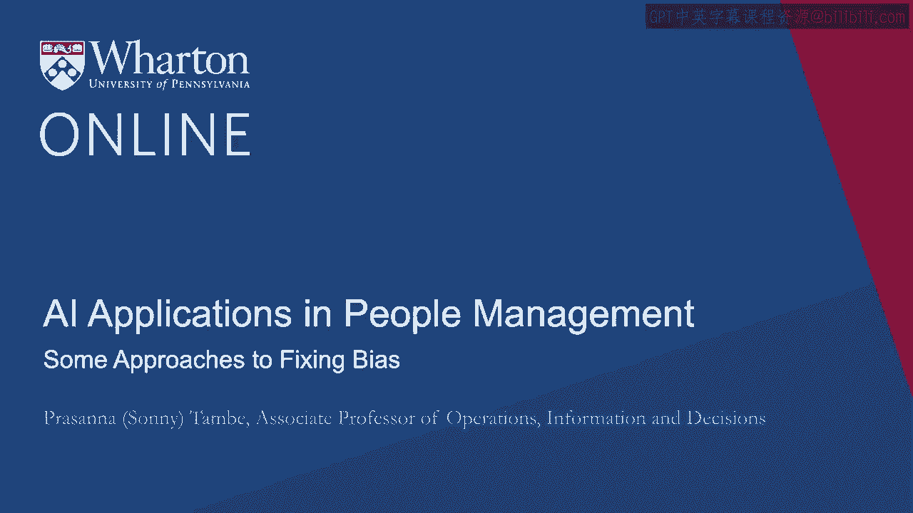
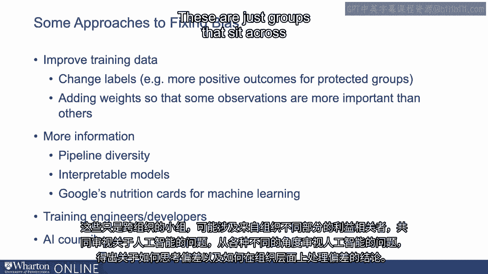

# 90：27_机器学习偏见修复方法 🛠️



在本节课中，我们将学习多种用于识别和修复机器学习系统中偏见的方法。鉴于偏见问题的严重性，行业和组织已经提出了多种应对策略。

## 概述 📋

机器学习系统中的偏见可能导致不公平的决策结果。为了解决这个问题，我们可以从数据、模型、流程和组织等多个层面入手。接下来，我们将逐一探讨这些具体的方法。

## 1. 改善训练数据 📊

上一节我们提到了偏见的严重性，本节中我们来看看如何从源头——训练数据入手进行修复。如果训练数据本身存在偏见，那么模型的输出也必然带有偏见。改善训练数据是减轻此类问题的根本方法之一。

具体做法包括：
*   **增加数据多样性**：更改或操纵数据，使其能反映更广泛、更多样的现实情况。
*   **满足性能与公平性指标**：在优化模型性能的同时，有意识地纳入对数据多样性的考量。

## 2. 调整数据权重 ⚖️

除了直接修改数据，我们还可以通过调整数据中不同样本的重要性来影响模型学习。这种方法的核心思想是，让那些更能体现“公平”目标的样本在训练中发挥更大作用。

具体做法是：
*   **对观察结果进行加权**：为数据中那些能更好反映组织在公平性方面目标的样本分配更高的权重。
*   **引导模型学习**：通过权重调整，让机器学习算法更侧重于学习我们期望的、无偏的决策模式。其核心思想可以用以下伪代码表示：
    ```python
    # 假设我们有一个函数来计算每个样本的“公平性权重”
    fairness_weight = calculate_fairness_weight(data_sample)
    # 在训练损失函数中，使用该权重放大或缩小对应样本的影响
    weighted_loss = fairness_weight * standard_loss_function(prediction, label)
    ```

## 3. 增强系统透明度 🔍

一个“黑箱”系统很难被审查和纠偏。因此，提高机器学习流程的透明度是识别和处理偏见的关键。这要求我们在系统构建的每个阶段都提供更多信息。

具体方法包括：
*   **打开系统流程**：使用工具来可视化整个机器学习管道（Pipeline），展示每个阶段的数据处理和决策过程。
*   **识别潜在问题点**：通过可视化，更容易发现在数据转换、特征工程或模型训练等环节可能出现的多样性或偏见问题。

## 4. 采用可解释模型 🧠

与增强流程透明度相辅相成的是采用可解释模型。这类模型本身的设计就旨在让人类理解其决策逻辑。

其核心优势是：
*   **提供决策依据**：可解释模型能够提供关于“它为何做出某个决策”的大量信息。
*   **定位偏见来源**：通过分析决策依据，我们可以追溯并定位偏见是在系统的哪个环节产生的。

## 5. 实施决策后评估 📝

即使在决策做出后，我们仍有办法进行审查和补救。这种方法侧重于对已完成的决策进行回溯分析。

一个著名的实践案例是：
*   **使用“营养标签”**：谷歌提出了类似食品营养标签的“模型卡片”（Model Cards），为机器学习模型的决策提供标准化的信息表。
*   **评估驱动因素**：通过回顾性评估，寻找可能驱动某个特定决策的关键因素，从而判断是否存在偏见。

## 6. 使用多样化性能指标 📈

传统的单一性能指标（如准确率）可能掩盖模型在不同子群体上的表现差异。采用多样化的评估指标能更全面地揭示问题。

这种方法要求我们：
*   **在不同数据集上测试**：不仅在整体数据上，还要在按性别、种族等划分的不同子数据集上评估模型性能。
*   **理解偏见特征**：通过对比模型在不同群体上的表现差异（例如，使用**差异公平性公式：|性能_群体A - 性能_群体B|**），我们可以更好地理解偏见的特征和严重程度。

## 7. 对开发者进行培训 👨‍🏫

技术最终是由人构建的。因此，对算法开发者和数据科学家进行培训，提升他们对偏见问题的意识和解决能力，至关重要。

培训内容应涵盖：
*   **偏见来源识别**：帮助开发者理解偏见在数据收集、算法设计等环节是如何产生的。
*   **问题解决方法**：提供识别、思考和解决偏见问题的框架与工具。



## 8. 建立组织治理结构 🏛️

修复偏见不仅仅是一个技术问题，更是一个需要组织层面承诺和协作的治理问题。这引出了一个根本性问题：管理偏见究竟是谁的职责？

一个日益常见的做法是：
*   **创建AI伦理委员会**：在组织内部成立一个专门的小组。
*   **汇集多元视角**：委员会成员应来自法律、伦理、产品、工程等不同部门，从多角度审视AI相关问题。
*   **制定组织级策略**：共同探讨并得出如何在组织层面系统性地思考和处置偏见的结论与政策。


## 总结 🎯

本节课我们一起学习了修复机器学习偏见的八种主要方法：从**改善训练数据**和**调整数据权重**入手，到**增强系统透明度**、采用**可解释模型**，再到实施**决策后评估**和使用**多样化性能指标**。此外，我们还认识到**对开发者的培训**和建立**组织级的AI治理结构**（如伦理委员会）对于系统性地应对偏见问题同样不可或缺。综合运用这些策略，可以更有效地在机器学习系统中识别、缓解和治理偏见。