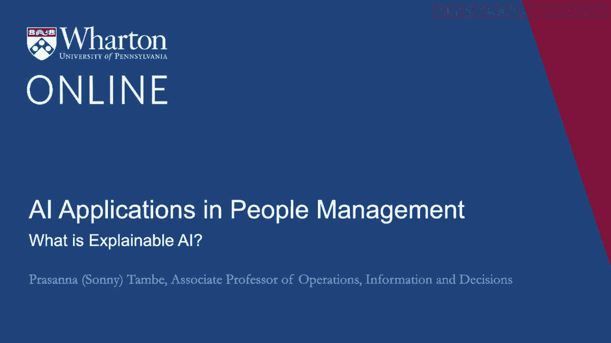
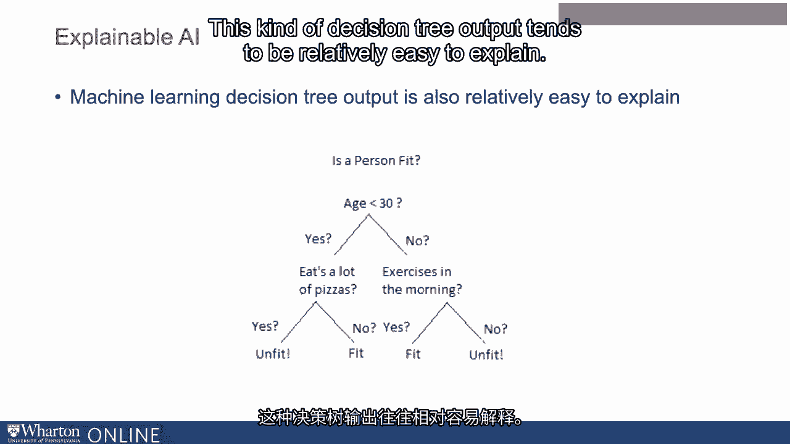
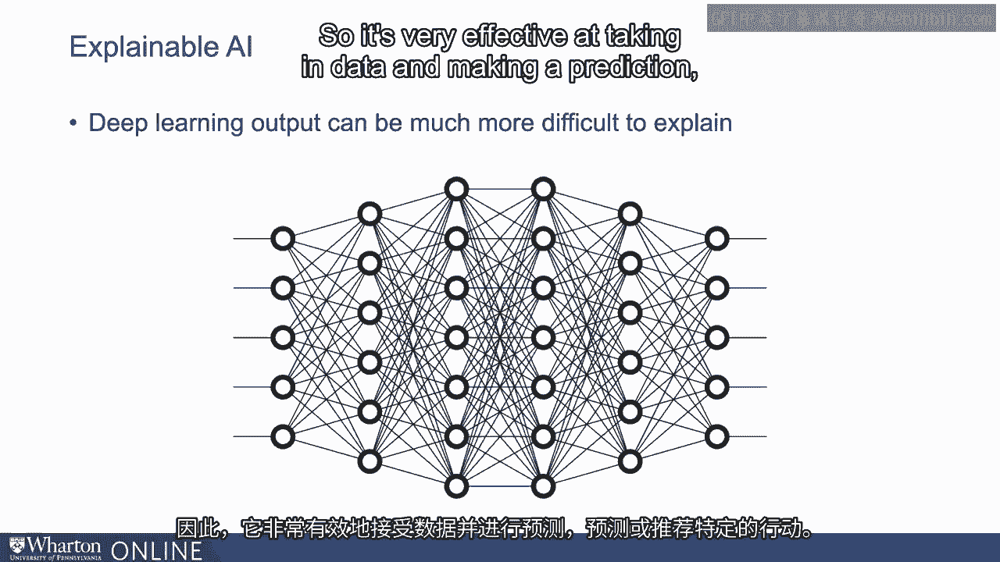

# 91：什么是可解释的AI？ 🤖

在本节课中，我们将要学习人工智能领域中的一个重要概念——可解释的AI。我们将探讨它的定义、重要性，并将其与不同类型的机器学习方法进行对比，以便初学者能够清晰地理解这一概念。

---



## 概述

在人力资源等领域应用人工智能时，一个可能出现的挑战与解决方案涉及“可解释的AI”。本节课程将解释这一概念，并说明为什么理解AI的决策过程至关重要。

---

## 什么是可解释的AI？

可解释的AI指的是一系列方法，这些方法能让人类专家理解算法是**如何**以及**为什么**做出特定决策的。

这与某些类型的机器学习形成鲜明对比，后者通常被视为一个“黑箱”。在“黑箱”模型中，系统接收输入数据并直接输出决策，但其内部的推理过程往往难以被人类所理解和追溯。

---

## 可解释AI与“黑箱”AI的对比

上一节我们介绍了可解释AI的基本定义，本节中我们来看看它与不同AI方法的对比。

### 易于解释的系统：基于规则的方法

我们之前讨论过基于规则的系统。在这种系统中，人类的专业知识通过开发者编写的明确规则被编码到算法或软件里。这类系统的决策过程通常相对容易解释。

例如，**决策树**就是一种基于规则的可视化模型。它的决策逻辑类似于一棵树的分支。

以下是决策过程的简化表示：
```
如果 条件A 成立：
    如果 条件B 成立：
        执行 决策X
    否则：
        执行 决策Y
否则：
    执行 决策Z
```

要理解系统为何做出某个决策，你只需沿着树的节点路径回溯，就能清晰地追踪到决策的依据。因此，这类系统的输出往往**相对容易解释**。

### 难以解释的系统：深度学习

相比之下，一旦进入**深度学习**的世界，情况就复杂得多。深度学习依赖于一种称为**神经网络**的技术。



虽然深度学习在处理复杂数据和做出高精度预测方面非常有效，但其内部运作机制就像一个多层、高度互联的网络。数据在这些层中经过复杂的非线性变换，最终产生一个预测或推荐。

以下是一个简单的神经网络结构概念图：
```
输入层 -> [隐藏层1 -> 隐藏层2 -> ... -> 隐藏层N] -> 输出层
```

然而，如果我们想回过头来理解**为什么**该系统做出了某个特定的推荐，这可能是一个相当大的障碍。要厘清是输入数据中的哪些特征、以何种方式、通过网络的哪条路径最终影响了输出，通常非常困难。

---

## 为什么可解释性很重要？



我们已经了解了可解释AI与“黑箱”AI的区别。那么，理解AI的决策过程为什么在许多场景下都至关重要呢？

在医疗、金融、司法以及我们讨论的人力资源等领域，AI的决策可能会对个人的生活产生重大影响。如果无法解释决策的原因，就会引发关于公平性、责任归属和信任的问题。例如，如果一个人工智能系统拒绝了某人的贷款申请或工作面试机会，当事人和监管机构都有权知道这个决定是基于什么理由做出的。

因此，推动AI的可解释性，不仅是技术挑战，也是伦理和合规性的要求。在下一个视频中，我们将更深入地讨论可解释性在各种上下文中的具体重要性。

---

## 总结

本节课中，我们一起学习了**可解释的AI**这一核心概念。


我们明确了它的定义：旨在让人类理解AI决策过程的方法。我们对比了**基于规则的系统**（如决策树）的易解释性，以及**深度学习模型**因其复杂的“黑箱”特性而带来的解释挑战。最后，我们简要提及了可解释性在确保AI系统公平、可靠和可信方面的重要作用。

理解这些基础知识，是负责任地开发和应用人工智能的第一步。