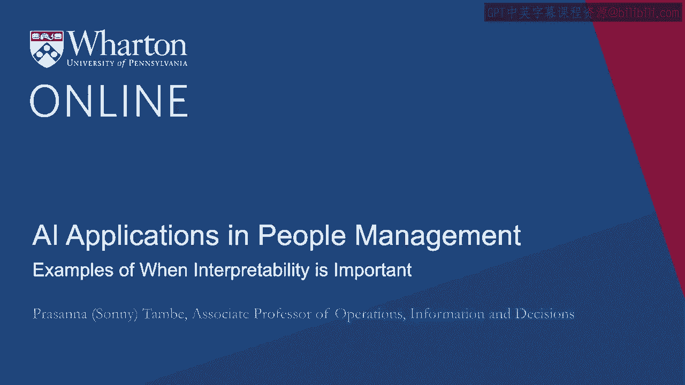
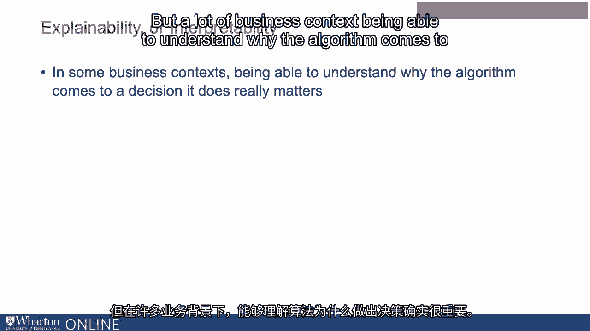
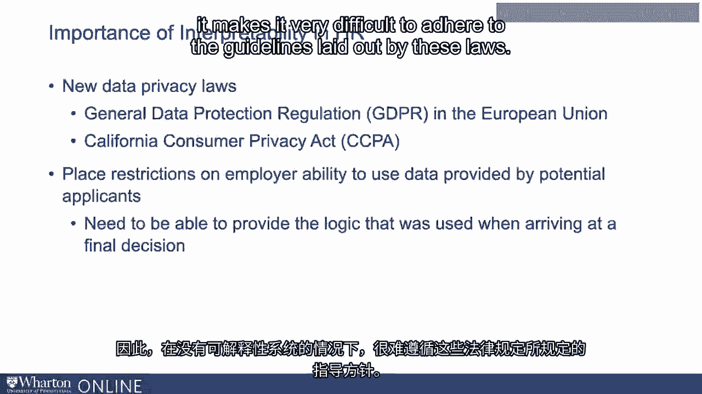
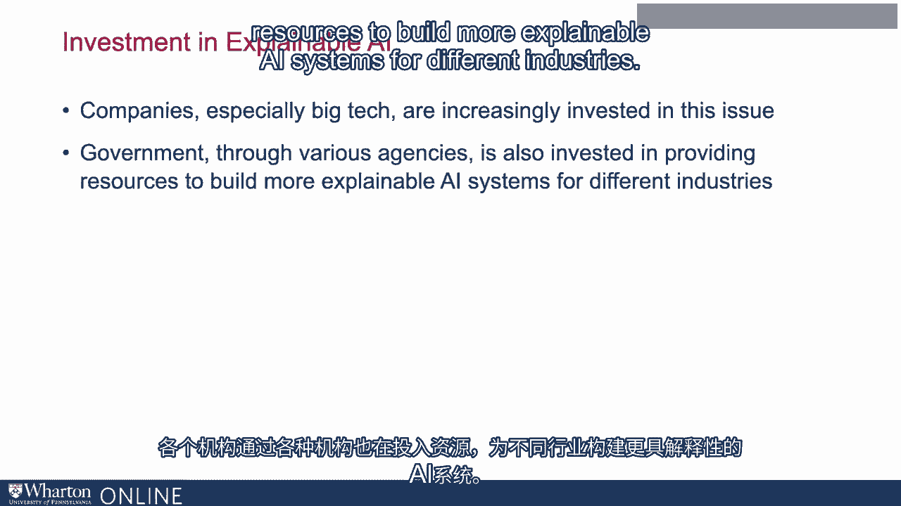

# 92：可解释性AI的重要性与示例 🧠

在本节课中，我们将探讨“可解释性”或“解释性”在人工智能与机器学习中的重要性。我们将通过具体示例，理解为何在某些关键领域，模型的决策过程必须是透明且可理解的。

---

## 概述

可解释性，有时也被称为解释性，指的是我们理解一个模型如何以及为何做出特定决策的能力。在许多应用场景中，仅仅获得一个高精度的预测结果是不够的；理解其背后的逻辑同样至关重要。

---

## 可解释性为何重要？🤔

上一节我们介绍了可解释性的基本概念。本节中，我们来看看它在不同场景下为何如此重要。

在某些仅需做出预测的背景下，可解释性可能不那么关键。然而，在许多商业和现实环境中，理解算法为何做出某个决策变得极其重要。

---

## 关键应用领域示例

以下是可解释性至关重要的几个具体领域。

### 1. 医疗健康领域 🏥

考虑一个医疗场景：一个深度学习系统被用于评估患者是否应该接受某种治疗。当一位高度专业化的医生与系统的评估意见不一致时，问题就出现了。

如果系统只是给出一个不同的结果，这通常容易解决。但医生需要知道系统是如何得出该结论的，以及依据是什么。这种对决策过程的理解必须被纳入整个医疗决策流程中。因此，医疗领域是可解释性非常重要的一个例子。

### 2. 人力资源领域 👥

在人力资源领域，可解释性尤为重要。该领域受到许多指导方针和法律条文的严格约束，要求人力资源部门必须能够清晰、明确地记录其决策过程。

例如，美国的平等就业机会委员会（EEOC）对雇佣员工的类型有相关规定。这些规定要求企业必须能够记录其做出的各种人事决策。你不能简单地将数据输入一个深度学习系统，然后直接采用它做出的“黑箱”决策。

如果你的预测模型在这样的环境中无法提供解释，那么它将难以持续使用。你需要有非常清晰的文档来说明决策是如何得出的，以确保遵循与就业保护法相关的所有指导方针。这些法律有着悠久的历史基础，使得使用不可解释的系统变得非常困难。

如果你无法退后一步，询问“为什么会做出这个决定？”或者无法调整系统以满足合规要求，就会产生问题。满足这些指导方针的要求使得可解释性成为人力资源技术应用中的关键考量。

### 3. 数据隐私法规 📜

另一个在人力资源等领域产生重大影响的领域是新兴的数据隐私法律。

考虑欧盟的《通用数据保护条例》（GDPR）和美国加州的《加州消费者隐私法案》（CCPA）。这些法律对雇主如何使用潜在申请者提供的数据施加了限制。

当法律提到在自动化决策过程中，你需要能够解释决策是如何做出的，并能提供做出最终决定时所使用的逻辑。在缺乏可解释系统的情况下，遵守这些标准变得极其困难。

因此，可解释性是考虑采用人力资源技术时的一个核心问题。

---

## 行业努力与发展趋势 🚀

幸运的是，大量的资源正被投入到解决可解释性问题上。

许多公司，尤其是大型科技公司，正越来越重视这个问题。众多新工具正在涌现，旨在提供更具可解释性的人工智能支持。

同时，各国政府及其机构也在投入资源，以在各个产业中建立更多可解释的人工智能系统。

---

## 总结

本节课中，我们一起学习了可解释性AI的重要性。我们了解到，在医疗诊断、人力资源管理和遵守数据隐私法规等关键领域，模型的决策必须透明、可追溯且易于理解。这不仅关乎信任与合规，也影响着技术的可靠与广泛应用。

在下一个视频中，我们将讨论在使系统更加可解释的过程中，所面临的一些挑战和需要做出的权衡。

[BLANK_AUDIO]

