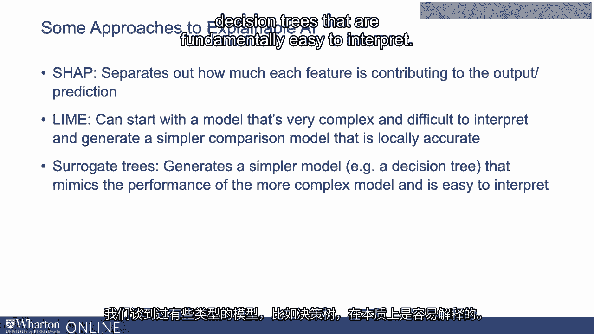
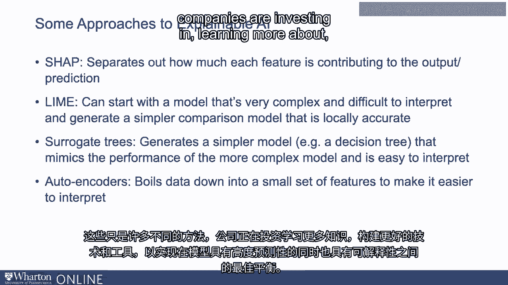
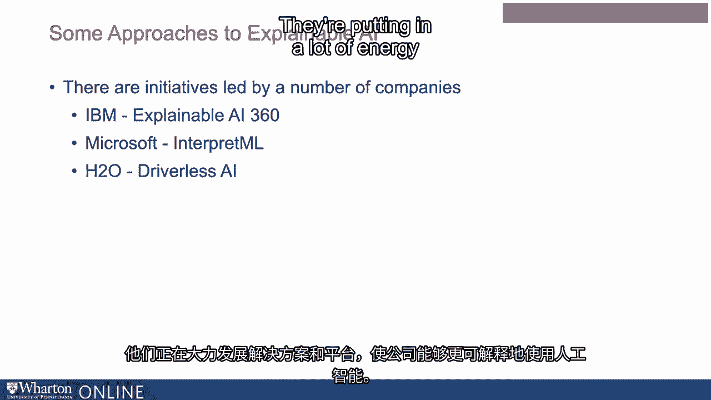

# 94：可解释AI方法简介 🧠

在本节课中，我们将学习可解释人工智能的一些核心方法。可解释AI在商业场景中至关重要，尤其是在人力资源等领域。许多公司和政府都在投入资源开发更易于理解的AI方法。接下来，我们将介绍几种主流方法，帮助你了解人们如何思考并解决模型的可解释性问题。

---

## SHAP：特征贡献度分析

上一节我们提到了可解释AI的重要性，本节中我们来看看第一种方法——SHAP。SHAP方法的核心是分析输入模型的各个特征对最终预测结果的贡献度。

该方法会观察用于预测模型的不同信息片段（即特征），并量化每个特征对最终预测结果的影响。例如，公司在对员工或申请者做决策时，模型可以告诉你每一条信息（如工作经验、学历）对最终决策的影响有多大。

**核心公式/概念**：SHAP值基于博弈论中的Shapley值，用于公平地分配“预测结果”这个“合作收益”给每个“参与者”（特征）。其核心思想可表示为分析每个特征在所有可能的特征组合中的边际贡献。

---

## LIME：局部可解释模型

了解了全局特征贡献的分析方法后，我们来看看另一种思路——局部解释。LIME方法主要用于解释复杂、难以理解的“黑箱”模型在单个预测点上的行为。

LIME的基本思想是，对于一个复杂的全局模型，虽然整体上难以解释，但可以在某个特定预测点（例如某个员工）附近，构建一个简单的、局部准确的解释模型。它通过比较与目标个体相似但略有不同的“邻居”样本来生成解释。

**核心概念**：LIME会生成一个更简单的、局部忠实的模型（如线性模型），来解释为什么某个样本（如员工X）会得到特定的预测结果。它可能会说：“因为员工X在A特征上与相似的员工Y不同，所以导致了不同的决策。”

---

## 替代模型与决策树

除了分析现有模型，另一种思路是直接使用本质上就可解释的模型来“模拟”复杂模型的行为，这就是替代模型方法。

我们之前提到过一些模型类型，如决策树，它们本身结构清晰，易于理解。替代模型方法就是训练一个行为与复杂模型相似的简单模型（如决策树）。这个简单模型在大多数情况下能模仿复杂模型的预测，同时自身又具备良好的可解释性。

**核心优势**：这种方法可以同时获得复杂模型的预测性能和简单模型的解释能力，达到一种平衡。

---

## 新兴技术：自动编码器

随着技术发展，一些新兴方法也被用于提升可解释性，例如自动编码器。

自动编码器是一种神经网络，它能将高维、复杂的数据压缩（编码）为低维、核心的特征表示，然后再重建（解码）回原始数据。在可解释性方面，通过分析编码后的低维特征，我们可以更容易地理解模型在进行预测时到底关注了数据的哪些本质信息。

**核心作用**：它简化了数据表示，使模型的前向预测过程所使用的关键特征更易于被人理解和解释。

---

## 行业实践与总结

以上介绍了几种不同的可解释AI方法。为了在模型的高预测性能与必要的可解释性之间达到理想平衡，行业正在积极开发更好的技术和工具。

例如，IBM、微软等公司都投入了大量资源，致力于开发解决方案和平台，帮助企业以更可解释的方式使用人工智能。

**本节课总结**：我们一起学习了四种主要的可解释AI方法：**SHAP**（分析特征贡献）、**LIME**（构建局部解释）、**替代模型/决策树**（用简单模型模拟复杂模型）以及**自动编码器**（通过数据简化提升可解释性）。这些方法帮助我们在享受AI强大预测能力的同时，也能理解其决策背后的逻辑。