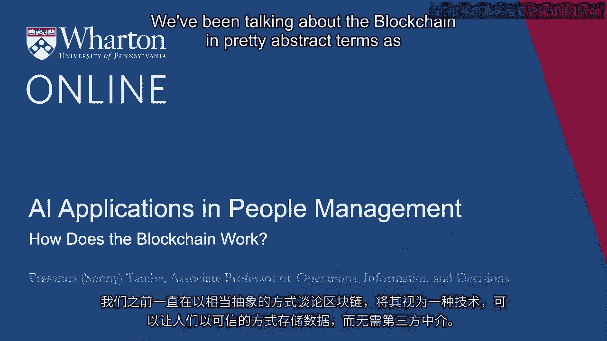
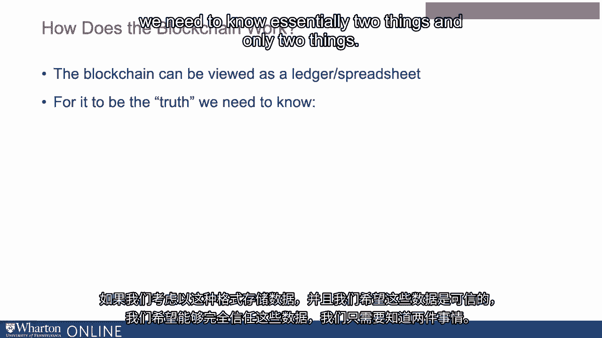
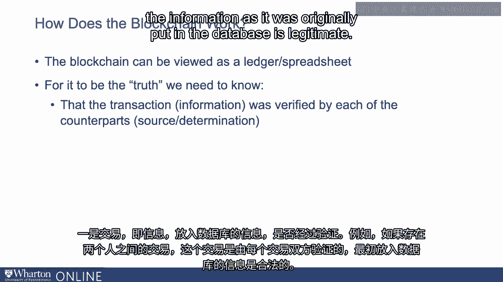
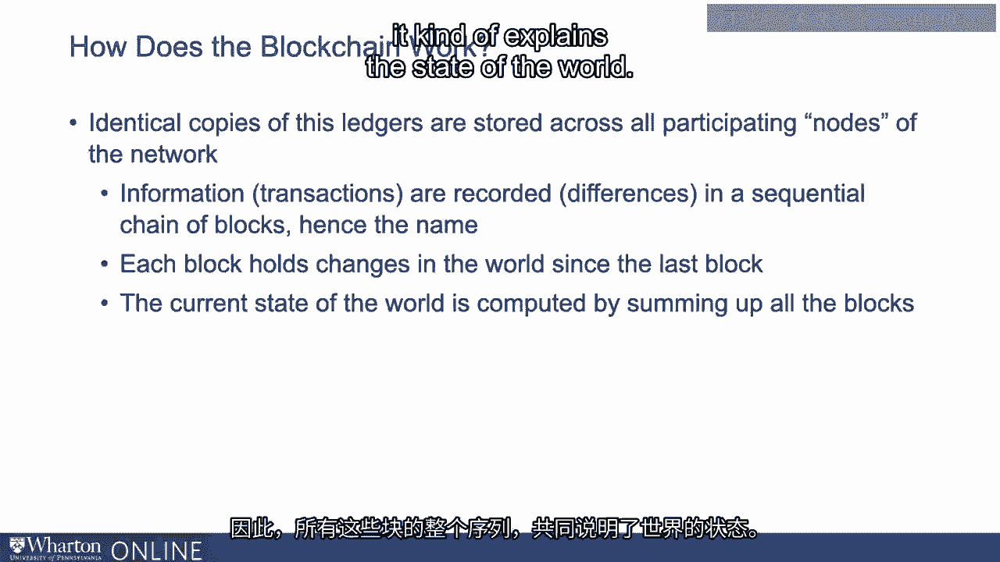
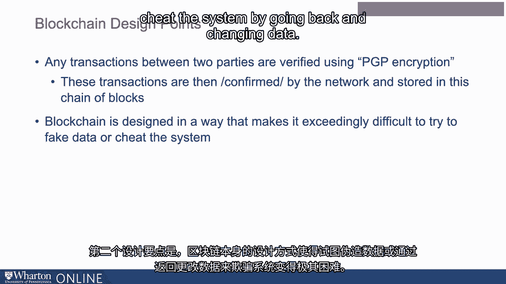
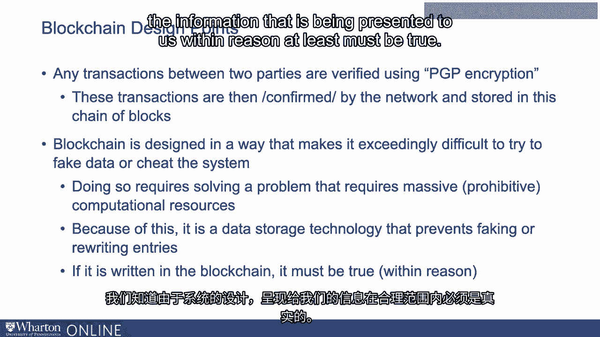

# 97：区块链工作原理详解 🧱

在本节课中，我们将学习区块链技术是如何工作的。我们将从高层次视角出发，了解区块链如何以一种可信的方式存储数据，而无需依赖第三方中介。通过理解其核心机制，你将明白区块链为何能提供独特的价值。

---

我们一直在用相当抽象的术语讨论区块链，它是一种可以让人们以受信任的方式存储数据，而无需第三方中介的技术。从高层次了解其工作原理，有助于你理解区块链上实际发生的事情以及它如何提供价值。

区块链可以被视为一个**账本**或**电子表格**。如果我们希望以这种格式存储的数据是可信的，我们需要能够完全信任这些数据。这依赖于两个基本条件：

1.  最初录入数据库的信息是经过验证的。
2.  信息一旦录入，就永远不会被更改、更新或删除。

如果我们确信这两点，就可以相信在区块链中看到的信息是正确的。第一点（信息验证）是我们长期以来一直在做的事情，而第二点（数据不可篡改）则是区块链技术所实现的核心目标。区块链确保我们可以相信没有人能回去伪造、更新或删除数据。

---

上一节我们介绍了区块链作为可信账本的基本概念，本节中我们来看看它的具体结构。

区块链虽然类似于电子表格，但与单一的电子表格不同。它本质上是将信息存储在整个网络的多个**节点**上。网络中的所有参与节点共同记录信息，这些信息被按顺序记录在**区块**中，这也是它被称为“区块链”的原因。

每个区块都记录了自上一个区块产生以来，世界上发生的变化或交易。因此，当前世界的状态是通过查看**整个区块序列**来计算的，而不仅仅是最后一个区块。整个区块序列共同解释了世界的状态。

简单来说，区块链系统利用网络中的许多节点（可以想象成许多电子表格）。信息以区块序列的形式记录，所有这些区块共同表达了世界的完整状态。

---

理解了区块链的结构后，我们来看看它是如何实现“可信”这一核心价值的。这主要依靠两个关键的设计要点。

以下是区块链实现可信度的两个核心设计机制：

1.  **交易验证**：任何放入区块链的信息（交易）都必须经过加密形式的验证。例如，如果使用区块链记录个人获得的技能，那么我和教育提供商之间的这笔交易，会通过加密技术由双方参与验证，然后由网络确认，最终才被存储到区块链中。这意味着所有交易在首次录入时都经过了验证。
2.  **防篡改设计**：区块链本身被设计得**极难**伪造或回溯更改数据。与传统数据库不同，在区块链上更改过去的数据在计算上**成本极高**，甚至在大多数情况下是**不可能**的。这个设计要点确保了数据一旦被记录，就可以被信任是真实且始终保持真实的。

正因为这两个设计要点，区块链成为一种可以防止任何条目被修改或重写的数据存储技术。如果信息在第一时间经过验证且从未被更改，那么我们就知道它必须是真实的。我们不再需要第三方来担保信息的有效性；系统的设计本身保证了呈现给我们的信息在合理范围内是正确的。

---

本节课中我们一起学习了区块链的工作原理。我们了解到，区块链通过分布式节点网络和按时间顺序链接的区块来存储数据。其核心价值来源于两个关键机制：**交易初次录入时的加密验证**和**数据一旦记录就极难篡改的设计**。正是这些特性使得区块链中的信息本质上是可信的，从而消除了对第三方中介的依赖。这为解决许多需要建立信任的行业问题提供了新的可能性。