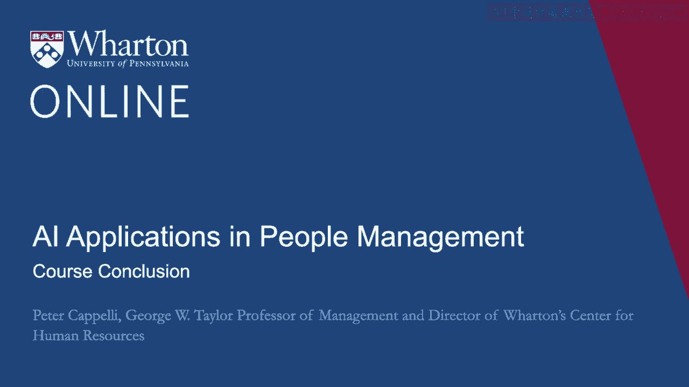
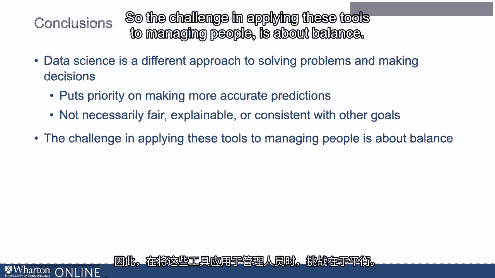
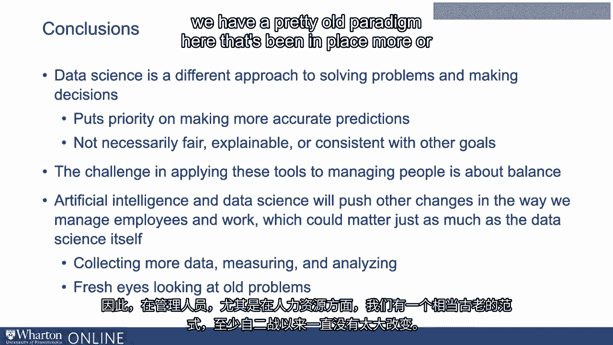

# 100：数据科学与人力资源管理总结 📊

在本节课中，我们将回顾整个课程的核心内容，探讨数据科学如何改变人力资源管理，并总结其带来的机遇与挑战。

---

## 🧠 核心主题回顾

我们共同度过了四个模块、超过四小时的学习时间。在整个课程中，我们反复讨论了一个重要主题：**数据科学正引领着工作场所的重大变革**。这是一种全新的问题解决与决策制定方法。

上一节我们介绍了课程的整体框架，本节中我们来总结其核心思想。

---

## ⚖️ 数据科学决策的双重性

数据科学优先考虑做出**准确的决策**，这本身是积极的。然而，当前工作场所的许多决策，尤其是在招聘等领域，并不完善。现有做法可能包含偏见，且不一定能选拔到最优秀的人才。

关于数据科学需要记住的关键一点是：那些为**优化决策**而设计的模型，不一定能满足**公平性**、**可解释性**或其他社会公平目标的要求。

**核心挑战公式**：
`优化决策 ≠ 公平性 + 可解释性 + 其他社会目标`

因此，将数据科学工具应用于人力管理的核心挑战在于**平衡**：一方面是利用数据科学提供的强大优化工具来指导管理；另一方面是必须兼顾那些在管理机器时无需考虑、但在管理“人”时至关重要的其他关切。

---

## 🔄 从“科学管理”到员工参与

这让我们回想起课程开始时提到的历史背景：大约一百年前弗雷德里克·泰勒的“科学管理”理论。过去数十年的经验表明，单纯将人视为机器、依赖简单规则的管理方式效果有限。

**关键转变**：员工的参与至关重要。在我们的语境下，这意味着让员工参与到数据科学的实践与决策过程中来。

---

## 📈 数据科学驱动的变革

除了决策方法，数据科学还可能推动其他管理变革，其重要性不亚于技术本身。以下是两个主要方向：

### 1. 数据收集与测量
为了进行数据科学实践，我们必须收集更多数据。这促使我们测量过去可能忽略的方面。

以下是数据收集可能涵盖的新维度：
*   测量员工在多维度的表现。
*   收集培训数据，以评估其实际效果。
*   通过数据分析，审视现有决策是否明智。

### 2. 以新视角审视旧问题
数据科学带来的最重要方法之一是**用全新的眼光看待老问题**。人力资源管理领域长期沿用相对固定的范式。

当数据科学家进入工作场所，他们能做的最有价值的事情之一就是提问：“**我们为什么要这样做？**” 这个问题本身就能引发变革，即使没有产生新的算法或完美解决方案。

---

## 🎯 总结与展望

本节课中我们一起学习了数据科学对人力资源管理的深远影响。

总结来说，随着数据科学的发展，我们正站在工作场所重大变革的边缘。部分变革由数据科学技术直接驱动，另一部分则源于由此引发的、对组织与管理的全新思考方式。

我们祝愿您能顺利运用所学，在实践中审慎地驾驭这些机遇与挑战。感谢您的学习与陪伴。