# 103：构建人工智能项目组合 🧠

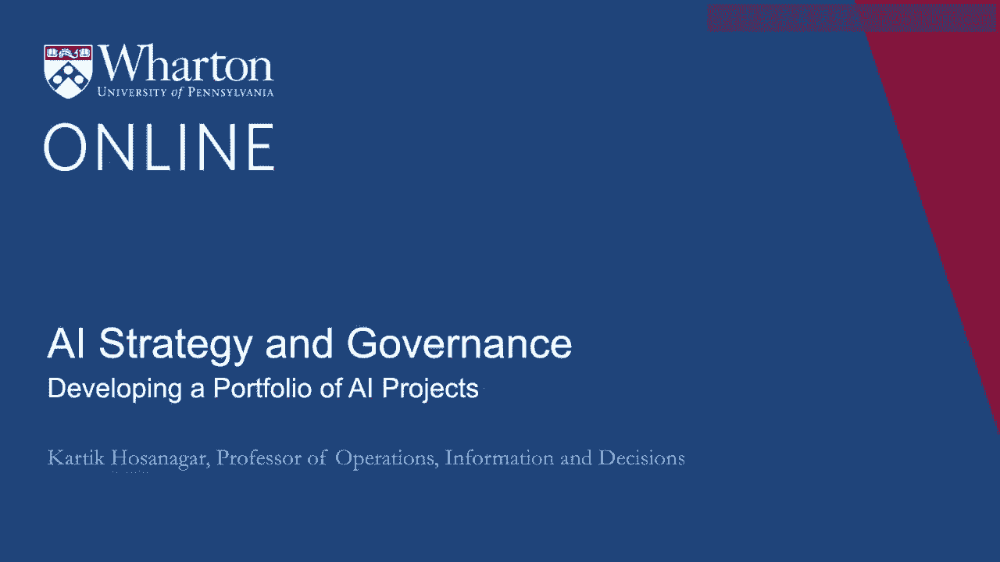

在本节课中，我们将学习如何为公司制定一个平衡的人工智能投资策略。我们将探讨如何通过组合短期“速赢”项目和长期战略项目，来系统性地推进人工智能转型，避免因早期挫折而放弃技术。

---

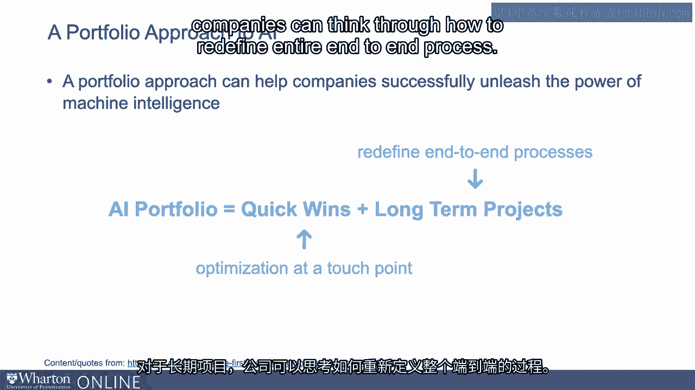

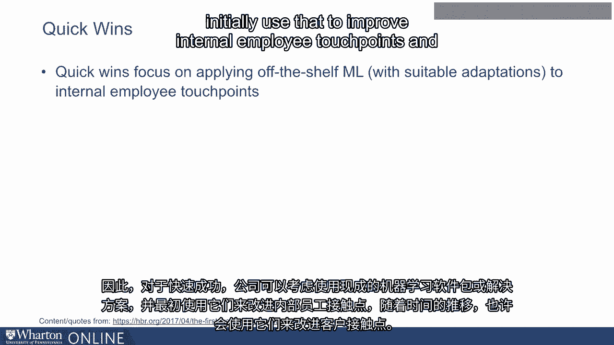

## 📈 从失败到长期投资

上一节我们讨论了早期失败可能导致对技术的非理性退缩，并可能产生长远影响。本节中，我们将探讨公司如何在回报不明确的较长时期内，对技术进行投资。

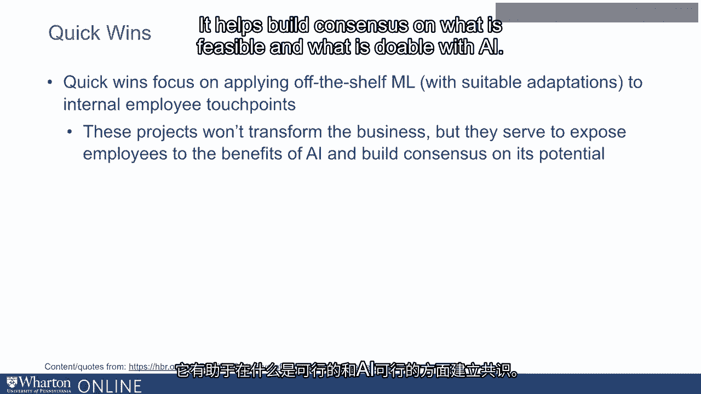

我倡导的一个关键原则是：公司应该思考如何**开发一组人工智能项目组合**来持续推进。让我们更深入地探讨这个想法。

---

## 🎯 什么是人工智能投资组合？

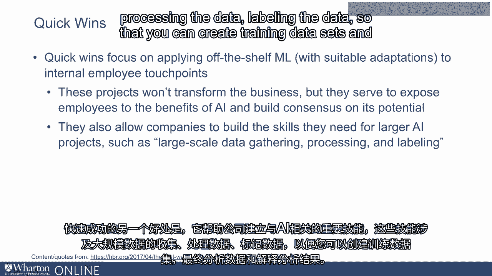

构建人工智能投资组合的核心思想是，提出一组可以被视为“速赢”的短期项目，以及一系列被视为“长期”的、短期内不太可能产生结果的项目。

以下是这两种项目的具体分析：

### 速赢项目

对于速赢项目，公司可以选择优化员工或客户的简单接触点。公司可以考虑使用现成的机器学习包或解决方案，最初利用这些来改善内部员工接触点。随着时间的推移，或许可以再利用这些技术来改善客户接触点。

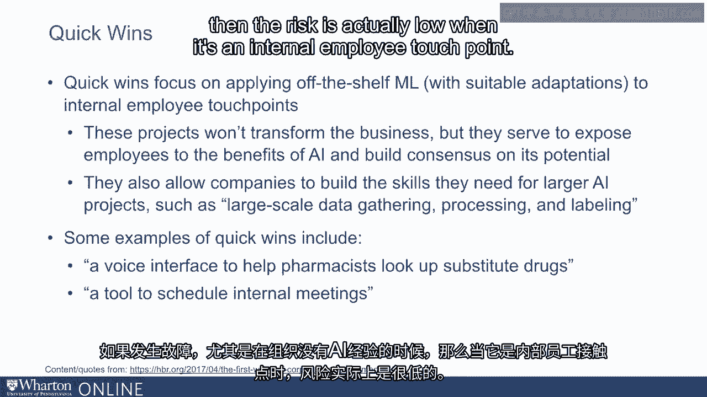

请注意，当你使用现成的机器学习技术时，每个竞争对手也都可以访问。你使用这些技术来改善内部员工接触点，这些项目可能不太可能彻底改变业务，但它们服务于不同的重要目的。

**速赢项目的主要好处包括：**

1.  **建立共识与认知**：它们有助于让组织，尤其是其中的怀疑者，接触到人工智能的潜力。这有助于就什么是可行的、可以做到的事情达成共识。
2.  **培养关键技能**：它帮助公司建立关于人工智能的重要技能。这些技能涉及大规模收集数据、处理数据、标注数据以创建训练数据集，以及最终分析和解释数据结果。

**速赢项目的例子：**
假设我们讨论的是一家药房。药剂师需要查找替代药物。通常，他们会通过计算机接口输入不可用的药物或症状，然后得到一份可用替代药物的列表。
一个简单的短期速赢项目可能是提供一个语音接口，这样药剂师就可以更快速地查找，而无需费力输入。这可以利用现成的自然语言处理和语音识别软件来实现。

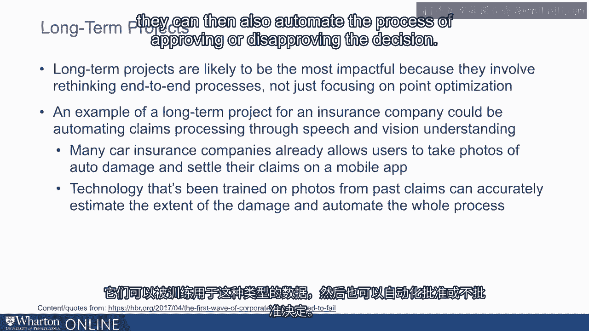

请注意，我经常提到利用内部员工接触点作为起点。这个点的风险非常低。如果出现问题，尤其是在组织没有人工智能经验的情况下，对于内部员工接触点来说，风险实际上是很低的。随着公司经验的积累，可以将其推广到客户接触点。

---

## 🚀 长期战略项目

上一节我们介绍了风险低、见效快的速赢项目。接下来，我们进入长期项目的探讨。

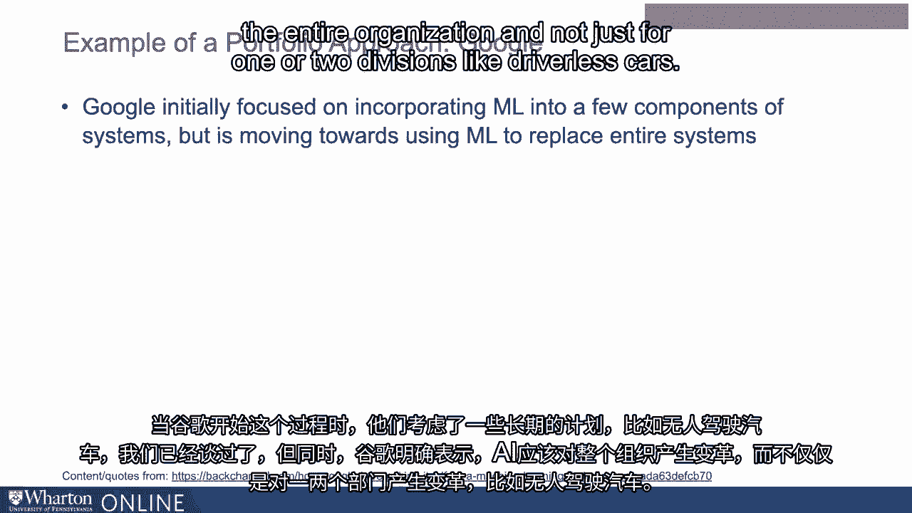

长期项目的理念是，这些项目必须有影响力，并提供战略价值，或为组织带来竞争优势。这可能涉及重新思考整个端到端的流程，而不仅仅是优化某个单一节点。

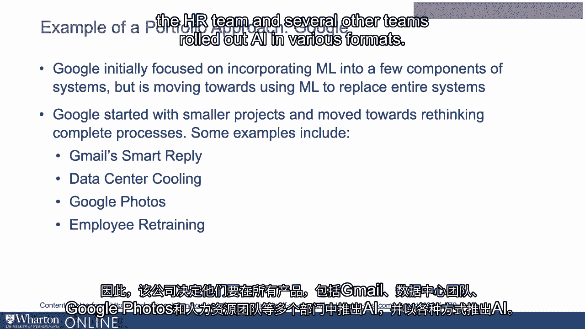

**长期项目的例子：**
可以考虑一家处理保险索赔的保险公司。对于汽车保险，可以设想一种情况：客户可以在移动应用上提交索赔，上传汽车损坏的照片。
一旦索赔进入，通常由保险代理分析并做出决策。现在，可以利用技术自动化这个过程的某些部分。例如：
*   使用图像识别算法分析索赔并识别损害类型。
*   利用针对历史索赔数据（包括批准/拒绝记录、赔偿金额）训练的机器学习算法，自动化批准或拒绝决策。

公司可能无法一开始就自动化所有索赔。然而，随着时间的推移，可以达到一个点，让50%、60%、70%的较简单索赔由机器学习系统处理。这样，组织中的人类代理可以专注于更复杂的任务。

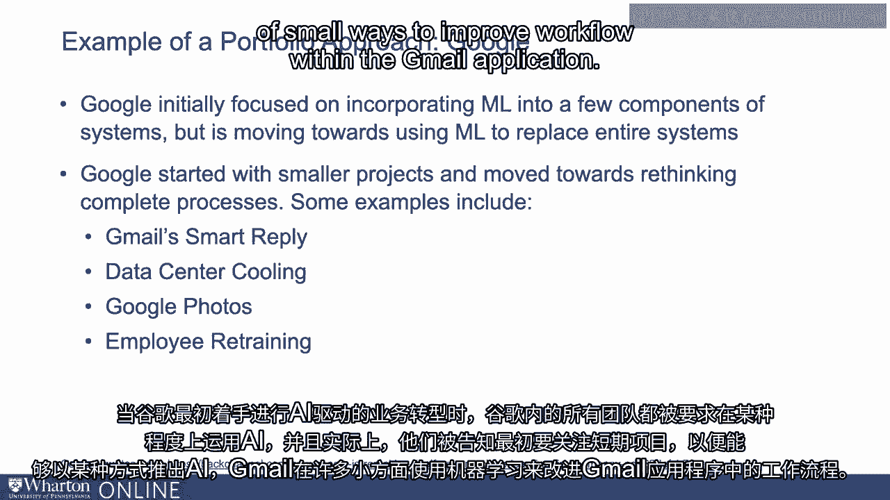

这种端到端的自动化在长期内可以降低成本，同时也改善了客户体验，赢得了客户信任。

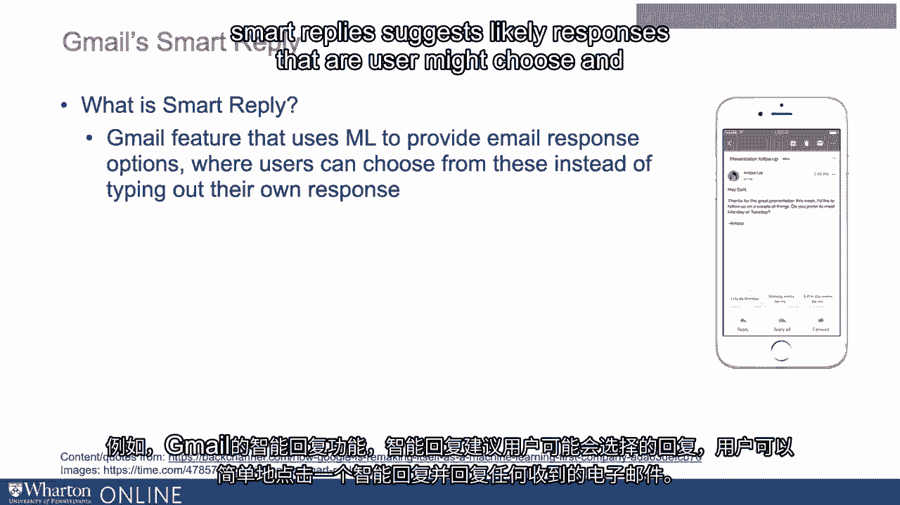

---

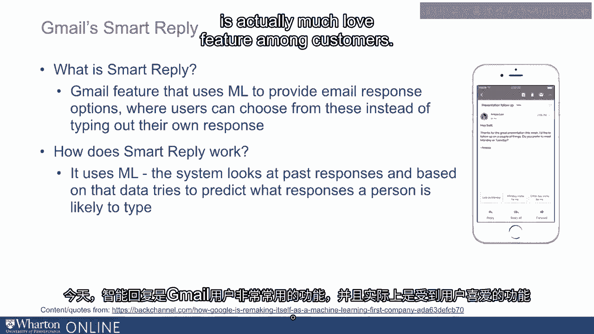

## 🌟 成功案例：谷歌的AI优先战略

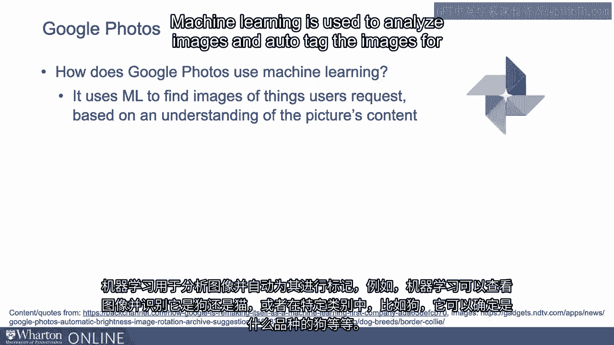

我刚才倡导的投资组合方法，是一些公司取得巨大成功的关键。谷歌就是一个很好的例子。

几年前，谷歌首席执行官Sundar Pichai宣布希望成为一家“人工智能优先”的公司。他们希望利用机器学习转变多种产品，并带来整个组织的变革。

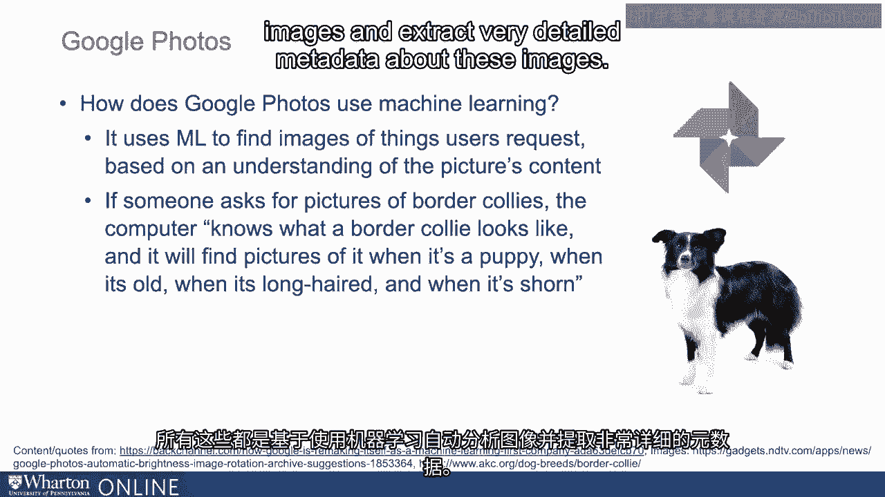

**谷歌的策略包括：**

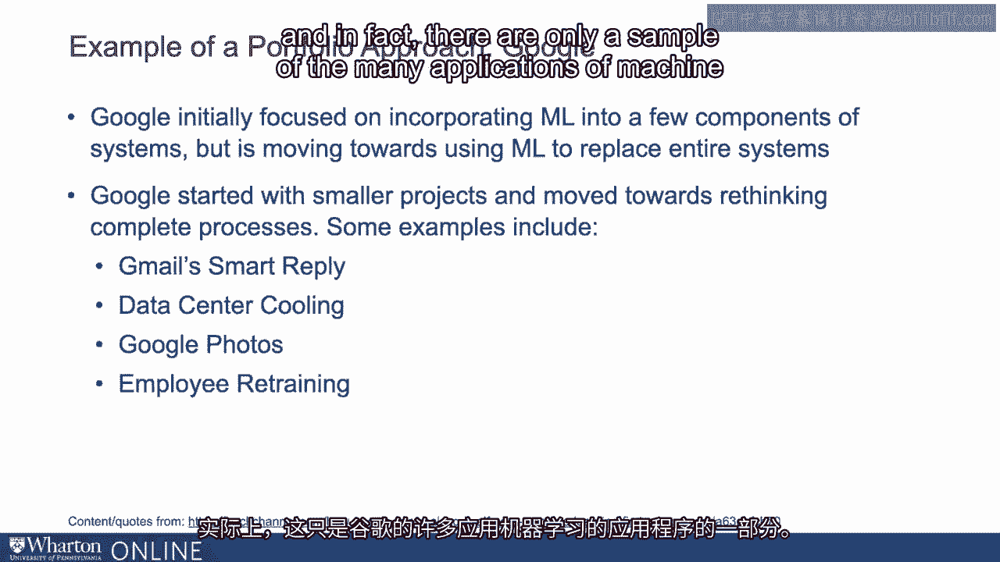

1.  **项目组合**：他们同时考虑了长期的倡议（如无人驾驶汽车），也要求所有产品团队（如Gmail、Google Photos、数据中心、人力资源等）以某种形式整合人工智能，最初专注于短期项目。
2.  **技能扩散**：除了项目，谷歌还进行了大规模的培训活动，包括在线课程和“驻留计划”，让员工与机器学习团队合作数月，学习技能后再回到原团队，使AI技能在整个公司去中心化。
3.  **初期重心**：他们最初的重点是帮助员工获得机器学习的经验和技能，而不是要求立即展示投资回报。这为后续更具雄心的项目奠定了基础。

**具体产品示例：**
*   **Gmail智能回复**：基于机器学习，分析邮件内容并推测用户可能使用的回复，用户只需点击即可发送。这始于简单的机器学习应用，后发展成重要功能。
*   **Google Photos图像识别**：机器学习用于自动分析图像内容（如识别狗、猫及其品种），并提取详细元数据，从而极大地增强了图像搜索能力。

谷歌的AI战略成功，正是因为它平衡了长期愿景与短期实践，并投资于全公司范围的能力建设。

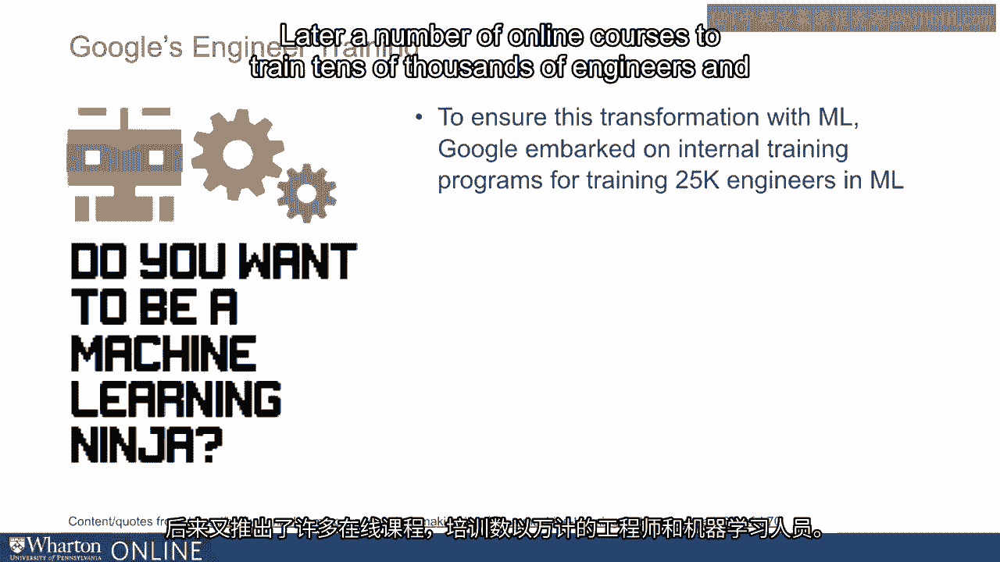

---

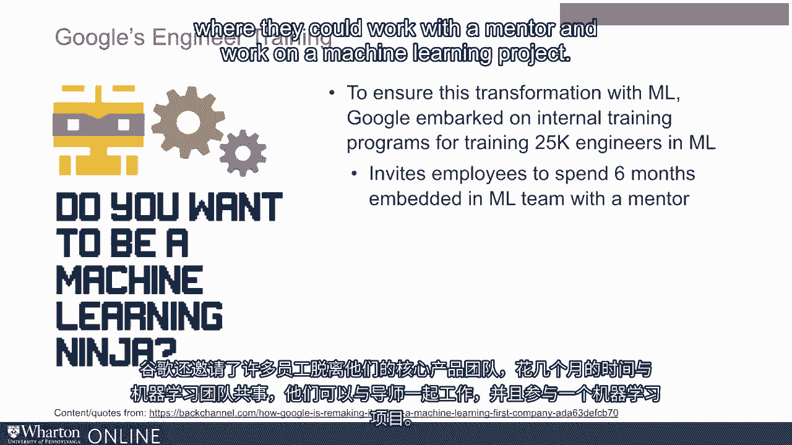

## 🛠️ 实践练习：为你的组织构建AI组合

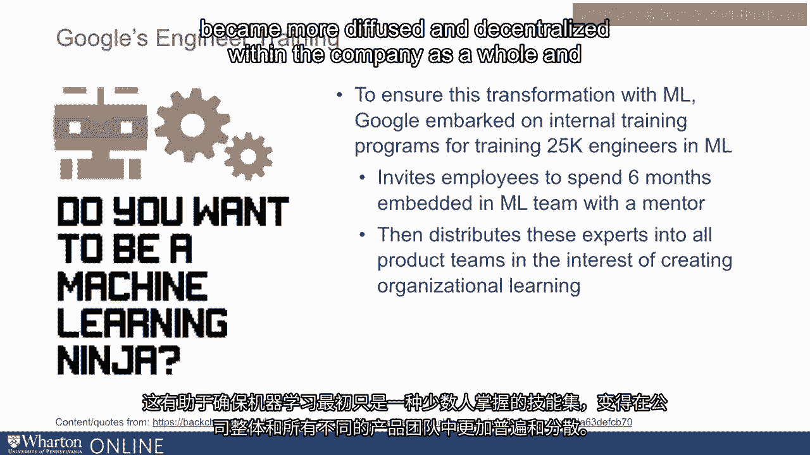

这是一个我建议你在组织内尝试的简单练习，可以与团队以研讨会形式进行。

**以下是具体步骤：**

1.  **识别机会**：首先，识别出可以通过机器学习实现自动化的活动集合。这些活动可以跨多个职能或产品团队。目标是列出几十个相关活动。
2.  **分类活动**：将这些活动分为两类：
    *   **短期活动**：可以在大约六个月内见效的项目。
    *   **长期活动**：需要数年时间才能完成的项目。
3.  **评估与筛选**：基于投资回报率评估和公司现有数据资产，从上述列表中筛选出一个较小的子集，作为未来三年的投资组合。这个组合可以由几个（如5-6个）短期活动和一到两个长期活动组成。
4.  **团队辩论**：在管理层和团队内进行辩论，讨论哪些活动值得追求。这样的辩论是健康的，有助于完善投资组合。
5.  **确定组织架构**：你需要弄清楚AI团队将如何融入组织架构。是设立独立的中央AI团队，还是将AI能力分散到各个产品团队中？适合的方案取决于公司的规模和文化。

这个练习有助于促成关于AI战略的健康对话，并明确执行路径。

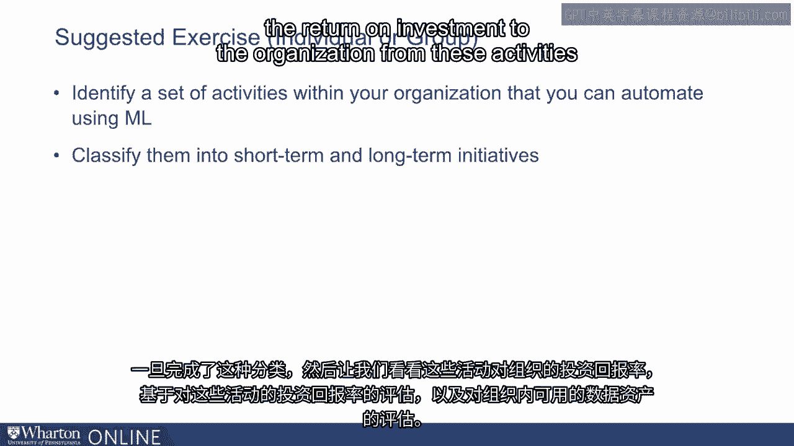

---

## 📝 课程总结

在本节课中，我们一起学习了如何构建一个平衡的人工智能项目组合来推动公司转型。我们探讨了：

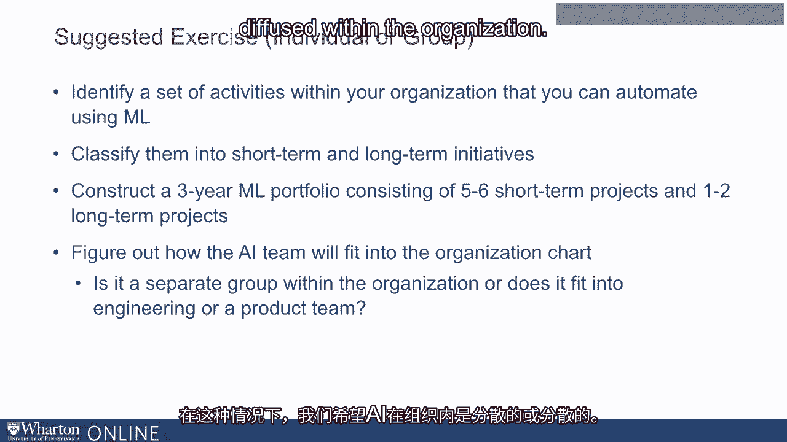

*   **速赢项目**的价值在于建立共识、培养技能和降低初始风险。
*   **长期战略项目**的目标是创造竞争优势和实现端到端的流程革新。
*   通过**谷歌的案例**，我们看到了结合项目组合、技能培训和去中心化推广的成功模式。
*   最后，我们介绍了一个**实践练习**，帮助你为所在组织识别、分类并规划人工智能投资组合。

记住，成功的人工智能转型不是追求单个“杀手级应用”，而是通过一系列有策略的、大小结合的项目，持续积累能力和推动变革。