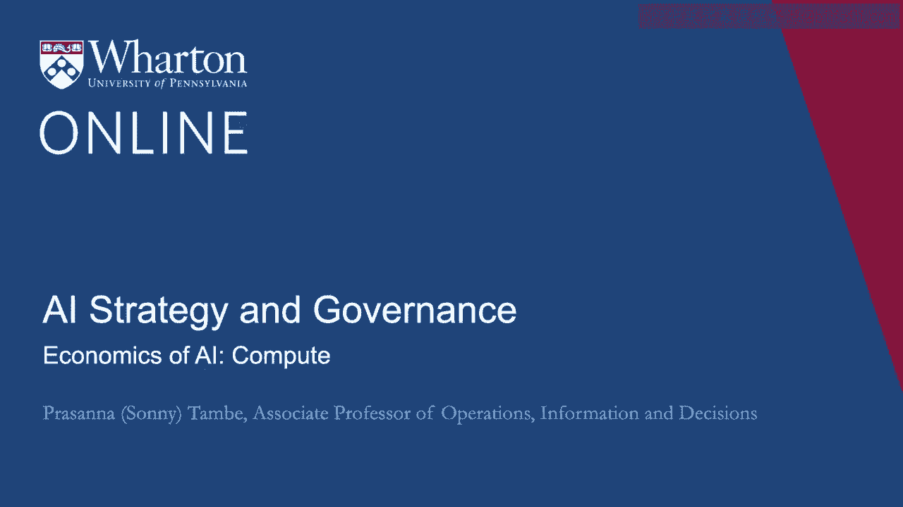
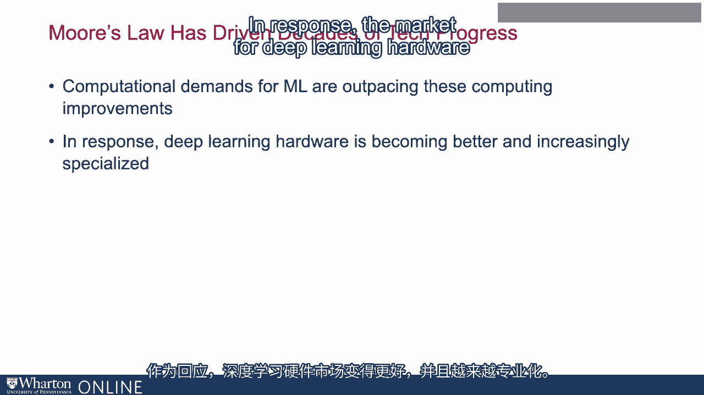
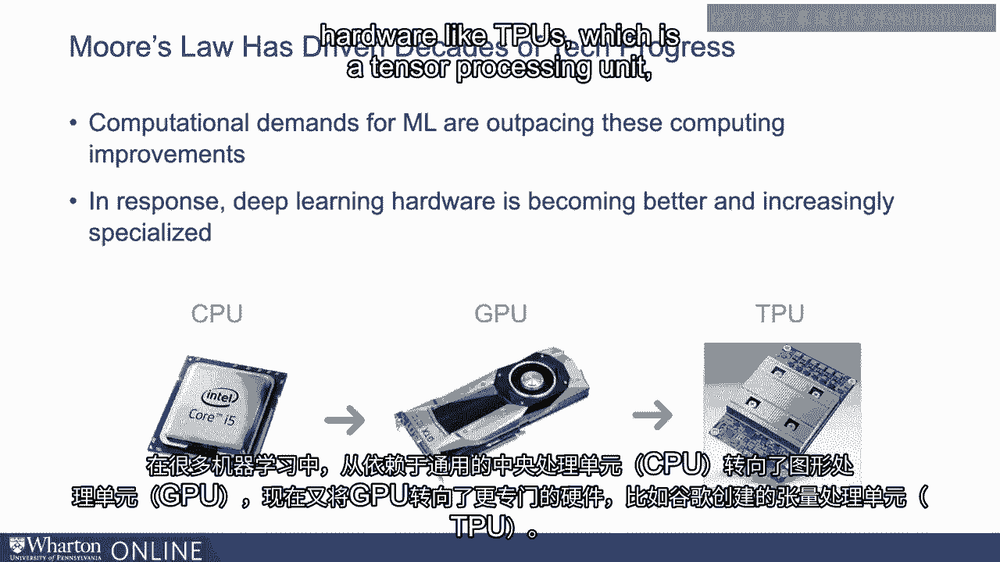
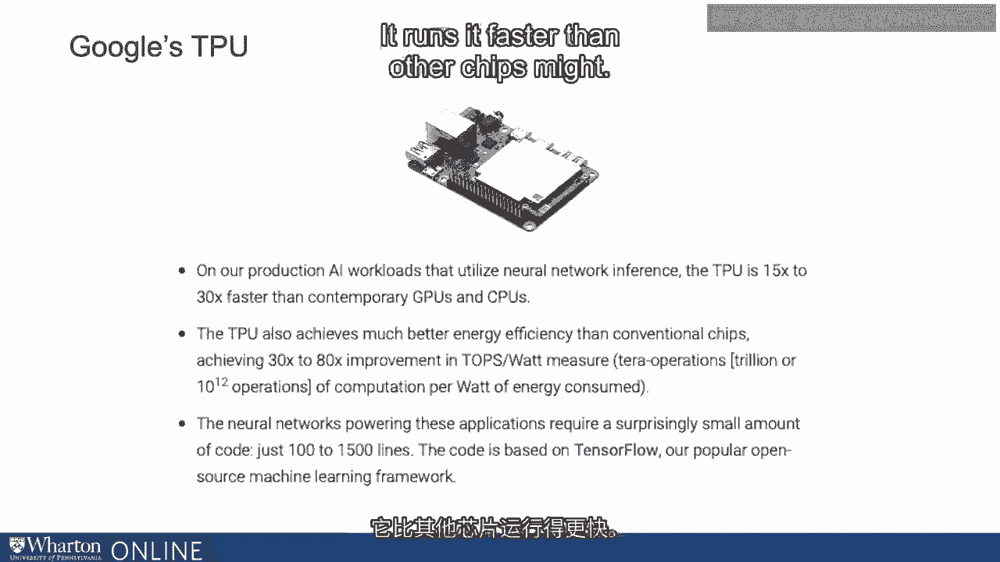
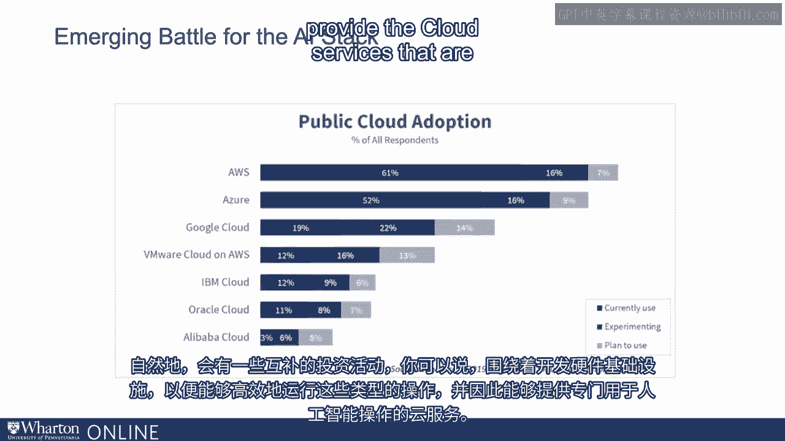

# 107：AI计算的经济学 💰

在本节课中，我们将要学习人工智能（AI）计算背后的经济学原理。我们将探讨计算需求如何增长、硬件如何演变以适应这些需求，以及这对企业和云服务市场意味着什么。

---

随着人工智能在软件应用方面变得更加容易使用，所需的技能门槛也在降低。

我们将看到更多的组织和地区，将这类技术应用于更多的场景。迄今为止，机器学习的许多进展都是由**摩尔定律**推动的。这条定律基本上主导了芯片计算速度和存储能力的技术进步。这些进步是近期机器学习取得诸多改善的主要驱动力。

上一节我们介绍了推动AI发展的计算基础。本节中我们来看看，当机器学习扩展到更多组织和用例时，会发生什么。

虽然机器学习正在普及，但其计算需求将开始超过硬件本身的改进速度。随着人工智能被更多人和更多场景使用，我们需要越来越强大的计算能力来构建和运行这些应用所需的模型。

因此，作为对上述需求的回应，深度学习硬件市场正在变得更好且日益专业化。

以下是机器学习硬件依赖的演变过程：
*   许多机器学习任务已从依赖**CPU**（中央处理单元，通用处理器）转变。
*   现在正从**GPU**（图形处理单元）转向更专业的硬件，如**TPU**（张量处理单元）。TPU是谷歌创造的专用芯片。

此外，初创公司中专门为机器学习计算开发AI芯片的市场也十分活跃。在消费电子领域，例如苹果公司在开发其新芯片时，就加入了一个专注于机器学习的核心组件。因此，围绕定制硬件和专门化的活动与投入一直非常强劲，且发展迅速。

理解了硬件专业化趋势后，我们还需要关注另一个关键因素：效率。

在某些情况下，运行机器学习应用时，能源效率也是一个重要考量。例如，谷歌的TPU被专门设计用来高效运行TensorFlow框架背后的特定算法逻辑。它不仅运行速度比其他芯片更快，而且能效也更高。

那么，为什么我们要如此关注计算呢？因为这无疑是围绕人工智能兴起的新兴背景。

如果我们思考这些公司为何投资制造能够运行、构建和训练机器学习算法的芯片和硬件，原因在于未来几年将发生大规模转变：企业将寻求利用人工智能，并找到能提供所有后端计算支持的供应商。我们考虑的许多应用需要的计算量过于庞大，无法在组织内部运行，或者自行运行非常不便。

因此，一些大型云服务提供商，如亚马逊、谷歌、微软，都对成为AI计算的云端后端表现出浓厚兴趣。这自然是一种互补的投资活动，主要是为了开发能够高效运行此类操作的硬件基础设施，从而能够提供专门针对AI操作的高效云服务。

最后，我们来看看这个新兴市场的竞争格局。这场关于“AI技术栈”主导权的竞争才刚刚开始。

你可以看到亚马逊、谷歌、微软在这方面的大量活动。它们以及其他参与者都在努力确保，当人们想要在云端运行AI时，能够理解其需求，并由这些公司提供实现需求的后端服务。新的竞争者正在进入这个市场，例如特斯拉最近就宣布将提供该领域的服务。这是一个将持续发展的市场，特别是围绕运行机器学习算法所需的计算资源。

---

**本节课总结**

在本节课中，我们一起学习了AI计算的经济学。我们了解到，AI的普及带来了爆炸式增长的计算需求，这推动了硬件从通用CPU向专用GPU和TPU的演变。能源效率成为关键考量。为了满足企业庞大的计算需求，一个由大型云服务商主导的、提供高效AI计算后端服务的市场正在形成并激烈竞争。计算能力已成为AI发展和应用的核心经济要素之一。