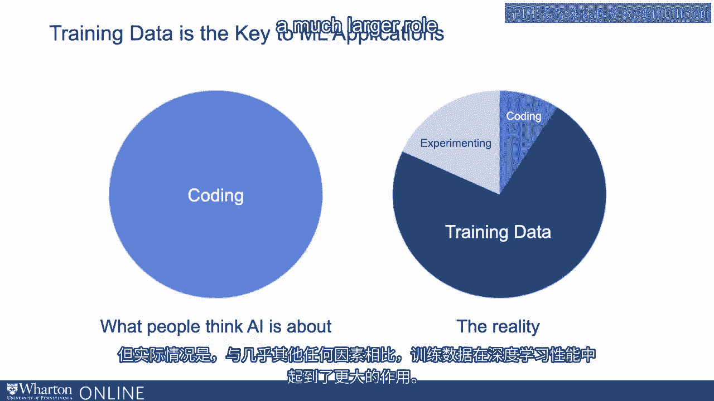
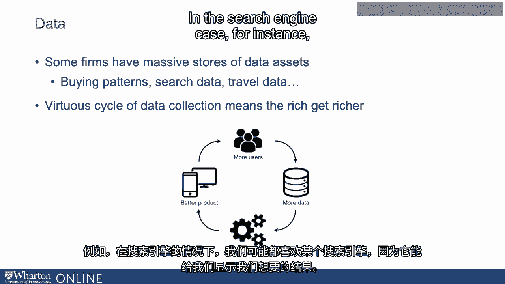

# 108：AI数据的经济学 📊

在本节课中，我们将探讨数据在机器学习，特别是深度学习中的核心作用，并分析数据如何成为现代AI经济中的关键资产。

---

## 概述

我们之前讨论过软件与计算技能。机器学习的最后一个关键输入是数据。训练数据确实是机器学习应用的核心。普遍观点认为，编码与其他输入结合能产生差异化的应用。但现实是，训练数据在深度学习性能中扮演着更重要的角色。

---

## 数据：性能的关键差异化因素

与几乎其他任何因素相比，数据的获取是机器学习领域性能的一个关键差异化因素。

与数据相关的一个细微差别在于，它和深度学习以及其他类型的机器学习模型的关系不同。事实证明，对于大多数传统的、浅层的机器学习模型，随着数据规模的增加，性能虽然会提升，但最终会达到一个瓶颈。

然而，深度学习模型处于一个非常不同的状态。对于深度复杂的神经网络应用，性能会随着数据规模的扩大而**持续提升**，并且这种提升已经持续了很长时间。

这意味着，对于依赖复杂深度学习网络的应用，拥有大量数据能带来巨大的优势。这引出了“数据是新的石油”这一说法。

---

## “数据是新的石油” 💎

对于复杂的应用，例如自动驾驶汽车，有些公司长期收集关于如何使用传感器输入数据进行决策的数据，从而积累了庞大的数据集。

从某种意义上说，数据是新的石油，因为它能以许多其他公司无法轻易复制的方式，为这些预测任务创造价值。

因此，一些公司拥有关于用户购买、行为模式等的大量数据资产。如果你是一个在线网站或信用卡公司，自然会收集搜索、旅行等数据。这些庞大的数据资产已经非常有价值。

随着利用数据在机器学习意义上做出预测变得越来越容易，它们的价值只会进一步增长。

---

## 数据的良性循环与马太效应

我们通常可以看到围绕数据收集的良性循环，本质上是一种“富者愈富”的马太效应。

你拥有的数据越多，你能构建的产品就越好。产品越好，你就能开始收集更多的数据。

以搜索引擎为例，我们都可能更喜欢某个特定的搜索引擎，因为它能展示我们想要的结果。但我们使用得越多，它就能收集到更多的数据来改进自身。

这导致了一个良性循环。在数据驱动的经济中，往往是那些数据丰富的实体继续变得越来越“富有”，逐渐拉开了与那些缺乏数据资产的竞争者之间的差距。

对于那些在起步和积累数据资产方面很困难的公司来说，即使他们能构建出同样高质量的算法，也难以弥补数据上的劣势。

---

## 总结

本节课中，我们一起学习了数据在AI，尤其是深度学习中的核心地位。我们了解到，数据规模对复杂神经网络的性能有持续的正面影响，这使得数据成为极具价值的战略资产。“数据是新的石油”这一比喻形象地说明了其难以复制的经济价值。最后，我们探讨了数据收集的良性循环和马太效应，解释了为何数据优势能在竞争中形成强大的壁垒。