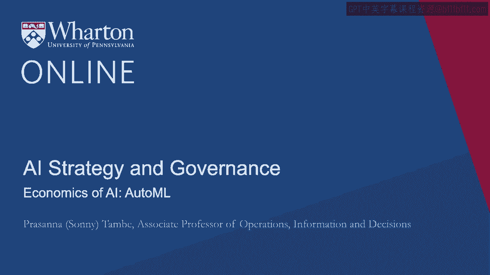
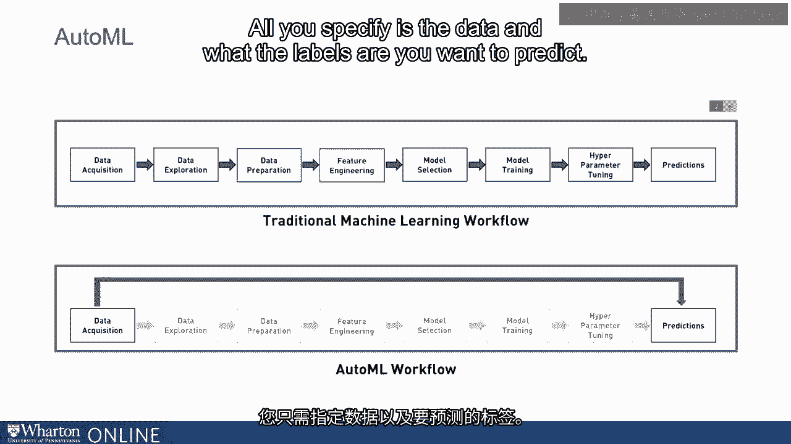
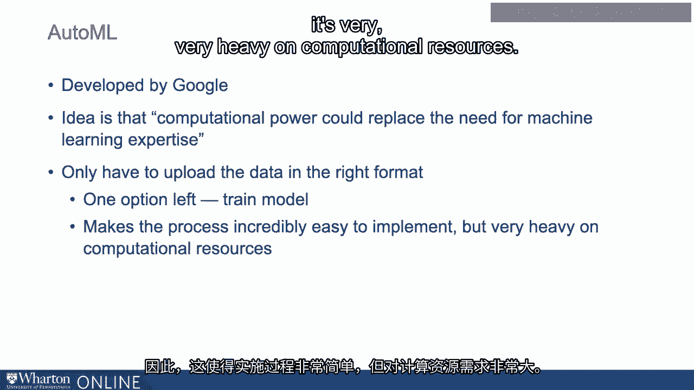
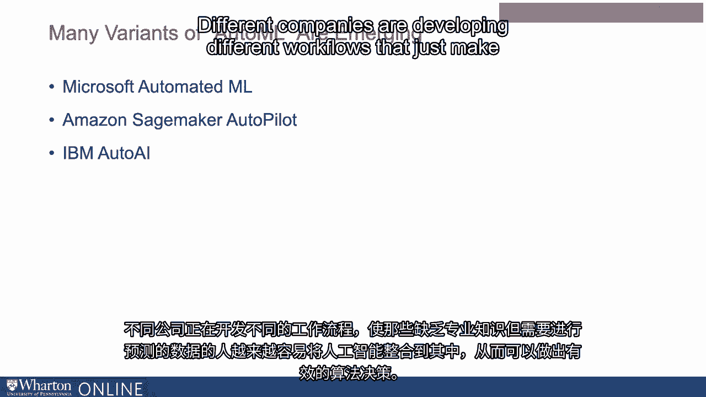
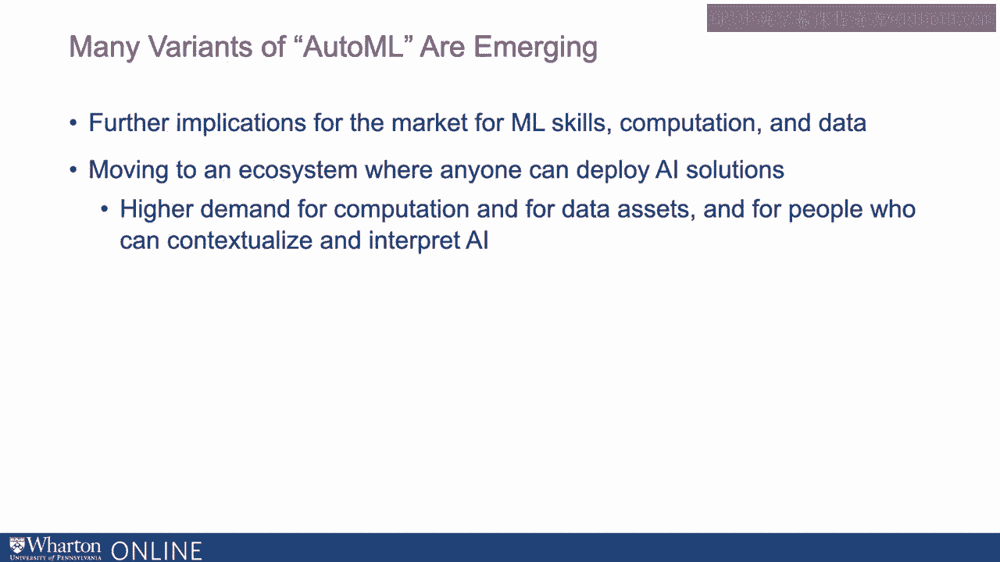

# 109：自动机器学习的经济学 💰🤖

在本节课中，我们将要学习自动机器学习（AutoML）的概念及其对机器学习领域经济学的影响。我们将探讨AutoML如何通过大量计算来替代专业知识，以及它如何改变数据、计算和技能在机器学习中的相对重要性。

---

我们一直在讨论数据和计算在机器学习中变得越来越重要。

在这个过程中，软件和技能的重要性可能会稍微降低。下一个阶段可能会将这种趋势提升到更高的层次。越来越多的工作流程正在被提供，它们真正允许人们开发机器学习应用，而几乎不需要软件或技能专业知识。

例如，**AutoML**（自动化机器学习）本质上是一个工作流程。它将我们从数据收集、清理、标记、数据准备、特征工程，到运行模型、优化和查看预测的整个机器学习过程整合在一起。AutoML接管了这个工作流程中的几乎所有步骤。

你需要做的只是获取数据，然后运行它直到得到预测。

---

## AutoML 的工作原理 ⚙️

上一节我们介绍了AutoML的基本概念，本节中我们来看看它的工作原理。AutoML的工作方式本质上是不断投入计算资源，直到它可以替代许多不同类型的专业知识。

以下是AutoML的核心运作方式：

*   AutoML能够对给定问题进行大量计算，从而尝试不同的模型变体。
*   它会持续运行，直到找出最佳模型。
*   你甚至不需要指定要运行的具体模型类型，AutoML会自行找出最佳模型。
*   它只是在这个问题上投入了大量计算。
*   你只需指定数据以及你想要预测的标签。

---

## AutoML 的实践与成本 💸

了解了原理后，我们来看看AutoML的实际应用和背后的经济学。AutoML是Google开发的一款产品，可以通过Google Cloud运行。

我们从Google关于AutoML的讨论中了解到，他们的想法是利用计算能力来替代对机器学习专业知识的需求，只是让运行过程变得越来越简单。如果你按照其工作流程进行，你只需要以正确的格式上传数据。

以下是使用AutoML的典型步骤：

1.  你上传带有训练标签的数据。
2.  此时，实际上只剩下一个选项：训练模型。
3.  这使得过程极其容易实现，但在计算上却非常消耗资源。

例如，如果我通过AutoML运行模型（我已经做过好几次），我上传数据并开始训练模型。然后在几个小时内，我会收到一封包含结果的电子邮件。Google会尝试不同的模型，告诉我哪个是最佳的，并附上结果。当然，我也会收到账单。这是通过他们的云服务运行的，我正在利用他们的计算资源。

这使得一切比以往任何时候都更简单，但它将一部分我所需的专业知识成本，转移到了后端的计算成本上。他们只需将结果发送到我的邮箱，并附上云服务的使用账单。这实际上意味着用越来越多的原始计算能力来交换专业知识。

---

## 更广阔的AutoML生态 🌐

我们谈到了Google的AutoML，但市场上还有许多其他类型的自动化机器学习解决方案。

以下是不同公司提供的类似服务：

*   微软称之为 **自动化机器学习**。
*   亚马逊提到 **SageMaker Autopilot**。
*   IBM则称之为 **AutoAI**。

这些不同的公司正在开发不同的工作流程，旨在使机器学习变得越来越简单。

对于专业知识较少但拥有强大数据和预测需求的人来说，这些工具能够帮助他们以一种有效做出算法决策的方式整合AI。这当然会产生影响，只会对市场、机器学习技能和计算资源的重要性产生进一步的影响。

我们本质上正在朝着一个生态系统发展，**任何人都应该能够部署AI解决方案**，但对计算和数据资产的需求将会更高。正如我们接下来将讨论的，也许对于那些能够对数据和AI预测进行情境化和解释的人，需求也会增加。

---

## 总结 📝

本节课中，我们一起学习了自动机器学习（AutoML）的经济学。我们了解到，AutoML通过封装复杂的工作流程和投入大量计算资源，显著降低了对专业机器学习技能的门槛。这使得数据和计算资源的重要性进一步提升，而专业技能的成本部分转移为云服务的计算成本。整个行业正在朝着让AI部署更普及的方向发展，但同时也加剧了对优质数据和强大计算能力的依赖。