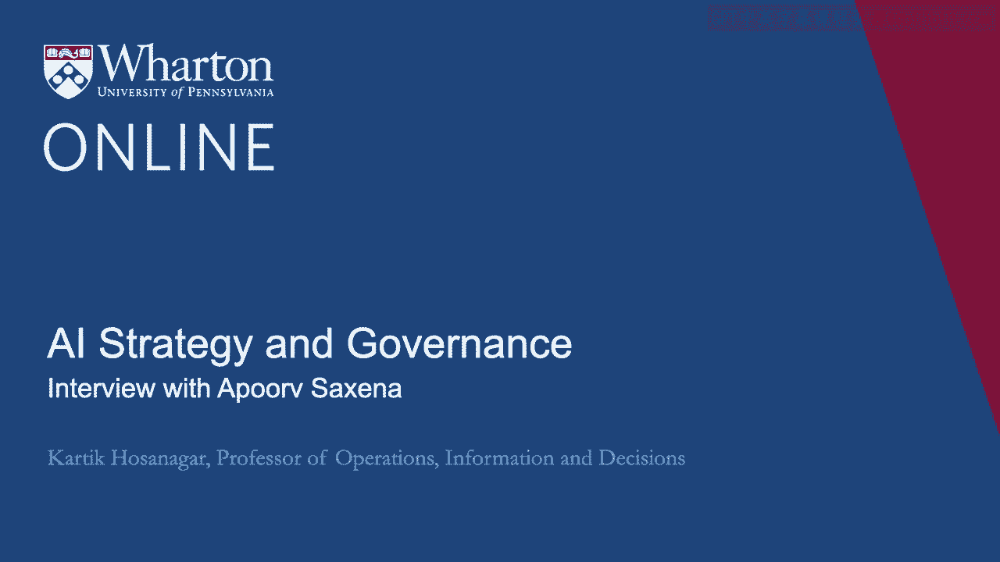

# 112：AI战略与规模化应用 🚀



在本节课中，我们将学习如何构建一个能产生实际回报的AI战略。我们将探讨成功实施AI所需的三个核心支柱，并通过具体案例理解如何利用AI创造变革性的商业价值。

---

上一节我们介绍了AI投资的普遍现象，本节中我们来看看，企业要想从AI投资中获得显著回报，需要具备哪些关键条件。

Apoorv Saxena指出，启动AI项目虽然简单，但要产生巨大影响，需要关注以下三个方面。

以下是实现AI规模化影响的三个核心支柱：

1.  **构建可规模化的AI基础设施**
    这意味着企业需要具备完善的数据基础。数据必须易于发现和标注，同时拥有大规模训练和部署模型的能力。这构成了**AI基础设施**的核心。像谷歌、Facebook这样的公司在此投入巨大，这也是他们能领先行业的原因。

2.  **端到端地审视业务流程**
    不应只关注流程中的单个环节，而应审视整个端到端的业务流程，并系统性地思考AI如何优化或改造整个流程。

3.  **利用AI创造全新的数字体验**
    这是能随时间产生最大影响的领域。AI在对话交互和内容生成方面的进步，使得创造几年前无法想象的新体验成为可能。

---

上一节我们列出了三大支柱，本节我们来深入探讨“创造新体验”这一战略要点。

当谈论创造新体验时，具体指的是利用AI彻底改变人机交互的方式。这主要得益于两项进展：**对话式交互**和**机器生成内容**。

以下是一个在金融领域的应用示例：

通常，与私人财富顾问进行的低接触、高频率的互动是银行希望自动化的环节。例如，早上醒来后，你可以通过智能助手（如Alexa）联系银行并询问：
```python
# 示例交互
用户: “我的投资组合今天表现如何？”
AI助手: “下跌了2%。”
用户: “为什么下跌了2%？”
AI助手: “您的投资组合中X股票因市场波动下跌，占总跌幅的1.5%...”
```
这种交互门槛低、频率高，但如今可以轻松实现自动化。这就是AI所创造的新体验。

---


本节课中我们一起学习了构建有效AI战略的三个核心支柱：**可规模化的基础设施**、**端到端的流程视角**以及**创造新数字体验**。关键在于，在启动大型AI项目前确保数据与平台就位，系统性地改造整个业务流程，并积极利用AI技术开辟全新的客户交互与价值创造模式。这不仅是优化现有操作，更是公司取得战略性突破的关键。