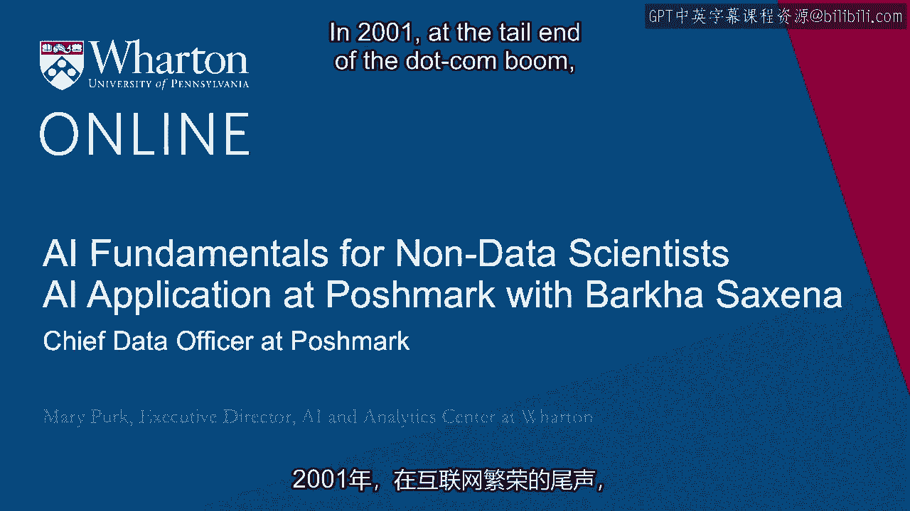

# 114：首席数据官访谈 - 数据科学在社交电商平台的应用 🎤📊

在本节课中，我们将学习 Poshmark 首席数据官 Barkha Saxena 的访谈内容。她将分享在社交电商平台中，如何构建数据基础设施、训练算法模型以及利用机器学习来服务买家和卖家的实践经验。

---

## 概述

Barkha Saxena 于 2001 年网络泡沫末期开始了她的数据科学职业生涯。如今，她担任 Poshmark 的首席数据官。Poshmark 是一个融合了实体购物人际连接与电子商务便利性的社交市场平台。本节课将探讨她的角色、团队影响以及数据科学在平台中的具体应用。

---

## 数据基础设施的构建 🏗️

Barkha 在 2014 年加入 Poshmark 时，公司规模尚小。她的首要任务是构建数据基础设施。这一步骤为后续所有数据应用奠定了基础。

以下是构建数据基础设施的核心步骤：

1.  **事件模式设计**：设计深思熟虑的事件模式来收集新数据。
2.  **数据建模**：通过数据建模来丰富原始数据。
3.  **数据存储**：构建数据表，确定数据是批处理还是实时存储。

构建稳固的数据基础设施，使得团队能够有效区分和利用买家和卖家的行为数据。

---

## 算法训练与特征工程 ⚙️

上一节我们介绍了数据基础设施的构建，本节中我们来看看如何利用这些数据来训练算法。一切始于明确的商业问题。

以下是训练算法的关键流程：

1.  **定义商业问题**：例如，目标是提升购买转化率还是优化商品列表质量。
2.  **特征工程**：根据商业问题，从数据中创建相关特征。例如，为购买推荐模型，主要提取与用户购买行为相关的信号。
3.  **目标函数设定**：确保算法训练针对正确的目标（如买方行为或卖方行为）。
4.  **模型训练与验证**：训练模型，并与业务团队讨论以获取反馈。

在某些情况下，如识别“核心用户”，需要综合买卖双方的数据特征来训练模型。

---

## 模型的可解释性与业务协作 🤝

当我们构建了复杂的模型后，确保其可被理解并与业务目标对齐至关重要。Barkha 是“可解释AI”的坚定支持者。

以下是确保模型可解释性与有效性的方法：

1.  **业务团队审核**：任何模型在最终确定前，都必须经过业务或产品团队的审核。
2.  **融入领域知识**：与市场、运营等一线专家合作，确保模型不仅依赖历史数据，还能适应策略变化。
3.  **简单清晰的解释**：能够用简单的语言向任何人解释最复杂的模型。

这种协作流程确保了模型能够解决真实的业务问题，并具有长期的适用性。

---

## 移动优先战略与机器学习赋能 📱

Poshmark 的成功很大程度上得益于其早期对移动端的押注。创始人 Manish 预见到移动设备将成为购物主要入口，这一远见为数据应用创造了巨大舞台。

机器学习在提升移动端用户体验中扮演了核心角色：

*   **个性化体验**：利用用户历史行为数据，在信息流、搜索和推荐中提供个性化内容。
*   **平衡发现与熟悉**：算法不仅展示用户已知的喜好，也引入新的时尚灵感，促进探索。
*   **提升买卖匹配效率**：通过“需求匹配”和“供应匹配”等模型，高效连接海量商品与买家需求。

面对平台每天产生的海量互动数据，基于规则的系统无法胜任，必须引入能够持续学习和优化的机器学习智能。

---

## 总结

本节课中，我们一起学习了 Barkha Saxena 在 Poshmark 的数据科学实践。我们从构建坚实的数据基础设施开始，探讨了如何围绕具体商业问题训练算法并进行特征工程。我们强调了模型可解释性以及与业务团队紧密协作的重要性。最后，我们看到了移动优先战略如何与机器学习结合，为千万用户创造无缝且个性化的社交购物体验。其核心在于：**从清晰的业务目标出发，利用高质量的数据和智能的算法，持续优化平台两端——买家与卖家的体验。**