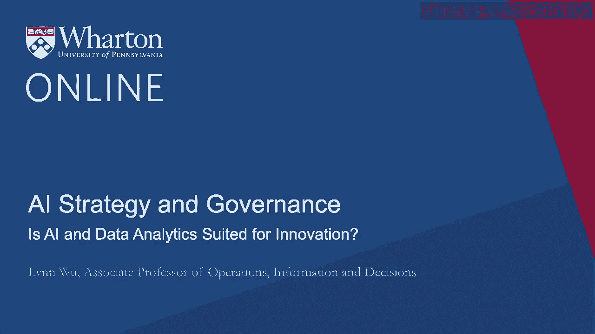
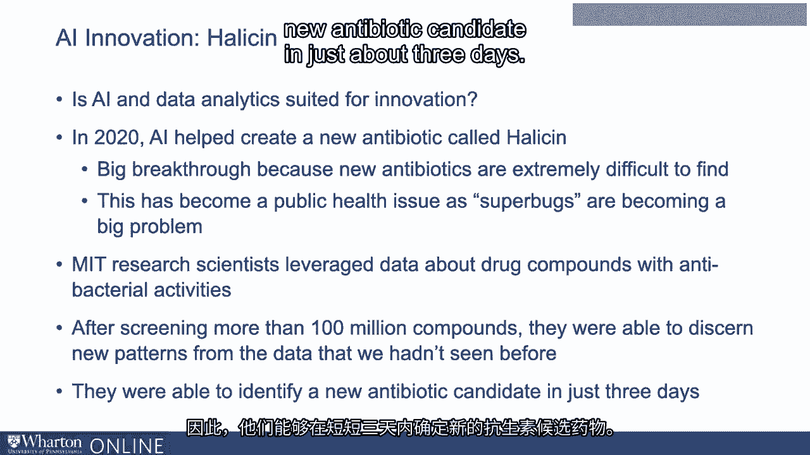
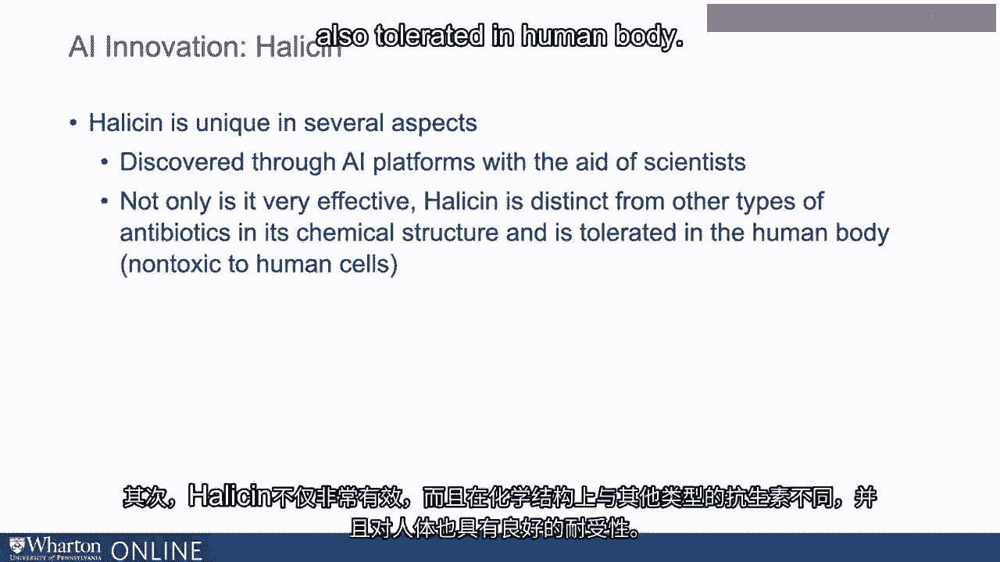
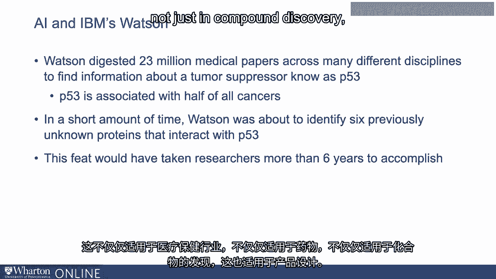
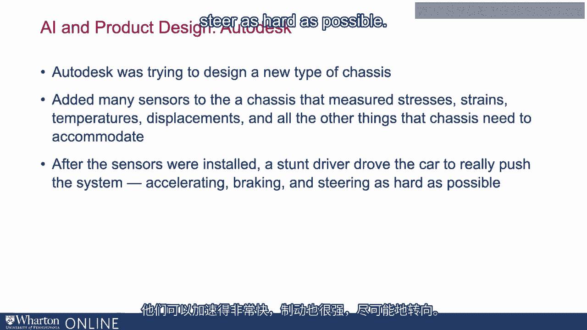
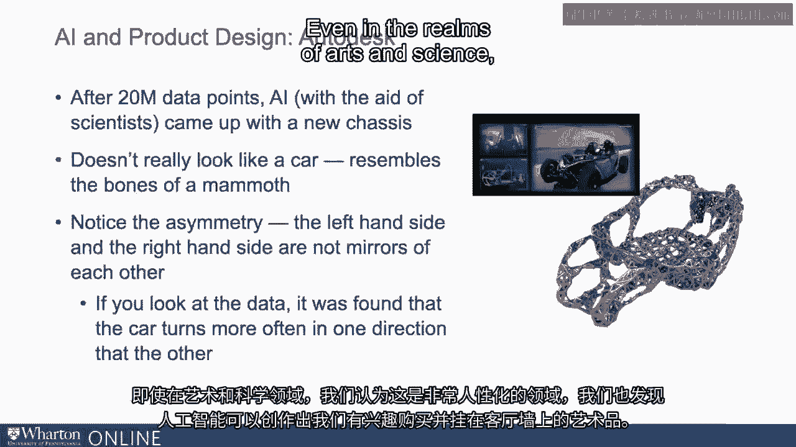
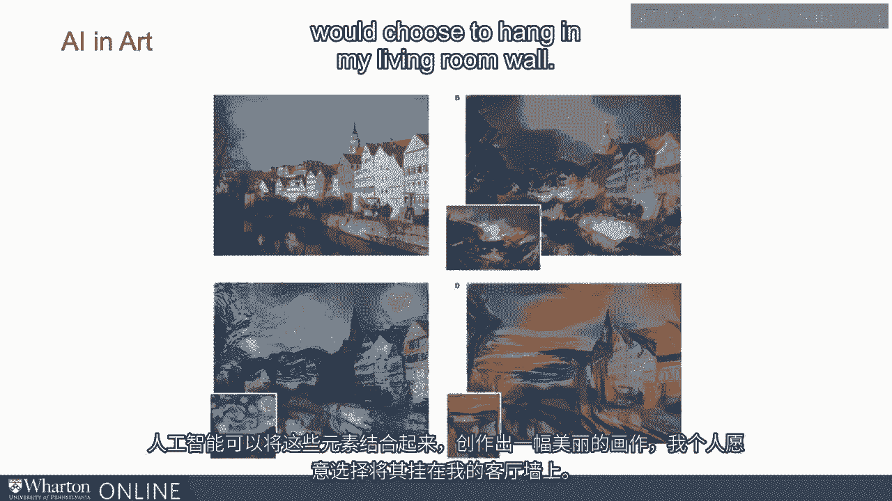
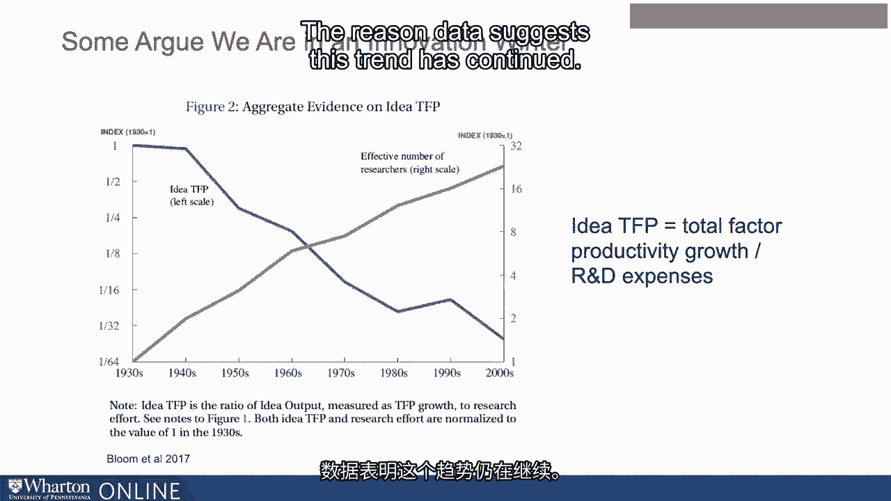
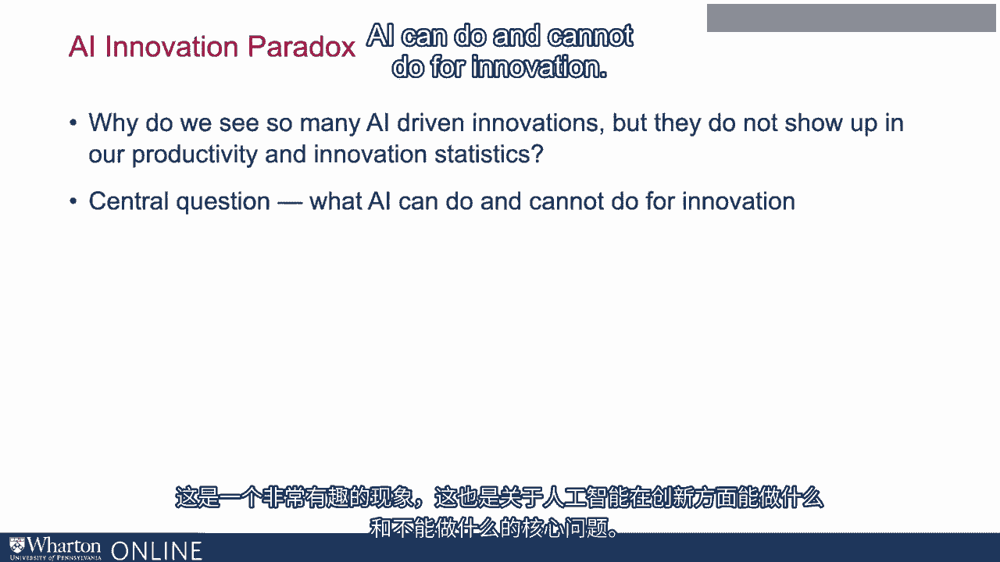

# 115：AI与数据分析适合创新吗？🤖💡



在本节课中，我们将探讨人工智能与数据分析在创新领域的应用与潜力。我们将通过具体案例，分析AI如何驱动突破性创新，同时也会审视宏观数据中呈现的创新悖论。

我叫林吴，是Wern商学院运营信息系的副教授。我的专业领域是研究人工智能对组织的影响，尤其关注其与创新的关系。

---

## AI驱动的创新案例 🚀

上一节我们介绍了课程主题，本节中我们来看看AI在现实世界中推动创新的几个具体案例。



### 1. 新抗生素的发现 💊

你可能在过去几年听过许多关于AI驱动创新的新闻。其中最著名的一个案例发生在2020年，AI协助创造了一种名为“Halicine”的新型抗生素。



这是一个重大突破，因为发现新型抗生素极其困难，这已成为一个重大的公共卫生问题。一群MIT的研究科学家利用了关于各种化合物及其抗菌活性的数据。在筛选超过一亿种化合物后，他们能够识别出数据中前所未有的新模式，从而发现了这种新抗生素。

**核心过程**：
```
输入：超过1亿种化合物的数据
处理：AI模型识别隐藏模式
输出：发现新型抗生素Halicine
```

Halicine在几个方面都很独特。首先，它是在AI平台的协助下被发现的。其次，它不仅非常有效，其化学结构也与其他类型的抗生素不同，并且在人体内具有良好的耐受性。

### 2. 医学研究的加速 🧬

几年前，IBM的沃森系统在医疗创新领域取得了重要成果。沃森消化了大约2300万篇涵盖多个学科的医学论文，以寻找关于一种名为P53的肿瘤抑制剂的信息。



P53非常重要，因为它与近一半的癌症相关。在短时间内，沃森分析了所有论文，发现了数据中的隐藏模式，并识别出六种之前未知的与P53相互作用的蛋白质。

**成就对比**：
*   **传统研究**：预计需要研究人员超过六年时间。
*   **AI辅助**：沃森在几周内完成。

### 3. 颠覆性的产品设计 🏎️



AI的创新不仅限于医药领域，也体现在产品设计上。例如，Autodesk公司尝试设计一种新型汽车底盘。

他们的方法是在底盘上部署大量廉价的传感器，用于测量压力、温度和位移等数据。安装传感器后，由特技车手进行极限驾驶，以收集极端工况下的数据。

经过收集约2000万个数据点，AI与八位科学家合作，设计出了一个全新的底盘。这个底盘的外观不对称，不像传统汽车，反而像一根猛犸象的骨头。

**设计逻辑**：
```
数据发现：汽车在一个方向的转向频率远高于另一个方向。
设计结果：承受更多压力的一侧结构得到加强，导致底盘外观不对称。
```



### 4. 艺术领域的创造 🎨

即使在艺术这种被认为非常人性化的领域，AI也能创造出令人感兴趣的作品。AI可以将一张普通照片与著名画作（如梵高的《星空》）的元素相结合，创造出一幅全新的、具有艺术美感的画作。

这个过程可以应用于许多其他著名画作，AI能够融合不同作品的元素，生成许多人愿意挂在客厅墙上的艺术作品。

---



## 创新的宏观悖论 📉

上一节我们看到了AI驱动创新的精彩案例，本节中我们来看看宏观统计数据揭示的另一面。

然而，如果我们查看尼古拉斯·布恩及其合著者在2017年制作的图表，会看到不同的景象。图表显示，尽管我们在研发上投入了更多资源（以绿色线表示有效研究人员数量），但人均创新产出（蓝色线）却呈现下降趋势。

**图表解读**：
*   **绿色线（投入）**：代表在研发上投入的资金和资源。
*   **蓝色线（产出）**：代表人均产生的创新量。

数据显示，从1930年到2000年，虽然资源投入持续增长，但创新产出的效率却在下降，并且这一趋势似乎仍在持续。



这就引出了一个核心问题：为什么我们看到了这么多由AI驱动的精彩创新案例，但这些成果似乎没有充分体现在整体的生产力和创新统计数据中？这是一个非常有趣的现象。

---



## 总结与下节预告 📚

本节课中，我们一起学习了AI在药物发现、医学研究、产品设计和艺术创作等领域推动创新的具体案例。同时，我们也看到了宏观数据中存在的创新效率悖论。


这引出了关于AI能力边界的核心问题：AI擅长进行什么样的创新，又不擅长什么样的创新？在我们下一个视频中，我将详细解释，对于不同类型的创新活动，什么样的AI是合适的，什么样的AI是不合适的。