# 118：人工智能与产品创新类型 🧠

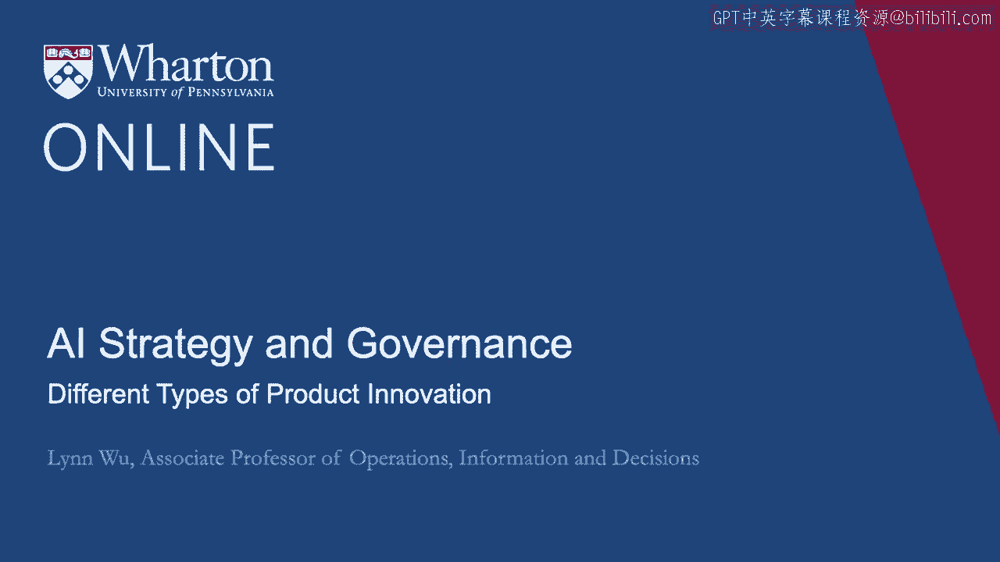

在本节课中，我们将探讨人工智能如何影响不同类型的产品创新。我们将区分“重组创新”与“根本性创新”，并通过数据和案例理解人工智能在其中扮演的不同角色。

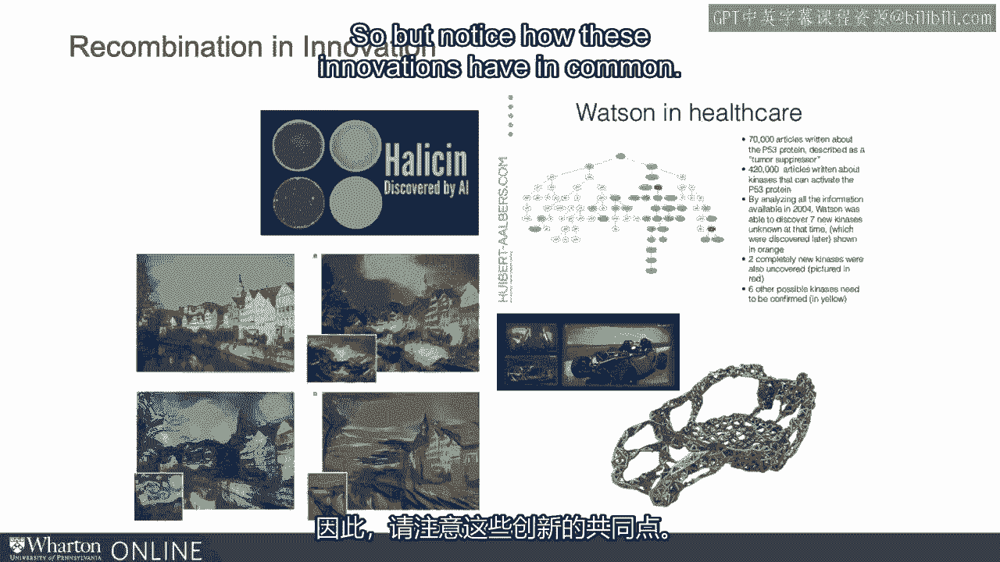

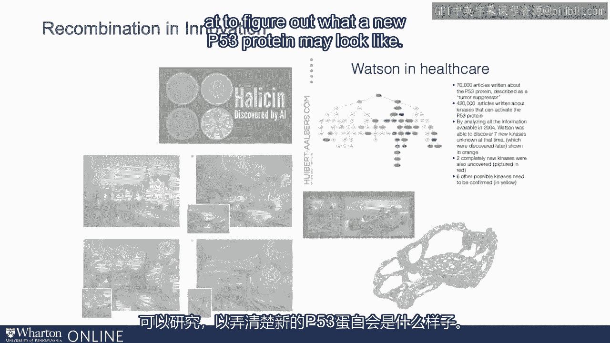

在上一节中，我们研究了通用产品创新的进展。本节我们将深入产品创新本身，分析其不同类型以及人工智能对它们的影响差异。

## 重组创新：人工智能的擅长领域 🔄

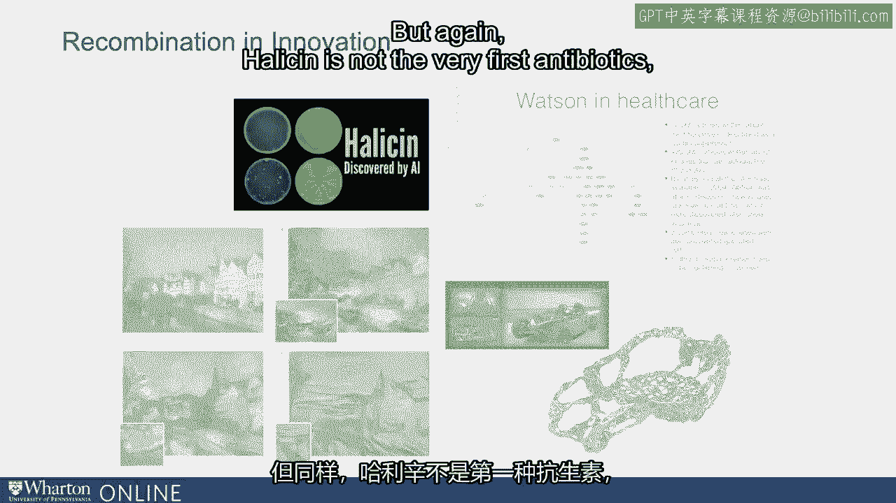

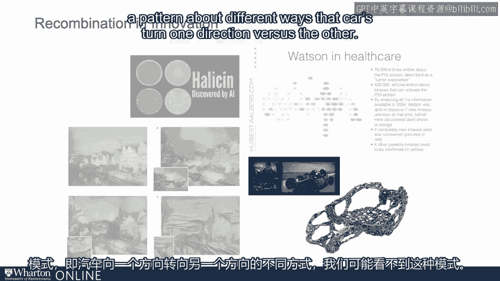

请注意，许多由人工智能驱动的创新案例都有一个共同点：它们都属于**重组创新**。这意味着将两种或多种现有事物以新的方式结合，创造出新事物。

以下是重组创新的几个例子：

*   **AI艺术生成**：将一张普通照片与梵高的《星夜》风格结合，生成一幅全新的画作。公式可表示为：`新作品 = 照片 + 著名艺术风格`。
*   **汽车底盘优化**：利用传感器数据和AI分析，改进现有底盘设计，使其性能提升。这本质上是将**传感器技术**、**数据分析**与**传统工程**相结合。
*   **新药物发现（如Halicin）**：通过分析海量的抗生素研究论文和药物相互作用数据，找出一种新的、有效的抗生素分子。这是将**跨学科信息**和**海量数据点**进行重组挖掘的结果。
*   **蛋白质研究（如P53）**：AI通过分析已知的P53蛋白及其相互作用蛋白的大量模式，帮助预测新的P53蛋白可能的结构。这是在庞大已知数据空间内寻找新的组合模式。

从本质上说，人工智能和分析技术极大地扩展了我们寻找创新组合的“搜索空间”。它擅长链接不同领域的知识，发掘隐藏的模式，从而找到以新方式结合现有技术的方法。

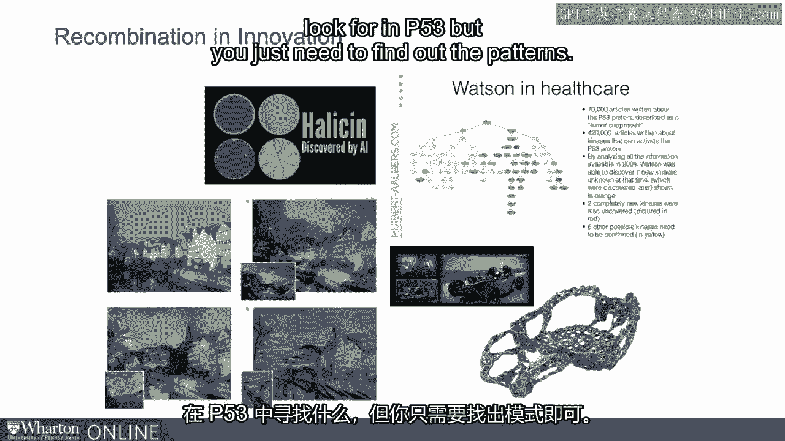

## 多样重组与根本性创新 🆕

人工智能不仅帮助组合事物，更擅长进行**多样重组**。这意味着将许多差异很大的元素以全新的方式组合起来。

例如，假设有三种现有技术：A、B、C。一个多样化的重组可能是结合A、B、C创造出全新的技术D。用公式表示：`D = A + B + C`（其中A、B、C差异显著）。

我们的假设是：**人工智能能极大地帮助我们发现这类多样化的重组创新**。它可以处理成千上万的元素，找出人类难以想象的有效组合。

然而，人工智能可能不擅长帮助我们发现**根本性创新**（或称为第一类创新）。例如，发现第一种抗生素——青霉素。这种之前完全不存在的技术类别，缺乏历史数据供AI学习，因此AI在促成此类从0到1的突破上能力有限。

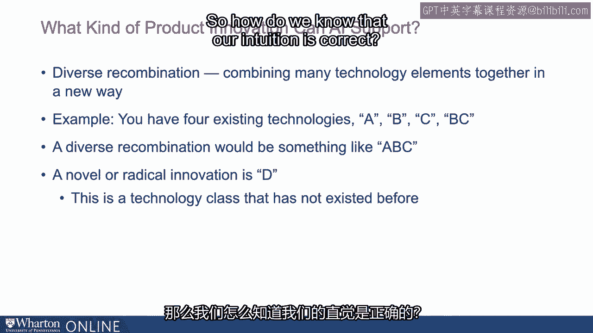

## 数据验证：专利分析 📊

我们如何验证“人工智能促进多样化重组”这个直觉呢？一种方法是分析专利数据。

以下是利用专利进行分析的几个维度：

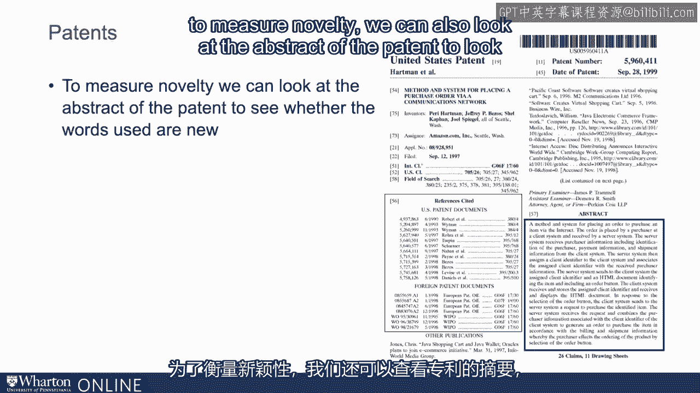

*   **技术分类代码**：专利有分类代码。如果一项专利是其技术类别中的第一个，则表明它非常新颖（可能是根本性创新）。
*   **引用专利**：一项专利会引用已有的技术（前案）。如果引用的专利来自许多不同的技术类别，则表明该专利是多样化重组的结果。例如，引用来自10个不同类别的专利，比引用10个同类别专利更具“多样性”。
*   **文本新颖性**：分析专利摘要中使用的词汇。如果某个词（如“HTML”）首次出现，表明该专利可能引入了全新概念。

通过分析企业的人工智能投资与其专利特征（是多样化重组还是全新技术）之间的关系，我们可以得到实证证据。

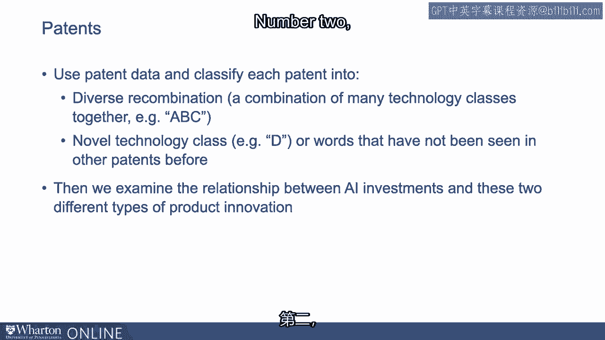

## 研究结果与生产力影响 📈

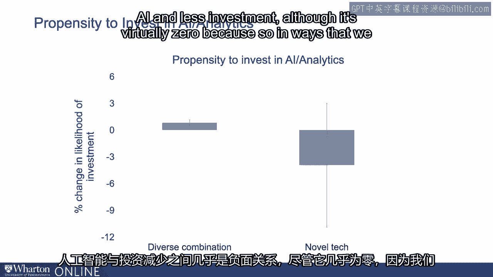

研究发现了明确的模式：

1.  **投资人工智能的企业**，更有可能产出**多样化重组**类型的专利（效应显著）。
2.  **投资人工智能的企业**，与产出**全新技术**（自身类别中的第一个）类型的专利之间，**几乎没有正相关**。
3.  **生产力影响**：同时投资AI并专注于重组创新的公司，获得了显著的生产力提升（约1%的变化，在宏观层面影响巨大）。而投资AI但专注于寻找全新技术的公司，则未见明显的生产力增益。
4.  **特异性**：这种效应是人工智能特有的，在一般的IT技术投资中并未观察到同样模式。

## 核心要点总结 🎯

本节课我们一起学习了以下核心内容：

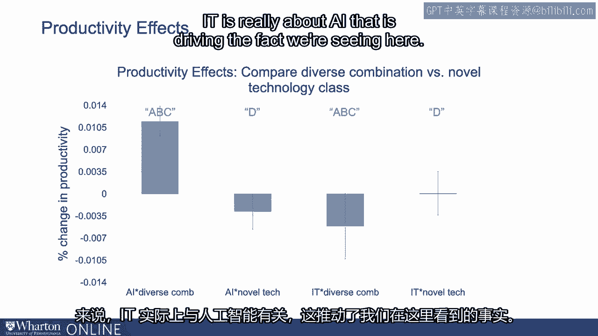

*   产品创新可分为**重组创新**（结合现有事物）和**根本性创新**（创造全新事物）。
*   **人工智能和分析技术非常擅长支持多样化的重组创新**。它通过处理海量数据，发现跨领域元素的创新组合。
*   人工智能在促进**根本性、全新技术**的诞生方面作用有限，因为这类创新缺乏可供学习的历史数据。
*   企业获得最大生产力收益的关键在于**组合策略**：即投资人工智能，并将其用于寻找和实现重组创新，而非单纯追求颠覆性的新技术。

这个发现也部分解释了为何有时感觉AI没有带来颠覆性突破——如果将AI用于寻找全新的“D”类技术，其效果可能远不如将其用于寻找“A+B+C”式的重组创新。

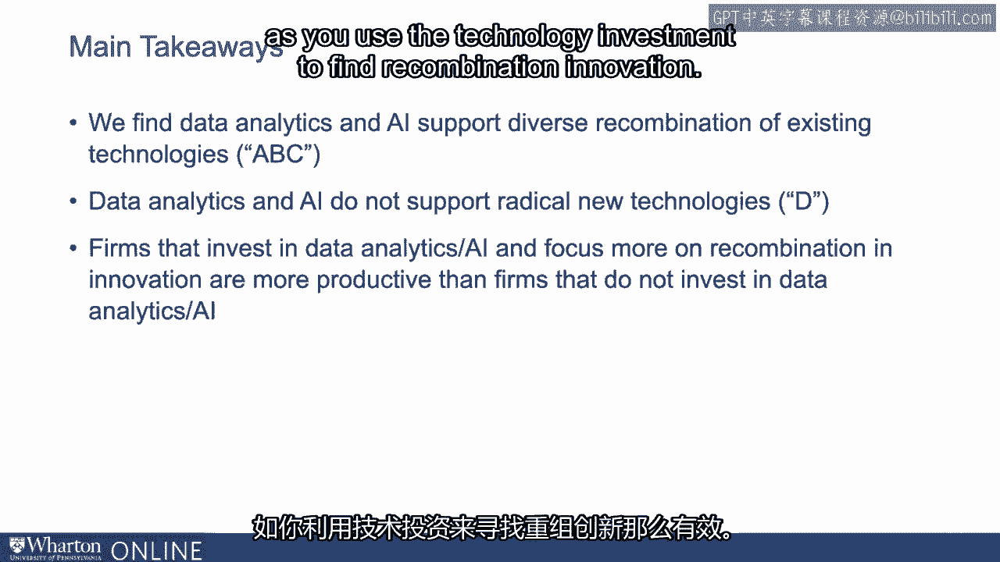

---
**谢谢观看。**