# 119：组织因素如何影响AI驱动的创新 🏢

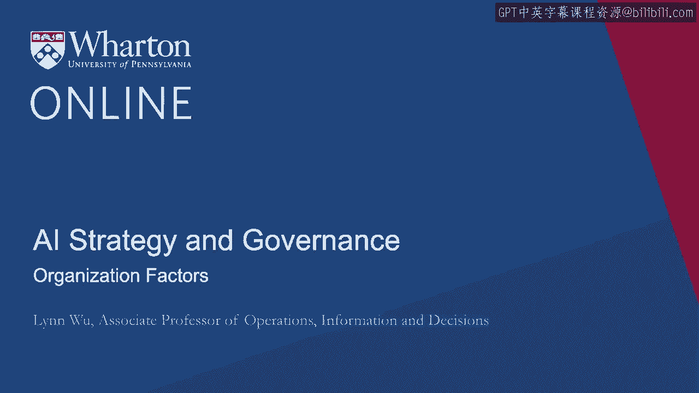

在本节课中，我们将探讨公司的组织结构如何影响其利用人工智能（AI）和分析技术进行创新的能力。我们将了解不同的组织模式（如集中化与去中心化）如何与AI技术相互作用，并最终影响公司所能创造的创新类型。

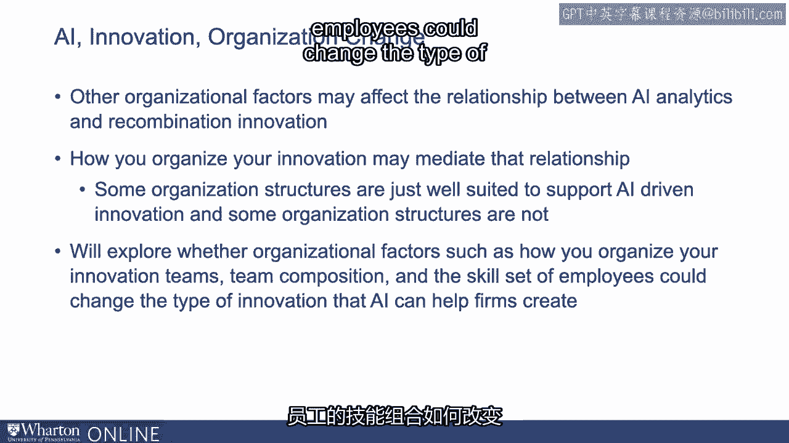

---

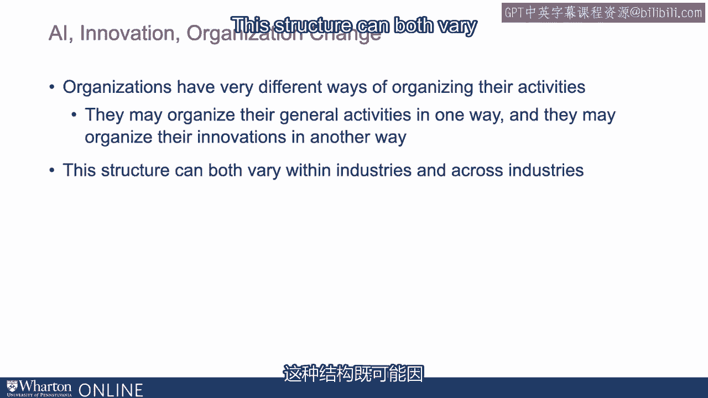

在上一个视频中，我们探讨了AI分析与特定产品创新之间的关系。然而，还有许多其他组织因素可能影响这种关系。因此，在本视频中，我们将讨论公司的组织结构如何调节AI与创新之间的关系。有些组织结构非常适合支持AI驱动的创新，而有些则不然。

## 🔍 组织结构的多样性

组织在安排其活动的方式上存在显著差异。它们可能以一种方式组织日常运营，而以另一种方式组织创新活动。因此，具体观察公司如何组织其创新活动，并将其与整体组织结构进行比较，这一点非常重要。

这种结构差异不仅存在于不同行业之间（例如，药物研发的组织方式可能与汽车研发截然不同），也存在于同一行业内部。例如，在药物发现领域，一家公司可能以一种方式组织创新，而另一家公司则选择不同的方式。

为了让你更清楚地理解，我们来看一些例子。

以下是两家公司：谷歌和苹果。它们以非常不同的方式组织创新活动。这两家公司都是科技行业中极具创新力的公司。

*   **谷歌**的创新结构更加**去中心化**。
*   **苹果**的结构则非常**集中**在少数几个集群中。

那么，这些图中的节点和链接代表什么呢？
*   **节点**代表发明者。
*   **链接**表示两个节点（发明者）共同撰写了一项专利。

因此，你可以看到谷歌有几个集群，但整体上是分散的。而苹果的创新结构实际上集中在少数几个集群中，中心有一个大节点，底部还有一个。谷歌的去中心化程度更高。

公司以不同方式组织创新可能有很多原因，可能是历史原因，也可能是对创新的不同思考方式。这些结构一旦形成，实际上很难改变，因为通过法令或更换领导层来改变非正式的创新合作关系并不容易。

## ⚖️ 集中化与去中心化的利弊

既然AI和分析技术发展迅速，我们能否看到它们对不同组织结构的公司产生不同的影响？这些技术是更有利于谷歌式的世界，还是苹果式的世界？它们是否能比集中化结构更好地促进去中心化的创新结构，或者反之亦然？

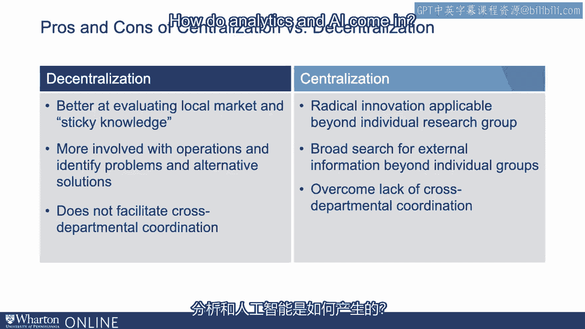

这不仅仅是苹果与谷歌的对比，因为它们是知名公司，且都极具创新性。你在其他各个行业中也会看到同样的现象。例如，大型制药公司**Cenofe**和**Roche**也有着非常不同的组织方式：Cenofe稍微分散，而Roche则更加集中在少数几个集群中。

因此，我们可以提出类似的问题：AI能否帮助谷歌/Cenofe式的世界，或者苹果/Roche式的世界更好地创新？

**去中心化的优势与劣势**

去中心化有许多优势：
*   团队专注于特定类型的工作，非常本地化于其市场。
*   倾向于积累**粘性知识**（即团队内部知晓但难以传递给他人的隐性知识）。
*   当人们长期共同解决特定问题时，更可能识别问题并创造自主解决方案。

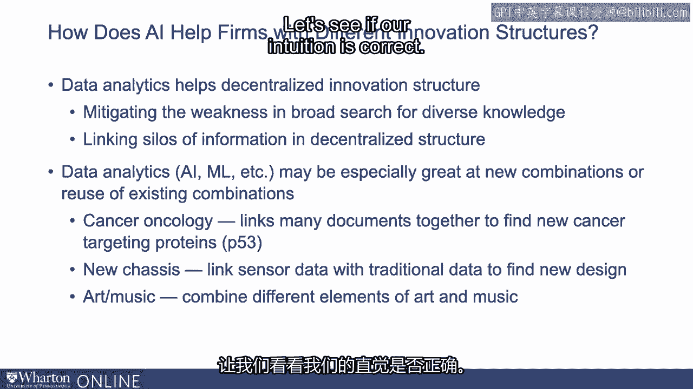

然而，去中心化也存在劣势：
*   有时难以促进跨团队协调。
*   团队内部合作良好，但可能难以将知识转化或与沟通方式、行话不同的其他团队合作。

**集中化的优势与劣势**

集中化也能提供许多优势：
*   往往能催生超越个别团队的**激进创新**。
*   可以更好地进行广泛的、超出单个团队范围的**外部信息搜索**。
*   可以从组织整体利益出发考虑问题，克服单个小组可能存在的短视行为。

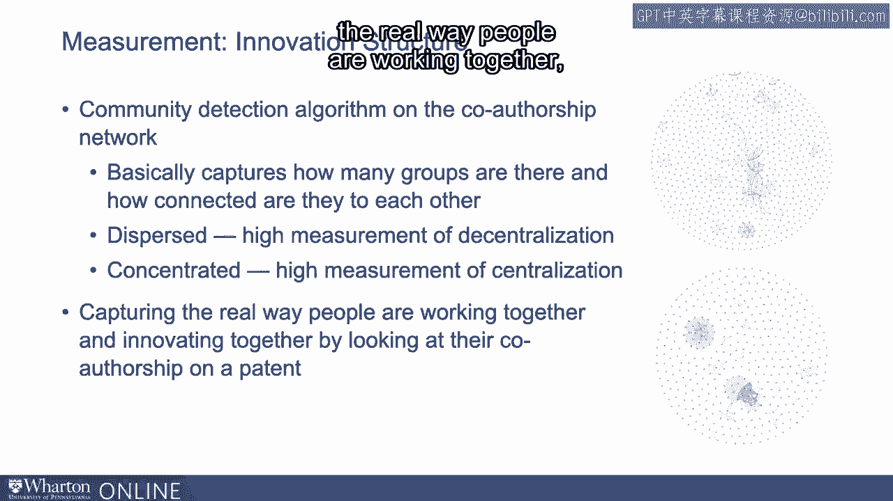

集中化的劣势可能包括：
*   解决方案可能只适用于特定团队，而不具有普遍性。

因此，两种结构各有利弊。那么，分析和人工智能如何介入呢？

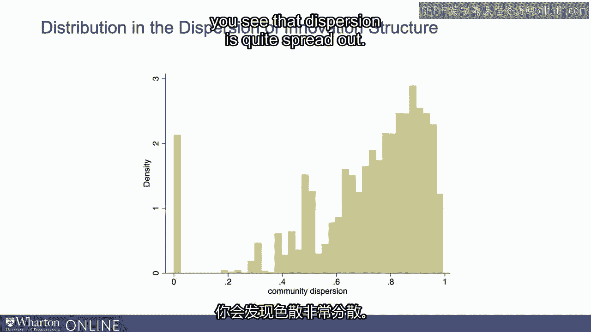

## 🤖 AI如何赋能不同的组织结构

如果你考虑分析和人工智能能做什么，其中一个关键优势就是它们能够进行**广泛的、多样化的知识搜索**。它们可以发现隐藏的模式和关系，并将现有的信息孤岛连接起来。

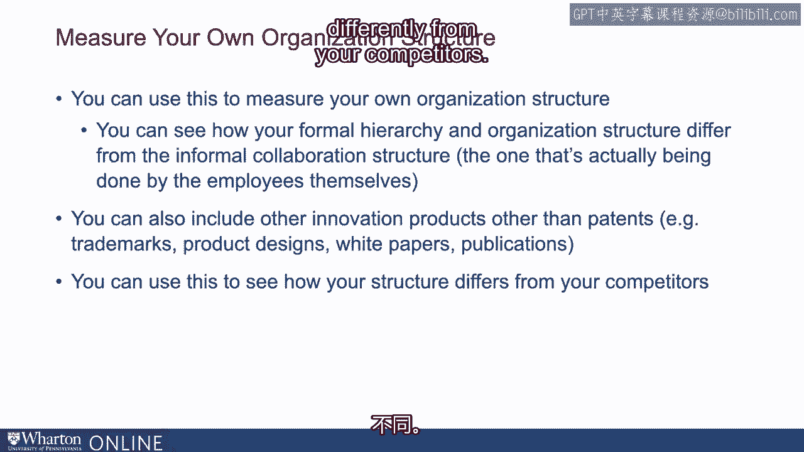

通过拥有一个能自动挖掘不同领域、寻找隐藏模式的工具，AI可以在一定程度上缓解去中心化结构在协调方面的弱点。它虽然不能解决所有协调问题，但即使只是削弱这些困难，也可能促进这些组织结构在创新活动中发挥作用。

回想一下，在上一个视频中，我们展示了AI和机器学习特别擅长发现**新的组合**或**多样化的组合**，或者以新的方式使用现有技术。这一切都将有助于去中心化结构解决诸如“似乎还有其他地方发明的技术可以帮助我”之类的问题。

本质上，AI可以通过整合信息孤岛、以新的方式结合技术来帮助去中心化结构。

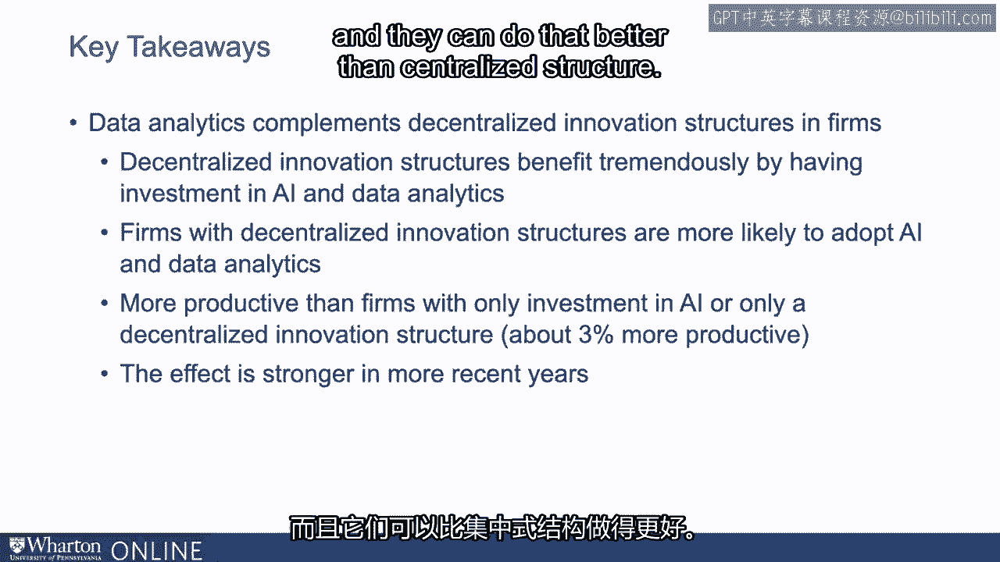

## 📊 实证检验：结构与AI的协同效应

那么，让我们看看我们的直觉是否正确。我们可以通过衡量公司的创新结构来验证。

在这里，我们使用机器学习中的**社区检测算法**来分析共同创作网络（基于专利共同署名）。这捕捉了图中存在多少组以及它们之间的连接程度。在高度分散的“谷歌世界”中，你会看到较高的去中心化测量值；而在集中化的“苹果世界”中，你会看到较高的集中化测量值。

需要指出，这与正式的组织层级不同。正式层级很难捕捉，且可能无法反映人们实际的工作方式。我们这里捕捉的是人们真实的合作与共同创新方式。

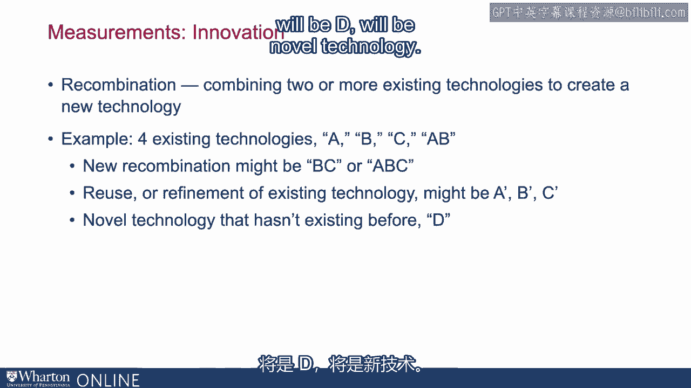

以下是去中心化创新的分布图。高值意味着非常分散，低值意味着非常集中。你可以看到公司之间存在巨大的光谱，有些非常分散，有些非常集中。

你可以用类似的指标来衡量自己公司的组织结构，并与竞争对手进行比较，看看你们在组织活动方式上有何不同。

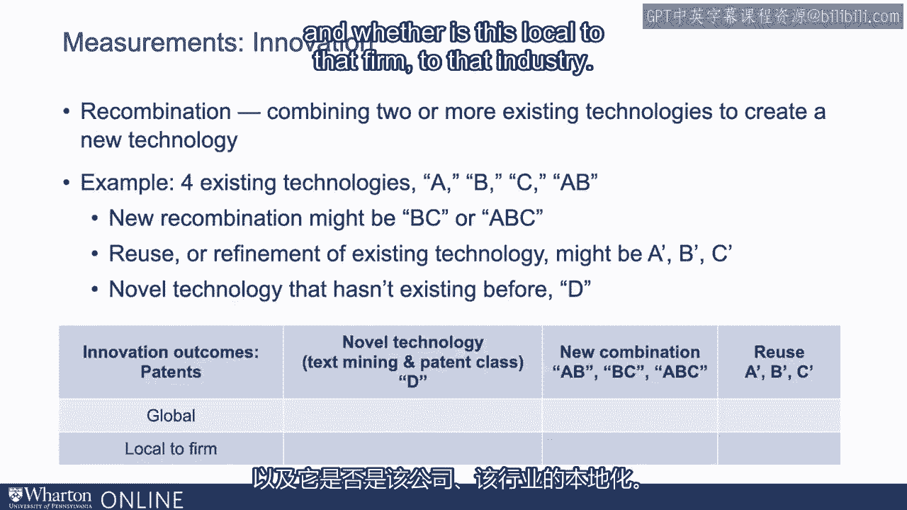

当我们查看数据时，我们发现AI投资与分析技术**补充了公司的去中心化创新结构**。这意味着去中心化的创新结构通过投资AI和分析技术受益匪浅。

不仅它们更可能采纳这些技术，而且当它们同时投资AI并拥有去中心化结构时，其生产力比只投资AI或只拥有去中心化结构的公司高出约**3%**。考虑到这些行业的竞争性，这个差异相当大。这种效应在近年（2008-2013年）甚至更强，表明公司学会了如何更好地部署分析和AI进行创新，但组织结构至关重要。

## 🧩 AI具体支持何种创新？

好的，我向你展示了AI如何更好地支持去中心化。但其中存在细微差别：它并非支持所有类型的创新，而是主要支持一种特定类型——**以新的方式组合现有事物**，即**重组式创新**或**多样化组合创新**。

我们可以将创新大致分为三种类型：
1.  **全新技术（D）**：之前完全不存在的技术。
2.  **新的组合（如 A+B, B+C, A+B+C）**：将现有技术以新的方式结合。
3.  **重用/改进（A‘, B’, C‘）**：对现有技术进行渐进式改进或精炼。

同时，我们还可以从新颖性的范围来区分：
*   **全球新颖**：在整个世界上首次出现。
*   **本地新颖**：对公司或行业而言是新的，但在世界其他地方已存在。

下图展示了在去中心化结构中投资AI，对产生这六种不同类型创新的可能性影响：

*   **创造全新的全球技术类别**：效应几乎是**负面**的。
*   **引入本地全新的技术类别**：效应**非常高**。
*   **创造全球范围内的新组合**：效应**最高**。
*   **创造本地的新组合**：效应**很高**。
*   **重用/改进现有技术**：效应**存在但不大**。

这表明，**AI与去中心化结构结合，最擅长的是帮助公司创造“新的组合”**——无论是全球首次还是本地首次。对于渐进式的改进，由于搜索空间较小，AI的帮助相对有限。而对于全新技术，可能因为公司不知道如何有效应用，收益也不明显。

当搜索空间巨大时（例如从1000种技术中找出有效的两两组合），AI才能真正发挥其广泛搜索的优势。去中心化结构恰恰需要这种扩展搜索空间的能力，而集中化结构本身已具备一定的协调搜索能力。

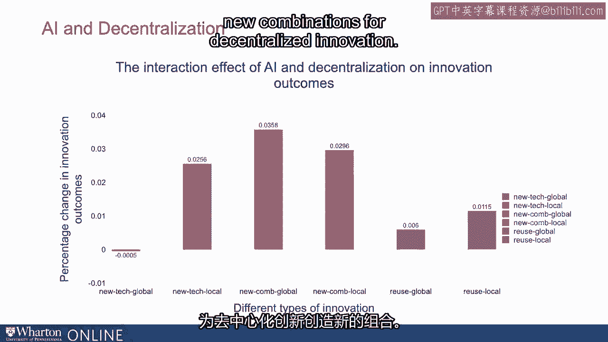

## 📈 从专利引用看创新质量

我们还可以通过专利引用来检验创新质量。下图显示了在同时投资AI并采用去中心化结构时，专利引用模式的分布：

最大的收益出现在**引用比例在40%到60%之间**的中间范围。这表明最佳的创新状态是**恰到好处地结合内部与外部知识**，而不是完全依赖外部全新知识或完全内部渐进改进。

非常新颖（外部引用比例极高）或非常渐进（外部引用比例极低）的组合，其效应甚至是负面的或很小的。这种“中等新颖性”似乎是AI帮助去中心化组织结构进行创新的最佳点。

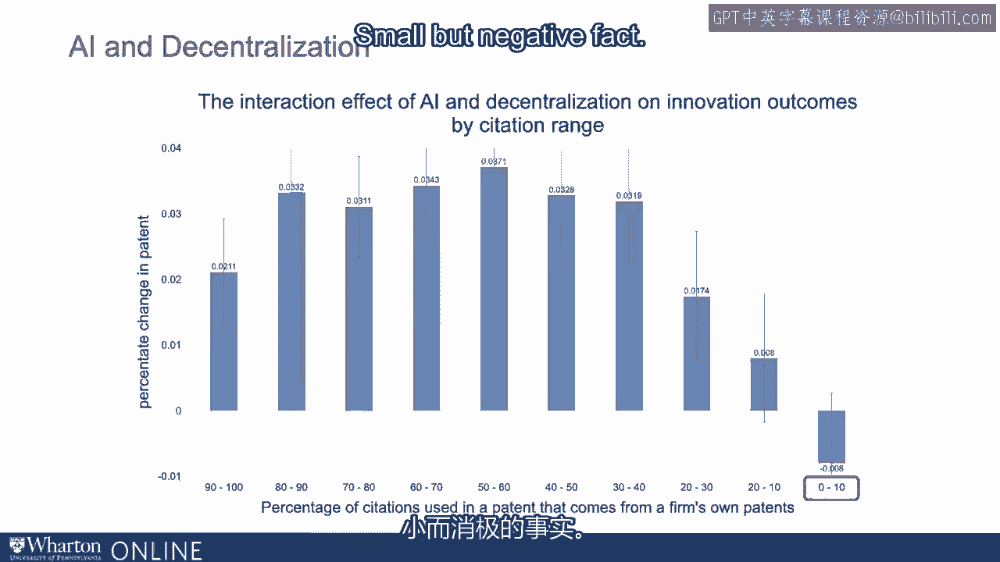

## ✅ 总结与生产力提升

最后，生产力效应再次印证了这一点。我们看到，当公司投资AI并采用去中心化创新结构时，其生产力得到显著提升。这种效应在近年（2008-2013年）甚至更强，提升了约**3%的生产力**。

**本节课中，我们一起学习了：**
1.  公司的组织结构（集中化 vs. 去中心化）是其创新模式的重要基础。
2.  AI和分析技术特别能够**补充和增强去中心化的创新结构**。
3.  这种协同效应的核心在于，AI擅长进行**广泛搜索和发现新组合**，而这正是去中心化结构所缺乏但急需的能力。
4.  AI主要促进的是**重组式创新**（以新方式结合现有技术），而非创造全新技术或进行渐进式改进。
5.  同时采用去中心化结构和AI投资的公司，在创新生产力上能获得显著的提升（约3%）。

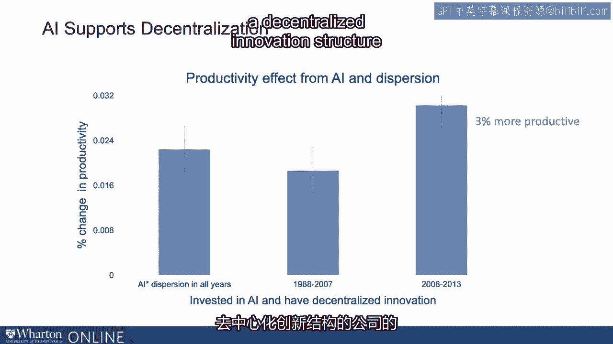

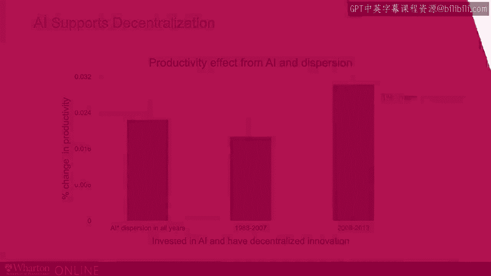

因此，对于希望利用AI推动创新的公司而言，审视并优化自身的组织结构，使其更有利于信息流动和跨领域组合，可能与投资AI技术本身同等重要。