# 122：AI在药物研发中的应用 🧪💻

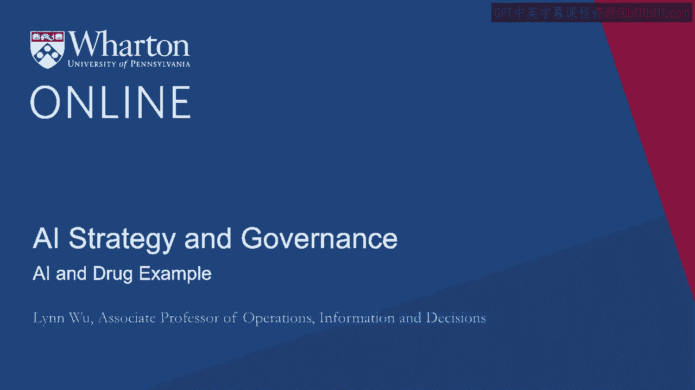

在本节课中，我们将探讨人工智能如何影响并应用于药物研发领域。我们将了解AI在药物发现过程中的具体作用、其优势与局限性，以及它如何帮助解决制药行业面临的复杂挑战。

---

在之前的课程中，我们介绍了AI如何影响创新以及不同类型的创新。本节中，我们将深入探讨一个具体的行业案例——制药业，看看AI在其中扮演了怎样的角色。

药物创新至关重要，尤其是在经历全球疫情之后。目前，由各种细菌和病毒引起的疾病约有3万种，但其中仅有约三分之一可以得到有效治疗。药物研发成本极高，通常需要超过10年时间和约20亿美元。这主要是因为药物发现过程极其复杂，涉及的人体生物系统组合空间巨大，可能超过10的60次方种分子。

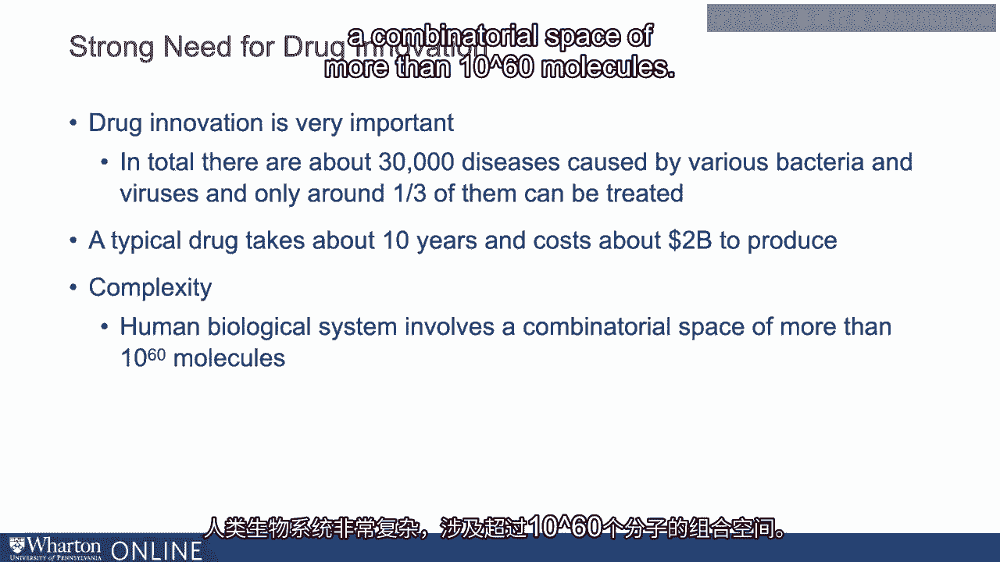

因此，面对COVID-19疫情、超级细菌和抗药性等挑战，AI被视为一个潜在的解决方案。对于许多制药公司而言，AI具备处理、解释外部数据并从中学习的能力，从而为实现特定目标提供支持。

那么，AI对药物研发的具体影响是什么？我们如何利用已知药物化合物的数据，通过AI预测并开发出人类可以安全服用的新药？

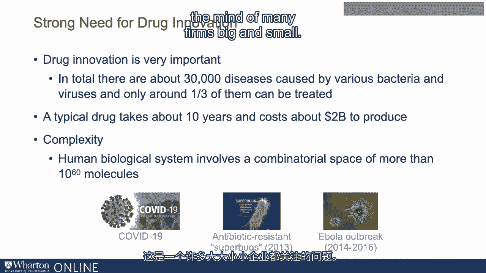

---

以下是AI在药物发现中的具体应用方式。

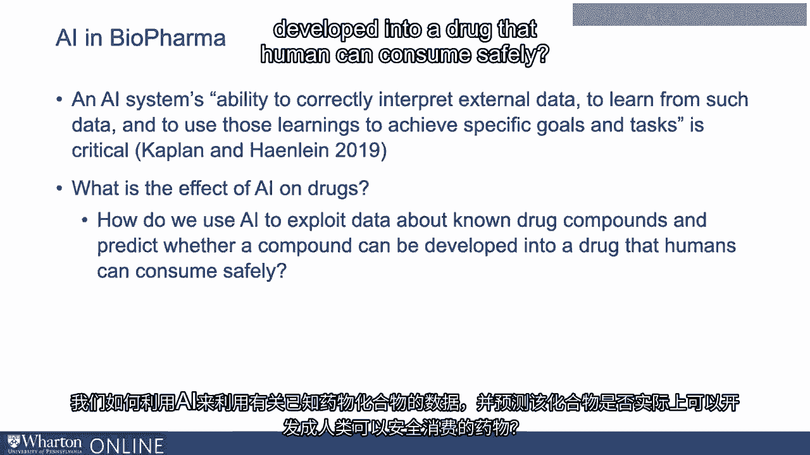

*   **数据驱动的化合物筛选**：Atomwise等初创公司开发了复杂的深度学习神经网络。这些模型在关于药物、生物相互作用的庞大数据集上进行训练。
*   **加速新药发现**：得益于庞大的数据集，AI能够快速识别潜在的新药化合物。例如，针对埃博拉病毒，AI曾在一周内识别出新的候选化合物并提交了相应专利。这对于许多其他疾病情况也具有典型意义。
*   **投资趋势**：制药行业在AI领域的巨额投资反映了一个更大的趋势。近年来，制药公司对AI的投资显著增长。

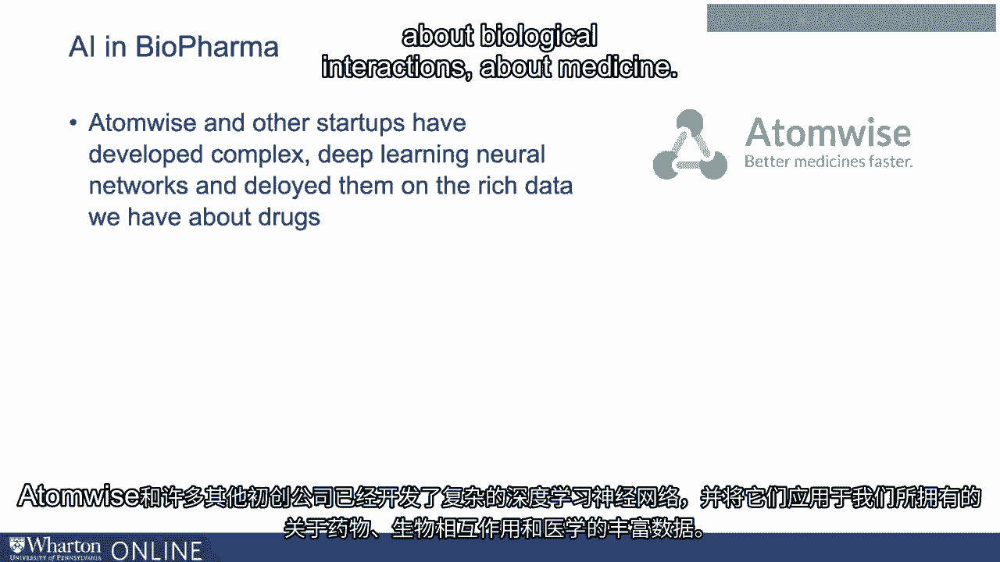

我们真正关心的是，AI在多大程度上能帮助解决药物研发这个漫长而复杂的创新过程？请记住，我们的综合研究表明，AI在发现**重组式创新**方面表现出色。对于具有中等新颖性的创新，AI表现最佳。这通常意味着创新中50-60%的知识源于自身领域，40-50%的知识来自其他领域。

---

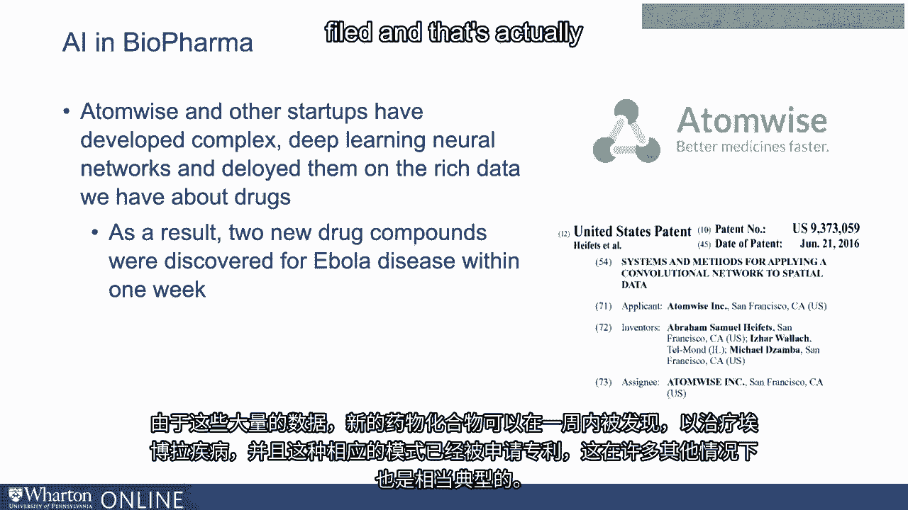

我们针对药物的新颖性进行了类似研究。在这里，药物新颖性通过其化学结构的新颖性来衡量。有趣的是，我们发现了非常相似的模式：AI在中等新颖性范围内表现良好。

以下是关于AI与药物创新关系的核心发现。

*   **AI不擅长发现全新化合物**：AI在寻找前所未见的全新化学化合物方面效果不佳。
*   **AI对渐进式创新效果有限**：对于现有化合物的增量改进，AI的正面影响相对较小。
*   **AI在中等新颖性创新中表现最佳**：AI最能帮助制药公司发现具有中等新颖性的药物。这类创新通常属于**重组式创新**。

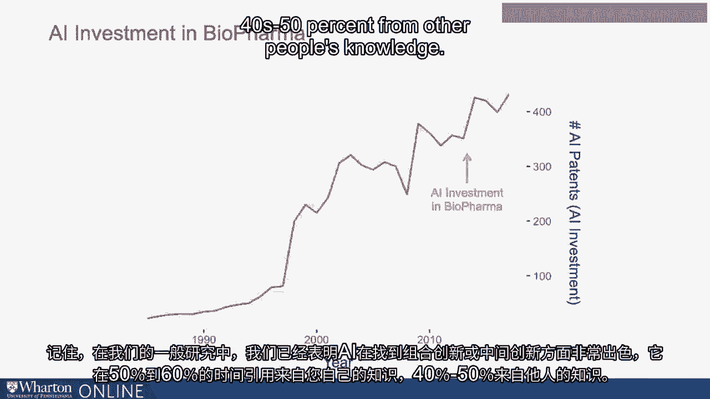

请记住，AI本质上是一台模式识别机器。它能发现各种相关性并利用它们进行预测。但我们都知道，相关性不等于因果关系。如果找到了错误的相关性，在制药行业可能意味着一个20亿美元的错误。因此，即使AI能提出大量潜在的化学化合物来应对某种疾病，其中许多相关性也可能是虚假或错误的。

那么我们如何辨别呢？如果选错了目标或化合物，AI甚至可能对药物创新产生负面影响。我们通过研究这些药物化合物的作用机制来探讨这个问题。

---

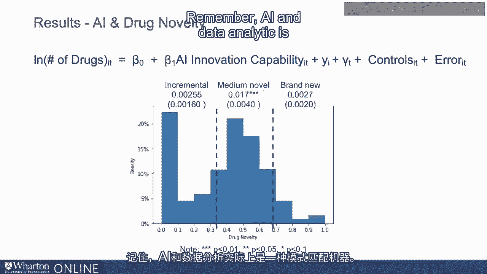

上一节我们提到了作用机制的重要性，本节中我们来看看它对AI效用的具体影响。

我们根据是否了解药物作用机制，来分类研究AI对这些新化学化合物的影响。

以下是基于作用机制知识的不同情况分析。

*   **情况一：机制未知**：当我们不知道某种药物如何针对疾病机制起作用时（第一栏），AI的影响微乎其微，几乎为零。这很合理，因为在盲目寻找相关性时，无法辨别哪个是真实的。
*   **情况二：机制已知**：当我们了解作用机制时（例如抗生素如何杀死细菌），AI可以产生很大影响。但即使机制已知，AI的影响也主要集中在化学结构具有**中等新颖性**的化合物上。对于高度新颖或仅是增量改进的化合物，AI的影响仍然较小。

因此，主要结论是：很难知道哪些药物候选者是真实有效的，哪些是错误的。AI是一台出色的数据挖掘机器，能发现各种隐藏的联系和模式，例如以新的方式组合事物。但在寻找真正全新的药物化合物方面，其影响相对有限。

---

这并不意味着新的组合方式没有益处。它们极其有益。我们发现AI可能帮助我们解决下一个超级细菌问题，也可能帮助我们找到COVID-19疫苗。这些创新不一定是激进的，但它们是组合事物的新方式，仍然非常有用。

关键在于，需要考虑创新是否属于**重组式创新**，以及是否已经了解其影响疾病的**机制**。对机制的理解有助于辨别虚假相关性和真实因果关系。

---

我们如何看待那种首创的、突破性的新颖创新呢？

正如我们在早期的专利研究中提到的，我们没有看到AI对这种“首创”式创新的显著影响。在药物研发领域，情况更为复杂。

因为这类药物如此新颖，关于该特定药物和病症的数据非常有限。临床经验中包含大量**隐性知识**，而这些知识目前很难被完全编码，使得AI在聚合和检测模式方面能力有限。

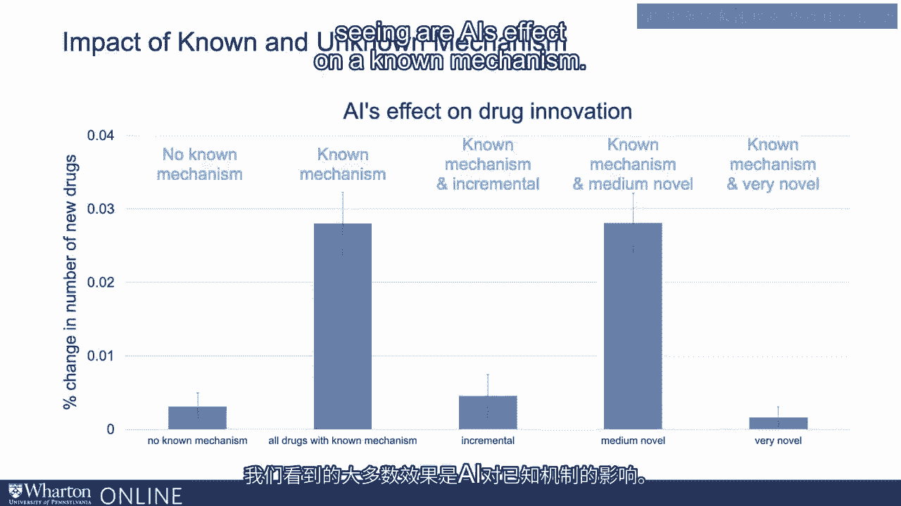

以屠呦呦教授发现青蒿素为例，这款抗疟疾药物源自古老的中文文献，结合了她深厚的临床经验和专业知识。在这种情况下，AI能做的非常有限。数据稀缺，且大量的临床隐性知识目前无法被AI编码和利用。

也许有一天，当这些知识能够被编码时，我们或许能取得突破。但目前，利用AI进行这类突破性发现的能力仍然有限。

---

本节课中我们一起学习了AI在药物研发中的应用与局限。

主要的结论是：
1.  AI可以在药物发现的早期阶段提供帮助，例如快速筛选数百万种化合物，发现新的相关性和模式，这对于生成药物假设至关重要。
2.  当已知药物的**作用机制**时，AI尤其强大，是验证药物有效性的好方法，有助于在投入昂贵的临床试验前降低风险。
3.  通过专利数据可见，AI确实通过寻找具有**中等新颖性**的新化合物来帮助药物研发，这与**重组式创新**非常相似。
4.  然而，对于真正全新的、首创的疗法，AI的应用仍然受限，主要是因为缺乏相关数据，且大量**隐性知识**无法被编码。在很大程度上，我们仍然依赖人类的聪明才智。

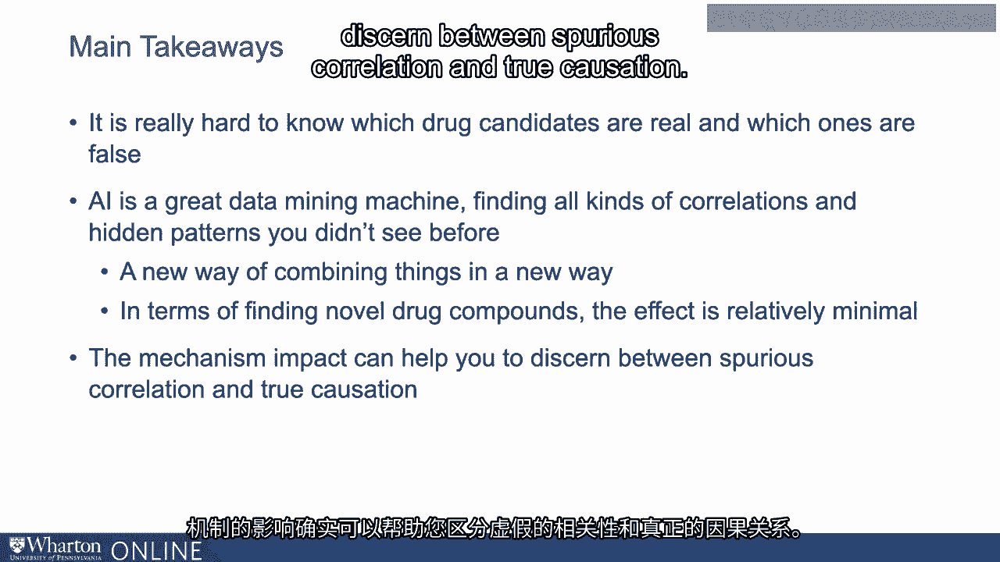

---

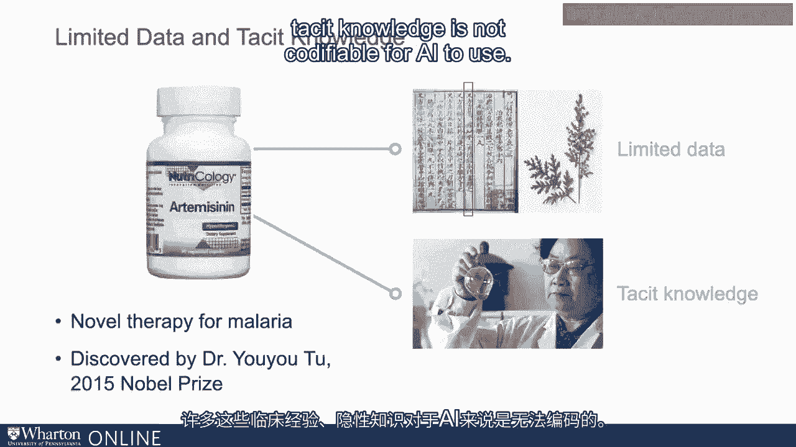

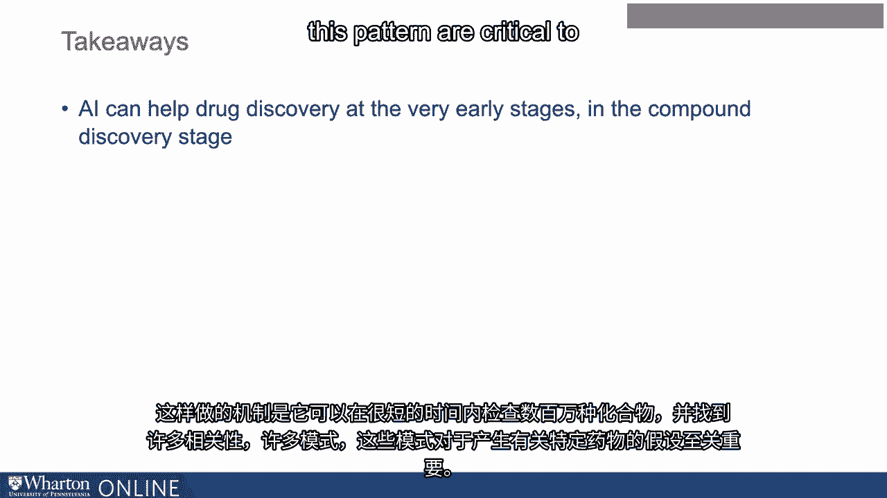

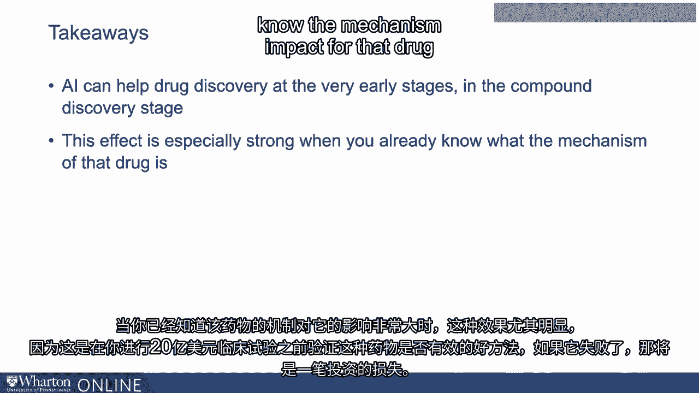

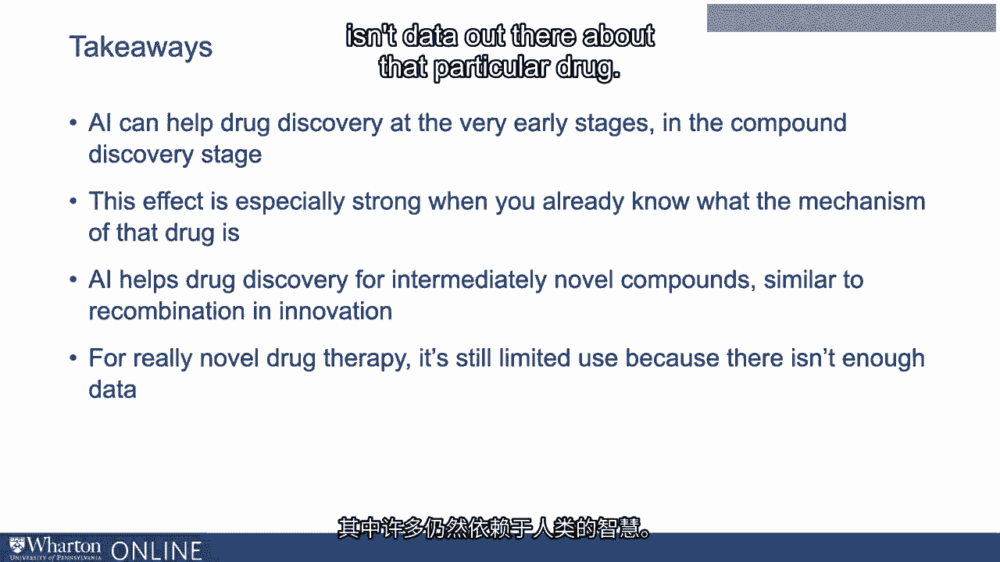

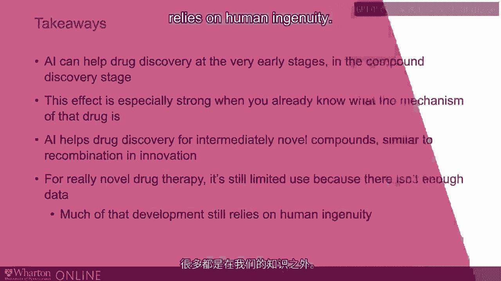

