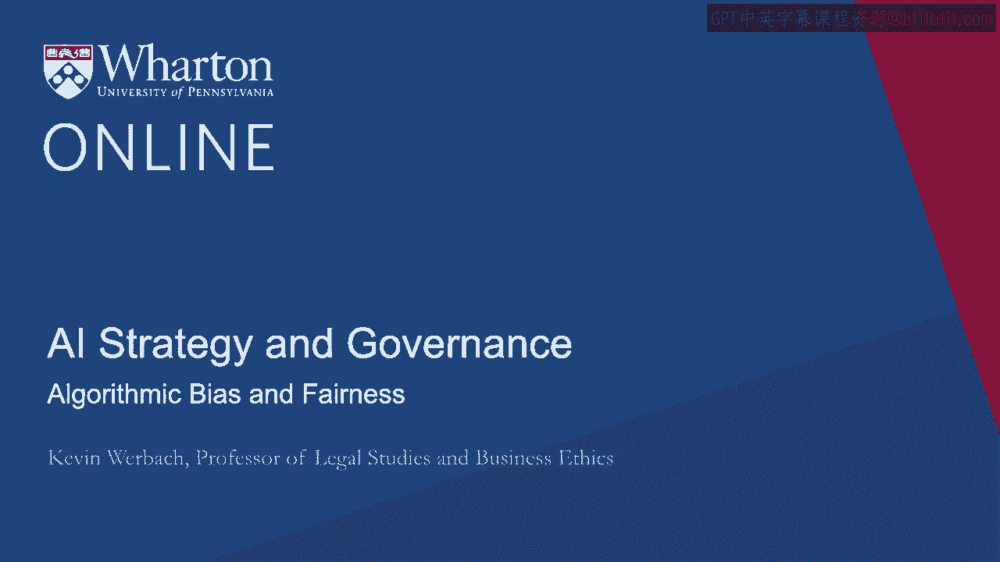
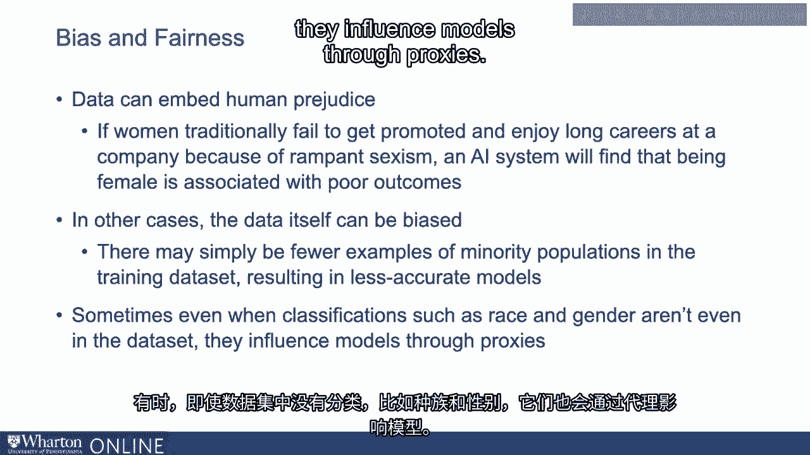
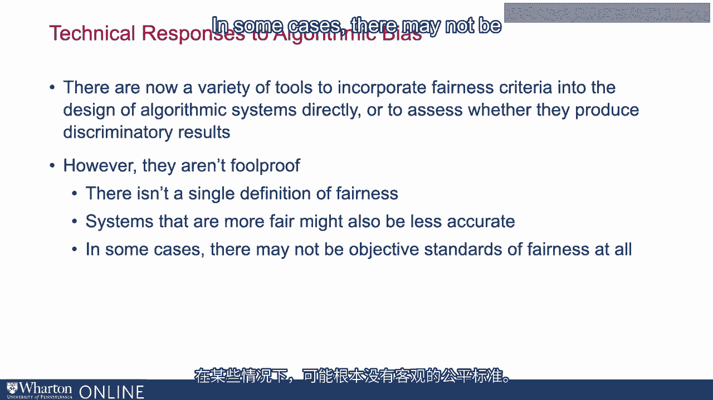
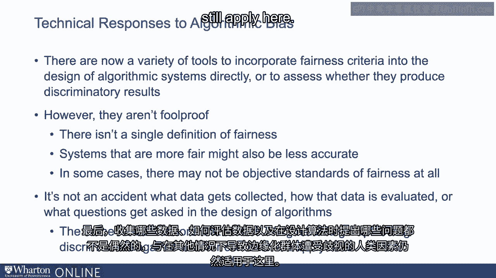
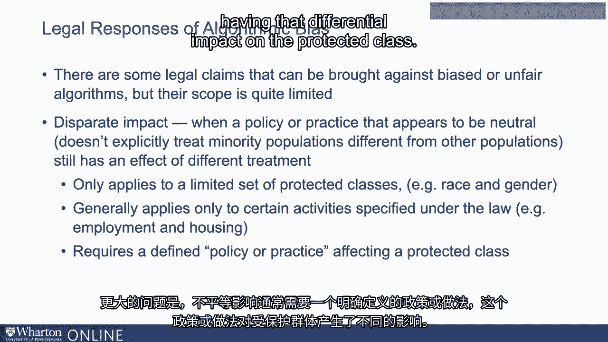
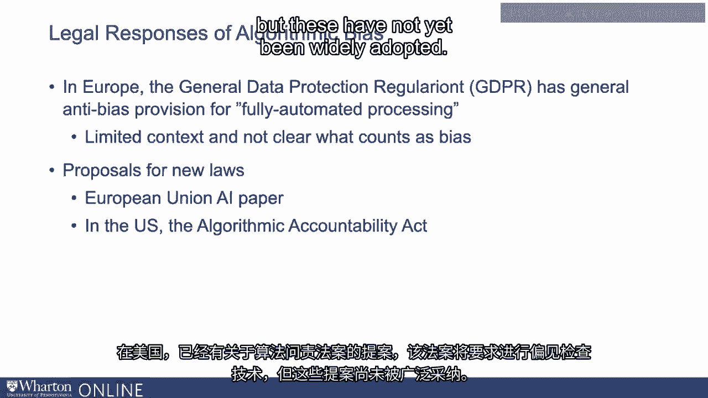
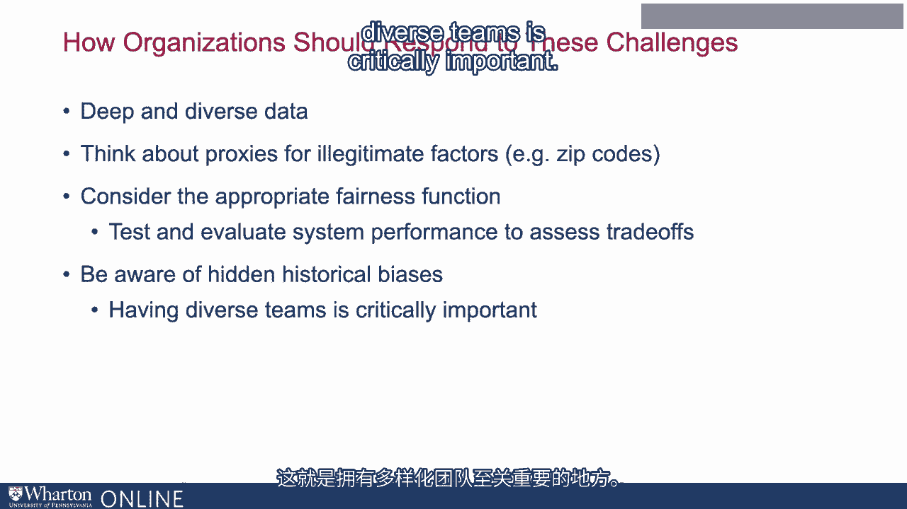

# 124：算法偏见与公平性 ⚖️



在本节课中，我们将要学习算法偏见与公平性的核心概念。我们将探讨人工智能系统如何复制和放大人类社会的偏见，理解其产生的原因，并了解组织可以采取哪些措施来应对这一挑战。

## 概述

人工智能常被认为能克服人类的偏见与盲点。人类确实容易受到刻板印象、隐性偏见甚至明确歧视的影响。而人工智能系统仅基于数据运行。然而，认为人工智能本质上是客观的想法是危险且具有误导性的。实际上，人工智能可以复制甚至强化人类偏见，导致严重的不公平现象。

## 算法偏见的危害 🚨

上一节我们提到了算法可能复制偏见，本节中我们来看看这种偏见会带来哪些具体的危害。

算法偏见在伦理上是错误的。它对边缘化群体造成伤害。这可能引发员工、客户及其他利益相关者的反感，甚至可能导致法律后果。

以下是几个著名的案例：
*   **医疗资源分配**：2019年《科学》杂志的一项研究显示，波士顿一家大型医院使用的护理管理算法存在种族偏见。该算法根据患者风险高低推荐额外资源，但研究发现，**黑人患者需要比白人患者病得更重，才能获得同等水平的护理**。当算法被修正后，符合额外护理条件的黑人患者比例几乎增加了两倍。
*   **人脸识别**：人脸识别系统已被证明对深肤色面孔的识别准确率较低。
*   **招聘筛选**：亚马逊等公司使用的、基于简历预测工作表现的招聘算法，被发现对女性求职者不利。
*   **文本生成**：文本生成和机器翻译系统有时会强加性别歧视甚至种族主义的关联。例如，将匈牙利语（使用性别中立代词）翻译成英语时，系统可能将“教授”和“政治家”与“他”关联，而将“洗衣工”和“助手”与“她”关联。

## 偏见从何而来？🔍

了解了偏见的危害后，我们自然会问：这些偏见是如何产生的？本节中我们来探究其根源。

算法偏见主要源于数据和模型设计。

**1. 数据嵌入人类偏见**
训练数据本身可能反映了历史或社会中的不平等。例如：
*   如果女性在职场中因普遍的性别歧视而难以晋升，AI系统可能会从历史数据中“学习”到“女性与不良职业结果相关”。
*   在医疗案例中，算法使用“历史治疗成本”作为“病情严重程度”的代理指标。但问题在于，黑人患者通常获得的护理质量较差，即使病情相同或更重，花费也更少。因此，这个代理指标本身就带有偏见。



**2. 数据代表性不足**
训练数据集中可能缺少少数群体的足够样本。这似乎是导致人脸识别系统对某些群体准确率较低的部分原因。

**3. 代理变量编码偏见**
即使数据中不直接包含种族、性别等受保护特征，这些因素也可能通过代理变量影响模型。
```
例如：邮政编码本身只是一个地址标记，但它可能与种族或社会经济地位高度相关。
```

## 定义“公平”的挑战 ⚔️

认识到偏见的来源后，我们试图在算法中追求公平。但本节中我们将看到，定义和实现“公平”本身就是一个重大挑战。



有多种工具可以将公平标准纳入算法设计或评估结果。然而，它们并非万无一失。

首先，**公平的定义并不统一**。以用于提供假释建议的COMPAS系统为例：
*   它对黑人的错误率高于白人（群体层面不公平）。
*   但给定两个除种族外完全相同的囚犯，系统通常会给出相同的风险评分（个体层面公平）。

这表明，**个体公平和群体公平是两种不同的衡量方式**。研究证明，**某些公平目标在数学上无法同时满足**，必须做出权衡。有时，更公平的系统可能整体准确性较低。



其次，**在某些情况下，可能根本没有客观的公平标准**。
```
例如：如何判断社交媒体新闻推送是否对保守派或自由派存在歧视？这依赖于对“何为中立基线”、“如何定义政治类别内容”等主观决定。我们无法写出一个关于“绝对中立”新闻推送的客观规范。
```

最终，设计算法时提出的问题、收集和评估数据的方式，与导致社会歧视的人为因素处于相同的背景中。

## 法律现状与局限 ⚖️



既然算法偏见可能造成伤害，那么法律如何规制呢？本节中我们来了解当前的法律框架及其局限性。

目前可以对有偏见或不公平的算法提出一些法律主张，但其适用范围相当有限。

*   **美国：“不同影响”理论**
    主要法律依据是“不同影响”，即一项表面上中立的政策或做法，虽未明确区别对待少数群体，却产生了差异化的负面影响。
    *   **局限一**：通常只适用于有限的受保护类别（如种族、性别）和特定领域（如就业、住房）。
    *   **局限二**：美国最高法院裁定，仅显示统计差异（算法结果）不够，必须指向某项具体的政策或步骤。**仅仅使用算法本身不足以构成“不同影响”**。因此，现有歧视法的结构与算法系统产生的问题之间存在脱节。

*   **欧洲：GDPR条款**
    《通用数据保护条例》（GDPR）中包含处理“完全自动化决策”的反歧视条款，但其规定较为模糊，应用尚不明确。



*   **立法提案**
    多个司法管辖区提出了新立法提案，如欧盟的《人工智能法案》和美国的《算法问责法案》，要求进行偏见审计，但这些尚未被广泛采纳。

## 组织的应对策略 🛡️

面对技术与法律的双重挑战，组织应如何行动？本节我们将探讨一些实用的应对策略。

以下是组织可以采取的关键步骤：
*   **确保数据深厚多样**：训练数据集必须在不同的多样性维度上包含足够多的样本。
*   **警惕代理变量**：注意那些表面上中立、实则可能编码了受保护群体特征的变量（如邮政编码）。
*   **选择公平性定义**：思考哪种公平性定义（个体公平、群体公平等）最符合你的应用场景。有多种数学方式可以定义算法公平。
*   **测试与评估系统**：基于选定的公平性指标对系统进行测试和评估。目前已有一些工具可用于评估算法影响。
*   **组建多元化团队**：意识到潜在的历史偏见至关重要。拥有多元背景、特别是包含曾经历歧视的成员的团队，更有可能在设计过程中发现并指出潜在问题。



## 总结


本节课中，我们一起学习了算法偏见与公平性的核心议题。我们了解到，人工智能并非天生客观，它可能通过有偏见的数据和模型设计复制并放大社会不公。我们探讨了定义“公平”的复杂性以及当前法律框架的局限性。最后，我们学习了组织可以通过确保数据多样性、警惕代理变量、明确定义公平、持续测试评估以及组建多元化团队等策略，来积极应对算法偏见带来的挑战。在开发和部署人工智能系统时，主动关注并解决公平性问题，是负责任创新的关键一步。