# 125：人工智能中的操纵问题 🎭

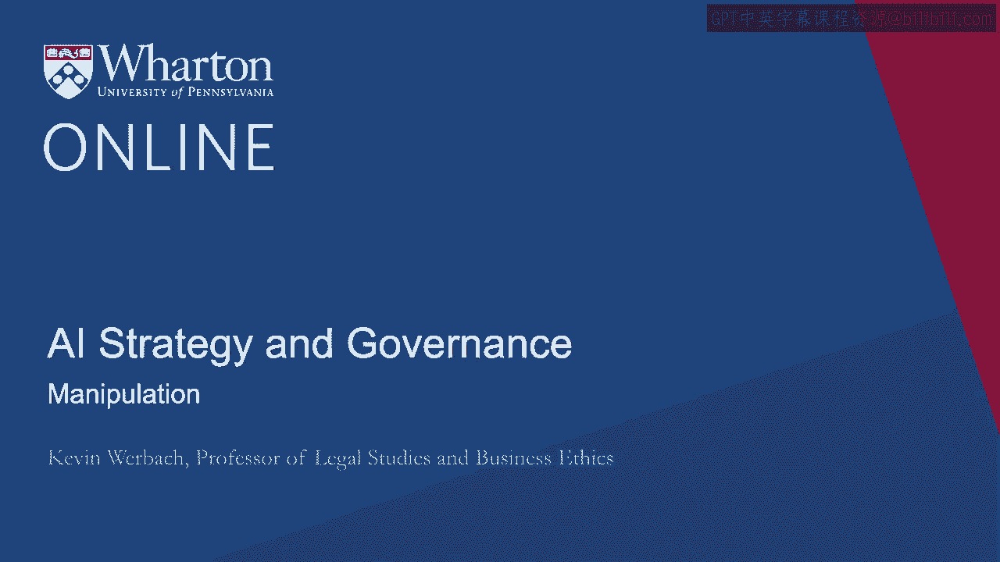

在本节课中，我们将探讨人工智能（AI）系统中的“操纵”问题。操纵介于合法的说服与非法的强迫之间，是AI伦理中的一个核心挑战。我们将了解什么是操纵，它在AI中的具体表现，以及如何负责任地应对。

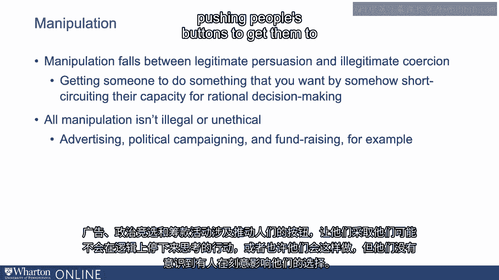

## 什么是操纵？🤔

操纵是指以某种方式影响他人，使其按照操纵者的意愿行事，同时绕过或削弱其理性决策能力的过程。

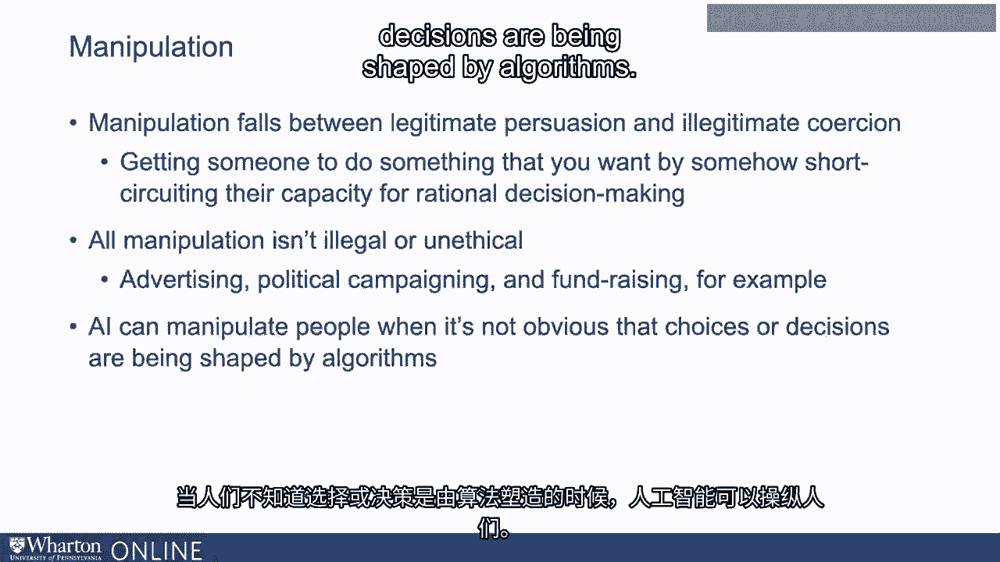

并非所有操纵都是非法或不道德的。例如，广告、政治竞选和筹款活动常常通过激发人们的情感来获取支持或促使行动。如果人们停下来进行逻辑思考，他们可能不会采取这些行动。或者，他们可能没有意识到自己的选择正被他人刻意影响。

因此，区分单纯的“令人毛骨悚然”与不道德甚至非法的操纵行为，有时非常困难，但这却是一个至关重要的问题。

## AI如何实现操纵？⚙️

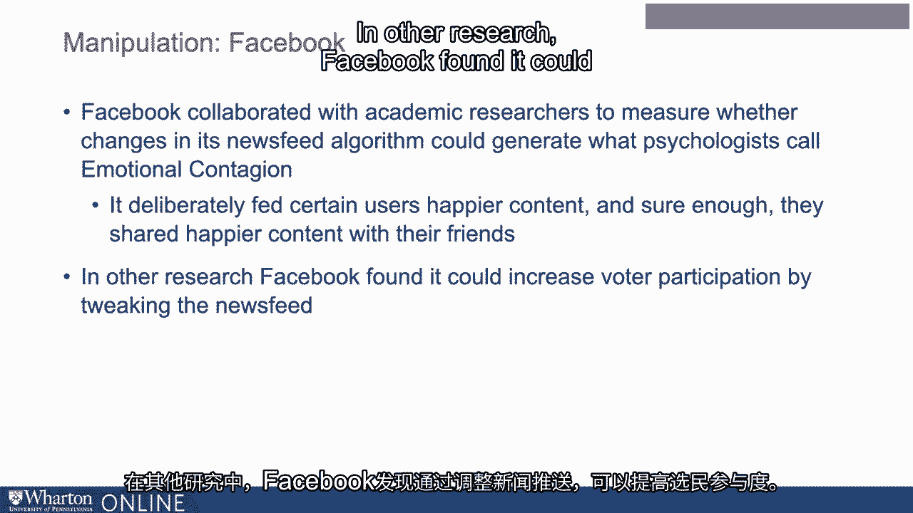

AI可以在用户不知情的情况下，通过算法微妙地塑造其选择或决策。

上一节我们介绍了操纵的基本概念，本节中我们来看看AI实现操纵的具体机制。

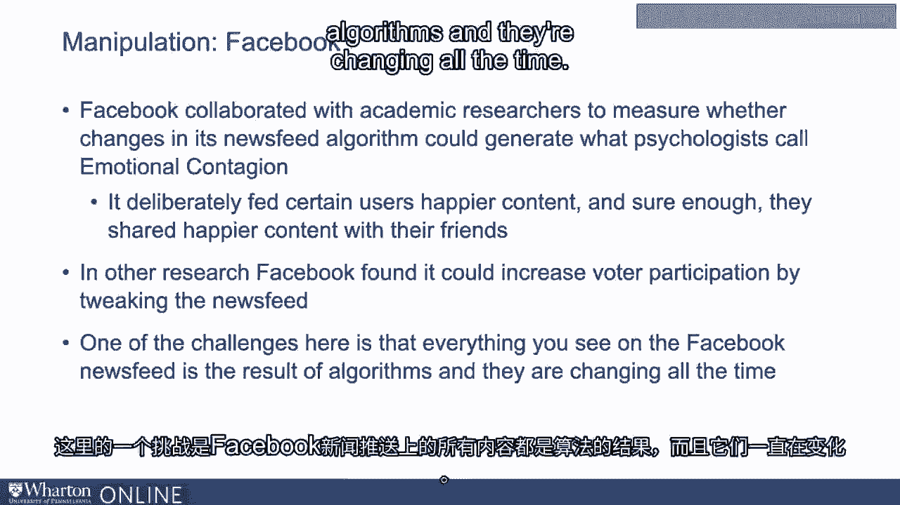

**核心机制**：`算法推荐系统`。系统通过分析用户数据，预测其偏好，并推送特定内容以影响其情绪或行为。

以下是几个著名的案例：

*   **情感传染实验**：Facebook曾与学术研究人员合作，研究其动态消息算法能否影响用户情绪（即“情感传染”）。他们故意向一部分用户推送更快乐的内容，结果这些用户自己也分享了更快乐的内容。当这项研究公开后，引发了公众愤怒，因为人们意识到，既然算法能让人快乐，同样也能让人悲伤甚至抑郁。
*   **影响选民参与**：在其他研究中，Facebook发现可以通过调整推送内容来增加选民的参与率。这引发了一个问题：如果算法微妙地偏向某位候选人的内容，这是否构成对民主进程的操纵？用户可能永远不知道自己的投票受到了影响。
*   **算法的不透明性**：用户在Facebook动态中看到的一切都是算法运算的结果，而这些算法一直在变化。例如，如果Facebook决定向你展示更多关于气候变化的帖子，这是操纵吗？如果公司高管认为这对世界有益，或是为了从相关广告中获利，其性质是否不同？

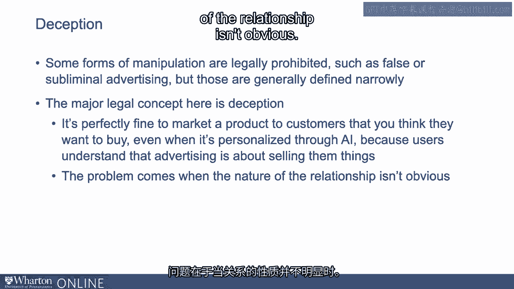

## 非法的与有害的操纵形式 🚫

除了上述灰色地带，一些形式的操纵是法律明确禁止的，例如虚假广告或潜意识广告。然而，这些定义通常较为狭窄。

更普遍的相关法律概念是“欺骗”。向客户推销他们想买的产品（即使通过AI个性化推荐）是允许的，因为用户理解广告的意图。问题在于，当双方关系的本质不明确时，就可能构成欺骗。

接下来，我们探讨一种更有害的操纵形式：**剥削**。

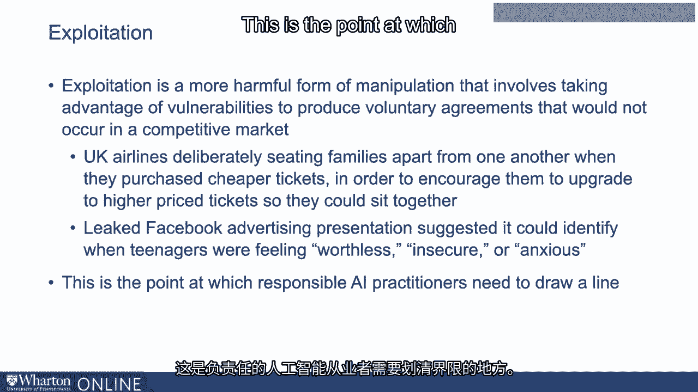

剥削涉及利用他人的脆弱性，促使其达成在公平竞争市场中不会发生的“自愿”协议。

*   **航空公司案例**：例如，有航空公司使用算法，在乘客购买廉价机票但未选座时，故意将家庭成员分开安排座位。这是一种鼓励他们付费升级座位以坐在一起的策略。虽然当时的算法很简单（仅查看姓氏），但可以想象更复杂的系统能够识别用户处于压力或困难时刻，并加以利用。
*   **利用情绪状态**：一份泄露的Facebook广告演示文件显示，其系统能够识别青少年何时感到“无价值”、“不安”或“焦虑”。对于负责任的AI从业者而言，这正是需要划清界限的时刻。除了可能引发的公关反弹，如果一个商业模式不会故意利用脆弱群体，那么也不应通过算法间接实现。

## 市场操纵与算法共谋 📈

算法还可能被用于更宏观的市场操纵，微妙地破坏市场竞争。

*   **平台自营偏见**：例如，亚马逊同时销售第三方卖家和自家的自营商品。其搜索引擎虽不直接优先展示自营产品，但会结合使用各种代理信号来提升亚马逊的整体盈利能力，这可能导致隐性的偏见。问题在于，这是否构成对产品市场的不可接受操控。
*   **算法共谋**：在某些情况下，算法可能参与“共谋”，这通常违反反垄断法（或称竞争政策）。2018年，美国司法部曾起诉亚马逊上的海报销售商，因为他们的算法故意串通以维持高价格。研究甚至表明，机器学习算法可以自行学会采用共谋策略，从而提高（共谋者的）利润。

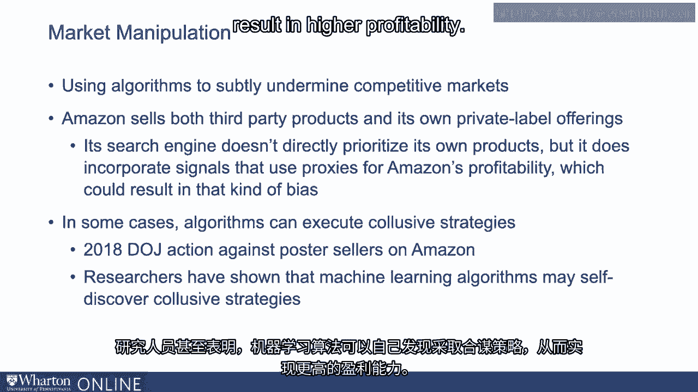

## 如何应对操纵问题？🛡️

正如前文所述，除了市场操纵案件可适用反垄断原则外，对于操纵并没有明确的法定界限。

那么，该如何解决这些担忧呢？你应该问的核心问题是：你的AI系统目标是否在于与利益相关者建立**互惠互利**的关系？

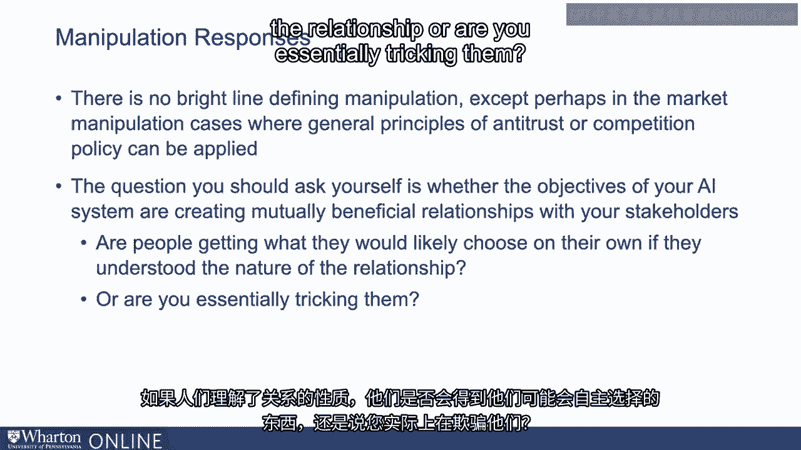

以下是关键的评估思路：
1.  **透明度**：如果人们理解了你们之间关系的本质，他们还会选择参与吗？
2.  **诚实性**：你是在本质上欺骗他们，还是在提供真实的价值？

在学术研究领域，针对以人为对象的研究已有一套成熟的原则（源于1970年代的《贝尔蒙特报告》），可供我们借鉴：

以下是四项主要原则：

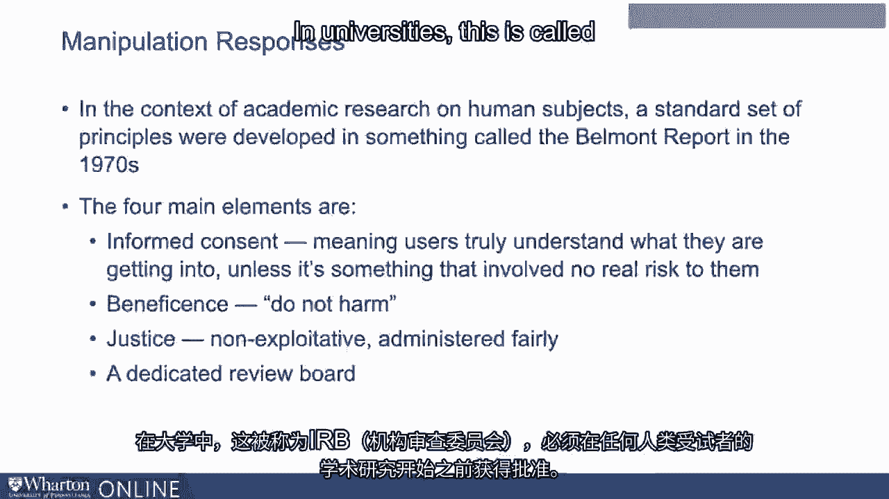

*   **知情同意**：用户必须真正理解他们参与的是什么，除非是那些对他们没有真正伤害风险的活动。
*   **慈善**：这是一条“不伤害”原则。不应将人们置于可能遭受严重身体或心理伤害的境地。
*   **公正**：即不剥削、不利用他人脆弱性的理念。系统应以公平的方式实施。
*   **审查委员会**：在大学中，这被称为机构审查委员会（IRB），任何涉及人类受试者的学术研究都必须事先获得其批准。

虽然要求私营部门的每个AI项目都接受如此严格的审查并不现实，但许多组织发现，设立一个专门的卓越中心或伦理委员会来评估重大AI项目中的此类问题（以及其他如算法偏见等问题）是很有帮助的。

然而，这不应以削弱组织内全体成员对负责任AI的责任感为代价。每一位参与者都应对避免不道德的操纵、剥削以及算法偏见等问题负责。

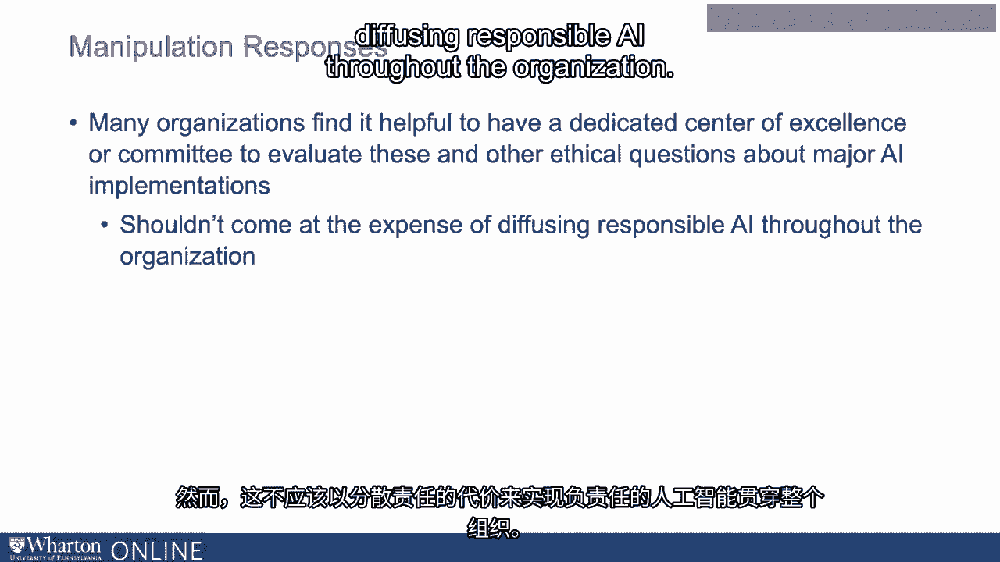

## 总结 📝

本节课中，我们一起学习了人工智能中的操纵问题。我们了解到，操纵是介于说服与强迫之间的灰色地带，AI通过算法可以微妙地影响用户决策。我们探讨了从情感传染、用户剥削到市场操纵等多种表现形式。最后，我们学习了如何通过借鉴伦理原则（如知情同意、慈善、公正）和建立审查机制来应对这些挑战，核心在于确保AI系统的目标是建立透明、互惠的关系，而非欺骗或剥削用户。