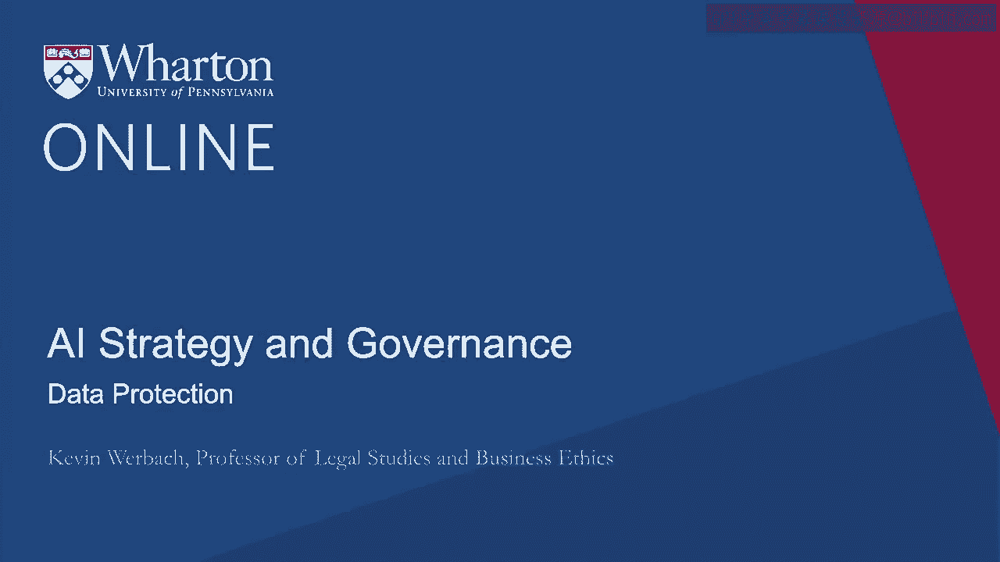
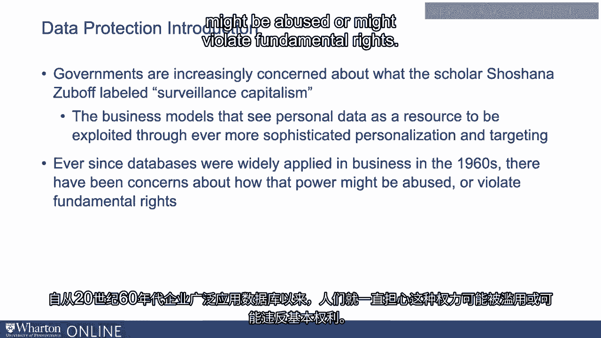
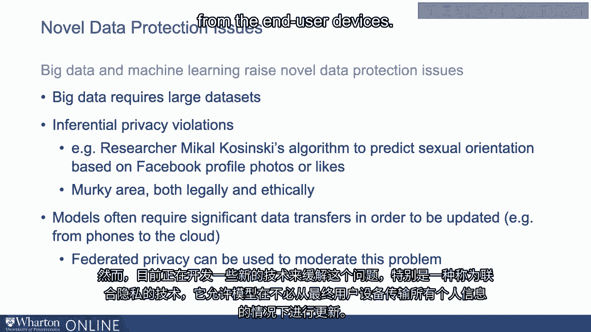
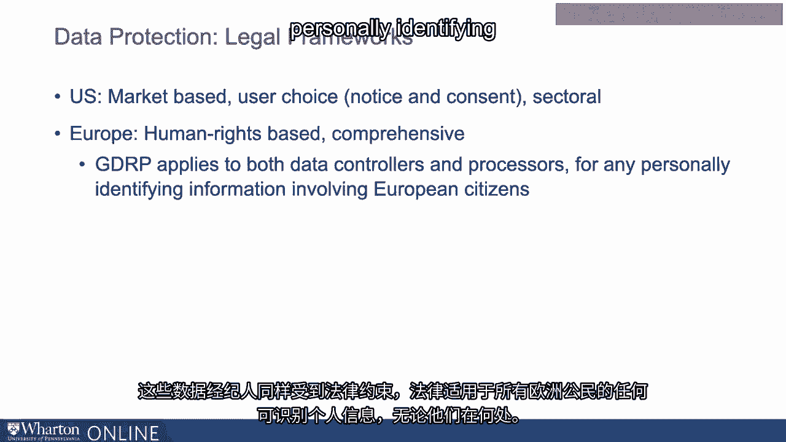
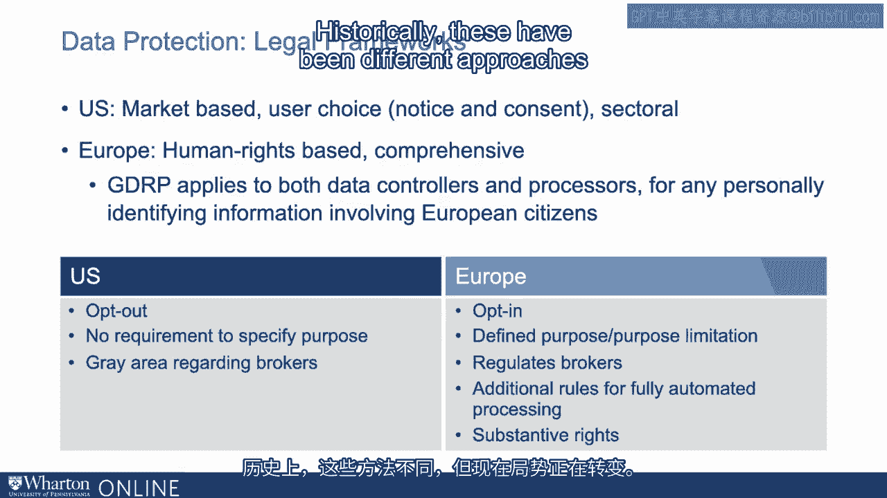
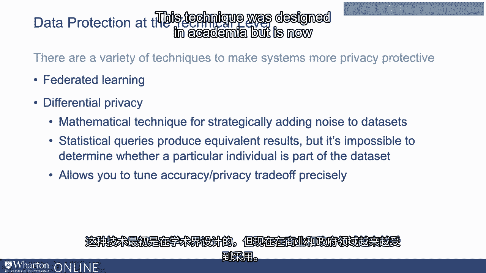
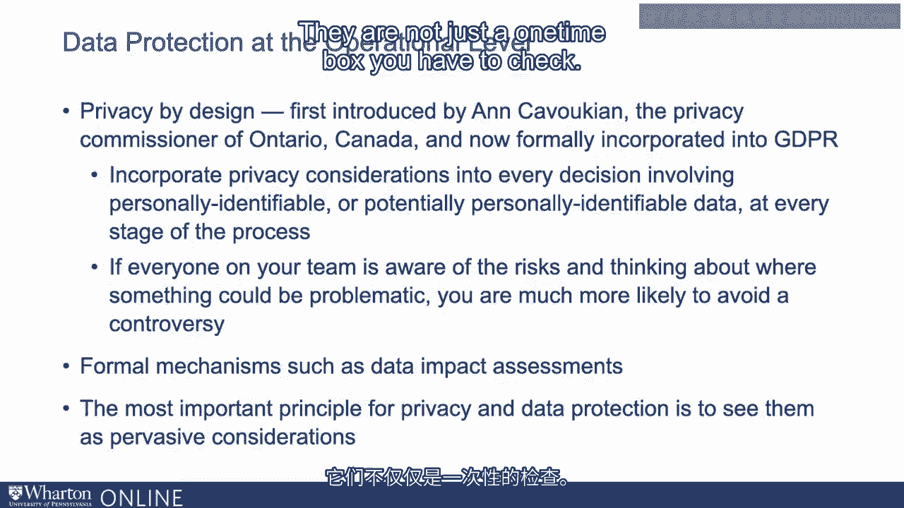

# 126：数据保护与人工智能 📚

在本节课中，我们将要学习人工智能与大数据时代下的数据保护问题。我们将探讨数据隐私面临的新挑战、隐私生命周期的各个阶段、全球主要的隐私法律框架，以及如何在技术和管理层面构建保护隐私的AI系统。

***

人工智能和分析依赖于数据，即大数据。

你在这个课程中学到了聚合和分析的一些技术，并应用数据来推动机器学习和其他类型的算法。与此同时，尽管人工智能取得了飞速发展，但围绕数字隐私问题的关注也在增加。

各国政府对学者肖申娜·祖博夫所称的“监视资本主义”商业模型表示担忧。这种模型将个人数据视为可以通过不断更复杂的个性化和定位来获利的资产。值得注意的是，这些问题已经存在很长时间。自从20世纪60年代数据库广泛应用于商业以来，人们就一直对数据权力可能被滥用或侵犯基本权利感到担忧。

然而，大数据和机器学习引发了新型的数据保护问题。

## 🔍 大数据与机器学习带来的新挑战

上一节我们介绍了数据隐私问题的历史背景，本节中我们来看看大数据和AI带来的三个新挑战。

以下是三个核心的新问题：

1.  **数据规模与整合**：机器学习需要庞大的数据集，其价值往往来自于使用海量数据。更多的数据意味着需要从更多的人那里收集信息，以及整合不同数据集的机会。这些信息单独来看可能并不令人担忧，但整合后能构建出全面的用户画像。
2.  **推断隐私侵犯**：随着机器学习技术的发展，有时无需直接要求用户提供敏感信息，系统就能推断出来。例如，研究员迈克尔·卡辛斯基构建了一个能够根据Facebook个人资料照片可靠预测性取向的系统。系统并未直接收集性别或性取向信息，而是通过关联分析推断出来。这在法律和伦理上都是一个模糊地带。
3.  **数据转移与集中风险**：AI模型通常需要大量数据，这涉及数据从用户设备（如手机）向云端服务器的转移和集中存储。然而，新技术如**联邦学习**正在发展，它允许模型在训练时不必将所有个人信息从终端用户设备转移至中央服务器。

## 📊 隐私生命周期：五个关键阶段

理解了新挑战后，我们需要系统地看待数据保护。数据保护不仅仅是收集阶段的问题，它贯穿于隐私生命周期的五个阶段。每一个阶段都是在开发AI解决方案时需要考虑的重要因素。

以下是隐私生命周期的五个阶段：

1.  **收集**：这是获取用户信息的初始环节。
2.  **聚合与分析**：问题不仅在于收集了什么，还在于如何处理。少量信息与其他数据集整合，或通过分析和特征工程，可能最终引发隐私担忧。
3.  **存储**：存储大量数据用于训练机器学习算法，其本身就成了巨大的安全风险。数据泄露可能造成严重问题，因此关于存储哪些数据、保留多久的决策至关重要。
4.  **使用**：数据的用途可能引发担忧。学者海伦·尼斯巴姆提出了“上下文完整性”概念，即人们希望数据被用于他们同意收集的特定上下文中。超出此范围的使用（如将医疗数据用于营销）可能不被接受。
5.  **分发**：数据被转移或转售给第三方（数据经纪人）。这不仅是用户关心的问题，也引发了额外的安全风险，因为你无法控制第三方如何处理数据。

***

## ⚖️ 全球隐私法律框架：美国 vs. 欧洲

在了解了数据处理的完整周期后，我们来看看管理这些活动的法律框架。全球主要有两种做法：美国模式和欧洲模式。

*   **美国模式**：通常是基于市场的、分部门的。其理念是创造一个功能正常的市场，防止市场失灵和虐待。它依赖于基本通知和用户选择（通常是“选择退出”）。美国没有全面的联邦隐私法，而是在医疗、金融等特定领域有规则，并由联邦贸易委员会进行一般性的消费者保护监管。
*   **欧洲模式**：以**通用数据保护条例（GDPR）** 为代表，基于人权理念，认为数据保护是一项基本权利。它是全面的，适用于所有情况下的所有类型数据收集和处理者。GDPR的核心原则包括：
    *   **选择加入**：数据收集前必须获得用户的明确授权。
    *   **目的限制**：必须出于特定、合法的目的收集数据，不能用于其他目的除非获得进一步同意。
    *   **数据主体权利**：用户拥有访问、纠正、删除（“被遗忘权”）其个人数据的明确权利。
    *   **监管自动化决策**：对完全由算法做出重大决策的情况有专门规则。

## 🌍 发展趋势：趋同与强化

上一节我们对比了两种主要框架，本节中我们来看看全球的发展趋势。实际上，世界正朝着更接近欧洲GDPR模式的方向发展。

许多主要管辖区，如日本、南美国家，甚至中国，都已出台或正在制定类似GDPR的全面隐私法律。中国的数据保护法虽然并非完全相同，但已体现出类似的全面监管思路。

在美国，联邦层面已有推动全面隐私法的倡议，而州层面（如《加州消费者隐私法案》）已经实施了更严格的规定。全球范围内，针对涉及高风险数据（如医疗数据）的AI系统，正在推动更明确的保护要求，以防止歧视和偏见。

因此，跨国公司往往需要遵循其运营所在地中最严格的规则，这通常意味着实施更具保护性的措施。需要注意的是，GDPR具有域外效力，适用于处理欧盟公民数据的任何公司，无论其位于何处。

***

## 🛡️ 构建保护隐私的AI系统：技术与运营

了解了法律环境后，我们来看看在构建AI项目时，如何在技术和运营层面落实数据保护。

### 技术层面

有多种技术可以使系统更加保护隐私：

*   **联邦学习**：一种允许模型在分散的设备上训练，而无需将原始数据集中到服务器的技术。
*   **差分隐私**：一种通过向数据集中战略性添加噪声的数学技术。其核心公式或目标是：确保查询结果在统计上有效，但极难判断某个特定个体是否在数据集中。这提供了技术性的隐私保障。
    *   **代码/概念描述**：`差分隐私通过添加可控的噪声，在数据可用性和个体隐私之间实现权衡。`
    *   应用示例：Uber用于内部查询，苹果用于iPhone数据收集，美国人口普查用于2020年人口普查数据。

### 运营与管理层面

这涉及商业实践和组织机制：

*   **隐私设计**：这一由安妮·卡伏基安提出的概念，现已正式纳入GDPR。其理念是将隐私和数据保护融入系统设计的每一个环节，贯穿隐私生命周期的所有五个阶段。
*   **数据保护影响评估**：类似于环境影响评估，是对可能产生高风险的数据处理活动进行正式评估，以识别和降低风险。美国提出的《算法责任法案》等法律可能要求此类评估。
*   **组织意识**：确保团队中的每个人都意识到隐私风险，并在每个决策点考虑隐私问题。

最重要的原则是**将隐私视为无处不在**。它不仅仅是为了满足法律要求而进行的一次性合规检查，而是需要在每个阶段持续思考：“这里可能会发生什么？哪里可能出现问题？第三方或攻击者会如何利用这些数据？”

***

## 📝 总结

本节课中我们一起学习了人工智能时代下的数据保护。我们探讨了大数据和机器学习带来的新隐私挑战，系统分析了隐私生命周期的五个阶段（收集、聚合分析、存储、使用、分发），对比了以市场为导向的美国模式和以权利为基础的欧洲GDPR模式，并观察到全球隐私保护标准趋严的趋势。最后，我们介绍了在技术层面（如联邦学习、差分隐私）和运营层面（如隐私设计、影响评估）构建保护隐私的AI系统的具体方法。记住，数据保护是一个需要贯穿始终、持续关注的综合性议题。

