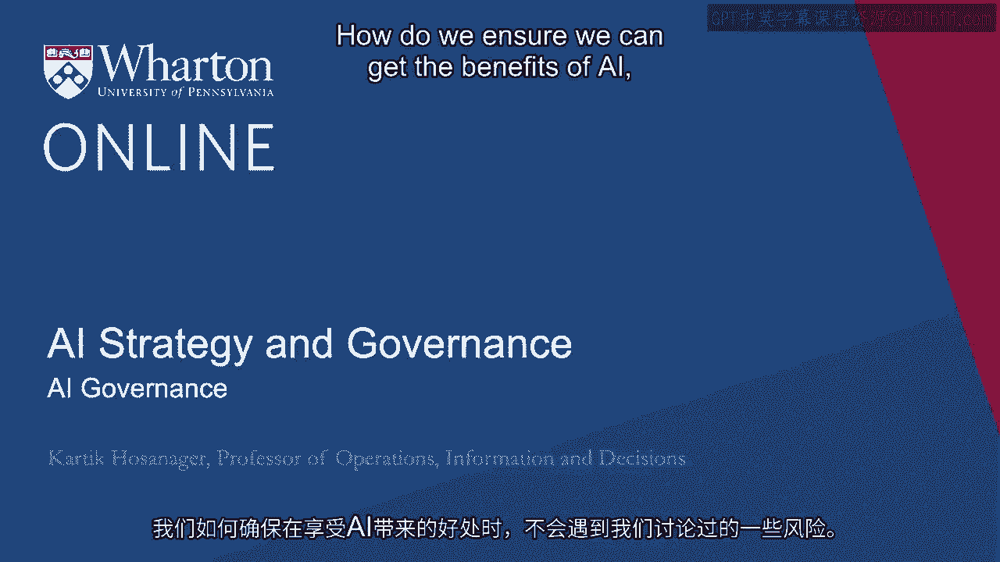
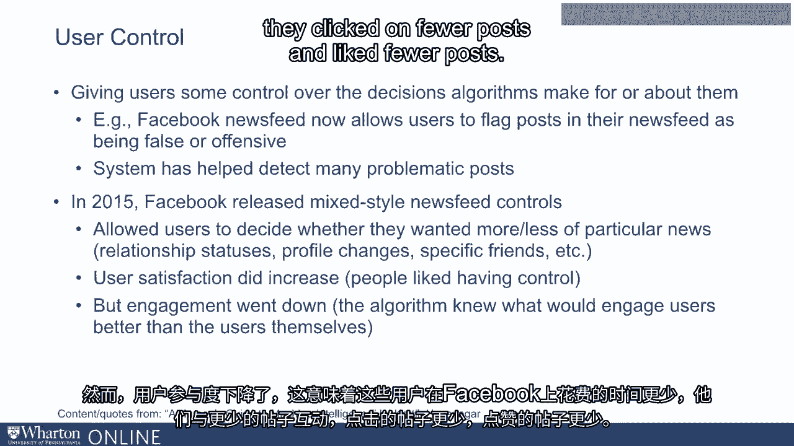
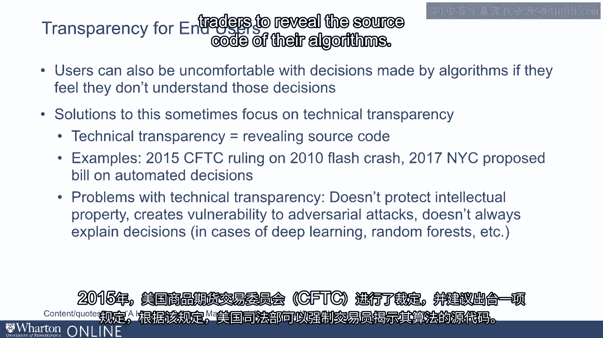
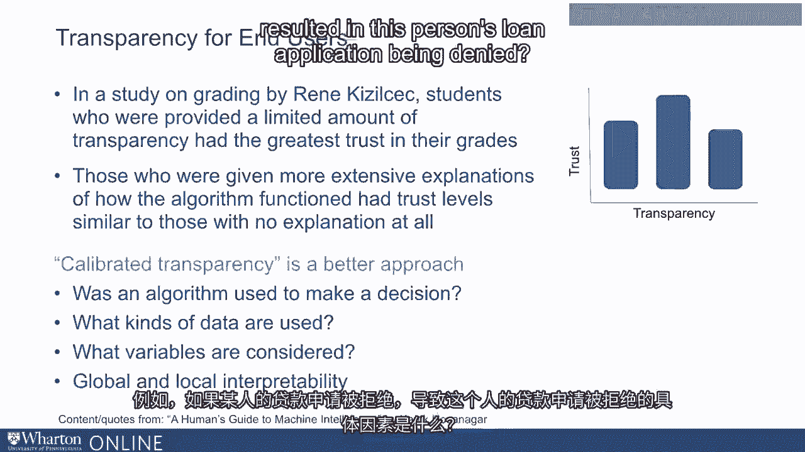
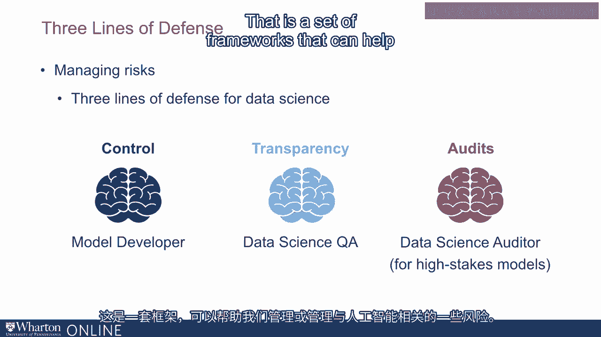

# 128：AI治理 🧠



在本节课中，我们将学习如何确保在享受人工智能（AI）带来好处的同时，有效管理其潜在风险。我们将探讨三个核心治理原则：用户控制、透明度和审计。

---

## 概述

人工智能系统，特别是那些用于自动化决策的系统，可能带来偏见、不透明和失控等风险。为了应对这些挑战，我们需要建立有效的治理框架。本节课将介绍三个关键原则，帮助我们设计更负责任、更可信赖的AI系统。

---

## 1. 用户控制：让人参与决策循环 🎮

上一节我们概述了AI治理的重要性，本节中我们来看看第一个原则：用户控制。其核心思想是让用户对算法的决策方式拥有一定的控制权，即“让人参与其中”。



### 1.1 控制的价值与案例

以下是用户控制的一个实际案例：

*   **Facebook新闻推送的演变**：2016年，Facebook因其平台上传播假新闻而受到批评。作为回应，它推出了允许用户标记他们认为不恰当（如假新闻或冒犯性内容）帖子的功能。这赋予了用户控制权，并向算法提供了反馈，帮助其识别和减少问题内容。

### 1.2 控制的潜在风险与设计考量

然而，控制并非越多越好。一个需要谨慎对待的例子同样来自Facebook。

*   **过度控制的实验**：2015年，Facebook测试了一个功能，允许用户精细控制新闻推送中出现的帖子类型（例如，显示更多或更少某位朋友的动态）。结果发现，使用该功能的用户满意度虽然上升，但用户参与度（如花费时间、点赞、点击）却下降了。这表明，过多的用户控制可能干扰算法有效展示用户真正感兴趣内容的能力。

因此，虽然用户控制很重要，但设计时必须权衡：既要让用户能够标记问题或推翻算法，又要避免因控制过多而导致系统性能下降。

### 1.3 研究启示：多少控制才够？

我的研究以及其他学者的工作，为如何设计控制提供了见解。一项由沃顿商学院同事进行的研究评估了用户控制对信任的影响。

实验设置如下：
```python
# 实验分组示例（非实际代码）
group_1 = “无控制组” # 必须完全接受算法建议
group_2 = “有限推翻组” # 可在极少数情况下推翻算法
group_3 = “微调组” # 可小幅修改算法预测
group_4 = “完全控制组” # 对算法拥有完全控制权
```

研究发现：
*   毫无控制权的用户信任度低，不愿使用算法。
*   只要给予一点控制权（无论多少），用户的信任度就会显著提高，并且更愿意使用算法。
*   信任水平在“有一点控制”和“有很多控制”的组别中同样高。

**结论**：给予用户一点控制权对于建立信任非常有效，但过多的控制可能带来性能风险。关键在于设计允许用户在发现问题时进行干预的系统，而不是让算法完全不能独立决策。

---



## 2. 透明度：解释算法的决策过程 🔍

上一节我们探讨了用户控制，本节中我们来看看第二个原则：透明度。这意味着为用户提供关于算法如何做出决策的足够信息。

### 2.1 技术透明度的局限性

对透明度的一种常见误解是“技术透明度”，即公开算法的源代码。然而，这种做法存在争议：

*   **案例：金融市场与政府提案**：在2010年美股“闪电崩盘”后，曾有监管机构提议强制交易公司公开其自动交易算法的源代码。类似地，纽约市也曾提出法案，要求市政部门使用的自动决策软件公开源代码。
*   **抵制与原因**：这些提议遭到了强烈抵制，原因包括：1) 泄露商业秘密和知识产权；2) 使系统更容易受到黑客攻击。最终，这些严格的技术透明度要求大多被修改或放弃，因为其实际价值有限（普通人难以理解代码），且弊端明显。

### 2.2 有效的透明度：高层次解释

对最终用户而言，更有用的是高层次的、可理解的解释。Renee Kieselchak的研究评估了不同透明度对信任的影响：

实验让学生知道其作业成绩由算法决定，并分为三组：
1.  **无信息组**：信任度很低。
2.  **基本解释组**：获得高层次信息（如算法考虑了哪些因素，哪些因素最重要）。信任度显著提高。
3.  **详细公式组**：获得详细的算法公式和具体信息。信任度依然较低，因为用户难以消化复杂信息。

**结论**：用户不需要看到源代码，他们需要的是基本信息，例如：
*   是否使用了算法做决策？
*   算法使用了哪些数据？
*   考虑了哪些变量？
*   哪些变量对当前决策最重要？

### 2.3 可解释机器学习：全局与局部



这与机器学习中的“可解释性”领域直接相关。该领域主要关注两个层面：

*   **全局可解释性**：解释**整个模型**的决策逻辑。例如，在贷款审批模型中，可以说明“申请人的收入是影响决策的最重要因素，其次是信用历史”。
    *   **公式表示（示例）**：`决策权重 = f(收入， 信用历史， 负债率...)`， 并给出各因素的重要性排序。
*   **局部可解释性**：解释**针对单个样本**的决策原因。例如，解释“为什么张三的贷款申请被拒绝了？可能是因为其收入低于阈值X，且近期有Y次逾期记录”。

欧盟的《通用数据保护条例》（GDPR）赋予了消费者“解释权”，推动了可解释机器学习的发展。这不仅有助于向消费者提供解释、建立信任，也能帮助数据科学家和管理者理解复杂模型（如神经网络）的内部逻辑，从而更好地调试和部署系统。

---

## 3. 审计：对高风险算法进行压力测试 🧪

上一节我们讨论了透明度，本节中我们来看看最后一个原则：审计。特别是在高风险应用场景中，对算法进行系统性审查至关重要。

### 3.1 审计的必要性与监管趋势

即使有控制和透明度，算法仍可能存在隐藏的偏见或缺陷。美国国会曾提出《算法问责法案》的提案（尚未通过），要求大公司对其用于高风险决策（如贷款、招聘）的自动化系统进行准确性和公平性等方面的审计。

前瞻性的公司不应等待法规强制，而应主动建立审计流程，以赢得信任、预防问题并确保系统长期稳健。

### 3.2 审计流程框架

一个典型的审计流程可能包含以下步骤：

以下是审计流程可能包含的关键步骤：

1.  **建立清单**：创建公司使用的所有机器学习模型的清单。
2.  **识别与评估**：针对每个模型，识别其用途、开发者、业务负责人。根据模型出错可能带来的社会和财务风险，对其进行风险评级。
3.  **启动审计**：对高风险模型启动审计。审计可由内部专家或外部第三方执行。
4.  **审计内容**：审计将多维度评估模型：
    *   **输入（数据）**：检查训练数据的质量和是否存在偏见。
    *   **模型本身**：将当前模型与替代模型进行性能对比，确保其最优。
    *   **压力测试**：使用模拟数据或对抗性样本来测试模型在异常情况下的鲁棒性。
    *   **输出（决策）**：分析模型的预测结果，评估其决策逻辑是否合理，并查找异常预测。

### 3.3 将审计融入组织流程

可以将审计思想融入团队设计。就像软件开发中有“开发工程师”和“测试工程师”一样，数据科学团队也可以设立“模型开发”和“数据科学质量保证”角色。后者专门负责对模型进行测试和审计，特别是针对那些高风险模型。

---

## 总结

本节课我们一起学习了管理AI风险的三个核心治理原则：



1.  **用户控制** 🎮：在系统设计中融入用户干预的选项，特别是在算法出错时，这能有效建立信任，但需注意平衡，避免过度控制损害性能。
2.  **透明度** 🔍：为用户和管理者提供关于算法决策的高层次、可理解的解释，而非复杂的源代码。这涉及可解释机器学习中的全局与局部解释。
3.  **审计** 🧪：对高风险AI系统进行系统性审查，包括数据检查、模型对比、压力测试等，以主动发现问题、确保公平与稳健。


通过结合**控制**、**透明度**和**审计**，我们可以构建一个框架，帮助我们在享受人工智能巨大潜力的同时，有效地治理其伴随的风险。