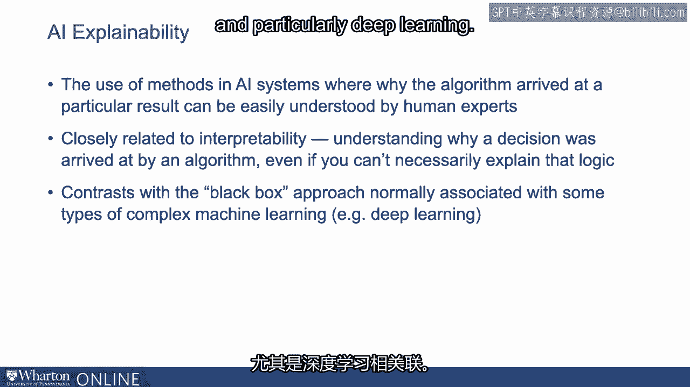
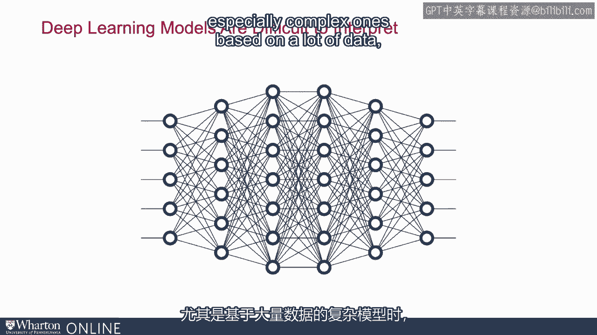

# 130：可解释的AI是什么？🤔

在本节课中，我们将要学习人工智能领域中的一个重要概念——可解释的AI。我们将探讨其定义、重要性，以及它与传统“黑箱”模型的区别。

---

## 概述

使用AI系统的一个主要挑战与可解释性相关。

因此，AI的可解释性是指AI系统中使用的方法，解释算法为何得出这样的结果。特定结果可以被人类专家轻松理解。这与可解释性概念密切相关，即理解为什么算法是如何得出决策的。即使你能够理解结果，它可能无法解释该逻辑。这与通常关联的黑箱方法形成对比，后者常见于某些类型的更复杂的机器学习，特别是深度学习。

---

## 可解释性的重要性

上一节我们介绍了可解释性的基本概念，本节中我们来看看为什么它如此重要。

在许多背景下，这对采纳至关重要。当你考虑实施时，即使模型非常准确，无法解释它是如何得出决策的，将成为采纳的主要障碍。可解释性目前是AI中的一个关键举措，是关键的科研前沿。大型科技公司目前在这一问题上投入了大量资源，政府也在努力，比如资助相关项目以开发更好的可解释AI。

---

## 不同模型的可解释性对比

理解了可解释性的重要性后，我们来看看不同类型的模型在可解释性上的差异。

所以稍微对比一下，如果我们的决定是基于基本商业规则，通常这些是容易解释的。我们可以清晰地说明是如何得出这个决定的，以及哪些因素对得出该决定起了作用。

以下是几种模型的可解释性分析：

*   **基于决策树的模型**：例如，相对容易解释。可以查看决策树，基本上可以了解特定决策是如何得出的，到底是如何得出决策的，哪些因素对决策起了作用。
*   **基于神经网络的深度学习模型**：特别是基于大量数据的复杂模型，它们变得相对更难去解释。有时很难深入算法内部，理解导致这一结果的原因，决策被做出。

对于更复杂的模型，这存在一个主要的权衡：一方面，它们能够处理大量数据并做出非常准确的预测；但另一方面，它们可能难以解释逻辑。

---

## 总结

本节课中我们一起学习了可解释AI的概念。我们了解到，可解释性是指让AI的决策过程对人类而言是清晰、可理解的。它与传统“黑箱”模型形成对比，对于AI系统的实际应用和信任建立至关重要。我们对比了基于规则的系统、决策树模型与复杂深度学习模型在可解释性上的差异，认识到在模型性能与可解释性之间往往需要权衡。目前，可解释AI是业界和学术界共同关注的关键前沿领域。