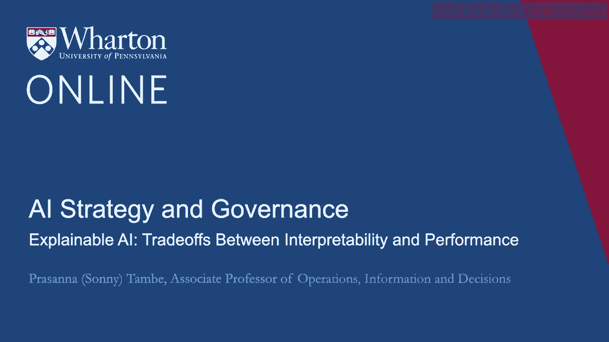
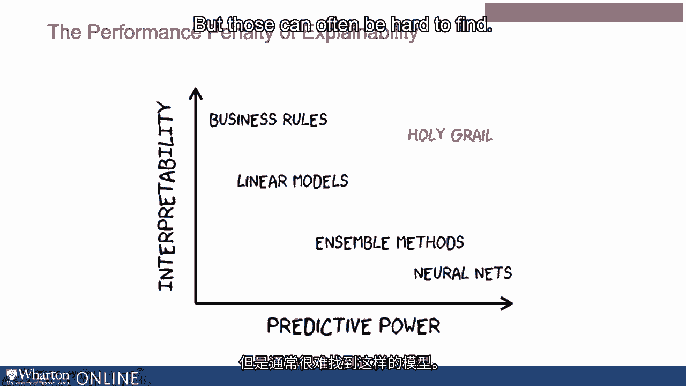
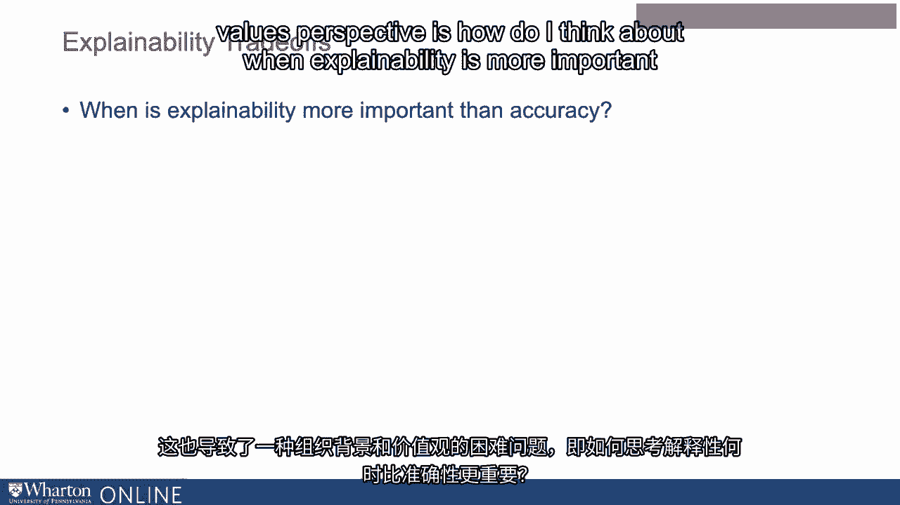
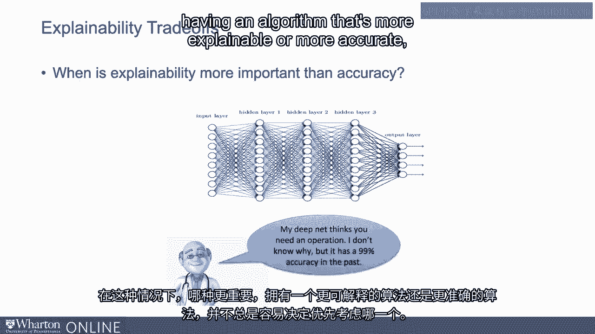

# 132：解释性与性能之间的权衡 🧠

在本节课中，我们将探讨人工智能模型中的一个核心矛盾：**解释性**与**预测性能**之间的权衡。理解这一权衡对于在实际应用中正确选择和评估模型至关重要。

---

鉴于解释性对于人工智能的使用和采纳非常重要，一个自然的疑问是：为什么不直接让每个模型都具备良好的解释性呢？

结果发现，在模型的**解释性**与其**预测性能**之间通常存在一种权衡关系。这种权衡在复杂的数据环境中表现得尤为明显。当你追求模型的高解释性时，往往需要接受其在预测能力上的某种妥协。

因此，我们可以将这个问题视为算法的**预测能力**与其**解释性**之间的平衡。

正如我们之前所讨论的，像商业规则、简单的决策树或线性回归模型通常具有较好的解释性。例如，一个线性模型的决策可以表示为：

**公式：** `y = w1*x1 + w2*x2 + ... + b`

其中，权重 `w` 直接显示了每个特征 `x` 对结果 `y` 的影响程度，这非常容易理解。

然而，这些模型的预测能力相对有限，难以处理高度非线性的复杂关系，无法与像深度神经网络这样更强大的模型相提并论。

上一节我们介绍了简单模型的特点，本节中我们来看看更复杂的模型。随着我们接触到神经网络等复杂模型，它们虽然具有更高的预测能力，能够从海量数据中学习到精妙的模式，但其内部运作机制就像一个“黑箱”，更难以解释。

当然，我们理想的目标是找到一个完美的平衡点，即拥有一个**同时具备高度预测性和高度解释性**的模型。但遗憾的是，这类模型往往很难找到。

因此，当你考虑选择一个算法或应用一个模型时，通常必须在**精准度**和**可解释性**之间做出权衡。你需要问自己：我是更想要一个在预测中非常精确的模型，还是更需要一个能够解释其决策原因和过程的模型？

为了更清晰地理解这种权衡，以下是几个具体的应用场景分析：

*   **贷款审批与医疗诊断**：在这些领域，如果一个模型虽然预测能力很强但完全不可解释，可能是无法被接受的。例如，银行需要向客户解释拒贷理由以符合监管要求；医生需要理解算法的诊断建议才能与患者沟通并建立信任。因此，在这些场景下，解释性的优先级可能高于纯粹的预测准确性。
*   **内容推荐与金融交易**：相比之下，在预测用户点击广告、推荐商品或执行高频金融交易时，算法的解释性可能不那么重要。这些决策不直接对人产生法律或伦理上的重大影响，核心目标是最大化点击率、转化率或收益。因此，在这些场景下，可以优先优化模型的预测性能。
*   **组织内部决策（如晋升）**：这类决策对人的影响重大，公平性和透明性至关重要。因此，模型的解释性再次变得非常重要，需要能够说明影响决策的关键因素。

所以在不同的应用上下文中，哪个因素更重要——是使用一个更精确的算法，还是一个更具解释性的算法——并不总是容易决定，需要根据具体情况**确定优先级**。

---

**本节课总结**

本节课中，我们一起学习了人工智能模型**解释性**与**性能**之间的核心权衡关系。我们了解到：

1.  简单模型（如线性模型、决策树）通常**解释性好**但**预测性能有限**。
2.  复杂模型（如神经网络）通常**预测性能强**但**解释性差**，像一个“黑箱”。
3.  在实际应用中，需要根据场景（如医疗、金融、推荐系统）的**具体需求**和**监管要求**，来决定是优先追求准确性还是可解释性。
4.  做出这种权衡是构建负责任且可用的AI系统的关键一步。

理解这一权衡，能帮助我们在面对具体问题时，做出更明智的模型选择与设计决策。