# 134：人工智能的可解释性与法律 📜⚖️

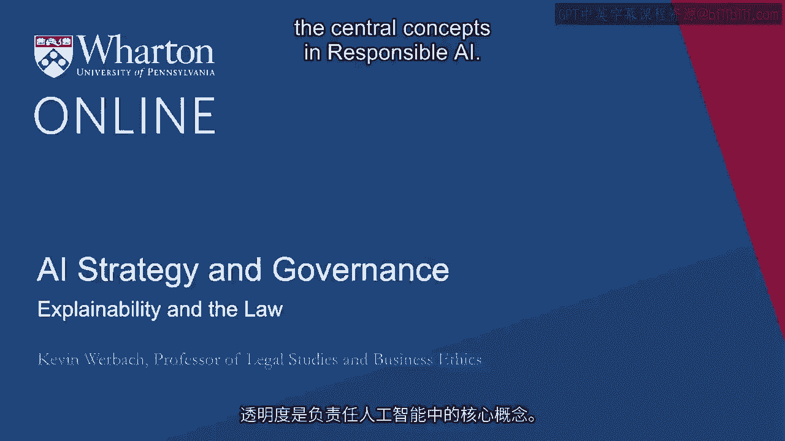

在本节课中，我们将要学习人工智能（AI）系统中的“可解释性”概念，以及它与现有及潜在法律框架之间的关系。理解这一点对于构建负责任、透明且合规的AI系统至关重要。

---

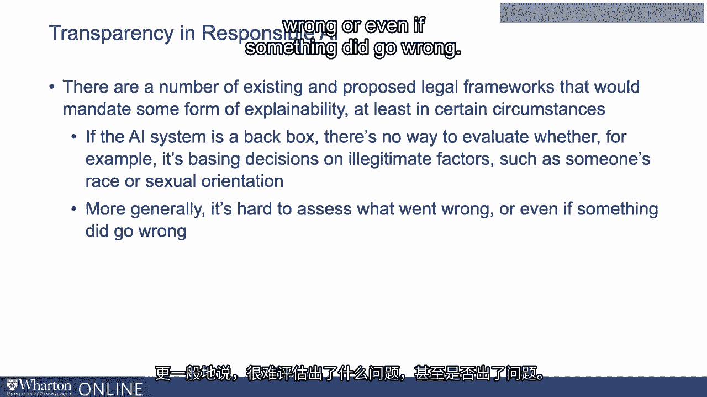

## 概述：为什么可解释性至关重要？

透明性是负责任的人工智能中的核心概念之一。许多现有和提议的法律框架会要求某种形式的可解释性，至少在某些情况下。如果人工智能系统是一个黑箱，就无法评估决策是否基于不合法的因素，例如某人的种族或性取向。更普遍地说，很难评估系统出了什么问题，甚至是否真的出了问题。

上一节我们介绍了可解释性的重要性，本节中我们来看看法律是如何具体要求和塑造这一概念的。

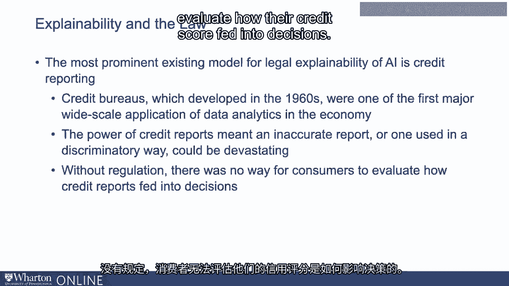

---

## 历史先例：信用报告模型

现有的最突出法律可解释性模型是信用报告。信用局在1960年代发展，是数据分析在经济中首次大规模应用的重大例子之一。它们迅速成为像美国这样的国家消费者金融市场的必需品，以及其他如招聘等领域使用信用报告数据来评估候选人。

但信用报告的权力意味着一个不准确的报告，或者以歧视性方式使用它，可能会造成严重后果。在没有监管的情况下，消费者无法评估他们的信用评分如何影响决策。

当1970年代美国的两部法律——《平等信贷机会法》（ECOA）和《公平信用报告法案》（FCRA）通过时，对信用报告的法律可解释性施加了标准。

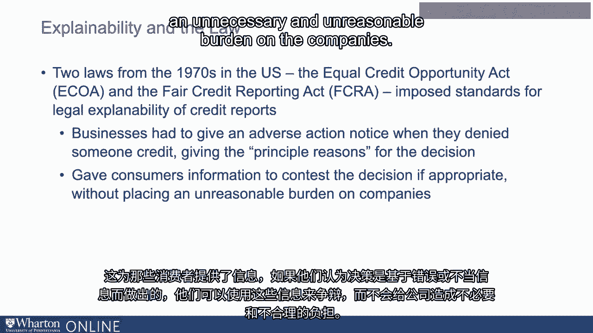

具体来说，这意味着企业必须在拒绝某人信用时发出“不利行动通知”。这意味着要提供“主要原因”来说明决定。他们不必列出每一个原因，也不需要给出算法的确切公式或每个因素如何影响结果，但他们确实需要给客户一些指示，说明是什么驱动了不利的决定。

这给消费者提供了他们可以使用的信息，以便在他们认为决定基于错误或不当信息时，可以质疑该决定。这可以在对公司没有不必要和不合理负担的情况下发生。

---

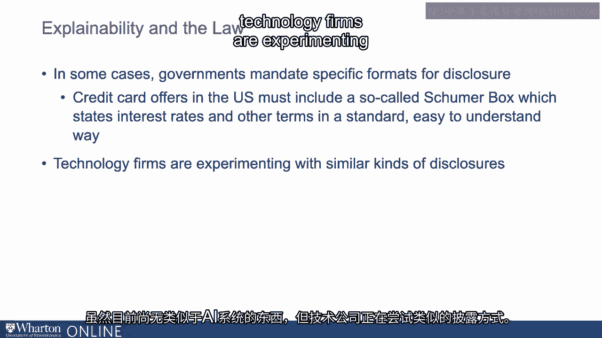

## 标准化披露的尝试

在某些情况下，政府规定具体的披露公式。例如，美国的信用卡优惠必须包含一个所谓的“Schumer Box”（以提案议员命名），它以标准、受监管、易于理解的方式陈述利率和其他条款。虽然目前尚无完全类似于人工智能系统的强制披露机制，但科技公司正在尝试类似的披露方式。

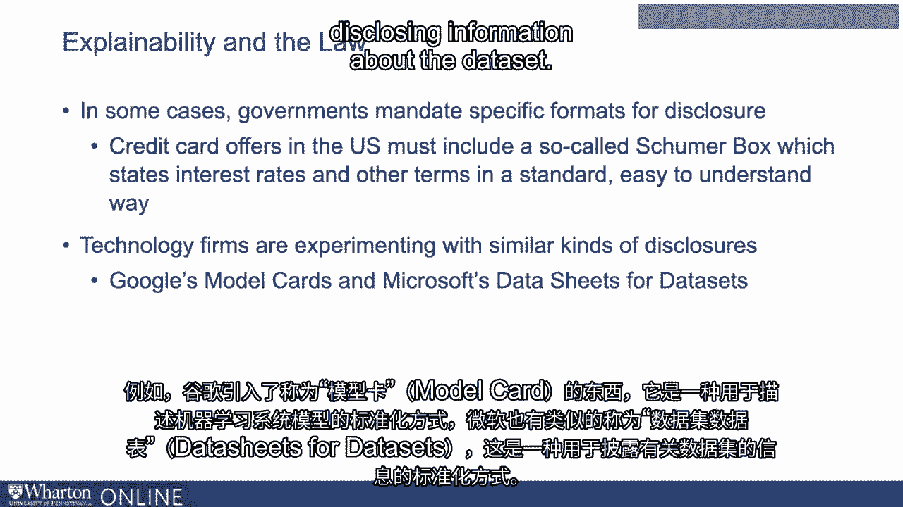

因为这再次给用户，甚至在某些情况下给其他开发者，提供了更容易理解发生了什么的机会。

以下是科技公司采取的一些措施示例：
*   **模型卡**：谷歌引入的一种标准化描述机器学习系统模型的方式。
*   **数据集的数据表**：微软采用的一种标准化的信息披露方式，用于描述数据集的情况，帮助识别源数据和构建模型所涉及的技术。

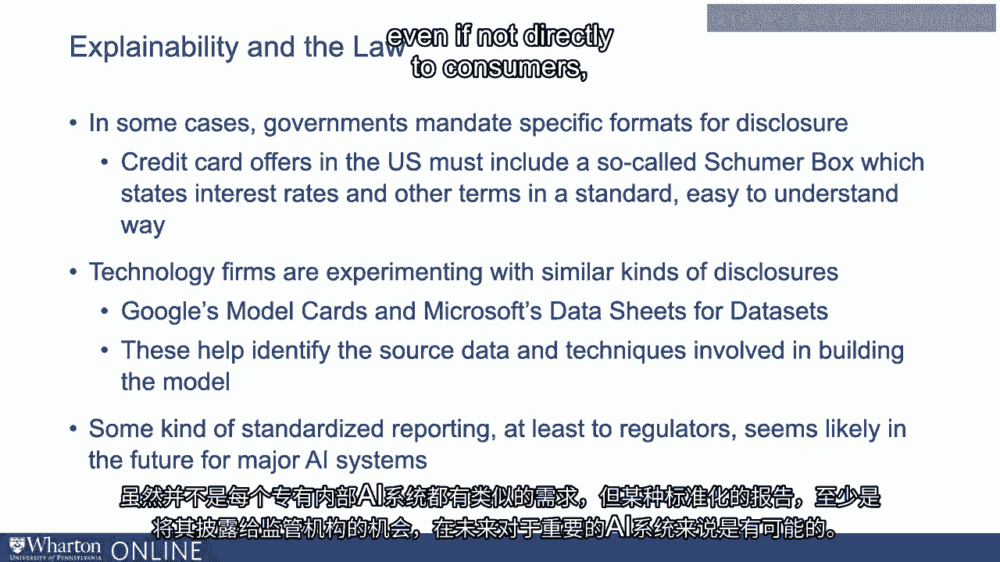

尽管并不一定要为每个内部专有AI系统设立类似机制，但某种标准化报告，至少要有机会向监管者披露（即使不直接面向消费者），未来主要的AI系统似乎也可能需要如此。

---

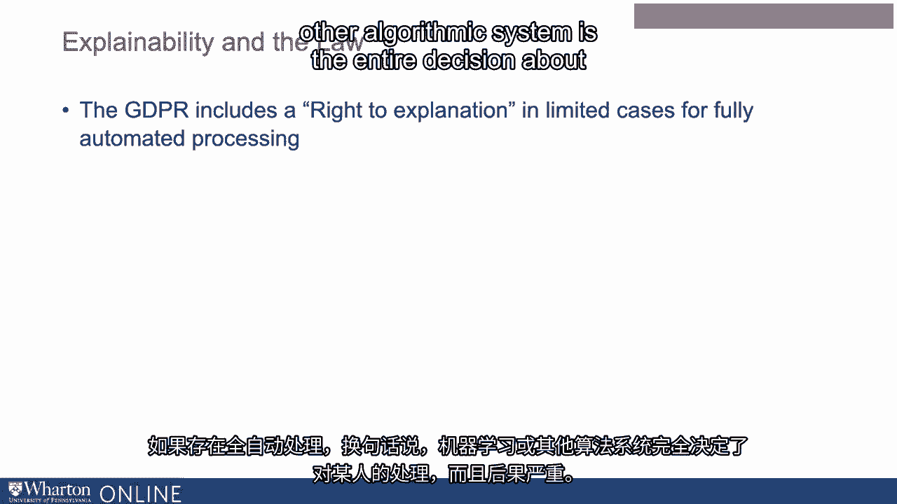

## 法律框架中的解释权

再次强调，如果监管者不知道发生了什么，他们无法判断是否出了问题。欧洲的《通用数据保护条例》（GDPR）虽然主要是一项隐私法，但包括了通常所描述的在有限情况下的“解释权”。

所以，如果存在完全自动化处理（即机器学习或其他算法系统完全决定了一个人所经历的事情），并带来严重后果（如某人获得或未获得贷款、工作，或面临某种法律后果），那么系统实施者需要提供解释决策所依据的因素的信息。不幸的是，这在实践中到底意味着什么并不明确，GDPR中的语言有些笼统，且缺乏显著的案例法。

在美国，至少有一起涉及休斯敦教师的联邦上诉法院案件。教师们因基于学生测试分数的黑箱评估算法被解雇，法院发现缺乏解释违反了教师们享有的宪法正当程序权利。教师们无法挑战他们的解雇，因为他们不知道算法是如何处理测试分数的。这最终导致案件和解，算法被披露或停用。虽然这在美国并非普遍法律，但它表明在不同法律理论下，对解释要求的运动正在加速。

---

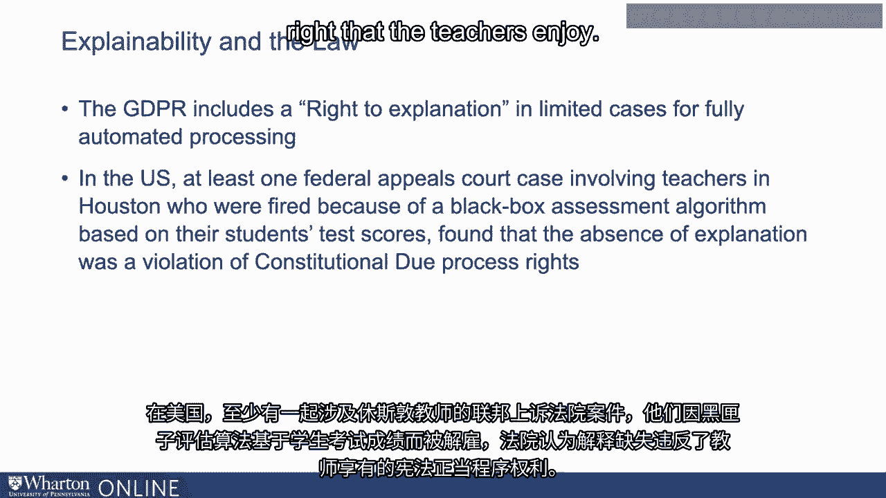

## 高风险场景与算法影响评估

同样，在任何需要分配法律责任的情况下，例如涉及自动驾驶车辆的事故，调查人员通常需要并能够访问计算机视觉系统的数据，以了解系统是如何行为的，以及它认为自己在路上看到或没有看到什么。因此，当发生事故调查后要求解释时，确实需要一种机制。

我之前提到的《算法责任法案》是美国的一项提议法案。欧盟的白皮书以及建议新人工智能立法的文件都提议，在高风险人工智能系统部署前，必须提供正式的“算法影响声明”。

**高风险**指的是有可能导致非法歧视、伤害或重大财务后果的系统。在这些情况下，算法影响声明将迫使公司或政府机构明确识别系统的工作方式。

与早期的信用报告法律一样，确切理解这些法律如何实施，以及在充分解释和公司所需灵活性之间找到适当平衡的道路还很漫长，特别是考虑到在技术上很难确切解释一个复杂的深度学习系统内部发生了什么。但法律的确在朝这个方向发展。

---

## 对开发者的启示与未来展望

所以，当你有机会在内部更好地理解系统行为的解释时，你应该尝试这样做。现在，一些关于这些算法影响声明的提案要求向公众披露。

但即使他们不这样做，公司可能仍需向监管机构证明他们采取了必要措施，并在影响评估中评估或解决了可能的危害。所以再次强调，如果可以的话，提前考虑你拥有的可解释性机制是值得的。

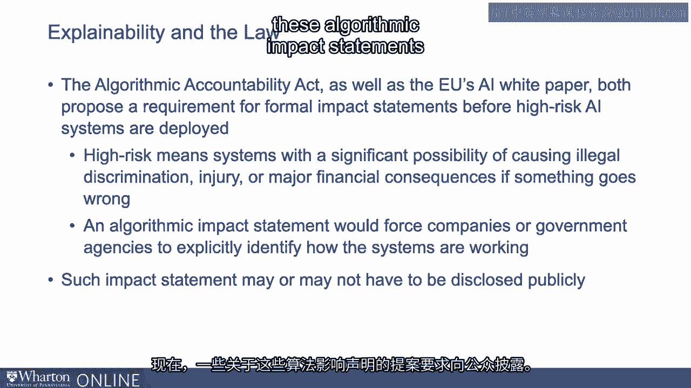

这些潜在的法律要求也会推动研究人员和供应商开发更好的可解释人工智能技术和工具。目前已有许多解决方案，未来会有更多更好的解决方案。

人工智能的一大优势是它能够发现人类无法察觉的联系。然而，更好地理解人工智能系统如何做出决策以及发生了什么，将惠及所有人。

---

## 总结

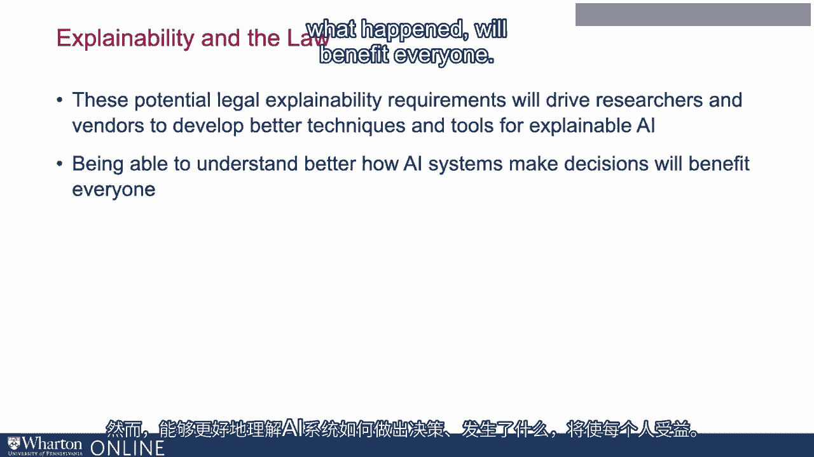

本节课中我们一起学习了：
1.  **可解释性的法律必要性**：透明性是评估AI决策合法性、公平性和排查问题的关键。
2.  **历史模型**：以美国信用报告法律为例，展示了“不利行动通知”和“主要原因”披露如何平衡消费者权利与企业负担。
3.  **标准化实践**：科技公司推出的“模型卡”、“数据表”等，是行业自我规范的可解释性尝试。
4.  **法律权利**：GDPR的“解释权”和美国的司法案例表明，法律正逐步要求对自动化决策提供解释。
5.  **未来监管方向**：“算法影响声明”可能成为部署高风险AI系统的前置要求，推动技术透明化。
6.  **行动建议**：开发者应主动构建和理解系统的可解释性机制，以应对未来的法律和伦理要求。

理解并实践AI的可解释性，不仅是合规的需要，更是构建可信、可靠人工智能系统的基石。祝你在这个项目的其余部分以及在你的组织中实施这些技术时好运。