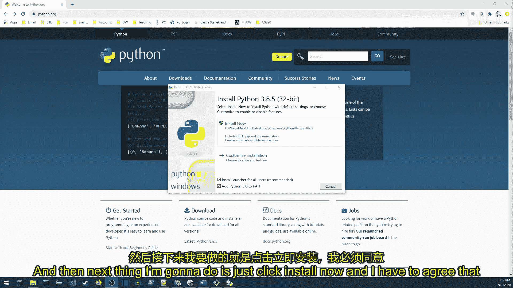
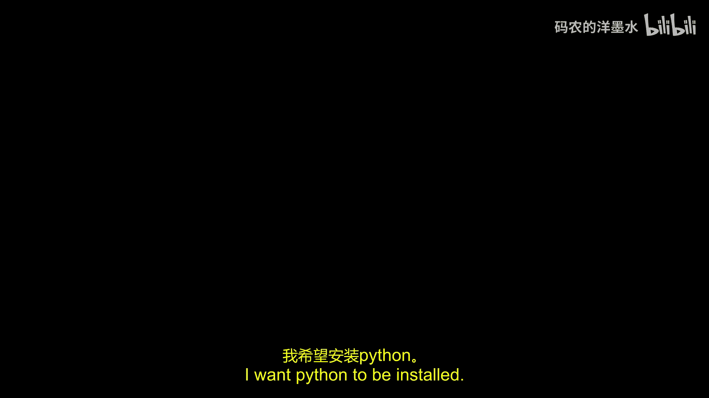
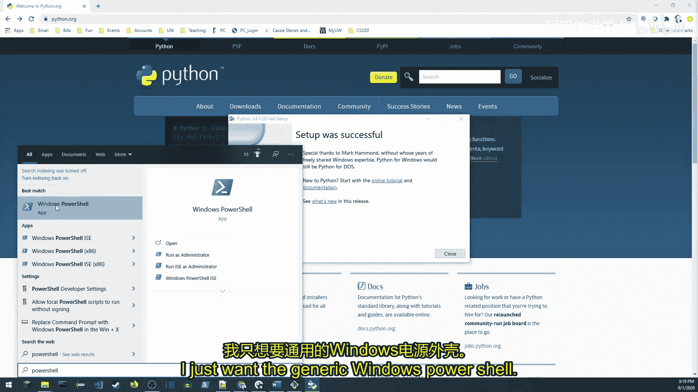
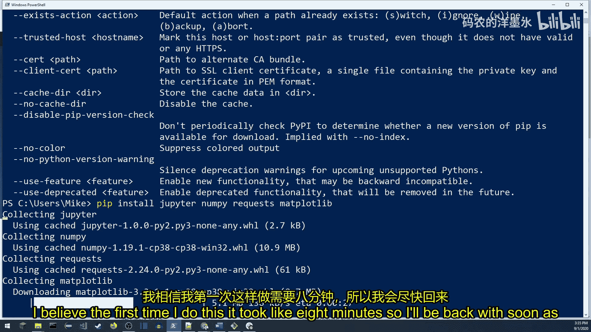
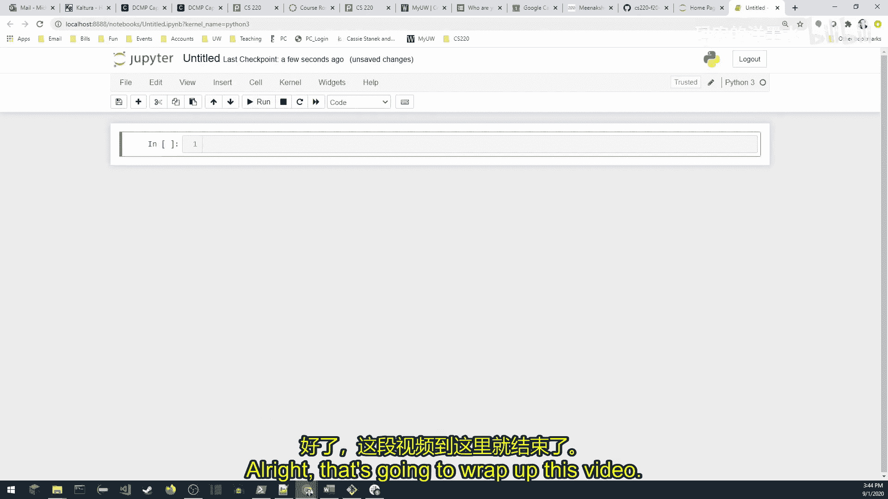

# 001：Windows系统Python安装教程 🐍

在本教程中，我们将学习如何在Windows操作系统上安装Python编程语言，以及本课程所需的核心扩展包。我们将一步步完成从下载Python到验证安装的整个过程。

---

## 下载Python安装程序

首先，我们需要访问Python官方网站下载安装程序。以下是具体步骤。

1.  打开浏览器，访问 `python.org`。
2.  将鼠标悬停在导航栏的“Downloads”选项上。
3.  网站通常会为Windows用户自动推荐最新版本的Python安装程序。点击该下载按钮。

下载过程可能需要一些时间，请耐心等待。

---

## 运行Python安装向导

上一节我们下载了Python安装程序，本节中我们来看看如何运行安装向导并进行关键设置。

下载完成后，在文件资源管理器中找到下载的安装文件（通常名为 `python-3.x.x.exe`），双击运行。

在打开的安装向导界面中，请务必进行以下两项关键操作：



*   **勾选“Add Python 3.x to PATH”**：这会将Python添加到系统环境变量中，方便在命令行中直接调用。
*   **勾选“Install launcher for all users”**：如果计算机有多个用户账户，此选项能让所有用户都能使用Python。



完成设置后，点击“Install Now”开始安装。安装过程可能需要几分钟。

---

## 安装课程所需的扩展包

Python安装完成后，我们需要安装本课程将要用到的几个重要扩展包。我们将使用Python自带的包管理工具 `pip` 来完成这个任务。



首先，我们需要打开Windows PowerShell。点击开始菜单，输入“PowerShell”，然后选择打开。

在PowerShell窗口中，我们可以通过输入 `pip` 命令来验证Python和pip是否安装成功。如果看到一系列pip的使用说明，则表明安装正确。

接下来，我们将使用pip一次性安装四个核心包。请在PowerShell中输入以下命令：

```bash
pip install jupyter numpy requests matplotlib
```

请注意，`jupyter` 的拼写是 **J-P-Y-T-E-R**，与木星（Jupiter）的拼写不同。命令中无需逗号，直接列出所有包名即可。

执行此命令后，pip会开始下载并安装这些包及其依赖项。首次安装可能需要较长时间（例如8分钟或更久），请等待其完成。

---

## 验证安装并启动Jupyter Notebook

所有包安装完毕后，我们可以通过启动Jupyter Notebook来验证整个环境是否配置成功。



在PowerShell中，输入以下命令：

```bash
jupyter notebook
```

此命令会启动Jupyter Notebook服务，并自动在您的默认网页浏览器中打开其界面。您会看到一个文件浏览器界面。

需要说明的是，Jupyter Notebook此时运行在您的**本地计算机**上（地址为 `localhost`），并非真正的互联网。它只是借助浏览器的功能来提供一个交互式的编程环境。

要创建一个新的Python编程文件，您可以点击页面右上角的“New”按钮，然后选择“Python 3”即可。

---

## 总结



本节课中，我们一起学习了在Windows系统上搭建Python数据编程环境的完整流程。我们首先从官网下载Python安装程序，接着在安装时**务必勾选“Add Python to PATH”**选项。然后，我们使用 `pip install` 命令安装了 `jupyter`、`numpy`、`requests` 和 `matplotlib` 这四个核心扩展包。最后，我们通过启动Jupyter Notebook成功验证了所有安装。如果您在任何一个步骤遇到问题，请及时寻求帮助。