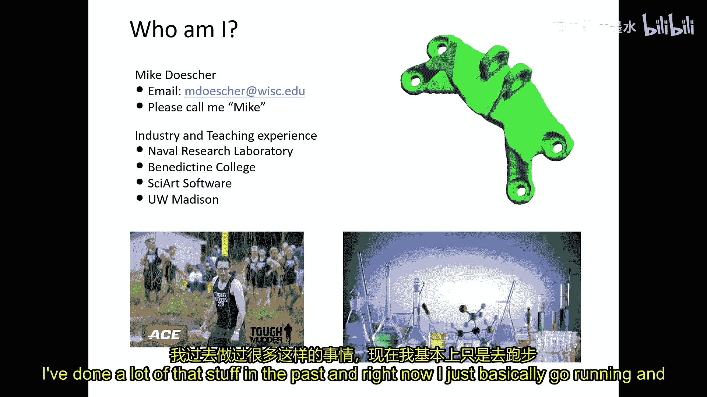
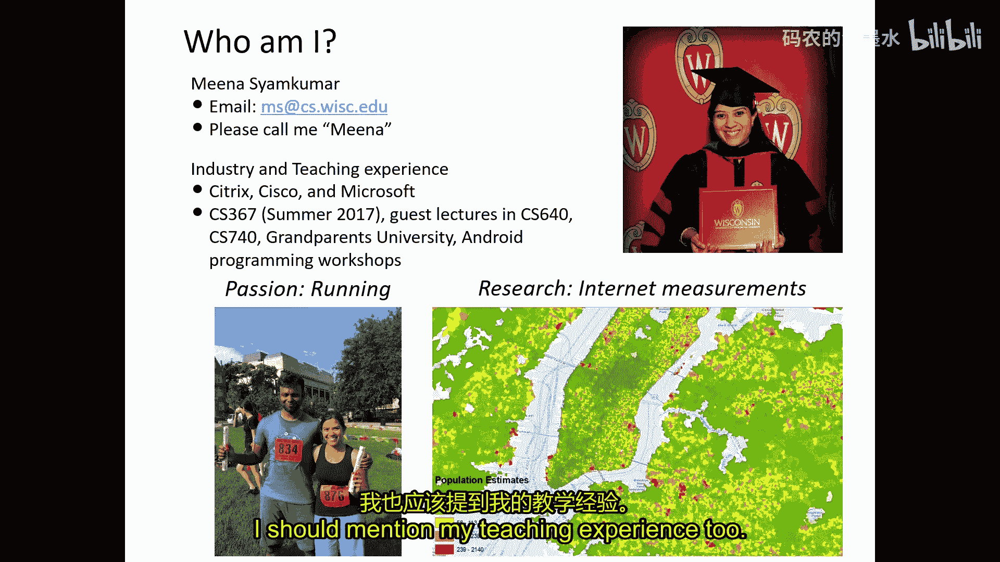
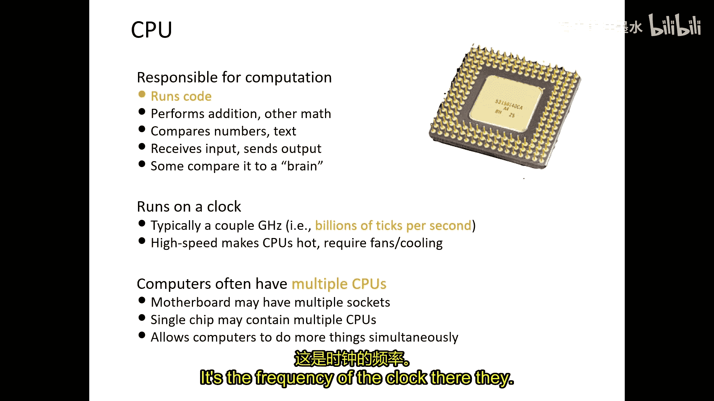
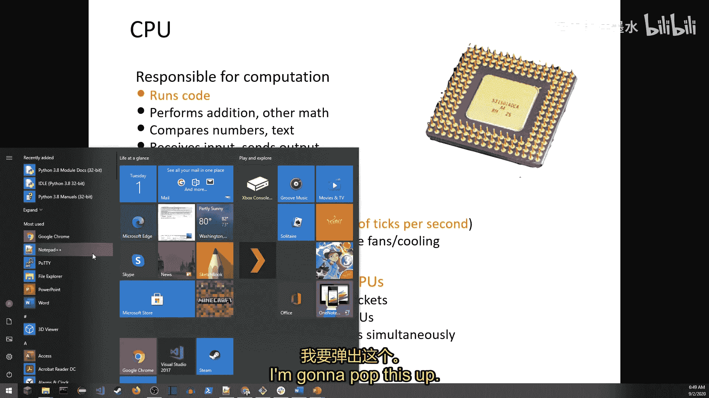
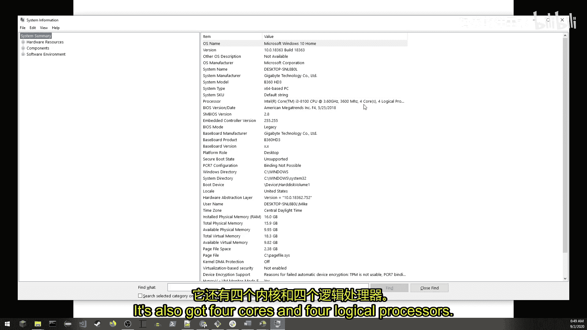
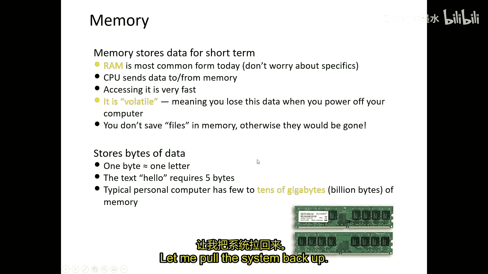
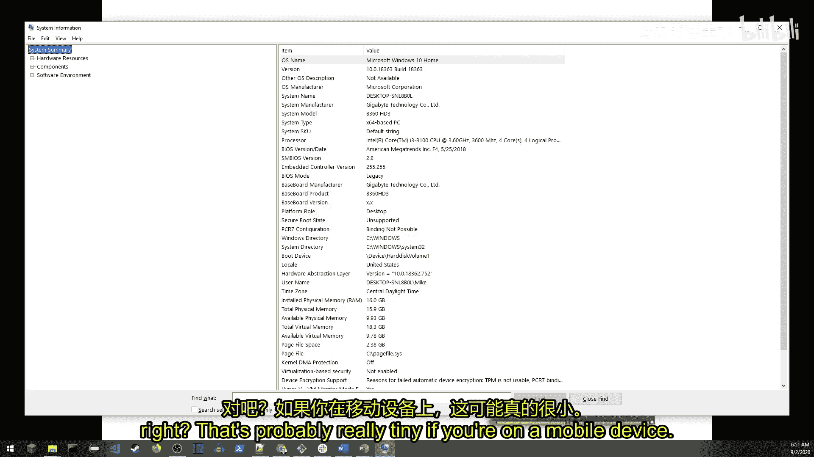
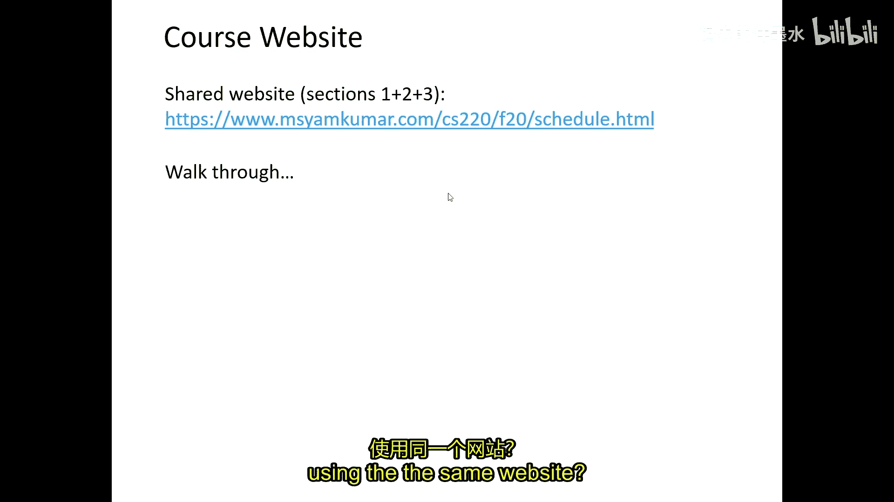
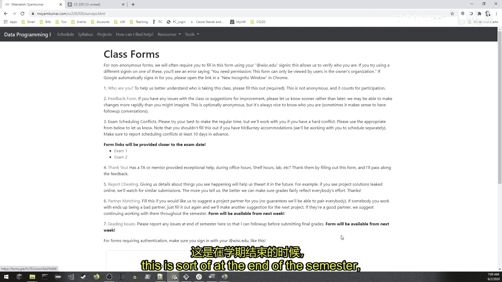
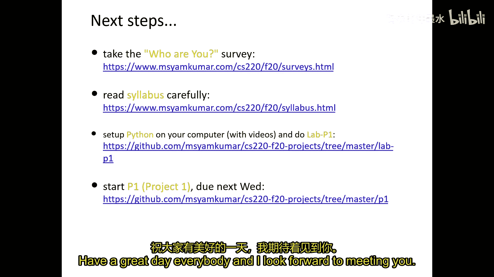

# 002：课程概述与硬件

在本节课中，我们将要学习CS220《数据编程1》的课程概述，并初步了解计算机硬件的基本组成部分。我们将探讨数据在现代世界中的重要性，以及如何利用计算能力从数据中学习。课程将使用Python语言，并强调实践与项目的重要性。

---

## 课程介绍与背景

大家好，欢迎来到威斯康星大学麦迪逊分校的CS220《数据编程1》课程。我是Mike Dosher，本课程的联合讲师之一。

近年来，本课程的学生人数急剧增长，这反映出数据技能在当今职业生涯中的重要性日益凸显。我们生活在一个数据爆炸的时代，无论是新闻、医学、物理学还是工程学，数据都无处不在。本课程的核心目标是教会大家如何从数据集中提取知识，而答案就在于**计算**。

过去，“计算”曾是一个职业头衔，指进行数学计算的人。如今，我们依靠机器进行计算。我们的目标是学会利用强大的计算能力来解决实际问题。

计算机的优势在于速度更快、更可靠。正如谷歌联合创始人拉里·佩奇所说：“找到世界上的杠杆，这样你就可以更懒。” 这句话的深层含义是，我们应该让计算机自动化处理它能完成的工作，从而将时间投入到更有价值的创造性任务中。

要实现自动化，我们需要告诉计算机该做什么。这就好比成为“双语者”：既要精通自己专业领域（如生物学、新闻学）的语言，也要掌握计算机编程的语言。数据科学目前是一个极佳的就业方向，在2019年曾被评为美国最佳职业。

与传统的以Java或C++为主、侧重理论的计算机科学导论课不同，本课程将使用更易学习的Python语言，并紧密结合来自各学科的真实数据问题。课程将重度依赖数据，几乎所有的项目都会涉及数据集的处理与分析。

---

## 讲师介绍

本节我们来认识一下教学团队。

我是Mike Dosher。我的背景比较多元：本科学习生物和化学，辅修数学；在南卡罗来纳大学获得了物理化学博士学位；之后在华盛顿的海军研究实验室工作了三年；随后在堪萨斯的本尼迪克特学院教授了八年化学。出于对计算机的好奇心，我来到威斯康星大学进修，并获得了计算机科学硕士学位，之后在麦迪逊的一家初创公司担任软件工程师。我已经在威斯康星大学任教三年。我的爱好包括障碍赛跑和搏击运动。

我的联合讲师是Meena Kumar。她去年刚获得计算机科学博士学位，拥有在思科、微软等公司的行业经验，并在本校任教三年。她的研究兴趣是互联网测量。她也喜欢跑步。

我们还要感谢Tyler，他是本课程的前任讲师，开发了我们正在使用的许多课件和工具。他对于优化工具效率很有热情，例如使用更符合人体工学的DVORAK键盘布局，这体现了本课程的一个理念：熟练使用工具至关重要。

---

## 关于学生

了解课堂的构成对我们很重要。因此，我们设置了一份调查问卷。请尽快完成这份调查，这对于等待名单上的同学尤其重要。

**重要提示**：填写问卷需要使用你的学校邮箱（Wisc ID）登录谷歌账户。如果遇到权限问题，请尝试在浏览器的无痕模式下打开谷歌并重新登录。

根据以往学期的调查数据，大约40%的同学是第一次学习计算机科学课程，约50%的同学此前编写的代码不超过10行。本课程正是为这些初学者设计的。历史成绩表明，即使是零编程经验的同学，只要努力学习，超过90%的人都能获得B-或更好的成绩，其中约50%的人能获得A-或A。这证明，在本课程中取得好成绩是完全可能的。

当然，如果你已有大量编程经验（例如编写过上千行代码），这门课对你来说可能过于简单。欢迎你通过邮件与我们讨论这是否是最适合你的课程。

---

## 课程结构概述

上一节我们介绍了课程背景和学生情况，本节中我们来看看课程的整体结构。

本课程大致分为三个部分，每部分约持续五周：

1.  **控制流**：这部分的核心问题是“计算机现在在做什么？接下来要做什么？”。我们将学习代码的执行顺序，包括使用条件语句（`if/else`）进行分支选择，以及使用循环（`for/while`）进行重复操作。我们还会学习如何编写和调用**函数**来组织代码。
2.  **状态**：这部分关注计算机如何管理数据。我们将学习如何使用Python内置的**列表**和**字典**等数据结构来组织数据，如何对数据进行排序，以及如何从文件中读取数据或将数据保存到文件。
3.  **数据科学专题**：在掌握了编程基础后，我们将聚焦于具体的数据科学主题。这包括处理表格数据（如CSV文件）、从互联网获取并分析数据、使用数据库高效查询数据，以及利用绘图库将数据可视化，以便更直观地发现规律。

前两部分是任何编程入门课都会涉及的内容，但本课程会减少理论深度，增加对数据的侧重。最后一部分则完全围绕数据科学实践展开。

---

## 教学风格与支持

我的授课风格倾向于引导式学习。视频中会经常出现“暂停视频，尝试解决这个问题”的环节，然后我再演示解决方法。课程包含概念讲解、示例演示、大量练习，以及“现场编程”——我会在大家面前实时编写代码，过程中可能会犯错，但这正是学习调试和理解思路的好机会。

课程支持包括阅读材料、发布的幻灯片PDF、以及实时问答环节。请务必利用这些资源。

学习编程就像爬梯子，每一级知识都建立在下一级之上。如果中间缺失了任何一块（就像瑞士奶酪上的洞），爬到顶端就会非常困难。因此，如果你对某个主题不理解，**请务必及时提问**，不要掉队。不要因为课程规模大或觉得讲师忙碌而不敢提问。

我们有一个庞大的支持团队：15名助教、14名本科生朋辈导师，加上我和Meena，共31人支持近800名学生。我们会提供“实验时间”，这不是强制性的，但你可以在此连接到Blackboard Collaborate会话，向在场的助教或朋辈导师咨询策略性问题或寻找项目伙伴。

---

## 课程资料与沟通

课程阅读材料主要来自三个来源，均为免费资源：
1.  《Think Python》第二版（针对Python 3）。
2.  《Automate the Boring Stuff with Python》。
3.  我们自己编写的课程笔记，主要涵盖数据科学部分。

有效的沟通对于大规模课程至关重要。我们将使用以下工具：

1.  **Piazza（在线论坛）**：这是提问的主要场所。提问前请先搜索是否已有相同问题。请尽量将问题设为公开（可匿名），以便他人受益。**严禁在Piazza上发布超过5行与作业相关的代码**，这将被视为作弊。
2.  **电子邮件**：你会收到课程邮件列表的通知。如有课程内容或作业问题，请先联系助教。他们的邮箱格式是 `cs220-help@cs.wisc.edu`，并在主题中加上 `+TA姓名`。如果是课程安排等行政问题，可以直接联系讲师。
3.  **反馈与表扬**：我们设有匿名反馈表单，用于收集改进建议。另有一个表扬表单，如果你觉得某位助教或朋辈导师提供了特别大的帮助，可以在此告知我们。
4.  **Canvas**：主要用于查看成绩、参加每周测验和三次考试。

项目提交和评分有专门的工具。你提交项目后，助教会运行测试并检查代码风格，可能会因“硬编码答案”（即直接输出结果而非通过计算得出）等问题扣分。你可以在提交前运行我们提供的测试程序来预测分数。

---

## 评分与考核

本节我们来详细了解课程的评分方式。

成绩构成如下：
*   **编程项目**：共13个，占总成绩约50%。P1较简单，其余权重相同。我们会提供评分测试，因此在提交前你就能知道大致得分。
*   **每周测验**：共12次，去掉最低的2次，每次占2%。目的是帮助你检查学习效果。
*   **考试**：共3次，各占10%。计划在24小时窗口内开放，你有2小时完成答题。
*   **课堂参与**：占1%，包括完成调查、遵守指引等。
*   **额外学分**：学期末有机会获得，用于帮助处于成绩边缘的同学。

评分标准保证：至少95分获得A，至少85分获得B。这个标准看似严格，但因为项目提供了测试且允许修改后重新提交，大部分同学应该在项目部分取得接近满分的成绩。因此，考试成为区分对知识掌握程度的关键。

关于**项目合作**：允许两人一组完成。最佳合作模式是两人同时在线协作，共同讨论和编写代码。应避免“乒乓模式”（一人做完另一人接着做）或一人包揽所有工作。每组只需提交一份代码文件。

关于**学术诚信**：我们严肃对待作弊行为。允许与项目伙伴共享代码，也允许讨论思路、绘制伪代码、分享非项目特定的在线资源（但需引用）。**严禁**复制/粘贴他人代码、逐行抄袭、或拍摄代码照片。我们会使用名为Moss的自动化工具检测代码相似性。首次作弊的处罚通常是该作业零分并上报学校，多次作弊可能导致开除。

---

## 计算机硬件基础

在开始编程之前，了解计算机的基本硬件组成很有帮助。我们可以将硬件分为几个核心部分。

### 输入/输出设备

计算机通过输入设备接收信息，通过输出设备发送信息。
*   **输入设备示例**：键盘、鼠标、摄像头、麦克风、网络接口。
*   **输出设备示例**：显示器、扬声器、网络接口。

### 核心内部组件

以下是计算机机箱内的主要部件：

1.  **中央处理器**：CPU是计算机的“大脑”，负责执行所有计算和逻辑运算。它并不负责存储数据。现代CPU速度极快，以吉赫兹（GHz）计量，且通常包含多个核心，可以同时处理多个任务。CPU运行时会产生大量热量，因此需要散热器或风扇冷却。
    *   **公式示例**：`运算速度 ≈ CPU时钟频率 × 核心数量`

2.  **内存**：通常指RAM。它是CPU的工作区，用于临时存储正在运行的程序和数据。访问速度远快于硬盘，但**断电后数据会丢失**（易失性）。内存容量通常以吉字节（GB）计量。
    *   **代码示例**：思考一个程序运行时，其指令和数据就加载在RAM中。

3.  **存储器**：即硬盘驱动器（HDD）或固态硬盘（SSD）。用于永久存储操作系统、程序、文档和数据集。即使断电，数据也不会丢失（非易失性）。SSD速度更快但更贵，HDD容量更大更便宜。
    *   **示例**：你的Python程序文件和课程数据集就保存在硬盘上。

4.  **主板**：一块大型电路板，所有其他组件（CPU、内存、硬盘、网络卡等）都连接在上面，它负责组件间的通信。

5.  **网络**：网络接口卡（有线或无线）允许计算机通过互联网与其他计算机通信。典型的交互模式是**客户端-服务器模型**：你的电脑（客户端）向远程服务器（如YouTube）发送请求或接收数据。

---

## 课程网站导览与下一步

我们的课程网站是获取所有信息的中枢。最重要的部分是**课程日程表**，上面会按周列出所有讲座视频链接、幻灯片PDF、实验指导和项目说明。

请务必阅读**教学大纲**，其中详细说明了评分政策、合作规则、学术诚信规定和迟交政策等。

在**资源**页面，你可以找到调查问卷链接、助教匹配工具、旧考题等。

**下一步行动**：
1.  完成“Who are you”调查问卷。
2.  仔细阅读课程大纲。
3.  在你的电脑上安装设置Python环境。
4.  开始着手项目P1，它将于下周三截止。

---

本节课中我们一起学习了《数据编程1》课程的总体框架、教学目标、评分方式以及计算机硬件的基础知识。我们了解到，本课程旨在通过Python编程解决实际数据问题，并配备了强大的支持系统。接下来，我们将从Python编程基础开始，一步步构建数据处理的技能。祝你学习顺利！