# 003：第2讲 - 终端与控制流程 🖥️

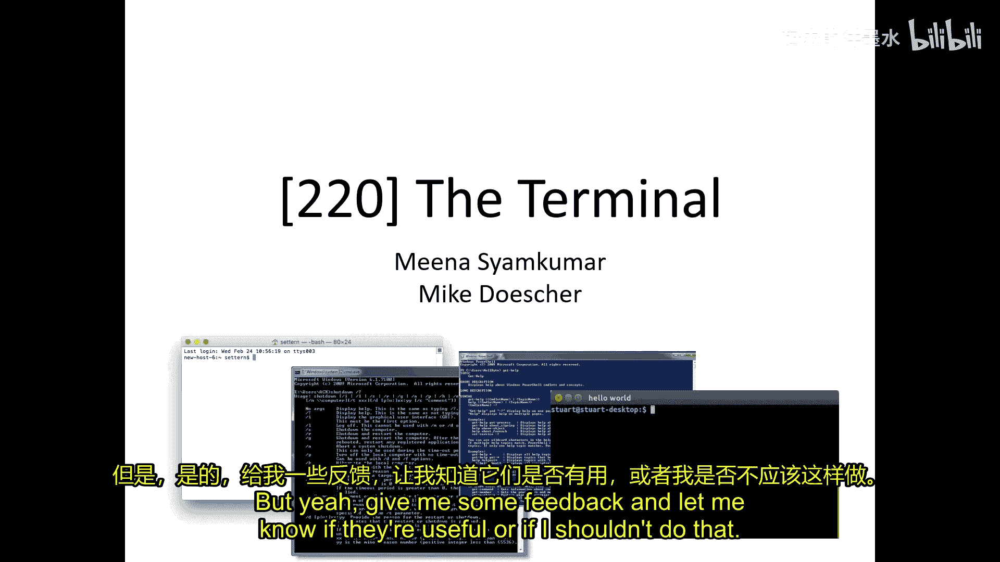

在本节课中，我们将学习如何使用终端（命令行界面）与计算机交互，并初步了解程序控制流程的基本概念。我们将从终端的历史和基本操作开始，逐步深入到文件系统导航、常用命令，最后通过一个工作表练习来理解控制流程的核心思想。

## 课程公告与帮助渠道 📢

在开始之前，有两个重要的公告。

首先，感谢大家关于视频长度的反馈。本学期的目标是让每节课的平均时长保持在50分钟左右。有些课程可能会更长，有些会更短。如果在录制过程中需要增加额外的示例，可能会略微超时。如果这对您造成困扰，请提供更多反馈。

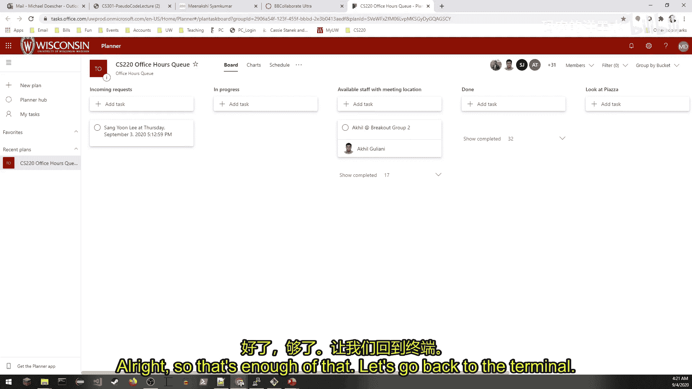

其次，关于如何获得帮助和参加答疑时间。您可以通过课程网站上的链接找到所有联系方式。实验时间（Lab hours）是开放的集体答疑时间。要预约一对一的答疑，请使用“答疑时间请求工具”。提交请求后，您可以在仪表板上查看排队情况。当轮到您时，答疑人员会将您从等候列表移至“进行中”，并通过Canvas的Blackboard Collaborate将您拉入一个分组讨论室。

## 终端简介与历史 🕰️

对于许多人来说，使用终端可能是一种与计算机交互的新方式。我们花一些时间确保大家熟悉它。

回顾历史，在计算机刚发明时，它们非常昂贵。大多数人没有自己的计算机。一个系（如计算机科学系）可能会购买一台价值数百万美元的大型机。为了充分利用这台计算机，他们会购买这些基于文本的“哑终端”连接到强大的主机。这些终端基本上只是一个屏幕和一个键盘。用户在终端输入，指令被发送到主机进行处理，结果再发送回屏幕显示。

如今，我们拥有更强大、更快速的计算机。我们仍然可以通过终端模拟器来使用类似终端的特性。问题是，为什么我们还想使用终端或终端模拟器？原因在于，很多时候使用键盘输入比使用鼠标操作更快。例如，在文件系统中导航时，如果我知道文件的确切位置，通过键盘输入路径名通常比用鼠标点击菜单和图标更快。

这里有两个职业建议：
1.  评估工具价值：问问自己，学习使用终端是否是一个好的投资。虽然现在可能不熟悉，使用文件资源管理器或访达（Finder）点击操作更快，但如果投入时间熟练掌握，使用终端是否会显著提高效率？对于许多数据编程和计算机编程工具来说，熟练掌握后能极大提升编码速度，这通常是值得的投资。
2.  寻找随处可用的工具：例如，如果发生全球性疫情，你被困在家中，你仍然需要能够完成工作。使用终端模拟器可以让你连接到大学的计算机，从任何地方进行工作。例如，我现在坐在我的地下室，三周后我可能会在拉斯维加斯，你们甚至不会知道我离开了家，正在酒店里工作。

## 终端、Shell与基本命令 ⚙️

当我们在计算机上启动终端模拟器（Windows上我使用PowerShell，Mac上使用名为“终端”的应用）时，其内部运行着另一个称为Shell的程序。Shell是非常棒的程序，它基本上只问一个问题：“我应该做什么？”，你给出一个命令，它执行，然后再问“我应该做什么？”，如此循环。它主要做两件事：让我在计算机的文件和文件夹中导航，以及运行程序。

关于术语：我会经常使用“目录”这个词。虽然我作为Windows用户习惯说“文件夹”，并且它们看起来像小文件夹，但我们将要输入的所有命令的缩写（如`cd`代表更改目录）都使用“目录”这个词。所以为了保持一致，我们将使用“目录”。

实际上，Shell有很多选择。Windows用户可以使用PowerShell或CMD。Mac和Linux用户通常使用相同的命令集。PowerShell是Windows版本，它适配并使用了这些命令，因此对Mac和Linux用户更友好。在本课程中，我只讨论在PowerShell、Mac和Linux上通用的命令。

接下来，谈谈从Shell运行程序。这很简单。打开终端模拟器，Shell已经在那里了。从提示符（例如 `C:\Users\Mike>` 或 `$`）开始，你只需要输入命令。例如，输入 `ls`（代表“列表”），它将列出当前目录中的所有程序和目录。然后，它会给你另一个提示符，询问“下一步做什么？”，如此循环。

## 文件系统与路径 📁

导航是指寻找我们需要的文件或目录。使用文件资源管理器或访达，我们可以在Windows或Mac上做到这一点。但在Shell中，我们将使用命令进行导航。我们会输入一个命令，该命令运行一个程序来执行某些操作，例如更改目录或创建新目录。

让我们看看文件实际存储在哪里。我们希望文件永久保存，不会在计算机关闭时丢失，因此我们将文件写入硬盘。在Windows系统上，每个驱动器都被分配一个字母，例如C盘、D盘、E盘等。

每个文件都有自己的文件名和与之关联的路径。以 `C:\readme.txt` 为例，`readme.txt` 是文件名。包含路径和文件名的完整名称称为路径名。`C:` 是驱动器盘符。`.txt` 是扩展名，它告诉我们文件的类型。一个关键区别是：Mac和Linux使用正斜杠 `/` 作为分隔符，而Windows使用反斜杠 `\`。这个差异可能导致代码在你的计算机上运行良好，但在我们评分时完全失败。我们将在学期后半部分处理文件和操作系统时重点强调这一点，目前暂时不会成为问题。

在第一讲中，我们简要讨论了输入和输出。键盘和鼠标是输入设备，扬声器和显示器是输出设备。文件也可以是输入或输出。我们可能有一个程序生成一些输出，并将其保存到文件系统中。之后再次运行程序时，我们可能希望读取这个文件，将其作为输入放回程序中。

计算机上的目录可以包含文件或其他目录。和文件一样，目录也有路径名。例如，我有三个文件：`file1.doc`、`file2.doc`、`file3.doc` 在 `C:\mydir` 目录中。`file1.doc` 的完整路径是 `C:\mydir\file1.doc`。目录的路径是 `C:\mydir`。如果我在 `mydir` 内添加另一个目录 `subdir`，并且 `subdir` 中也有一个 `file1.doc`，那么由于它们在不同的目录中，我重用了文件名，但它们是不同的文件。一个的路径是 `C:\mydir\file1.doc`，另一个是 `C:\mydir\subdir\file1.doc`。

## 绝对路径与相对路径 🧭

我们有两种不同的路径来引用文件：相对路径和绝对路径。上面例子中的路径都是绝对路径，它们确切地告诉我们如何到达那里。

让我用一个更简单的例子。如果我问：“计算机科学大楼在哪里？” 我可以给出两个答案：
1.  威斯康星州麦迪逊市西代顿街1210号，邮编53706。这给出了你需要知道的确切信息。
2.  在约翰逊街对面。

答案一几乎总是有效的。你可以把它输入手机，查看到底在哪里。答案二只有当我们站在计算机科学大楼对面时才是一个好答案，然后我可以告诉你“就在街对面”。这通常更方便，对在场的人更有意义。

路径名也是如此。我们有绝对路径名和相对路径名。绝对路径总是可行的。相对路径只有在我们已经掌握一些信息（即我们知道自己在哪）时才真正好用。我们所在的位置称为工作目录，是我们当前的位置。

让我们看一些例子。假设中间部分是我们的工作目录。这是我在文件资源管理器或访达中正在查看的目录。在这里，我有一个文件的绝对路径，我想做的是根据绝对路径和工作目录找出相对路径。

在第一个例子中，如果我在C盘根目录（`C:\`），我要找的路径是 `C:\test.txt`。文件已经在C盘上，我只需要输入 `test.txt`。这很简单。
第二个例子类似，如果我在 `C:\dirX\dirY\dirZ` 目录中，我的文件在 `C:\dirX\dirY\dirZ\my.doc`，我只需要输入 `my.doc`。
但是，如果我在目录树中向上移动一级，即我在 `C:\dirX\dirY`，而我的文件在 `C:\dirX\dirY\dirZ\my.doc`，我需要输入 `dirZ\my.doc` 才能到达那个位置。
对目录也可以做同样的事情。如果我想进入目录 `C:\dirX\dirY\dirZ`，而我当前在 `C:\dirX`，我可以输入 `dirY\dirZ` 作为相对路径。

## 特殊目录与更多示例 🔤

这里还有几个小东西，特殊的目录名。实际上有三个，我这里有两个。`..` 表示向上移动一级目录。例如，如果我在 `C:\dirX\dirY`，执行 `..` 会把我上移到 `C:\dirX`。`.` 表示当前目录。

这里还有几个例子。如果我要找 `test.txt`，我也可以将其称为 `.\test.txt`。在很多情况下，加上这个前缀并非必要，但我会指出一些需要它的例子。我也可以做 `.\dirY\dirZ`。所以，这只是在之前的例子前面加上了 `.\`，对目录也有效。

然后，让我快速谈谈这个例子。如果我在目录 `C:\dirX\dirY\dirZ` 中，我在目录树中深入了三层。我想获取这个绝对路径 `C:\dirX\my.doc`。这意味着我需要向上移动。`..` 基本上会移除这里的 `dirZ`，我将上移一级到 `dirY`。我需要再做一次，所以再加一个 `..`，那将把我从 `dirY` 移出到 `dirX`。所以它应该看起来像 `..\..\my.doc`。

再看一个例子。在这种情况下，我的工作目录是 `C:\A`。我真正想获取的是 `C:\B\file.txt`。我们需要做的是：首先使用 `..` 上移到C盘根目录。从那里，我需要使用 `B` 进入B目录。然后，`file.txt` 让我找到我关心的文件。

## Windows与Mac路径差异 💻🍎

我想简要讨论一下Windows和Macintosh计算机在驱动器方面的几点差异。在Windows上，所有绝对路径都以驱动器名开头，如 `C:\` 或 `D:\`，这告诉我们数据存储在哪个驱动器上。然而，在Mac上，分隔符始终是正斜杠 `/`，并且绝对路径总是以那个正斜杠开头。例如：`/Users/Tyler/myfile.doc`。它从不告诉我们这个文件实际存储在哪个驱动器上。

那么，如果我们有多个驱动器，而每个文件路径都以相同的符号开头，我们如何区分不同的驱动器呢？仅仅通过查看绝对路径是无法分辨的。基本上，所有不同的驱动器看起来就像是不同的目录。事实上，在Windows系统上，如果我在 `C:\Users\Tyler` 有 `file.txt`，在Mac上，它只是 `/Users/Tyler/file.txt`，没有驱动器字母。`C:\Program Files` 在Mac上可能相当于 `/usr/local/bin`。D盘在Windows上可能是 `D:\Backup`，在Mac上可能是 `/Volumes/Backup`。E盘也可能是 `/Volumes/Movies`。这些驱动器被设计成看起来一样。这样想：假设我的硬盘装满了电影，然后我有更多电影，所以我买了另一个硬盘。在Mac上，我不希望看起来有很多驱动器，路径不会告诉我我在哪个驱动器上，它们都只是看起来像目录。这样我就可以移动我的电影，把它们移到我刚买的新硬盘上，但就我查找或导航到该目录的方式而言，它们感觉仍然在同一个地方。

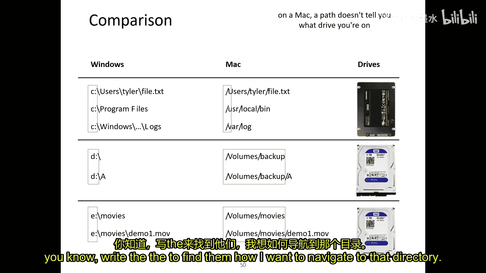

## 基本命令演示（基于Mac）⌨️

我想在幻灯片中讲解几个简单的例子。当你们打开幻灯片并浏览时，我们有一些示例。本幻灯片中我要讨论的例子都是基于Mac电脑的。然后我将用Windows机器进行演示，并强调那里的一些差异。我将只关注在PowerShell、Mac和Linux上都能工作的命令。

第一个要讨论的命令是 `pwd`。这会告诉我我在哪里。它代表“打印工作目录”。当我运行它时，它只会打印出我所在的确切位置。注意我的提示符：`~/TRH/scratch $`，这个提示符已经包含了目录名。这很常见。PowerShell默认这样做。CSL机器上的bash提示符则没有。所以 `pwd` 可能很有价值。我个人不喜欢在提示符中显示目录，它占用大量空间，如果你在机器中嵌入得很深，很难看到你在输入什么。有方法可以改变这一点，但本课程中我不会深入讨论。

接下来，如果我想做出改变。现在我在 `scratch` 目录，`cd ..` 将向上移动一级。现在我的当前路径是 `~/TRH`。从这里，如果我想清屏，屏幕有点满了，我可以使用 `clear` 命令。现在我回到了漂亮、干净的黑屏，只有一个提示符。从那里，我可以使用 `cd`（更改目录的缩写）移回目录名。我只需要输入我想进入的目录的名称。这个目录恰好是我刚才所在的位置。所以 `cd scratch`，现在我又回到了起始位置。

`cd /` 命令将把我带到根目录，即最顶层的级别。`ls` 将列出当前目录的内容。所以当我输入 `ls` 时，它是一个程序，会打印出根目录（本例中最顶层）的所有内容。

另一个我们会发现非常有用的命令是 `cat` 命令。`cat` 接受一个参数。`readme.txt` 在这种情况下是文件名。它所做的就是打印出该文件的内容。所以如果我执行，这个文件显示“hello”，这就是 `readme.txt` 的内容。

参数。像这里的 `cat` 这样的命令需要一个参数。这是程序的输入。`cat` 是程序名。它需要知道你想让我读取哪个文件。这被称为参数。

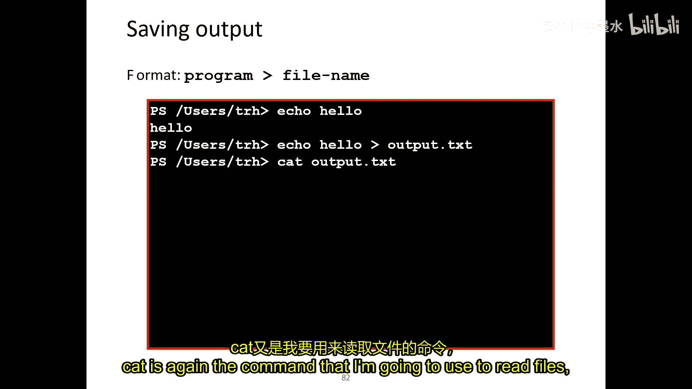

`echo` 是另一个命令。让我演示一下。如果我输入 `echo`，它接受一个参数。这里，我给它单词“hello”，它所做的就是打印出“hello”。它只是把这一行上的任何内容打印出来给我们，这并不超级有用。但事实证明，它是创建新文件的好方法。右尖括号 `>` 是重定向操作符，它会将输出发送到文件。所以如果我输入 `echo hello > output.txt`，它将创建这个文件，并将单词“hello”存储在该文件中。注意，在第一种情况下，它打印在屏幕上。而这里它没有打印在屏幕上，只是给了我一个提示符，因为它实际上将输出重定向到了 `output.txt`，而不是打印在屏幕上。然后当我读取 `output.txt` 时，`cat` 是我用来读取文件的命令。所以 `cat output.txt`，我们就看到了“hello”。

## PowerShell演示与高效技巧 🚀

接下来，我想打开PowerShell，为你们演示其中的一些内容。如果你想在Mac上跟着操作，要打开终端，你需要进入访达，然后应用程序，然后实用工具，找到终端。Mina的演示（第2讲）在今天的视频中实际上是分开的。如果你有Mac，想跟着Mac版本操作，我建议你跳过去看她的视频，然后再回来。欢迎你留下来看我的演示，你可能也会学到一些东西。

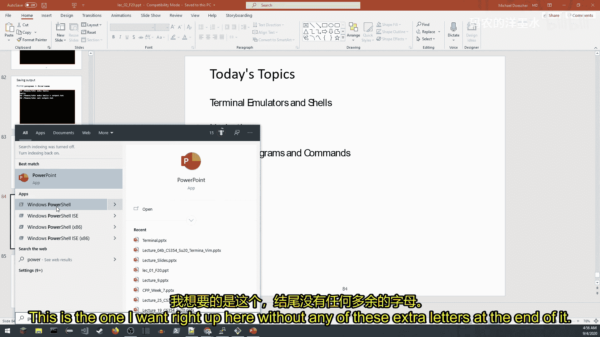

现在，我要退出这个，打开PowerShell。我只需点击Windows开始按钮，输入“power”，就找到了Windows PowerShell。就是这个，最简单的那个。点击它，打开PowerShell。我可以看到它告诉我我在PowerShell中。这里的“PS”代表PowerShell，它给了我提示符。那个尖括号是提示符的结尾。PowerShell的这个特定提示符告诉我的工作目录是什么。实际上，获取工作目录的命令是 `pwd`。今天我们可能只关心大约8个命令。`pwd` 是告诉我当前路径的命令。这是我的当前工作目录，然后它在这里给了我另一个提示符。

要获取帮助，命令是 `man`。让我们获取一些关于 `pwd` 的帮助。`man` 是“manual”（手册）的缩写。我可以在后面输入任何命令的名称，它会提供一些帮助。如果我阅读这个，有些可能非常复杂，但它们通常具有相同的结构。它告诉我这个命令有一些别名，`gl` 代表 `Get-Location`。我实际上可以在这台机器上输入 `Get-Location`，它也会做和 `pwd` 相同的事情。让我们现在就做一下。`Get-Location`。很好，所以做同样事情的多个命令被称为别名。

接下来，我们再做一个。`cd` 是我们讨论过的另一个命令。它也被称为 `Set-Location`。我们还有其他一些别名。它告诉我们可选的参数。我只想指出，这里的 `man` 是我现在正在运行的一个程序。它所做的就是显示信息。这里有“more”。我可以按回车键继续并完成程序。如果我返回再做一次，我也可以按 `Ctrl+C` 来终止当前程序。当我们编写有无限循环的程序时，会发现这非常有用。

我想花点时间谈谈效率。刚才我描述了如何使用键盘导航文件结构比点击更高效。看看这个。我的主目录里有很多东西。如果我想进入我的教学材料，我需要做的就是输入。看看我需要输入多少个字母：`T`，然后按 `Tab` 键。所以制表符补全会让我基本上完成这个词，我不需要输入所有那些字母。我进入了 `teaching`，然后我这里有所有这些课程。让我们看看CS 368 C++。在这里，我也有很多东西。所以 `cd DCS`，按 `Tab`，它会给我第一个匹配的选项。再按一次 `Tab` 会向下移动，给我第二个选项。看看还有什么，`cd Homework`。我有 `homeworkmark1`。这就是最深的了。这是我不喜欢PowerShell显示所有文件的方式的原因之一，因为当我处理我的课程时，我有所有这些目录，一切都整理得非常整齐。否则，我会丢失跟踪东西。但它占用了超过一半的屏幕。我稍后再解决这个问题。

接下来，我提到了有三个特殊命令。`cd ..` 将我向上移动一级。`cd .` 是当前目录。`cd ~` 是第三个，它会把我带回我的主目录。我的主目录在 `C:\Users\Mike`。所以 `cd ~` 会把我带回那里。无论我在哪里，我都可以一直向上，查看C盘，`cd ~` 会把我带回那里。

另一种我们可以高效使用终端的方式是使用上箭头键。如果我输入过一个命令，我可以使用上箭头键返回并查看我已经使用过的命令。所以这里我可以做 `cd teaching`，我可以做 `Get-Location`。这只是另一种节省输入的方式。我有很多学生在答疑时间来找我，我看着他们输入东西，他们本可以使用制表符补全，或者他们正在输入刚刚输入过的相同命令，特别是当他们试图编译一些C代码或需要正确设置许多小选项的长命令时。上箭头键节省了大量时间。所以这些都是小技巧。学习你使用的软件的键盘快捷键，无论是Microsoft Word还是高端编程软件，学习如何使用它。

接下来是 `history` 命令。这会给我最近输入的所有内容的列表。然后，一旦我有了这个，我可以使用 `Ctrl+R` 进行搜索。这将从列表底部（比如编号30）开始，向列表更高的位置搜索。我需要做的就是开始输入一些东西。例如，输入“g”会找到“Get-Location”，看起来我做了很多次。删除它，试试“ma”。最近包含“ma”的是第12行的“man cd”，我可以直接按回车，它会再次运行该命令。按 `Ctrl+C` 终止它。这就是历史记录，或者叫反向搜索。

## 运行其他程序与路径设置 🌐

接下来，让我们退出这里。如何运行其他我们可能熟悉的程序？比如Notepad，我经常使用。如果我输入“notepad”，它会打开。我可以从这里读取我的文件。关闭它。Chrome呢？我经常使用我的网页浏览器。但当我这样做时，我知道Chrome在电脑上，但它不被识别。原来，它不在PowerShell寻找程序的地方之一，它不在正确的路径上。所以我现在想带你们了解如何将Chrome添加到系统路径中，这样你就可以直接从终端输入“chrome”，它就会工作。这仅适用于Windows的PowerShell。Mac版本不同。如果你想在Mac电脑上添加这个，去看Mina的视频，她的第二个视频。

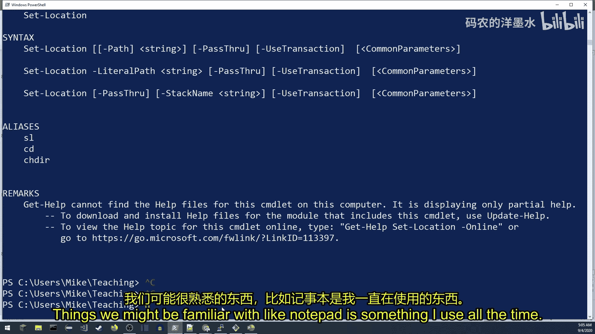

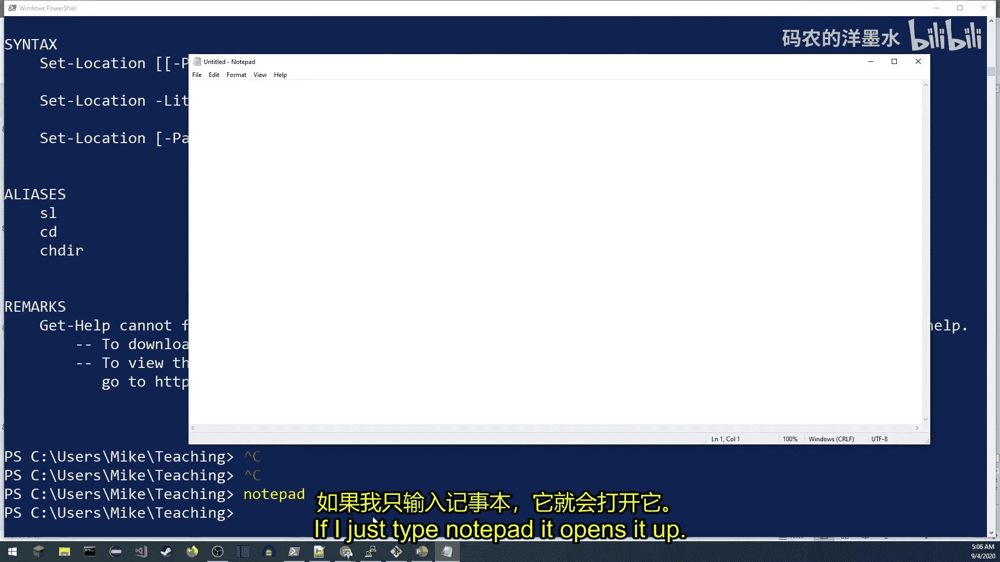

想法是这样的：我想将Chrome添加到我的路径中，这样我就可以从终端输入“chrome”并启动它。首先，我要去找Chrome。它就在这里。点击Windows按钮，输入“chrome”。右键点击它，第二个选项是“打开文件位置”。点击它。实际上有两个步骤。第一步可能有点误导性，我实际上看到的是开始菜单程序，这些只是开始菜单中的所有东西，这实际上不是程序本身，而是程序的快捷方式。但这很好，因为快捷方式知道它位于哪里。所以我要点击那个快捷方式，右键点击，然后点击“属性”。其中一项是“目标”。复制这个目标，它实际上很长。现在我们应该能够进入那个目录。回到PowerShell，看看这个。我想 `cd` 进入那个目录。右键点击，因为在PowerShell中，右键点击既是复制也是粘贴，非常方便。它已经在引号里了，但我不想要带 `chrome.exe` 的 `cd`，我只想 `cd` 进入一个目录。所以删除一些内容。现在，这应该会把我带到正确的目录。它就在那里，第三个，`chrome`。很好。我输入“chrome”，仍然报错，不被识别。部分问题是，由于目录的组织方式，我需要将路径添加到这个文件。它没有被识别。

想法是这样的：回到Windows，搜索“path”，这是我需要编辑的地方。“编辑系统环境变量”中的“Path”。点击它。这是一个环境变量“Path”。点击它。然后我可以看到我有用户（Mike）的本地变量和所有人的系统变量。我就在这里为我编辑它。点击“Path”，点击“编辑”。然后我看到这里所有不同的路径。当我输入像“chrome”或“notepad”这样的命令时，它会搜索所有这些目录，看看那个程序是否在那里。我只需滚动到底部，添加一个新路径，粘贴Chrome的路径。我不想要 `chrome.exe`，只想要那个目录。现在它知道在那个目录中查找。然后我需要启动一个新的PowerShell实例。它就在我的热键栏上。现在我应该可以输入“chrome”了。它打开了另一个窗口，太棒了。让我试试这种方式。看看最后一个Chrome实例是否在这里，它会在另一个显示器上弹出。相信我，它完全正常。等一下，再试一次。再试一次。好的，我有几个Chrome实例打开，它们都在另一个显示器上，所以它试图在另一个显示器上打开它们。但看看这个：输入“chrome”回车，它完全正常。我也可以输入我想访问的网站名称。例如，输入“chrome www.example.com”。让我们试试那个。一只小狗，很可爱。刚才有一瞬间，我的心跳有点加速，想着如果出现什么不好的东西怎么办？不能放在YouTube上。

## 文件与目录操作演示 📄

接下来，我想做更多关于更改目录的操作，包括创建一个新目录，然后使用 `echo` 命令创建一些文件，复制、移动它们，并用 `cat` 读取。这将结束这部分。让我快速演示一下，然后移到桌面。我会缩小一点，这样你们就能看到发生了什么。

我刚刚导航到桌面。如果我输入 `echo` 并输入一个单词，它只会打印到控制台，到屏幕上。如果我使用尖括号 `>`，它会让我写入一个文件，那应该出现在我的桌面上。我们看看它去哪了。是的，在左下角，很小，`hi.txt`。我也可以创建一个目录，使用 `mkdir`。就叫它 `mydir`。它告诉我刚刚创建了目录，它就在顶部。然后，让我们复制。用 `cp` 复制 `hi.txt`，我们把它移到 `mydir` 中。然后我需要给它一个名字，就叫 `hello.txt`。所以 `cp` 接受两个参数：第一个是我想复制的文件，第二个是我想复制到的目标位置。看看，`hi` 还在这里。如果我打开 `mydir`，我看到它在那里：`hello.txt`。点击这个，Notepad会打开它，它确实写着“hello”。我应该在创建它的时候在这里打开 `hi.txt`，那也写着“hello”。看看这个，如果我输入 `echo world > hi.txt`。然后回到这里，看看。它不再说“hello”，只说“world”。我基本上破坏了那个文件的内容。让我们做一个稍微不同的版本，双尖括号 `>>` 会追加到文件末尾，不会直接覆盖旧文件重新开始。所以现在如果我这样做，它说“world peace”。再看看还有什么。`cat` 是读取文件的命令，所以我可以输入 `cat hi.txt`，它会打印出该文件的内容。看起来我的屏幕快满了，清屏。我还没讲 `move`。如果我想移动一个文件，那会让我把它从一个地方移到另一个地方，或者它可以让我重命名东西。让我演示一下。如果我有 `hi.txt` 作为源文件，我想把它重命名为“Christmas list.txt”。你们圣诞节想要什么？然后它改变了下面的名字，我可以看到。如果我双击那个，我可以打开，仍然写着“world peace”。现在我可以看到，文件名改变了。

## 控制流程入门：顺序执行 🔄

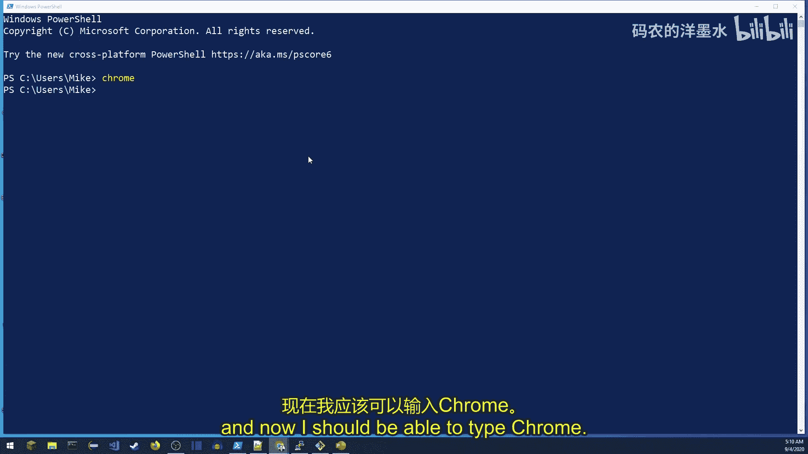

我觉得这个视频有点长了，但我想在最后找点乐子。首先，我要创建一个文件。`echo win > a`。`echo lose > b`。我非常仔细地注意。我要把b移到c。`mv b c`。我要把a移到b。`mv a b`。我要把c移到a。`mv c a`。然后我要 `cat a`。暂停视频，告诉我会发生什么。猜一下，写下来，确认，然后回来。

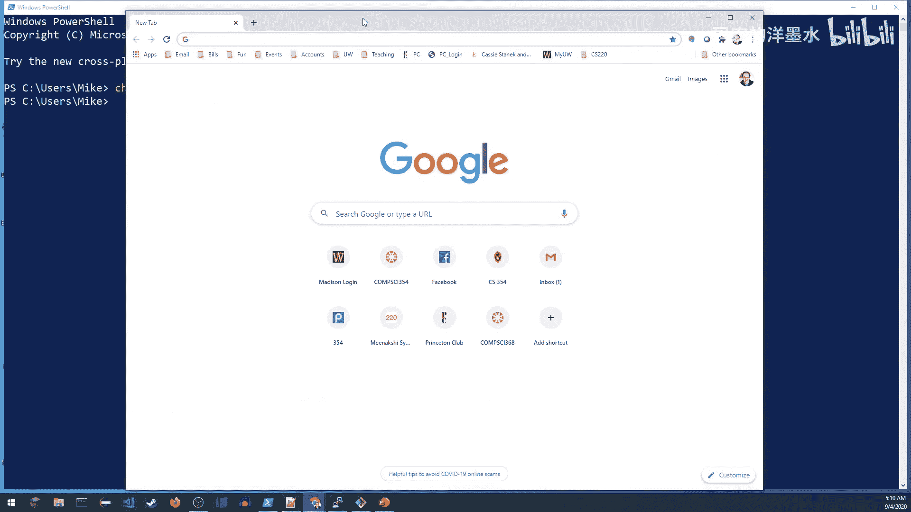

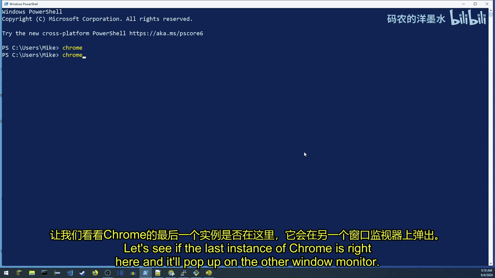

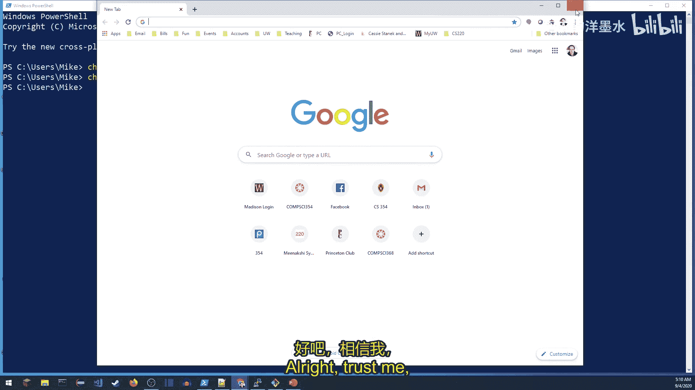

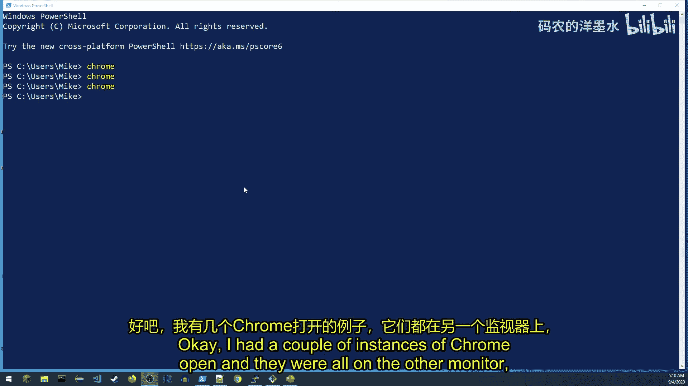

我带着答案回来了。我要按回车。我们看看输出什么。“lose”。所以发生了这样的事：我们需要非常仔细地跟踪这个顺序，才能弄清楚发生了什么。当“win”存储在a，“lose”存储在b时，然后b被移到c。所以b没了，我们重命名了它，现在是c。我有两个文件：a和c。a是那个写着“win”的文件。然后我们把a移到b。a没了，b被创建了。我现在有两个文件：b和c。b是那个写着“win”的文件。然后我把c移到a。当我使用 `move` 时，c会消失，没了。我有了a。我现在有两个文件：b和a。a是那个写着“lose”的文件，b是那个写着“win”的文件。我希望这讲得通，希望这有点意思。

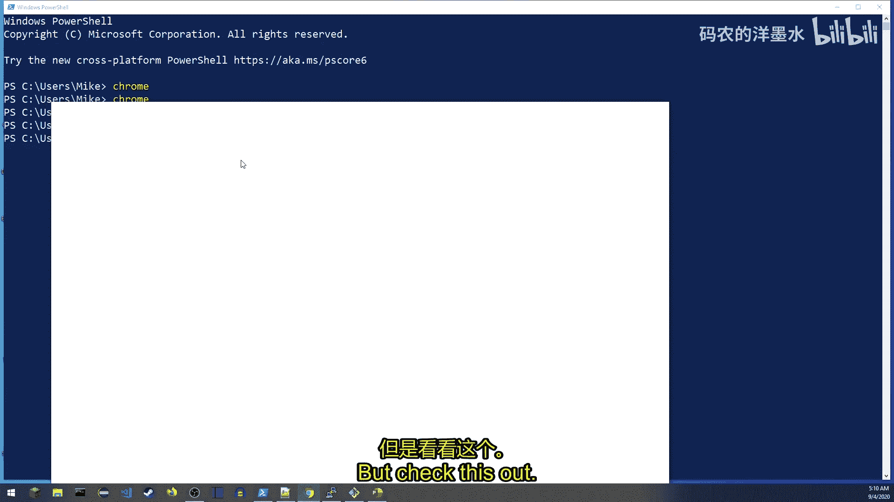

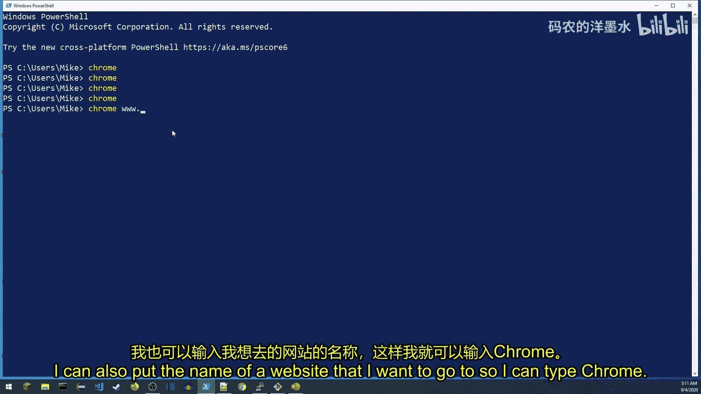

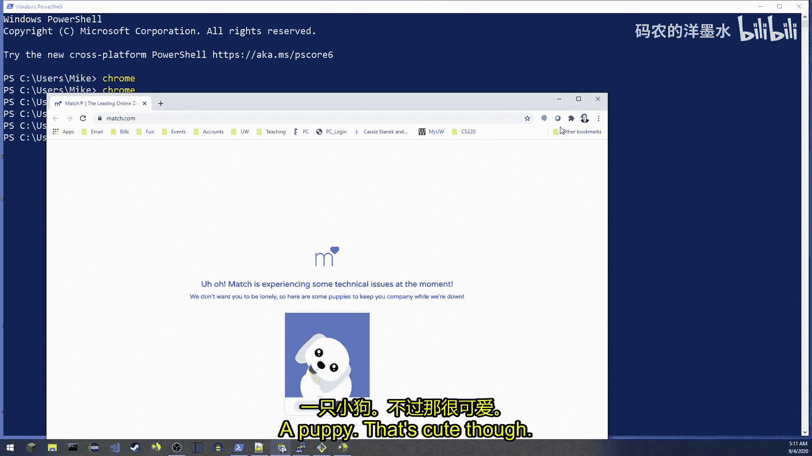

我要去拿配合最后这部分的工作表，马上回来。

## 控制流程工作表练习 📝

最后这部分，我将讲解工作表上的一些问题。所以去网页，点击工作表，打开它，也许甚至打印出来或拿些草稿纸，这样你可以和我一起完成。

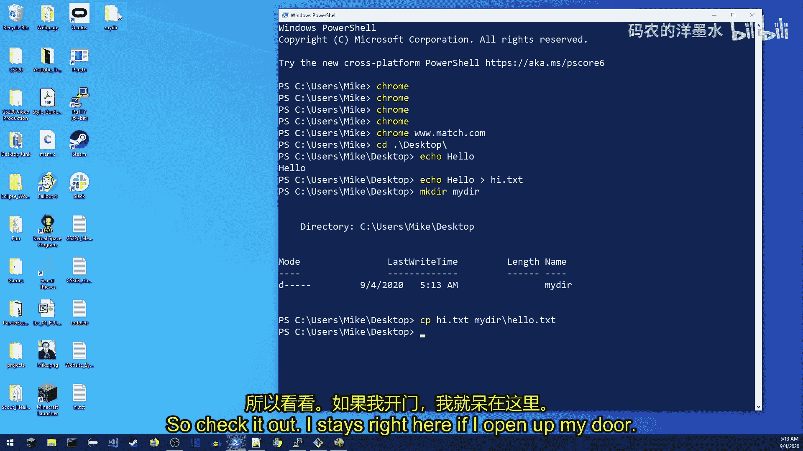

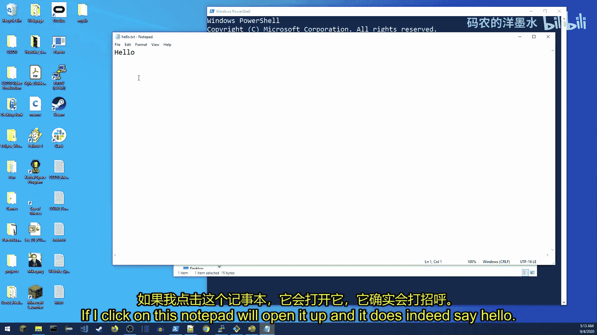

这个工作表有很多问题，我们只看其中四个。这里的想法是，我们将假装自己是计算机，按照这些指示逐步执行。我们将学习控制流程，这是本课程前五周的内容。数据是第二个五周，然后是数据编程的专题，是课程的最后三分之一。所以控制流程是关于计算机现在在做什么，下一步做什么，再下一步做什么。这就是我们要做的，逐步执行这些指令。

我希望你们先做这个。看看这个问题，逐步执行代码，暂停视频。我马上回来，自己过一遍，然后我们可以讨论。现在暂停。

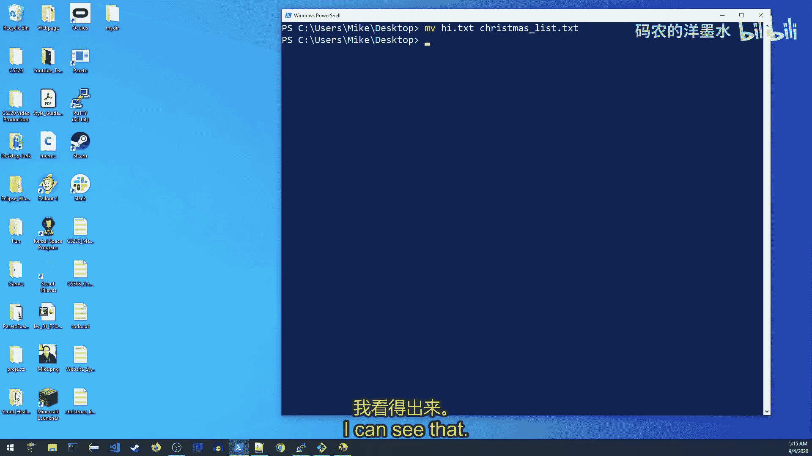

欢迎回来。希望你们有机会做了。当我逐步执行时，首先，我的X框在那里。第一行说“给X框加1”，然后这个框应该看起来像划掉的10，变成11，因为我用PowerPoint做这个。划掉容易做吗？不，我要删除并写上11。抱歉，我没有完全按照指示做，因为我没有用笔和纸。希望这仍然讲得通。接下来，我要给X框加2。它说11，我加2，得到13。最后，我要将X框中的值加倍，所以13乘以2是26。最终答案：26。现在，这里的问题是：如果我的朋友得到了不同的答案，24。他是个捣蛋鬼，不喜欢按正确顺序做事。问题是，要确保每个人都得到相同的答案，有什么好规则？如果教室里的每个人都带着笔记本电脑，给他们相同的代码，他们应该都得到相同的答案。

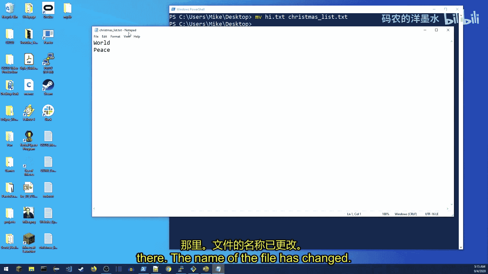

这里的想法是，这是控制流程的第一部分，即我们将按顺序逐步执行。一次一步，并且每一步只执行一次。所以我们做第一步，然后做第二步，然后做第三步。我们不会打乱顺序，不会多做，也不会跳过任何步骤。所以这是控制流程的第一条规则：顺序执行。

## 条件语句（If语句） 🤔

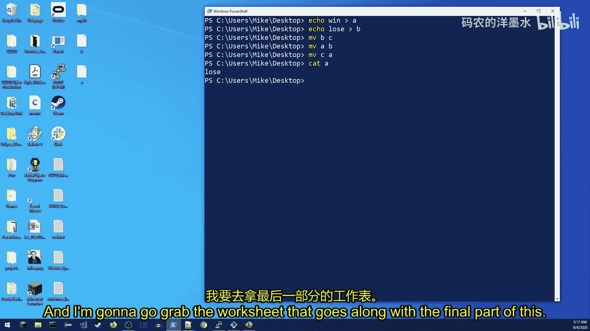

我忘了我为这个做了幻灯片。顺序执行，第一条规则。让我调出第二个例子。接下来，我们做问题4。伙计们，我在这里为我们设置好了例子，暂停视频，花点时间，逐步执行这些步骤，然后在你得出答案后，回来按播放。

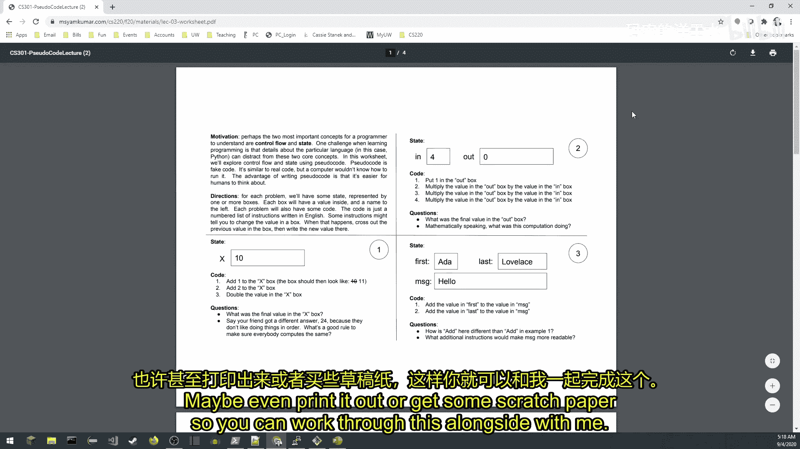

欢迎回来。让我逐步执行这个。第一步：如果x中的值是负数（它确实是负数），继续到第2步。否则，跳到第3步。它是负数，所以继续。将x中的值乘以-1，并将结果放回x。所以到这里，让我抓住正确的位置。我需要乘以-1，这使它变成正4，很好。然后我将继续，因为我的控制流程第一条规则（顺序执行）说，我要做第3步。第3步说：将x的值复制到ABS框中。所以我现在那里是0，它需要变成4。这个函数实际上是做什么的？它是在计算一个数的绝对值。如果x开始时是正4，就像现在这样，正4，让我们再走一遍。如果x中的值是负数，继续到第2步。它不是负数。否则，跳到第3步。所以我们现在跳下去做第3步。我们直接将x的值复制到ABS框中。它已经在那里了。

所以这里的想法是：控制流程的第二条规则是一种我们可以用来跳过某些步骤的技术。在这种情况下，这被称为条件语句。这里的关键词是“if”。所以这些将被称为if语句或条件语句。这是我们控制流程的第二部分。

## 迭代（循环） 🔁

接下来看下一个例子。做问题6。所以暂停视频，自己逐步执行，然后回来查看答案。

我逐步执行一下。所以把1放入total框。让我点击这里。我要放一个1进去。如果n等于1，它不等于，它是4。如果n等于1，跳过，否则继续到第3步。所以我要做第3步：将total中的值乘以n中的值，将结果放回total。所以total是1，n是4，把它们相乘，把4放回total。然后我想将n中的值减1。所以在这里，它从4变成3。然后我要转到第2步。回到第2步。如果n等于1，它不是，是3。所以我不跳到第6步。否则，我继续到第3步：将total中的值乘以n中的值，将结果放回total。所以是3乘以4，等于12。接下来，下一条规则说我们要顺序执行。所以我们到第4步：将n中的值减1。所以3变成2，然后到第2步。第2步说：如果n等于1，跳到第6步，它不是，否则到第3步。第3步：将total中的值乘以n中的值，将结果放回total。所以2乘以12等于24。然后我返回并将n中的值减1。到第2步。如果n等于1，哈，它等于，跳到第6步。我甚至不需要读剩下的部分，我只需要到第6步：将total中的值复制到answer框中。很好，一切看起来都很好。看起来这段代码实际上是在计算阶乘。所以4的阶乘是24，即4×3×2×1。

我们在这里看到的是一个迭代的例子。当我们逐步执行代码时，我们做了第2、3、4、5步，然后第2、3、4、5步，然后第2、3、4、5步，然后第2、6步。所以我们反复做了那些步骤，在一个循环中。所以控制流程的下一个部分是迭代或循环的概念，即我们将反复执行一系列步骤。再次强调，控制流程是逐步执行代码现在在做什么。如果它在一个循环中，它将多次执行那系列步骤。

## 函数调用 📞

最后，再做一个来结束。看看这个例子，自己先做，然后马上回来。

欢迎回来。我只做这部分。这个视频已经很长了，但让我至少从这里开始。主代码：把2放入moves框。现在我们将执行move code下的步骤。然后继续到第3步。所以我们跳到这里到move code。如果moves是0，它不是。停止执行move code中的这些步骤，并回到你上次在主代码中的位置以完成更多步骤。它不是0，所以我们继续步骤B：将机器人沿箭头所指方向向前移动一格。这是机器人，就是那个有箭头的。等一下，让我做这个。机器人移动了。接下来，第3步说：将moves中的值减1。然后我们回到步骤A。这看起来像迭代。我们刚讨论过。所以如果moves是0，在此之前停止。它不是0。所以B：将机器人沿箭头所指方向向前移动一格。所以我们拿出机器人，向上移动。然后我们将moves中的值减1。回到步骤A。如果moves是0，停止执行并回到我们来的地方。那是在上面的第2行：执行move code下的步骤，然后继续到第3步。接下来，将机器人向右旋转90度。让我看看能不能轻松做到。看起来不错。然后我们把3放入moves框。现在，当我们执行时，它说执行move code下的步骤，然后继续到第6步。所以我下去，move code。如果moves是0，它不是。将机器人沿箭头所指方向向前移动一格。将moves减1，所以它会变成2。我希望你们能看到，它会再向前移动一步，然后再向前移动一步，之后moves会从2变成1，再变成0。我们快进一下。把机器人开到那里。它最终停在心形上。很好。

所以这里的想法是：控制流程的下一部分被称为函数。我在这里所做的是，我从主代码中提取出一系列步骤。我本可以很容易地在第2步这里直接复制粘贴所有这四行，然后在第5步它说“转到move code”的地方，我本可以把这四行放在那里。但那样的话，同样的代码就会出现两次。如果我需要修改，就必须做两处更改才能让它工作。所以这里的想法是，我将跳出顺序执行，去做一些事情，然后回来。这让我能够提取出那些需要反复执行的相同代码块。这就是函数调用的概念。

最后总结一下，让我点击这个，填入我们将要讨论的所有四个控制流程部分，以及如何在接下来的四周半内在Python中实现它们。

## 总结 🎯

本节课中，我们一起学习了终端的基本使用和控制流程的初步概念。

首先，我们了解了终端的历史和重要性，认识到在特定场景下使用命令行可以提高效率。我们学习了如何启动终端或PowerShell，以及Shell的基本工作原理。

其次，我们深入探讨了文件系统和路径。理解了绝对路径和相对路径的区别，以及如何在命令行中使用 `cd`、`ls`、`pwd` 等命令进行导航。我们还特别指出了Windows和Mac在路径分隔符上的关键差异。

接着，通过演示，我们实践了创建目录 (`mkdir`)、创建文件 (`echo >`)、复制文件 (`cp`)、移动文件 (`mv`)、读取文件 (`cat`) 等常用命令，并学习了制表符补全、命令历史等提高效率的技巧。

最后，我们通过工作表练习引入了程序控制流程的核心思想：
1.  **顺序执行**：代码按顺序一步一步执行。
2.  **条件语句（If语句）**：根据条件决定执行哪些代码块。
3.  **迭代（循环）**：重复执行一段代码多次。
4.  **函数调用**：将一段代码封装起来，以便在需要时重复使用，使代码更模块化和可维护。

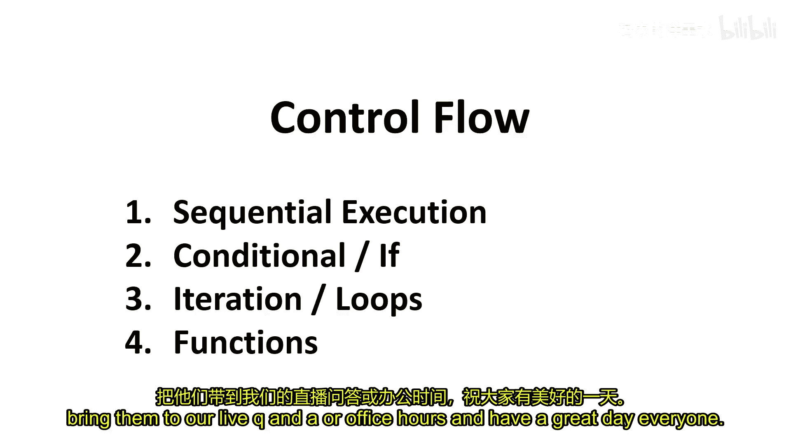

这些控制流程的概念是编程的基础，我们将在接下来的课程中在Python语言中深入学习和应用它们。请完成工作表的其余问题进行练习，如果有任何疑问，欢迎在实时问答或答疑时间提出。祝大家学习愉快！